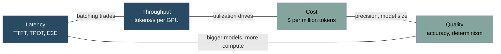
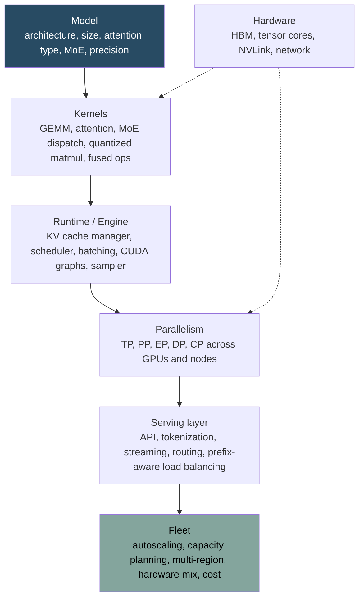

# What Inference Engineering Is

Training a model is a one-time capital project. Serving it is a utility bill that never stops. Once a model works, every prompt anyone ever sends it has to be turned into tokens, pushed through tens or hundreds of billions of parameters, and streamed back — fast enough that a human does not notice, cheaply enough that the business survives, and without quietly degrading the answer.

**Inference engineering** is the discipline of making that happen. It sits between ML research (which hands you a set of weights and an architecture) and infrastructure (which hands you GPUs, networks, and a budget). The inference engineer's job is to turn *weights + hardware + traffic* into *tokens per second per dollar at a given latency and quality*.

That last phrase is the whole subject. Keep it in mind for every note in this vault.

## The one-sentence definition

> Inference engineering is the optimization of a model-serving system over four coupled objectives — **latency**, **throughput**, **cost**, and **quality** — under the constraint of a specific workload and specific hardware.

Each word matters:

- **Optimization**: there is no "fast" in the abstract. There is fast *for a given batch size, sequence length, and SLO*.
- **Coupled**: you cannot move one objective without moving at least one other. Bigger batches raise throughput and lower cost per token but raise latency. Quantization lowers cost and latency but can lower quality.
- **Workload**: a chat product with 500-token prompts and a code agent with 60,000-token prompts are different optimization problems on the same model.
- **Hardware**: an H100 and a TPU v6e have different compute-to-bandwidth ratios, so the same model has different bottlenecks on them (see [[03 - Accelerator Hardware]] and [[04 - Roofline and Performance Modeling]]).

## The trade space



The classical picture is a **Pareto frontier**: plot per-user speed (tokens/s seen by one user) on one axis and system throughput (tokens/s across all users per GPU) on the other. Each serving configuration — batch size, parallelism, precision, speculative decoding on/off — is a point. The frontier is the set of configurations where you cannot improve one axis without hurting the other. Most real engineering work is either **moving to the frontier** (removing waste) or **pushing the frontier out** (new kernels, new hardware, new algorithms like [[09 - Speculative Decoding]] or [[12 - Disaggregated Serving]]).

```
per-user tokens/s
  ^
  |  *                          small batch: each user is fast,
  |    *                        GPU mostly idle waiting on memory
  |       *
  |          *  *               <- the frontier
  |                *   *
  |                       *  *  large batch: GPU saturated,
  +--------------------------->  each user waits longer per token
                     system tokens/s per GPU
```

A useful rule: **if you have not measured where you are relative to the frontier, you are not ready to optimize.** Many "optimizations" just slide along the curve.

## The metrics, precisely

Inference has a small set of standard metrics. Get these definitions exact; teams waste weeks arguing because one person's "latency" is another's "TTFT".

### Per-request metrics

| Metric | Definition | What dominates it |
| --- | --- | --- |
| **TTFT** (time to first token) | Time from request arrival to the first output token reaching the client | Queueing + prefill compute (scales with prompt length) |
| **TPOT** (time per output token) | `(E2E − TTFT) / (output_tokens − 1)` — average gap between output tokens for one request | Decode step time (memory bandwidth, batch size) |
| **ITL** (inter-token latency) | The individual gaps between consecutive tokens; TPOT is their mean | Same as TPOT, plus stalls from scheduling and preemption |
| **E2E latency** | Time from request arrival to last token | `TTFT + TPOT × (output_tokens − 1)` |
| **Queue time** | Time spent waiting before any GPU work starts | Load relative to capacity |

The decomposition `E2E ≈ TTFT + (n_out − 1) × TPOT` is worth memorizing. It tells you immediately which phase to attack. A summarizer with 8,000-token inputs and 200-token outputs is TTFT-dominated. A reasoning model producing 10,000 thinking tokens is TPOT-dominated: at 25 ms/token, 10,000 tokens is 250 seconds no matter how fast prefill was.

Some people quote **output tokens/s per user** = `1 / TPOT`. A TPOT of 20 ms is 50 tok/s per user. Humans read at roughly 4–8 words/s, so anything above ~20–30 tok/s feels "instant" for chat; agents and reasoning models, which no human reads token by token, want far more.

### System metrics

| Metric | Definition | Watch out for |
| --- | --- | --- |
| **Throughput** | Total tokens (input + output, or output only — always say which) processed per second per GPU or per node | Output-only and total throughput can differ by 10× on prompt-heavy workloads |
| **Requests/s (QPS)** | Completed requests per second | Meaningless without the length distribution |
| **Goodput** | Requests/s (or tokens/s) that *met their SLOs* | The honest throughput number; DistServe popularized it |
| **Utilization: MFU / MBU** | Fraction of peak FLOPs / peak memory bandwidth actually used | See [[04 - Roofline and Performance Modeling]] |
| **Cost per million tokens** | `($/GPU-hour) / (tokens per GPU-hour) × 10⁶` | Split input vs output; output tokens cost far more to produce |

**Goodput** deserves emphasis. A system that serves 100 req/s where 40% of them violate the TTFT SLO is not a 100 req/s system. It is a 60 req/s system with a lot of angry users. Optimizing raw throughput without an SLO constraint produces configurations that look great in benchmarks and terrible in production. The DistServe paper (Zhong et al., 2024) made goodput the target metric for exactly this reason.

### Percentiles, not means

Latency distributions in LLM serving are heavy-tailed: a long prompt arriving behind a burst, a preemption that recomputes a KV cache, a garbage-collection pause in the Python scheduler. **Report p50, p90, p99** (and p99.9 if you have the samples). SLOs are written on percentiles: "p99 TTFT < 2 s and p99 TPOT < 50 ms at 20 QPS."

A subtle trap: **per-request TPOT percentiles vs per-token ITL percentiles** are different distributions. A request with one 2-second stall in a 1,000-token stream has a fine mean TPOT and a terrible max ITL. Streaming UIs feel stalls, so track ITL p99 too.

### SLOs

An SLO is a contract shape, usually:

```
p99(TTFT) ≤ X ms   and   p99(TPOT) ≤ Y ms   at offered load ≥ Z req/s
```

Typical starting points (vary enormously by product):

| Product | TTFT target | TPOT target |
| --- | --- | --- |
| Interactive chat | ≤ 0.5–1 s | ≤ 30–50 ms (20–35 tok/s) |
| Code completion (inline) | ≤ 200–300 ms total for short outputs | short outputs; TTFT dominates |
| Voice agent | ≤ 200–400 ms (the whole turn budget is ~1 s including ASR and TTS) | fast enough to stay ahead of TTS |
| Agentic tool loops | moderate; many sequential calls compound | high per-user speed matters because steps chain |
| Offline batch (evals, synthetic data, embeddings) | none | none — optimize $/token only |

The SLO decides the architecture. Tight TPOT forces small batches or more parallelism; tight TTFT under long prompts pushes you toward chunked prefill, prefix caching, or disaggregated prefill (see [[07 - Batching and Scheduling]], [[05 - KV Cache]], [[12 - Disaggregated Serving]]).

## Worked example: decomposing a latency budget

A chat request arrives with a 2,000-token prompt and gets a 400-token answer. Measured: TTFT = 600 ms, E2E = 12.6 s.

```
TPOT = (12.6 − 0.6) / (400 − 1) = 12.0 / 399 ≈ 30.1 ms   → ~33 tok/s per user
```

Suppose the profiler shows queue time = 350 ms of the 600 ms TTFT. Then prefill itself is only 250 ms, and the problem is **capacity or scheduling**, not kernels. Writing a faster attention kernel would shave a fraction of 250 ms; adding replicas or fixing admission control removes 350 ms. This is the most common shape of inference "performance bug": the time goes somewhere you were not looking.

Now cost. Suppose one H100 at $2.50/hour sustains 2,400 output tokens/s at this SLO:

```
tokens/hour = 2,400 × 3,600 = 8.64 M
$/M output tokens = 2.50 / 8.64 ≈ $0.29
```

Double the batch and you might reach 4,000 tok/s ($0.17/M) — but if TPOT rises to 55 ms you have broken a 50 ms SLO. That is the trade space in one calculation. [[19 - Cost and Capacity Planning]] develops this fully.

## Workload shapes

The same model behaves like a different system depending on the shape of the traffic. Characterize these five numbers before anything else: **input length distribution, output length distribution, arrival process (steady vs bursty), prefix sharing, and latency sensitivity.**

| Workload | Input | Output | Prefix sharing | Bottleneck | Key techniques |
| --- | --- | --- | --- | --- | --- |
| **Chat** | 100s–few 1,000 tokens (grows with conversation) | 100s of tokens | System prompt + conversation history | Decode (TPOT), multi-turn prefill | Continuous batching, prefix caching, session affinity |
| **RAG** | 2k–30k (retrieved docs) | short–medium | System prompt; docs sometimes repeat | Prefill (TTFT) | Chunked prefill, prefix caching, long-context attention |
| **Agents / tool use** | Long and *growing* each step (tool outputs appended) | Short tool calls, then longer answers | Very high — each step extends the previous context | Repeated prefill of shared prefix; step-chained latency | Prefix caching is mandatory; KV offload; cache-aware routing |
| **Batch / offline** | Any | Any | Often high (same instructions) | Cost | Max batch size, no SLOs, preemptible capacity |
| **Reasoning models** | Medium | **Very long** (thousands to tens of thousands of thinking tokens) | Moderate | Decode for minutes; KV cache grows huge | Speculative decoding, KV memory management, high-throughput decode |
| **Code completion** | Medium–long (file context) | Very short | High (same file) | TTFT | Prefix caching, small fast models, speculative decoding |
| **Embeddings / rerankers** | Short–medium | None (one forward pass) | Low | Pure prefill compute | Large batches, encoder-optimized kernels |

The rise of **reasoning models** (OpenAI o-series, DeepSeek-R1, and successors) and **agents** shifted the industry's center of gravity. Reasoning inverts the classical prompt-heavy ratio: output tokens dominate, so decode efficiency, KV capacity, and speculative decoding matter more than ever. Agents create enormous prefix reuse, which made KV-cache storage tiers and cache-aware routing first-class infrastructure.

## The stack

Inference performance is decided at every layer of a deep stack. An inference engineer must be able to reason across all of them, even if they specialize in one.



| Layer | Questions you answer there | Notes |
| --- | --- | --- |
| Model | How many bytes per token of KV? Dense or MoE? GQA, MLA, sliding window? Can we quantize? | [[02 - Transformer Inference Anatomy]], [[08 - Quantization]], [[11 - Mixture of Experts Inference]] |
| Kernels | Are we at the roofline? Is attention fused? Are we wasting bandwidth? | [[06 - Attention Kernels]], [[13 - Kernels, Compilers, and CUDA Graphs]] |
| Engine | How do we batch, schedule, page memory, avoid CPU overhead? | [[05 - KV Cache]], [[07 - Batching and Scheduling]], [[14 - Inference Engines Landscape]] |
| Parallelism | How do we split a model that does not fit, or that is too slow on one GPU? | [[10 - Parallelism]], [[12 - Disaggregated Serving]] |
| Serving | How do we route, stream, cache, and survive failures? | [[17 - Serving Systems, Routing, and Autoscaling]] |
| Fleet | How many GPUs, which kind, where, at what cost? | [[19 - Cost and Capacity Planning]] |

The layers interact in ways that punish specialists who look at only one. A brilliant attention kernel is irrelevant if the scheduler leaves the GPU idle 30% of the time waiting on Python. A perfect scheduler is irrelevant if the router sends every request to a replica that does not hold its prefix in cache.

### Another cut: runtime, infrastructure, tooling

Philip Kiely's *Inference Engineering* (Baseten, 2026) groups the same stack into three layers. This framing is the practical one when you build or buy a platform:

| Layer | Scope | Owns | Notes |
| --- | --- | --- | --- |
| **Runtime** | One model on one GPU-backed instance (one GPU or several in one node) | Kernels, engine choice, batching, caching, quantization, speculation, parallelism, disaggregation | 05-16 |
| **Infrastructure** | Many instances across clusters, regions, clouds | Autoscaling, routing, capacity, multi-cloud, uptime | [[17 - Serving Systems, Routing, and Autoscaling]], [[19 - Cost and Capacity Planning]] |
| **Tooling** | The interface engineers use to deploy and operate | The level of abstraction: from "upload weights, get an API" (black box) to raw compute/network/disk primitives | [[14 - Inference Engines Landscape]] |

Runtime work stops being enough at some point. However fast one replica is, traffic eventually exceeds it, and that is a systems problem, not a CUDA problem. Infrastructure problems also change with scale. At first the question is *when to add or remove replicas, and how fast*. Past a few hundred GPUs, the question becomes *where to get capacity*. That pushes workloads across regions and providers, which creates silos: one cluster starves while another idles. The end state is a global scheduler that treats all GPUs as one pool. See the multi-cloud section in [[17 - Serving Systems, Routing, and Autoscaling]].

### Where the GPUs live

| Hardware tier | Example | Use |
| --- | --- | --- |
| Datacenter | B200, H100, MI355X | Production serving: high-bandwidth GPU-to-GPU links, standard rack configurations, available at scale |
| Workstation | RTX Pro 6000 | Development, small private deployments |
| Consumer | GeForce RTX 5090 | Hobbyist and local inference ([[20 - Edge and On-Device Inference]]) |

Datacenter GPUs are deployed in one of three modes:

- **Cloud.** You rent from hyperscalers (AWS, GCP, Azure) or neoclouds (CoreWeave, Nebius, and others). This is the default for fast-growing products.
- **On-premises.** You own the hardware in a datacenter you control.
- **Air-gapped.** The hardware is on-prem and physically isolated. Governments and regulated enterprises use this. It constrains tooling, because nothing gets pulled from the internet at deploy time.

## When is inference engineering worth it?

Optimization means picking the best option, and "best" depends on the product. Before tuning anything, pin down five requirements (Kiely's list):

1. **Model requirements.** Which model or models? Dense or MoE, what size, what modality?
2. **Application interface.** How do inputs arrive, and in what format must output come back? Streaming, structured JSON, tool calls?
3. **Latency budget.** How fast must the product respond end to end? Turn this into TTFT and TPOT SLOs.
4. **Unit economics.** What can you spend per request, per user, per month?
5. **Usage patterns.** How many concurrent users? Business-hours peaks? Bursty batch jobs?

The more constraints you can state, the better the result. A system tuned for one workload beats a generic one, the way an NFL player is built for their position rather than being the biggest, fastest, or strongest athlete.

**Start with off-the-shelf APIs.** Early on, the requirements are unclear and the volume is small, so a pay-per-token API wins. Dedicated inference engineering pays off once the product scales *and* needs something the APIs lack. The usual reasons for moving to self-hosted open-weight models:

- **Latency.** Shared APIs are tuned for throughput. A dedicated deployment can be tuned for real-time use (voice agents, code autocomplete).
- **Availability.** You control redundancy, so you are not tied to one provider's uptime.
- **Cost.** At high, steady volume, dedicated open-weight serving is often much cheaper per token. Kiely cites "often at least 80 percent". Check this against your own utilization in [[19 - Cost and Capacity Planning]].
- **Customization.** Fine-tuned or distilled models, custom speculators, and private data handling.

Open-weight models are what made this a broad discipline. When only closed models were good, only their labs did inference engineering. Once open-weight models (DeepSeek-V3/R1, Qwen, Kimi, and others) reached frontier quality, any company could own its serving stack.

### Techniques interact; tuning never ends

The levers in notes 05-16 do not add up independently:

- **Quantizing the KV cache helps disaggregation**, because fewer bytes cross the network ([[12 - Disaggregated Serving]]).
- **Bigger batches take away speculation's spare compute** ([[09 - Speculative Decoding]]).
- **Quantization frees memory for a larger prefix cache and bigger batches** ([[05 - KV Cache]]).
- **Disaggregation lets each phase pick its own parallelism and quantization** ([[10 - Parallelism]]).

So configuration is a search problem, and production traffic keeps moving the optimum. Kiely gives an example: a Baseten engineer scripted 77 configurations of a code-autocomplete deployment and found a non-obvious one that doubled tokens/s. The lesson is to automate sweeps ([[18 - Benchmarking and Profiling]]) and re-run them when traffic changes.

The same runtime levers apply beyond LLMs: vision-language models, embeddings, speech recognition, text-to-speech, and image or video generation. Each modality adds its own bottlenecks. This vault focuses on autoregressive LLMs.

## Why inference is its own discipline

Several properties make serving LLMs unlike classic web serving or classic ML serving:

1. **Autoregression.** Output is produced one token at a time, each depending on all previous ones. A request is not one unit of work but hundreds or thousands of sequential steps. This is why there are two phases — prefill and decode — with completely different performance characteristics. See [[02 - Transformer Inference Anatomy]].
2. **State per request.** Each in-flight request owns a KV cache that can be gigabytes. Memory, not compute, usually limits how many requests you can serve concurrently. See [[05 - KV Cache]].
3. **Unknown output length.** You do not know at admission time how much memory or time a request will need. Schedulers must handle preemption and overcommit.
4. **Decode is memory-bandwidth bound.** At small batch, the GPU's tensor cores sit mostly idle while weights stream from HBM. The fundamental lever is batching more requests per weight read. See [[04 - Roofline and Performance Modeling]].
5. **Extreme hardware cost.** A single 8-GPU node can cost $250k–$500k+ to buy. A few percent of utilization is real money at fleet scale.
6. **Quality is part of the objective.** Most systems optimizations are exact (same math, faster). But quantization, speculative decoding with lossy acceptance, KV compression, and even batch-dependent floating-point reduction order can change outputs. The inference engineer owns the evaluation that proves an optimization did not silently degrade the model. See [[15 - Sampling, Determinism, and Structured Output]].

## What an inference engineer actually does

A realistic week, depending on seniority and team:

- **Bring-up of a new model.** A research team ships a new architecture (new attention variant, new MoE routing, new positional encoding). You implement it in the engine, verify numerical parity against the reference implementation (logit diffs, eval scores), then make it fast.
- **Profiling and kernel work.** Take an Nsight Systems trace, find that 18% of decode step time is a non-fused RMSNorm + residual add, fuse it. Find that the MoE all-to-all is not overlapped with compute, overlap it. See [[18 - Benchmarking and Profiling]].
- **Configuration search.** For a new model on new hardware, sweep tensor-parallel degree, max batch size, chunked-prefill size, speculative depth, quantization scheme. Build the Pareto frontier for the target SLO and pick a point.
- **Quantization rollouts.** Quantize a model to FP8 or FP4, run the eval suite, investigate regressions on specific tasks (math and code are often the most sensitive), ship behind a flag.
- **Capacity planning.** Traffic forecast says 3× in two months. How many GPUs? Which type? Does disaggregation pay off at that scale?
- **Incident response.** p99 TTFT spiked at 14:00. Was it a traffic burst, a bad deploy, a hot prefix overwhelming one replica, a slow node, an NCCL hang?
- **Benchmark hygiene.** Someone claims a 2× speedup. You check whether they compared at the same SLO, same input/output distribution, same hardware, warm vs cold caches.

The core skill underneath all of these is **quantitative reasoning from first principles**: given a model's shape and a GPU's specs, predict the step time within ~20–30% before running anything. If the measurement disagrees with the prediction by 3×, something is wrong, and that gap is where the work is. [[04 - Roofline and Performance Modeling]] teaches that skill.

## Common mistakes

- **Optimizing the wrong phase.** Making prefill faster when the workload is decode-bound (or vice versa). Decompose E2E into TTFT and TPOT first.
- **Reporting throughput without latency.** Any throughput number without the batch size and the latency at that batch size is marketing.
- **Benchmarking with fixed lengths.** Real traffic has heavy-tailed input and output distributions. A benchmark with every request at 512 in / 128 out hides scheduling pathologies and padding waste.
- **Measuring means.** Users experience the tail.
- **Ignoring queueing.** At 80–90% utilization, queueing delay explodes non-linearly. Capacity plans must leave headroom.
- **Assuming optimizations are lossless.** Quantization and some KV compression techniques change outputs. Run evals, not just perplexity.
- **Forgetting the CPU.** Tokenization, detokenization, scheduling, and sampling on the host can become the bottleneck once GPU work is fast — especially with small models or tiny decode steps.

## Check yourself

1. A request has TTFT = 1.2 s, E2E = 9.2 s, and 321 output tokens. What is TPOT and the per-user tokens/s?
2. Why is "requests per second" meaningless without more information?
3. Define goodput. Why is it a better optimization target than throughput?
4. A team's p50 TPOT is 25 ms but users complain about "freezing." What metric should you look at?
5. Which workload shape is most sensitive to prefix caching, and why?
6. Name two optimizations that are exact (output unchanged) and two that may change outputs.
7. Why do reasoning models shift engineering attention from prefill to decode?
8. A seed-stage startup asks whether to self-host an open-weight model. What do you ask first, and what do you usually recommend?

<details>
<summary>Answers</summary>

1. TPOT = (9.2 − 1.2) / 320 = 25 ms; 40 tok/s per user.
2. Work per request varies by orders of magnitude with input and output length. 10 req/s of 100-token chats and 10 req/s of 50k-token RAG prompts are entirely different loads.
3. Goodput is the rate of requests (or tokens) that meet their SLOs. Raw throughput rewards configurations that batch so aggressively they violate latency targets; goodput counts only useful work.
4. ITL tail (p99 / max inter-token gap) — a few long stalls from preemption or long prefills interrupting decode hide inside a good mean.
5. Agents: each step re-sends the entire prior context plus a small extension, so most of the prompt is an exact prefix of the previous call.
6. Exact: FlashAttention, CUDA graphs, continuous batching, prefix caching, standard speculative decoding with exact acceptance. Possibly lossy: quantization, KV cache compression/eviction, approximate speculative acceptance, batch-variant floating-point reductions (tiny numerical differences).
7. Their outputs are thousands to tens of thousands of tokens, so E2E is dominated by `n_out × TPOT`, and the KV cache grows during decode.
8. Ask for the five requirements: model, interface, latency budget, unit economics, usage pattern. At low or unclear volume, start with an off-the-shelf API. Self-host once volume is steady and high, and there is a concrete need the API cannot meet: latency, availability, cost at scale, or customization.

</details>

## Further reading

- Philip Kiely, *Inference Engineering* (Baseten, 2026), free e-book: https://baseten.com/inference-engineering. Excerpt: Gergely Orosz, "What is inference engineering?", *The Pragmatic Engineer*: https://newsletter.pragmaticengineer.com/p/what-is-inference-engineering. A practitioner's overview covering runtime, infrastructure, and tooling.
- Zhong et al., *DistServe: Disaggregating Prefill and Decoding for Goodput-optimized Large Language Model Serving* (OSDI 2024) — https://arxiv.org/abs/2401.09670 — defines goodput-centric serving.
- Kwon et al., *Efficient Memory Management for Large Language Model Serving with PagedAttention* (SOSP 2023) — https://arxiv.org/abs/2309.06180 — the vLLM paper; why memory management is the core of serving.
- Pope et al., *Efficiently Scaling Transformer Inference* (MLSys 2023) — https://arxiv.org/abs/2211.05102 — the canonical first-principles analysis of latency vs cost.
- Databricks, *LLM Inference Performance Engineering: Best Practices* — https://www.databricks.com/blog/llm-inference-performance-engineering-best-practices — clear definitions of TTFT, TPOT, MBU.
- Google DeepMind / JAX team, *How to Scale Your Model* (inference chapter) — https://jax-ml.github.io/scaling-book/ — rigorous, free, and excellent.
- NVIDIA, *LLM Inference Benchmarking: Fundamental Concepts* — https://developer.nvidia.com/blog/llm-benchmarking-fundamental-concepts/

## Related

- [[00 - Inference Engineering Hub]]
- [[02 - Transformer Inference Anatomy]]
- [[04 - Roofline and Performance Modeling]]
- [[18 - Benchmarking and Profiling]]
- [[19 - Cost and Capacity Planning]]
- [[99 - Inference Engineering Glossary]]
