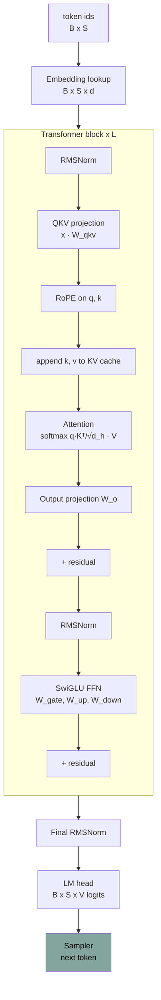

# Transformer Inference Anatomy

Before you can make inference fast, you need to be able to see — in your head — exactly what a decoder-only transformer does with each token: which matrices it multiplies, what shape every tensor has, how many bytes it touches, and how many FLOPs it spends. This note builds that picture, then uses it to explain the single most important fact in inference engineering: **prefill is compute-bound, decode is memory-bound.**

The running example is **Llama-3-70B**, a dense model whose shape is typical of modern LLMs:

| Hyperparameter | Symbol | Llama-3-8B | Llama-3-70B |
| --- | --- | --- | --- |
| Layers | `L` | 32 | 80 |
| Model (hidden) dim | `d` | 4,096 | 8,192 |
| Query heads | `H` | 32 | 64 |
| KV heads (GQA) | `H_kv` | 8 | 8 |
| Head dim | `d_h = d / H` | 128 | 128 |
| FFN inner dim | `d_ff` | 14,336 | 28,672 |
| Vocabulary | `V` | 128,256 | 128,256 |
| Parameters | `N` | ~8.0 B | ~70.6 B |

(Values from the Llama 3 model configs and *The Llama 3 Herd of Models*.)

## The forward pass, layer by layer

Notation: `B` = batch size (number of sequences), `S` = number of tokens being processed *in this step* per sequence, `T` = total context length so far (tokens already in the KV cache plus the new ones). During prefill `S = T = prompt length`. During decode `S = 1` and `T` grows by one per step.



### 1. Tokenization (CPU)

Text becomes integer token ids via a subword tokenizer (BPE, as in GPT-style `tiktoken` and Llama 3's 128k-vocab tokenizer, or SentencePiece in many others). Rules of thumb for English: ~0.75 words per token, ~4 characters per token. Code and non-Latin scripts tokenize less efficiently, which directly raises cost and latency for those users.

Tokenization runs on the CPU and is usually cheap, but at high QPS with long prompts it can cost milliseconds per request — enough to matter for TTFT on small models. Engines run it in separate processes or threads.

### 2. Embedding

```
x = E[token_ids]          # E: V x d,  x: B x S x d
```

A gather, not a matmul. Negligible FLOPs, but the table is `V × d` parameters (128,256 × 8,192 ≈ 1.05 B for Llama-3-70B).

### 3. Attention sub-block

```
h   = RMSNorm(x)                                   # B x S x d
q   = h @ W_q        # W_q: d x (H·d_h)             -> B x S x H x d_h
k   = h @ W_k        # W_k: d x (H_kv·d_h)          -> B x S x H_kv x d_h
v   = h @ W_v        # W_v: d x (H_kv·d_h)          -> B x S x H_kv x d_h
q,k = RoPE(q, k, positions)
KVcache[layer].append(k, v)                        # now holds T tokens
K,V = KVcache[layer].read()                        # B x T x H_kv x d_h
# each group of H/H_kv query heads shares one KV head (GQA)
scores = q @ Kᵀ / sqrt(d_h)                        # B x H x S x T
scores = causal_mask(scores)
p      = softmax(scores, dim=-1)
attn   = p @ V                                     # B x H x S x d_h
out    = attn.reshape(B, S, H·d_h) @ W_o           # W_o: d x d -> B x S x d
x      = x + out
```

Things to notice:

- **The KV cache.** `k` and `v` for every past token are stored, so each new token only computes its own `k, v`, not everyone else's. This turns an O(T²) per-step recomputation into O(T) work per step, at the price of memory. Everything in [[05 - KV Cache]] follows from this line.
- **GQA (grouped-query attention).** Llama-3-70B has 64 query heads but only 8 KV heads; each KV head is shared by 8 query heads. This cuts KV cache size 8× relative to full multi-head attention. MQA (one KV head) is the extreme; MLA (DeepSeek-V2/V3) compresses KV into a low-rank latent. See [[06 - Attention Kernels]] and [[16 - Long Context Inference]].
- **The score matrix is `S × T`.** In prefill with `S = T = 8,192`, that is 67 M entries per head per sequence — which is why FlashAttention never materializes it.
- **RoPE** rotates `q` and `k` by position-dependent angles so attention scores depend on relative position. It is elementwise and cheap but must be applied before the `k` is cached.

### 4. Feed-forward (SwiGLU) sub-block

```
h    = RMSNorm(x)
gate = h @ W_gate     # d x d_ff
up   = h @ W_up       # d x d_ff
f    = silu(gate) * up
out  = f @ W_down     # d_ff x d
x    = x + out
```

Three matrices of `d × d_ff`. For Llama-3-70B that is `3 × 8,192 × 28,672 ≈ 705 M` parameters per layer — about **82% of each layer's weights** live in the FFN. In MoE models, this block is replaced by a router plus many expert FFNs, of which only a few run per token ([[11 - Mixture of Experts Inference]]).

### 5. LM head and logits

```
h      = RMSNorm(x[:, -1, :])     # only the last position matters for generation
logits = h @ W_lm                 # d x V  -> B x V
```

The LM head is another `d × V` matrix (1.05 B params for Llama-3-70B, untied from the embedding). During prefill, engines compute logits **only for the last token** of each prompt — computing all `S × V` logits would waste work and memory (8,192 × 128,256 × 4 bytes = 4.2 GB in FP32 for one sequence).

**Logits** are unnormalized log-probabilities over the vocabulary. The sampler applies temperature, top-k/top-p, penalties, grammar masks, then draws a token. See [[15 - Sampling, Determinism, and Structured Output]].

### 6. Detokenization (CPU)

Token ids are converted back to text and streamed. Detokenization is incremental and has a subtle trap: one token may be half of a UTF-8 character or a word piece that only makes sense with the next token, so engines buffer until they can emit valid text. Stop-string detection also happens here.

## Parameter count from shapes

Per layer:

```
attention = d·(H·d_h) + 2·d·(H_kv·d_h) + (H·d_h)·d
          = 2d² + 2·d·H_kv·d_h                      (when H·d_h = d)
ffn       = 3·d·d_ff
```

Llama-3-70B:

```
attention = 2·8192² + 2·8192·8·128 = 134.2M + 16.8M = 151.0M
ffn       = 3·8192·28672                           = 704.6M
per layer ≈ 855.6M      ×80 layers                  = 68.45B
embedding + LM head = 2 · 128256 · 8192            =  2.10B
total ≈ 70.55B   (norms add a negligible ~1.3M)
```

Weight memory = `N × bytes_per_param`: **141 GB in BF16, 70.6 GB in FP8, ~35 GB in 4-bit.** In BF16, Llama-3-70B does not fit on one 80 GB H100 — the first reason you will meet [[10 - Parallelism]] and [[08 - Quantization]].

## FLOPs per token

A matrix multiply of an `(m × k)` by a `(k × n)` matrix costs `2mkn` FLOPs (one multiply and one add per term). Every weight participates in exactly one multiply-add per token that passes through it. Therefore:

```
FLOPs per token (weights) ≈ 2N
```

This is the famous **2N rule** (Kaplan et al., 2020). For Llama-3-70B: ~141 GFLOPs per token. Note that embedding lookups are free, so strictly it is `2 × (N − embedding params)`, but the difference is small.

**Attention adds a term that grows with context.** For each new token at position `t`, every layer computes `q·Kᵀ` over `t` keys and `p·V` over `t` values, for `H` heads of dimension `d_h`:

```
attention FLOPs per token ≈ 2 · 2 · L · H · d_h · t  = 4 · L · d · t     (d = H·d_h)
```

Llama-3-70B at `t = 8,192`: `4 × 80 × 8192 × 8192 ≈ 21.5 GFLOPs`, about 15% on top of 141. At `t = 128k`, it is ~344 GFLOPs — **more than double the weight FLOPs**. Long context changes the cost structure, which is why [[16 - Long Context Inference]] is its own note. (GQA does not reduce attention FLOPs — every query head still attends — it reduces KV *bytes*.)

Prefill of a whole prompt of length `P` costs about:

```
prefill FLOPs ≈ 2N·P + 2·L·d·P²       (causal: the attention term is halved)
```

## Memory per token: the KV cache

Per token, each layer stores one `k` and one `v` vector per KV head:

```
KV bytes per token = 2 · L · H_kv · d_h · bytes_per_elem
```

| Model | Per token (BF16) | 8k context | 128k context |
| --- | --- | --- | --- |
| Llama-3-8B (`L=32, H_kv=8`) | 2·32·8·128·2 = **128 KiB** | 1.0 GiB | 16 GiB |
| Llama-3-70B (`L=80, H_kv=8`) | 2·80·8·128·2 = **320 KiB** | 2.5 GiB | 40 GiB |
| Hypothetical 70B with full MHA (`H_kv=64`) | 2.5 MiB | 20 GiB | 320 GiB |

These numbers are per sequence. A batch of 64 sequences at 8k context on Llama-3-70B needs 160 GiB of KV — more than the FP8 weights. **KV cache capacity, not compute, is usually what limits batch size.** See [[05 - KV Cache]].

## Prefill vs decode

The same forward pass, two completely different performance regimes.

| | Prefill | Decode |
| --- | --- | --- |
| Tokens per sequence this step | `S = P` (whole prompt) | `S = 1` |
| Weight matmul shape | `(B·P × d) @ (d × k)` — a fat GEMM | `(B × d) @ (d × k)` — skinny GEMM / GEMV |
| FLOPs per weight byte loaded | high (∝ `B·P`) | low (∝ `B`) |
| Bottleneck | Tensor-core compute | HBM bandwidth (weights + KV) |
| Latency metric | TTFT | TPOT |
| Parallel across positions? | Yes | No — sequential by construction |

### Why decode is memory-bound: the core argument

In one decode step, to produce **one** token for each of `B` sequences, the GPU must read **every weight once** (2 bytes each in BF16) and do `2N × B` FLOPs. FLOPs per byte of weight traffic:

```
arithmetic intensity (decode, weights only) = 2N·B / (2N) = B   FLOPs/byte   (BF16)
```

An H100 SXM can do ~989 TFLOP/s of dense BF16 but only move ~3.35 TB/s from HBM. Its break-even ratio is ~989 / 3.35 ≈ **295 FLOPs per byte**. At batch size 1, decode delivers **1 FLOP per byte** — the tensor cores are ~99.7% idle, waiting on memory. You cannot fix this with a better kernel; it is arithmetic. The only levers are: read fewer bytes (quantization, smaller models, MoE), reuse each byte for more tokens (batching, speculative decoding), or buy more bandwidth (HBM3e, more GPUs). [[04 - Roofline and Performance Modeling]] turns this into a full model.

Prefill with a 2,000-token prompt has intensity ~2,000 FLOPs/byte for the weight matmuls — well above the ridge — so it is compute-bound, and its time is roughly `FLOPs / peak FLOP/s`.

### Worked example: Llama-3-70B, one H100-equivalent of bandwidth per 1/8 of the model

Take Llama-3-70B in FP8 (70.6 GB of weights) on 8×H100 with tensor parallelism (each GPU holds 1/8 of the weights and reads its share in parallel). Aggregate bandwidth ≈ 8 × 3.35 = 26.8 TB/s.

**Decode, batch 1:**

```
weight read time ≈ 70.6 GB / 26.8 TB/s ≈ 2.6 ms per step   (lower bound)
```

Plus KV reads, plus communication, plus kernel launch overhead. Real systems land around 5–8 ms per step at small batch — ~125–200 tok/s per user. The weight-read floor is the starting point for every decode estimate.

**Prefill, 2,000-token prompt:**

```
FLOPs ≈ 2 × 70.6e9 × 2000 + 2·80·8192·2000² ≈ 282 TFLOP + 5.2 TFLOP ≈ 287 TFLOP
peak FP8 ≈ 8 × 1,979 TFLOP/s ≈ 15.8 PFLOP/s
ideal time ≈ 287 / 15,800 ≈ 18 ms;  at a realistic ~50% MFU ≈ 36 ms
```

So prefill processes 2,000 tokens in about the time decode emits ~5–6 tokens. Per token, prefill is ~100× more efficient. This asymmetry drives batching design ([[07 - Batching and Scheduling]]): mixing prefill and decode in one batch, or splitting them onto different GPUs ([[12 - Disaggregated Serving]]).

## The autoregressive loop

A minimal, honest inference loop with a KV cache — this is what every engine elaborates on:

```python
import torch

@torch.inference_mode()
def generate(model, tokenizer, prompt: str, max_new_tokens: int, temperature: float = 0.7):
    ids = torch.tensor([tokenizer.encode(prompt)], device="cuda")   # 1 x P

    # Prefill: process the whole prompt at once, build the KV cache.
    kv_cache = model.allocate_kv_cache(batch=1, max_len=ids.shape[1] + max_new_tokens)
    logits = model(ids, kv_cache=kv_cache, start_pos=0)             # computes all P positions
    next_logits = logits[:, -1, :]                                  # only last position needed

    out = []
    pos = ids.shape[1]
    for _ in range(max_new_tokens):
        # Sample.
        probs = torch.softmax(next_logits / temperature, dim=-1)
        tok = torch.multinomial(probs, num_samples=1)               # 1 x 1
        if tok.item() == tokenizer.eos_id:                          # host sync every step!
            break
        out.append(tok.item())

        # Decode: one token in, reuse cached K/V for everything before it.
        next_logits = model(tok, kv_cache=kv_cache, start_pos=pos)[:, -1, :]
        pos += 1

    return tokenizer.decode(out)
```

What a production engine changes about this loop:

1. **Batching across requests** that arrive and finish at different times — continuous batching ([[07 - Batching and Scheduling]]).
2. **Paged KV memory** instead of one contiguous `max_len` buffer per request ([[05 - KV Cache]]).
3. **No per-step host sync** (`tok.item()` stalls the CPU until the GPU finishes) — engines keep sampling on the GPU and overlap the CPU scheduling of step `n+1` with GPU execution of step `n`.
4. **CUDA graphs** to remove kernel-launch overhead from the tiny decode steps ([[13 - Kernels, Compilers, and CUDA Graphs]]).
5. **Speculative decoding** to produce several tokens per weight read ([[09 - Speculative Decoding]]).
6. **Incremental detokenization and streaming** to the client.

## Where the time goes in one decode step

A rough breakdown for a dense model at moderate batch on a well-optimized engine (order of magnitude only; measure your own):

| Component | Share of decode step | Notes |
| --- | --- | --- |
| Weight GEMMs (QKV, O, FFN) | 50–75% | Bandwidth-bound at small batch |
| Attention (KV reads) | 10–40% | Grows with context length × batch |
| Communication (TP all-reduce) | 5–20% | Two all-reduces per layer with TP |
| Norms, RoPE, activations, residuals | 3–10% | Unless fused, each is a round-trip through HBM |
| Sampling, LM head | 2–5% | Large vocab makes LM head non-trivial |
| CPU/launch overhead | 0–30% | Near zero with CUDA graphs; can dominate without them |

## Common mistakes

- **Counting FLOPs and ignoring bytes.** Decode time is set by bytes moved, not FLOPs.
- **Forgetting the attention term.** At long context the "2N" rule underestimates cost badly.
- **Computing logits for every prefill position.** Wastes compute and gigabytes of memory.
- **Assuming GQA reduces attention compute.** It reduces KV memory and bandwidth, not the score FLOPs.
- **Mixing up `S` and `T`.** Prefill: new tokens = context. Decode: one new token, growing context.
- **Ignoring the host.** A Python loop with a `.item()` per step can cost more than the GPU work for a small model.

## Check yourself

1. Compute the parameter count of Llama-3-8B from its shapes.
2. How many bytes of KV cache does Llama-3-8B need for 32 sequences at 4k context in BF16?
3. Why is the arithmetic intensity of decode approximately equal to the batch size (BF16)?
4. At what context length does the attention FLOP term equal the weight FLOP term for Llama-3-70B?
5. Why do engines compute logits only for the last prompt position during prefill?
6. GQA with `H_kv = 8` vs MHA with `H_kv = 64`: what changes in compute and in memory?
7. Name three things a production engine does differently from the naive loop above.

<details>
<summary>Answers</summary>

1. Attention per layer: `2·4096² + 2·4096·8·128 = 33.6M + 8.4M = 41.9M`. FFN: `3·4096·14336 = 176.2M`. Per layer 218.1M × 32 = 6.98B. Embedding + LM head: `2·128256·4096 = 1.05B`. Total ≈ 8.03B.
2. 128 KiB × 4,096 × 32 = 16 GiB.
3. Each weight is read once (2 bytes) and used for `B` multiply-adds (2B FLOPs): `2B / 2 = B`.
4. `4·L·d·t = 2N` → `t = 2N / (4·L·d) = 141e9 / (4·80·8192) ≈ 53.8k` tokens.
5. Only the last position's distribution is needed to sample the next token; the rest would cost `S × d × V` FLOPs and `S × V` memory for nothing (unless you need prompt logprobs).
6. Compute: same score/value FLOPs (all 64 query heads still attend). Memory: KV cache and KV read bandwidth shrink 8×, and QKV projection params shrink slightly.
7. Continuous batching, paged KV cache, no per-step host syncs/async scheduling, CUDA graphs, fused kernels, speculative decoding, streaming detokenization.

</details>

## Further reading

- Vaswani et al., *Attention Is All You Need* (2017) — https://arxiv.org/abs/1706.03762
- Kaplan et al., *Scaling Laws for Neural Language Models* (2020) — https://arxiv.org/abs/2001.08361 — source of the 2N FLOPs-per-token accounting.
- Llama Team, *The Llama 3 Herd of Models* (2024) — https://arxiv.org/abs/2407.21783
- Ainslie et al., *GQA* (2023) — https://arxiv.org/abs/2305.13245; Shazeer, *Fast Transformer Decoding: One Write-Head is All You Need* (MQA, 2019) — https://arxiv.org/abs/1911.02150
- Su et al., *RoFormer* (RoPE) — https://arxiv.org/abs/2104.09864; Shazeer, *GLU Variants Improve Transformer* (SwiGLU) — https://arxiv.org/abs/2002.05202; Zhang & Sennrich, *RMSNorm* — https://arxiv.org/abs/1910.07467
- Sennrich et al., *BPE subword units* — https://arxiv.org/abs/1508.07909; Kudo & Richardson, *SentencePiece* — https://arxiv.org/abs/1808.06226
- kipply, *Transformer Inference Arithmetic* — https://kipp.ly/transformer-inference-arithmetic/ — the best short treatment of the math in this note.
- JAX team, *How to Scale Your Model*, "All About Transformer Inference" — https://jax-ml.github.io/scaling-book/inference/
- Karpathy, *nanoGPT* — https://github.com/karpathy/nanoGPT — read the model file end to end; then add a KV cache yourself.
- Tiktokenizer playground — https://tiktokenizer.vercel.app/ — see tokenization of real text.

## Related

- [[01 - What Inference Engineering Is]]
- [[04 - Roofline and Performance Modeling]]
- [[05 - KV Cache]]
- [[06 - Attention Kernels]]
- [[07 - Batching and Scheduling]]
- [[98 - Formula Cheatsheet]]
