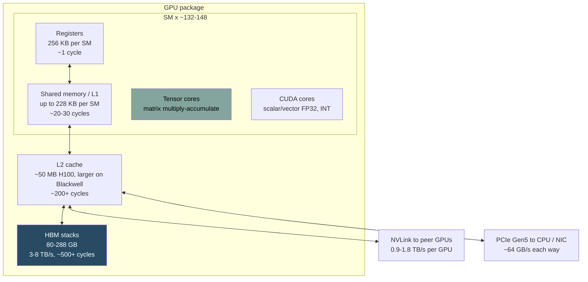
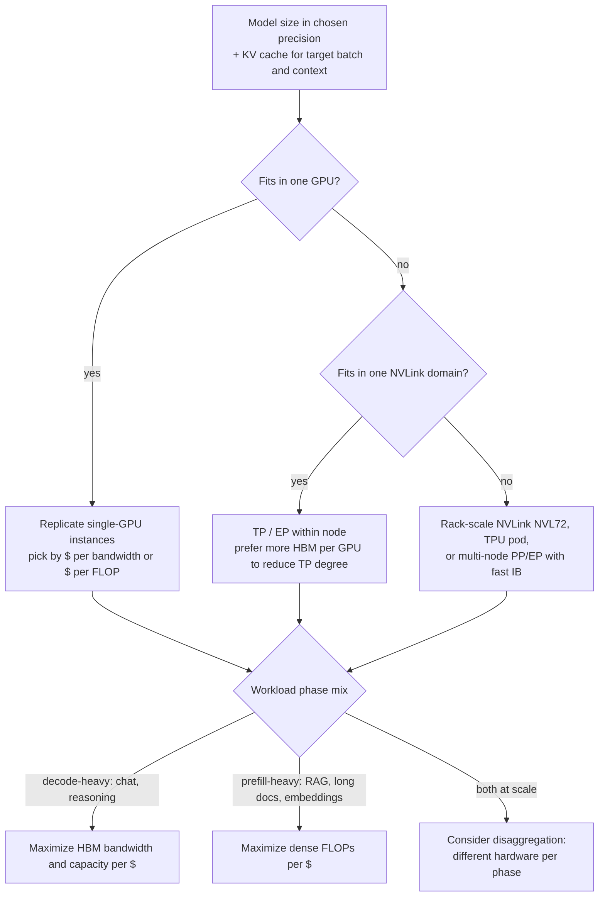

# Accelerator Hardware

Every performance number in inference eventually reduces to three hardware quantities: **how many FLOPs per second the chip can do, how many bytes per second it can move from memory, and how many bytes per second it can exchange with other chips.** This note explains where those numbers come from inside a GPU, gives a verified spec table for the accelerators you will meet in 2025–2026, and shows how to choose between them for a given workload.

You do not need to be a CUDA expert to be an inference engineer, but you must be able to read a spec sheet critically — including spotting the asterisk that says "with sparsity."

## The GPU as a memory hierarchy with math attached



### Streaming multiprocessors (SMs)

A GPU is a few hundred mostly independent processors called **SMs** (132 on an H100 SXM, 148 on a B200). Each SM has its own register file, shared memory, tensor cores, and scheduling hardware. A kernel launches a **grid** of **thread blocks** (CTAs); each block runs on one SM. Thread blocks never migrate, and blocks cannot directly talk to each other except through global memory (or, on Hopper and later, through **thread block clusters** with distributed shared memory).

The consequence for inference: **a kernel that launches fewer blocks than there are SMs leaves hardware idle.** A decode-step GEMV for a small batch can easily produce too few tiles to fill 132 SMs, which is why split-K and stream-K GEMM strategies, and "persistent kernels," exist.

### Warps and SIMT

Threads execute in groups of 32 called **warps**. All threads in a warp execute the same instruction; divergent branches serialize. Each SM keeps many warps resident (up to 64 warps = 2,048 threads on Hopper) and switches between them every cycle to hide memory latency. This is **latency hiding through occupancy**: while one warp waits ~500 cycles for HBM, others compute.

Occupancy is limited by registers and shared memory per block. A kernel that uses 255 registers per thread can only keep a few warps resident, so it must hide latency some other way — asynchronous copies and software pipelining, which is exactly how modern GEMM and attention kernels work.

### Tensor cores

**Tensor cores** are specialized units that compute small matrix multiply-accumulates (`D = A·B + C`) in one instruction. They are where essentially all of an LLM's FLOPs happen. Each generation added lower precisions and larger, more asynchronous instructions:

| Generation | Architecture | New inference-relevant precisions | Key instruction model |
| --- | --- | --- | --- |
| V100 (2017) | Volta | FP16 | `mma.sync` per warp |
| A100 (2020) | Ampere | BF16, TF32, INT8, 2:4 structured sparsity | `mma.sync`, `cp.async` |
| H100/H200 (2022–24) | Hopper | **FP8** (E4M3, E5M2) | `wgmma` (warpgroup = 4 warps, async), **TMA** bulk copies |
| B200/GB200 (2024–25) | Blackwell | **FP4/FP6, MXFP8/MXFP4, NVFP4** (block-scaled) | `tcgen05`, **tensor memory (TMEM)**, 2-SM (CTA pair) MMA |
| B300/GB300 (2025) | Blackwell Ultra | Higher FP4 throughput, 288 GB HBM3e | same as Blackwell |

Two practical points:

1. **CUDA cores are ~10–30× slower than tensor cores** for the same precision. Any work that falls off the tensor cores — softmax, normalization, activation functions, dequantization arithmetic — becomes disproportionately expensive. FlashAttention-3/4 and Blackwell's design both spend significant effort keeping exponentials and rescaling from becoming the bottleneck ([[06 - Attention Kernels]]).
2. **Lower precision doubles throughput per step down**: FP8 is 2× BF16, FP4 is 2× FP8 on Blackwell. It also halves the bytes per weight, which matters even more for memory-bound decode ([[08 - Quantization]]).

### Memory hierarchy numbers (H100 SXM)

| Level | Capacity | Bandwidth (approx.) | Who manages it |
| --- | --- | --- | --- |
| Registers | 256 KB per SM (33.8 MB total) | Highest | Compiler |
| Shared memory / L1 | 256 KB per SM combined, up to 228 KB as SMEM | ~tens of TB/s aggregate | Programmer (kernel) |
| L2 cache | 50 MB | ~10+ TB/s | Hardware |
| HBM3 | 80 GB | 3.35 TB/s | Programmer (allocation) |
| Peer GPU via NVLink 4 | 80 GB × 7 peers | 900 GB/s bidirectional (450 GB/s each way) | NCCL / runtime |
| Host DRAM via PCIe Gen5 x16 | 100s of GB–TBs | ~64 GB/s each way (128 GB/s bidirectional) | Runtime |
| Remote GPU via InfiniBand NDR | anything | 400 Gb/s = 50 GB/s per NIC, often 8 NICs/node | NCCL, NIXL, etc. |

Two numbers to tattoo somewhere: **HBM ≈ 3–8 TB/s**, **NVLink ≈ 0.45–0.9 TB/s each way**, **network ≈ 0.05 TB/s per NIC**. Each step down is roughly an order of magnitude. Every distributed-inference design ([[10 - Parallelism]], [[12 - Disaggregated Serving]]) is a negotiation with those gaps.

### Why HBM is the decisive number for decode

From [[02 - Transformer Inference Anatomy]]: decode reads every weight (and the active KV cache) once per step. So the **lower bound on decode step time is bytes / HBM bandwidth**. A GPU with 2× the FLOPs but the same HBM bandwidth will barely speed up small-batch decode. This is why the H200 — same compute die as the H100, but 141 GB at 4.8 TB/s instead of 80 GB at 3.35 TB/s — was a meaningful inference upgrade: ~1.4× more bandwidth and ~1.8× more capacity for KV cache.

## Spec table (dense, per chip)

All compute numbers are **dense** (no structured sparsity) and peak theoretical at boost clock. Vendors often headline sparse numbers, which are exactly 2× and rarely achievable for LLM inference. Sources are vendor pages and docs as of late 2025; verify before buying hardware.

| Accelerator | Memory | HBM BW | BF16 dense | FP8 dense | FP4 dense | Scale-up link (per chip) | Ridge point BF16 (FLOP/B) |
| --- | --- | --- | --- | --- | --- | --- | --- |
| NVIDIA A100 SXM 80GB | 80 GB HBM2e | 2.0 TB/s | 312 TF | — | — | NVLink3 600 GB/s | ~153 |
| NVIDIA H100 SXM | 80 GB HBM3 | 3.35 TB/s | 989 TF | 1,979 TF | — | NVLink4 900 GB/s | ~295 |
| NVIDIA H200 SXM | 141 GB HBM3e | 4.8 TB/s | 989 TF | 1,979 TF | — | NVLink4 900 GB/s | ~206 |
| NVIDIA B200 (HGX/DGX) | 180 GB HBM3e (usable) | 8 TB/s | ~2.25 PF | ~4.5 PF | ~9 PF | NVLink5 1.8 TB/s | ~281 |
| NVIDIA GB200 (per GPU, NVL72) | 186 GB HBM3e | 8 TB/s | 2.5 PF | 5 PF | 10 PF | NVLink5 1.8 TB/s, 72-GPU domain | ~313 |
| AMD MI300X | 192 GB HBM3 | 5.3 TB/s | 1.3 PF | 2.6 PF | — | Infinity Fabric 7×128 GB/s | ~247 |
| AMD MI355X | 288 GB HBM3e | 8 TB/s | 2.5 PF | 5 PF | 10 PF (MXFP4) | Infinity Fabric 7×144 GB/s | ~313 |
| Google TPU v5e | 16 GB HBM2 | 0.82 TB/s | 197 TF | (INT8 394) | — | ICI, 256-chip pod | ~240 |
| Google TPU v6e (Trillium) | 32 GB | 1.64 TB/s | 918 TF | 918 TF | — | ICI 800 GB/s, 256-chip pod | ~560 |
| Google TPU7x (Ironwood) | 192 GB | 7.38 TB/s | 2,307 TF | 4,614 TF | — | ICI 1.2 TB/s, 9,216-chip pod | ~313 |
| AWS Trainium2 | 96 GB | 2.9 TB/s | 667 TF | 1,299 TF | — | NeuronLink-v3 | ~230 |
| AWS Trainium3 | 144 GB | 4.9 TB/s | 671 TF | 2,517 TF (MXFP8) | 2,517 TF (MXFP4) | NeuronLink-v4 2.56 TB/s | ~137 |
| Huawei Ascend 950DT | 144 GB (HiZQ 2.0) | 4 TB/s | — | 1 PF (FP8/HiF8) | 2 PF (MXFP4) | 2 TB/s | — |

Notes on the table:

- **NVIDIA FP8/FP4 numbers** on NVIDIA's own spec pages are often listed sparse; the dense values above are half of those. H100 page: FP8 "3,958 TFLOPS*" with the asterisk "with sparsity" → 1,979 dense. GB200 NVL72 page lists "40 | 20 PFLOPS" FP4 per Grace Blackwell superchip (sparse | dense), i.e. 10 PF dense per GPU.
- **B200 memory**: 192 GB physical; DGX/HGX B200 systems expose 180 GB per GPU. GB200 exposes 186 GB.
- **TPU v5e** has no native FP8; it uses INT8 for quantized inference. TPU HBM capacities above are physical; runtime reserves some.
- **Ascend 950**: Huawei announced the 950 series (950PR for prefill/recommendation with lower-cost HiBL 1.0 memory; 950DT for decode/training with HiZQ 2.0 HBM) at Huawei Connect 2025, with 950PR targeted for Q1 2026. Treat figures as announced, not measured. The 950DT/950PR split is itself a statement about [[12 - Disaggregated Serving]]: prefill wants compute, decode wants bandwidth.
- **Ridge point** = peak FLOP/s ÷ HBM bytes/s — the arithmetic intensity at which a kernel stops being memory-bound. See [[04 - Roofline and Performance Modeling]]. Most modern accelerators sit around 200–600 FLOP/byte in BF16, meaning decode at batch < ~200 is memory-bound on all of them.

### Reading between the lines

- **Capacity per chip changed the game for big models.** A 671B-parameter MoE like DeepSeek-V3 in FP8 needs ~671 GB just for weights: 9+ H100s, 4 MI355Xs, or 4 B200s (before KV cache). Fewer chips per replica means less communication and simpler deployment.
- **Bandwidth per dollar** is often the most predictive single number for decode-heavy workloads. **FLOPs per dollar** predicts prefill-heavy and batch workloads.
- **Scale-up domain size** matters for MoE and huge models. A 72-GPU NVLink domain (GB200 NVL72) lets expert parallelism run over NVLink instead of InfiniBand — roughly an order of magnitude more bandwidth for the all-to-all ([[11 - Mixture of Experts Inference]]). TPU pods and Huawei's 384-chip Atlas 900 A3 SuperPoD (Ascend 910C) pursue the same idea.

## Interconnects

| Link | Scope | Bandwidth (per GPU, approx.) | Typical use in inference |
| --- | --- | --- | --- |
| **NVLink 4** (Hopper) | Within a node (8 GPUs via NVSwitch) | 900 GB/s bidirectional | Tensor parallelism all-reduce |
| **NVLink 5** (Blackwell) | Up to 72 GPUs (NVL72 rack) via NVLink Switch trays | 1.8 TB/s bidirectional; 130 TB/s rack total | TP, EP across a whole rack |
| **AMD Infinity Fabric** | 8-GPU node | 7 links × 128–144 GB/s | TP, EP within node |
| **Google ICI** | TPU pod (3D torus) | 0.8–1.2 TB/s per chip | All parallelism within a slice |
| **PCIe Gen5 x16** | GPU ↔ CPU / NIC / NVMe | ~64 GB/s each way | Weight loading, KV offload to host, NIC traffic |
| **InfiniBand NDR / XDR** | Between nodes | 400 / 800 Gb/s per port (50 / 100 GB/s) | Pipeline parallelism, cross-node EP, KV transfer for disaggregation |
| **RoCE v2 (Ethernet)** | Between nodes | 400–800 Gb/s per port | Same as IB; common at hyperscalers |

**NVSwitch** turns the 8 GPUs of an HGX node into a full crossbar: any GPU can talk to any other at full NVLink bandwidth. Without it (e.g., PCIe-only cards like L40S), tensor parallelism across GPUs is painful.

**GPUDirect RDMA** lets a NIC read and write GPU memory without bouncing through host memory. It is essential for disaggregated prefill/decode, where a multi-gigabyte KV cache must move from a prefill GPU to a decode GPU in milliseconds ([[12 - Disaggregated Serving]]).

Rule of thumb: **keep tensor parallelism inside the NVLink domain.** TP does two all-reduces per layer per step; over InfiniBand that latency kills decode. Pipeline parallelism (one point-to-point transfer per stage boundary) and data parallelism tolerate slower links ([[10 - Parallelism]]).

## Precision support per generation

| Format | Bits | A100 | H100/H200 | B200/GB200 | MI300X | MI355X | Notes |
| --- | --- | --- | --- | --- | --- | --- | --- |
| FP32 / TF32 | 32/19 | ✓ | ✓ | ✓ | ✓ | ✓ | Training/legacy; not used for LLM inference matmuls |
| BF16 / FP16 | 16 | ✓ | ✓ | ✓ | ✓ | ✓ | Baseline inference precision |
| INT8 | 8 | ✓ | ✓ | ✓ | ✓ | ✓ | W8A8 SmoothQuant-style |
| FP8 E4M3/E5M2 | 8 | ✗ | ✓ | ✓ | ✓ | ✓ | Default for production LLM serving on Hopper+ |
| MXFP8 | 8 + shared scale | ✗ | ✗ | ✓ | ✗ | ✓ | OCP microscaling, block size 32 |
| FP6 / MXFP6 | 6 | ✗ | ✗ | ✓ | ✗ | ✓ | |
| FP4 / NVFP4 / MXFP4 | 4 + scales | ✗ | ✗ | ✓ | ✗ | ✓ | NVFP4: 16-element blocks with FP8 scale; MXFP4: 32-element blocks with power-of-two scale |
| INT4 weights | 4 | via kernels | via kernels | via kernels | via kernels | via kernels | Weight-only (AWQ/GPTQ); dequantize to BF16/FP8 in-kernel |

"Supported" means hardware tensor-core support. Weight-only INT4 runs everywhere because it dequantizes inside the kernel and computes in BF16/FP8 — it saves bandwidth, not FLOPs. See [[08 - Quantization]].

## Other hardware you will meet

- **NVIDIA L40S / L4 / RTX-class**: GDDR memory (~0.3–0.9 TB/s), no NVLink, cheaper. Fine for small models, embeddings, image models, and cost-optimized serving of ≤ 8–14B models.
- **Wafer-scale and SRAM-centric chips (Cerebras, Groq)**: keep weights in on-chip SRAM, so per-user decode speed is extraordinary (hundreds to thousands of tok/s), but serving a large model needs many chips because SRAM capacity per chip is small relative to HBM. Excellent latency, different cost structure.
- **Apple silicon, mobile NPUs, laptop GPUs**: unified memory, low bandwidth (~100–800 GB/s), small power budgets. See [[20 - Edge and On-Device Inference]].
- **CPUs**: viable for tiny models or offline jobs; AMX (Intel) and SME (Arm) help, but memory bandwidth (~0.3–0.6 TB/s on a big server socket) limits decode.

## Choosing hardware: a decision procedure



Practical considerations beyond the spec sheet:

1. **Software maturity.** CUDA's ecosystem (FlashAttention, CUTLASS, TensorRT-LLM, vLLM/SGLang kernels, NCCL) is deepest. ROCm has closed much of the gap for mainstream models; TPU via JAX/XLA is excellent for teams that live in that ecosystem. Budget engineering time for anything non-default.
2. **Availability and price**, not list price. Cloud on-demand vs reserved vs spot pricing can differ by 3×. A cheaper-per-hour older GPU can lose on $/token.
3. **Power and cooling.** B200 is ~1,000 W, MI355X typical board power 1,400 W, GB200 NVL72 racks are liquid cooled at ~120+ kW. Datacenter readiness can be the binding constraint.
4. **Memory capacity for KV.** Long contexts and big batches are capacity-hungry. A 288 GB part may let you run at TP=4 instead of TP=8, halving communication.
5. **Failure domains.** A 72-GPU NVLink domain is fast but a single unhealthy GPU or switch tray affects a big unit of capacity.

## Worked example: which GPU for Llama-3-70B chat?

Target: Llama-3-70B in FP8 (70.6 GB weights), average context 4k, want batch 64 per replica.

```
KV per sequence (BF16 KV) = 320 KiB × 4096 ≈ 1.25 GiB
KV for batch 64           ≈ 80 GiB
Total ≈ 70.6 GB + ~86 GB + ~10% activations/overhead ≈ ~170 GB
```

- **H100 (80 GB)**: needs ≥ 4 GPUs for capacity (TP=4, 320 GB). Per-step weight read floor = 70.6 GB / (4 × 3.35 TB/s) ≈ 5.3 ms.
- **H200 (141 GB)**: TP=2 fits (282 GB). Floor = 70.6 / (2 × 4.8) ≈ 7.4 ms, using half the GPUs of the H100 option.
- **B200 (180 GB)**: TP=1 barely fits with smaller batch; TP=2 is comfortable. Floor at TP=2 = 70.6 / 16 ≈ 4.4 ms.
- **MI355X (288 GB)**: TP=1 fits. Floor = 70.6 / 8 ≈ 8.8 ms — single-GPU, no TP communication at all.

Which is "best" depends on whether you are bound by per-user latency (prefer more aggregate bandwidth per replica) or by $/token (prefer fewer, bigger-memory GPUs per replica and more replicas). [[19 - Cost and Capacity Planning]] finishes this calculation with prices.

## Common mistakes

- **Comparing sparse and dense numbers.** Always check the footnote.
- **Using peak FLOPs for decode estimates.** Decode is bandwidth-bound; use HBM bandwidth.
- **Ignoring capacity.** A faster chip that forces TP=8 instead of TP=2 may lose to a slower chip with more memory.
- **Running TP across nodes over InfiniBand.** Two all-reduces per layer per token on a slow link wrecks decode latency.
- **Assuming peak is achievable.** Real kernels get ~60–80% of peak FLOPs on big GEMMs and ~70–90% of peak HBM bandwidth on streaming reads. Budget for it.
- **Forgetting the host.** Slow CPUs, few PCIe lanes, or small host memory hurt tokenization, scheduling, weight loading, and KV offload.

## Check yourself

1. Why did the H200 improve LLM inference meaningfully despite having the same peak FLOPs as the H100?
2. What is the ridge point of a B200 in FP8, and what does it imply for decode at batch 128?
3. An NVIDIA page lists "FP8: 3,958 TFLOPS*". What should you check?
4. Why should tensor parallelism stay inside an NVLink domain?
5. Name two reasons a 288 GB GPU might beat a faster 180 GB GPU on cost per token.
6. Why do Blackwell and FlashAttention-4 care so much about the speed of exponentials?
7. What is the order-of-magnitude bandwidth ladder from HBM to NVLink to the network?

<details>
<summary>Answers</summary>

1. Decode is memory-bandwidth-bound: H200 has ~1.43× the HBM bandwidth (4.8 vs 3.35 TB/s) and ~1.76× the capacity (bigger batches, longer contexts, lower TP degree).
2. ~4.5 PF / 8 TB/s ≈ 562 FLOP/byte. With FP8 weights, decode intensity ≈ 2B FLOPs per byte ≈ 256 at B = 128, still below the ridge → still memory-bound.
3. Whether it is sparse. It is: dense FP8 is 1,979 TFLOPS.
4. TP needs two all-reduces per layer per step; NVLink gives ~10× the bandwidth and much lower latency than InfiniBand.
5. Lower TP degree (less communication, fewer GPUs per replica), more room for KV cache → larger batch → more tokens per weight read; fewer replicas to fit giant models.
6. Tensor cores got so fast that softmax's `exp` on the much slower special-function / CUDA-core units became a bottleneck in attention.
7. HBM ~3–8 TB/s; NVLink ~0.5–1 TB/s each way; network ~0.05–0.1 TB/s per NIC.

</details>

## Further reading

- NVIDIA, *H100 Tensor Core GPU Architecture* whitepaper — https://resources.nvidia.com/en-us-hopper-architecture/nvidia-h100-tensor-c
- NVIDIA product pages: H100 — https://www.nvidia.com/en-us/data-center/h100/ ; H200 — https://www.nvidia.com/en-us/data-center/h200/ ; DGX B200 — https://www.nvidia.com/en-us/data-center/dgx-b200/ ; GB200 NVL72 — https://www.nvidia.com/en-us/data-center/gb200-nvl72/
- NVIDIA, *GPU Performance Background User's Guide* — https://docs.nvidia.com/deeplearning/performance/dl-performance-gpu-background/index.html — arithmetic intensity, SMs, tiles, wave quantization.
- AMD Instinct MI300X — https://www.amd.com/en/products/accelerators/instinct/mi300/mi300x.html ; MI355X — https://www.amd.com/en/products/accelerators/instinct/mi350/mi355x.html
- Google Cloud, TPU7x (Ironwood) docs with v5p/v6e comparison — https://docs.cloud.google.com/tpu/docs/tpu7x
- AWS Neuron docs: Trainium2 — https://awsdocs-neuron.readthedocs-hosted.com/en/latest/about-neuron/arch/neuron-hardware/trainium2.html ; Trainium3 — https://awsdocs-neuron.readthedocs-hosted.com/en/latest/about-neuron/arch/neuron-hardware/trainium3.html
- Huawei Connect 2025 keynote (Ascend roadmap) — https://www.huawei.com/en/news/2025/9/hc-xu-keynote-speech
- JAX team, *How to Scale Your Model*, "How to Think About GPUs" and "TPUs" chapters — https://jax-ml.github.io/scaling-book/
- Horace He, *Making Deep Learning Go Brrrr From First Principles* — https://horace.io/brrr_intro.html

## Related

- [[02 - Transformer Inference Anatomy]]
- [[04 - Roofline and Performance Modeling]]
- [[08 - Quantization]]
- [[10 - Parallelism]]
- [[13 - Kernels, Compilers, and CUDA Graphs]]
- [[19 - Cost and Capacity Planning]]
- [[20 - Edge and On-Device Inference]]
