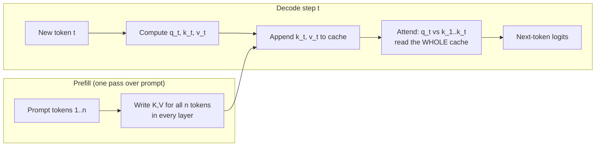
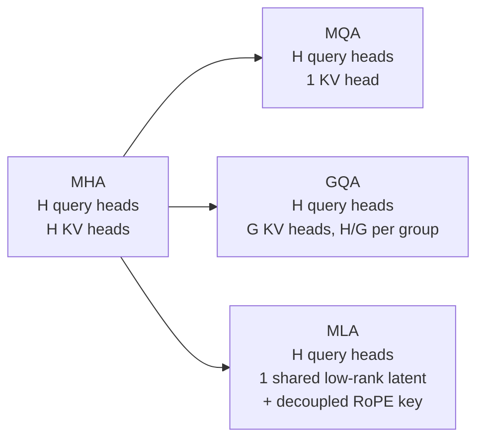

# KV Cache

The KV cache is the single most important data structure in LLM serving. Weights decide whether a model *fits*; the KV cache decides how many users you can serve at once, how long their contexts can be, and therefore how much each token costs. Most of the clever ideas in modern inference engines — PagedAttention, prefix caching, GQA/MLA, disaggregated serving, tiered KV stores — are answers to one question: *how do we store, share, move, and evict these tensors efficiently?*

Prerequisites: [[02 - Transformer Inference Anatomy]] (prefill vs decode), [[04 - Roofline and Performance Modeling]] (memory-bound vs compute-bound).

## Intuition: why a cache exists at all

In autoregressive decoding, token `t` attends to every previous token `1..t-1`. Attention needs, for every previous position, that position's **key** `k_i` and **value** `v_i` vectors in every layer. These vectors depend only on the prefix up to `i` (causal masking), so once computed they never change.

Without a cache, generating token `t` would recompute K and V for all `t-1` previous tokens through all layers — `O(t)` work per step and `O(n²)` work per sequence of length `n`. With a cache, each step computes K/V for exactly one new token, appends it, and *reads* the old ones. We trade compute for memory: the KV cache converts a quadratic compute problem into a linear memory problem.

That trade is the whole story of decode performance. Decode is dominated by *reading bytes* — the weights once per step (shared across the batch) and the KV cache once per sequence per step (not shared). See [[04 - Roofline and Performance Modeling]].



## The size formula

For a standard decoder with multi-head-style attention, KV bytes per token are:

```
kv_bytes_per_token = 2 × n_layers × n_kv_heads × head_dim × bytes_per_element
                     ^K and V
```

Total KV for a batch:

```
kv_total = kv_bytes_per_token × Σ_requests (prompt_len + generated_len)
```

Notice what is *not* in the formula: the number of query heads and the hidden size. Only **KV heads** matter. That is why GQA and MQA are such powerful levers.

### Worked example 1: Llama-3-8B

Config: 32 layers, 32 query heads, **8 KV heads**, head_dim 128, BF16 (2 bytes).

```
2 × 32 × 8 × 128 × 2 B = 131,072 B = 128 KiB per token
```

- One 8K-token conversation: `8192 × 128 KiB = 1 GiB`.
- One 128K-token context: `16 GiB` — larger than the 16 GB of BF16 weights.
- On an 80 GB H100: weights 16 GB, leave ~8 GB for activations/workspace/CUDA graphs, so ~56 GB for KV ≈ 458K tokens. That is 56 concurrent 8K conversations, or 3.5 concurrent 128K ones.

### Worked example 2: Llama-3-70B

Config: 80 layers, 64 query heads, **8 KV heads**, head_dim 128, BF16.

```
2 × 80 × 8 × 128 × 2 B = 327,680 B = 320 KiB per token
```

- 8K context: 2.5 GiB. 128K context: 40 GiB.
- Had the model used full MHA (64 KV heads), it would be `2.5 MiB` per token — 8× more. A single 128K context would need 320 GiB, i.e. four H100s *just for one user's cache*. GQA is not a nice-to-have; it is what makes long-context serving of 70B models economical.
- On 8×H100 (640 GB) with tensor parallelism 8: weights 141 GB, reserve ~10% headroom → ~435 GB for KV → ~1.3M tokens of capacity. With TP=8, each GPU stores exactly one KV head per layer (8 KV heads / 8 GPUs), i.e. 40 KiB/token/GPU. Note: with TP > n_kv_heads, KV heads must be **replicated**, wasting memory — one reason TP beyond the KV-head count is unattractive (see [[10 - Parallelism]]).

### Worked example 3: DeepSeek-V3 with MLA

Multi-head Latent Attention (MLA, introduced in DeepSeek-V2) does not cache per-head K and V at all. It caches a single compressed latent vector `c_KV` (rank 512) plus a small decoupled RoPE key (64 dims) per token per layer, shared by all 128 heads.

Config: 61 layers, kv_lora_rank 512, qk_rope_head_dim 64, BF16:

```
(512 + 64) × 2 B × 61 layers = 70,272 B ≈ 68.6 KiB per token
```

Compare with a hypothetical MHA version of the same model: 128 heads, K head dim 192 (128 "nope" + 64 rope), V head dim 128:

```
128 × (192 + 128) × 2 B × 61 = 4,997,120 B ≈ 4.77 MiB per token
```

That is a ~71× reduction. A 671B-parameter MoE model ends up with a per-token KV footprint *smaller than Llama-3-8B's* (68.6 vs 128 KiB).

Engines push it further with low-precision KV. FlashMLA's current format for DeepSeek-V4.1 stores 512 FP8 (E4M3) values plus 16 bytes of E8M0 scales (one per 32 values) = **528 bytes per token** per layer, and an FP4 variant at 288 bytes. Compare 1,152 bytes for BF16 `(512+64)×2`.

### Summary table

| Model | Attention | KV/token (BF16) | 32K context |
| --- | --- | --- | --- |
| Llama-2-7B | MHA, 32 KV heads | 512 KiB | 16 GiB |
| Llama-3-8B | GQA, 8 KV heads | 128 KiB | 4 GiB |
| Llama-3-70B | GQA, 8 KV heads | 320 KiB | 10 GiB |
| DeepSeek-V3 | MLA, latent 512+64 | 68.6 KiB | 2.1 GiB |

## Attention variants through the KV lens



- **MHA (multi-head attention).** Every query head has its own K/V head. Maximum quality, maximum cache. Decode arithmetic intensity ≈ 1 FLOP per byte of KV read in BF16 — hopelessly memory-bound.
- **MQA (multi-query attention, Shazeer 2019).** All query heads share one K/V head. Cache shrinks by `H×`. Quality loss is noticeable for larger models, and with tensor parallelism the single KV head must be replicated on every GPU.
- **GQA (grouped-query attention, Ainslie et al. 2023).** `G` KV groups, each shared by `H/G` query heads. Interpolates between MHA (`G=H`) and MQA (`G=1`). Llama-3 uses `G=8`. The paper also shows how to *uptrain* an MHA checkpoint into GQA with ~5% of pre-training compute.
- **MLA (DeepSeek-V2).** Compress K and V jointly into a latent `c_KV = W_DKV · h` of rank `d_c` (512). At attention time, the up-projections `W_UK` and `W_UV` can be **absorbed** into the query and output projections, so the kernel attends directly against the latent. From the kernel's perspective, MLA decode looks like MQA with one 576-dim K "head" and one 512-dim V "head" shared by 128 query heads. Because RoPE is position-dependent it cannot be absorbed, hence the separate 64-dim RoPE key.

The arithmetic-intensity consequence matters as much as the size: more query heads per KV head means more FLOPs per byte loaded. GQA-8 gives ~8 FLOP/byte; MLA with 128 heads gives a few hundred — enough to make decode attention close to compute-bound on H100-class hardware. See [[06 - Attention Kernels]].

## Memory management: PagedAttention

### The problem: fragmentation

Early serving systems (FasterTransformer, the first Orca prototype) allocated one contiguous KV buffer per request, sized for the *maximum* possible length (prompt + max_tokens), because the final length is unknown in advance. Three kinds of waste follow:

1. **Reserved but not yet used** — a request that will generate 2K tokens holds all 2K slots from step one.
2. **Internal fragmentation** — reserved for max_tokens = 4K but the request stops at 300 tokens.
3. **External fragmentation** — free space split into gaps too small for a new contiguous allocation.

The vLLM paper (Kwon et al., SOSP 2023) measured that in such systems only about 20–38% of KV memory actually held token states. The rest was waste — and wasted KV memory directly means smaller batches and lower throughput.

### The fix: virtual memory for KV

PagedAttention borrows the OS idea of paging:

- GPU KV memory is carved into fixed-size **blocks** (pages), each holding K/V for `block_size` tokens across one layer (or all layers, depending on layout). vLLM's default `block_size` is 16.
- Each request owns a **block table**: a list mapping logical block `i` (tokens `16i .. 16i+15`) to a physical block id.
- Blocks are allocated on demand as the sequence grows. Waste is bounded by at most one partially-filled block per sequence — the paper reports under 4%.
- The attention kernel takes the block table as input and gathers K/V from scattered physical blocks.

```
Request A logical blocks:   [0]  [1]  [2]
Block table A:               7    2    9      (physical ids)

Request B logical blocks:   [0]  [1]
Block table B:               7    4           (shares block 7 with A: same prefix)

Physical pool:  [0][1][2:A1][3][4:B1][5][6][7:A0,B0 ref=2][8][9:A2]
```

Sharing falls out for free: two sequences with the same prefix can point to the same physical block, tracked by a **reference count**. When one sequence writes into a shared, partially-full block, the engine does **copy-on-write**. This makes parallel sampling (`n > 1`) and beam search cheap.

```python
class BlockAllocator:
    def __init__(self, num_blocks):
        self.free = list(range(num_blocks))
        self.ref = [0] * num_blocks

    def allocate(self):
        if not self.free:
            raise OutOfBlocks          # scheduler must preempt or wait
        b = self.free.pop()
        self.ref[b] = 1
        return b

    def fork(self, b):                 # share a block between sequences
        self.ref[b] += 1
        return b

    def release(self, b):
        self.ref[b] -= 1
        if self.ref[b] == 0:
            self.free.append(b)

def append_token(seq, alloc, block_size=16):
    if seq.num_tokens % block_size == 0:          # last block full
        seq.block_table.append(alloc.allocate())
    else:
        last = seq.block_table[-1]
        if alloc.ref[last] > 1:                   # shared -> copy-on-write
            new = alloc.allocate()
            copy_block(src=last, dst=new)
            alloc.release(last)
            seq.block_table[-1] = new
    seq.num_tokens += 1
```

### Choosing block size

- **Small blocks (8–16 tokens):** less internal waste, finer-grained prefix sharing; more block-table entries and less contiguous memory access in the kernel.
- **Large blocks (64–256 tokens):** better kernel efficiency and fewer metadata ops, more waste, coarser prefix matching. Some backends require specific sizes (FlashMLA uses 64-token pages; some disaggregated KV transfer paths prefer larger pages to amortize per-transfer overhead).

### How many blocks exist?

At startup, engines profile peak activation memory with a dummy batch, then hand the remainder to the KV pool:

```
num_blocks = (gpu_mem × utilization_target − weights − peak_activations − cuda_graph_mem)
             / (block_size × kv_bytes_per_token_per_gpu)
```

In vLLM this target is `--gpu-memory-utilization` (default 0.9). Set it too high and you risk OOM from fragmentation in the PyTorch allocator or from NCCL buffers; too low and you throw away batch capacity.

## Prefix caching

Many requests share prefixes: system prompts, few-shot examples, tool schemas, multi-turn chat history, agent loops that re-send the whole transcript each turn. If the KV for a prefix is already in memory, the new request can skip prefill for that portion — saving compute (TTFT) and memory (shared blocks).

Two dominant designs:

### 1. Hash-based block caching (vLLM style)

- Each **full** block gets a hash of `(parent_block_hash, token_ids_in_block, extra_keys)`. Extra keys include anything that changes the KV: LoRA adapter id, multimodal input hashes, cache salt for tenant isolation.
- Chaining the parent hash means a block hash identifies the *entire* prefix up to and including that block.
- On a new request, the engine walks the prompt block by block, looking up hashes in a hash → physical block map, stopping at the first miss.
- Freed blocks with `ref == 0` are not wiped immediately; they stay in an evictable free list (LRU) so a later request can still hit them.
- Only full blocks are cached. A 1,000-token shared system prompt with block size 16 reuses 62 blocks (992 tokens); the last 8 tokens are recomputed.

### 2. Radix tree (SGLang RadixAttention)

- KV is organized as a radix tree keyed by token sequences; edges hold variable-length token runs mapped to KV storage.
- Matching a request is a longest-prefix lookup; insertion splits edges as needed.
- Eviction is LRU over **leaves** (an internal node cannot be evicted while a child still needs it).
- Paired with **cache-aware scheduling**: among waiting requests, prefer those with the longest cached prefix, which approximates a depth-first traversal of the tree and maximizes hit rate.

Both achieve the same functional result. The radix tree is more natural for token-granular sharing and branching workloads (tree-of-thought, many samples from one prompt); hashed blocks fit neatly into a paged allocator and are easy to export to external stores keyed by hash.

### Prefix caching realities

- **Hit rate is a product property, not an engine property.** Put volatile content (timestamps, user names, request IDs) *after* stable content. A timestamp at the top of the system prompt destroys the cache for everything after it.
- **Context truncation kills hit rate.** Sliding the window of chat history to fit the context means the prefix changes every turn. The LMCache paper reports that context truncation, widely used in industry, can cut the prefix-cache hit ratio by half.
- **Routing matters.** With N replicas, a request only hits the cache on the replica that holds its prefix. Cache-aware routing (consistent hashing on prefix, or KV-aware routers) is needed — see [[17 - Serving Systems, Routing, and Autoscaling]].
- **Tenant isolation.** Shared caches create a timing side channel (cache hit → faster TTFT reveals that someone else sent that prefix). Use per-tenant salts in the hash for sensitive deployments.

### Worked example: savings from a shared system prompt

An agent product sends a 6,000-token system prompt + tool schemas, followed by ~500 tokens of user-specific context. 50 req/s on Llama-3-70B.

- Prefill FLOPs per request without cache ≈ `2 × 70e9 × 6,500 ≈ 9.1e14` (ignoring attention).
- With the 6,000-token prefix cached, only 500 tokens are prefilled: `7.0e13`. Prefill compute drops by **92%**.
- Fleet-wide: `50 × 8.4e14 ≈ 4.2e16` FLOP/s saved — roughly 40+ H100s worth of dense BF16 compute at realistic utilization.
- TTFT drops from "prefill 6.5K tokens" to "prefill 500 tokens + lookup", e.g. from ~600 ms to ~60 ms on a moderately loaded 8×H100 node.

This is why API providers price cached input tokens at a large discount.

## Eviction and preemption

When blocks run out, the engine has three moves:

1. **Evict cached-but-unreferenced blocks** (prefix cache LRU). Free, already sorted by recency.
2. **Preempt a running request.** Either *recompute* (drop its KV, re-prefill later) or *swap* (copy its blocks to CPU memory, bring back later). Recompute is usually preferred for short sequences because prefill is compute-efficient and avoids PCIe traffic; swap wins for very long contexts. vLLM V1 relies on recomputation. See [[07 - Batching and Scheduling]].
3. **Refuse admission.** Keep the request queued until memory frees up — this is the right answer most of the time, and is what KV-aware admission control does.

Lossy *KV compression/eviction within a sequence* (dropping unimportant tokens — H2O, StreamingLLM attention sinks, SnapKV) is a different family: it changes model outputs. It belongs to [[16 - Long Context Inference]].

## KV-aware admission control

A naive scheduler admits requests until running out of blocks, then thrashes with preemption. A KV-aware one reasons about *future* demand:

```
blocks_needed(req) = ceil((prompt_len + expected_output_len) / block_size)
admit if free_blocks − Σ_running reserved_growth ≥ blocks_needed(req) + watermark
```

- `expected_output_len` is unknown. Options: use `max_tokens` (safe, wasteful), a per-route historical percentile (p90 output length), or a learned predictor.
- A **watermark** (e.g. 1–5% of blocks) keeps headroom so running decodes never stall waiting for a block.
- Prefer admitting requests whose prefixes are already cached: they cost fewer *new* blocks.

The admission policy is where KV capacity, latency SLOs, and throughput meet. Admitting too eagerly causes preemption storms (throughput collapses as work is recomputed); too conservatively leaves HBM idle.

## Offloading and tiered KV stores

HBM is small and expensive. Prefixes are reused across minutes or hours (multi-turn chat, agents, document Q&A). The natural move is a memory hierarchy for KV.

| Tier | Typical capacity per node | Bandwidth to GPU (rough) | Use |
| --- | --- | --- | --- |
| HBM (H100) | 80 GB | 3.35 TB/s | Active decode, hot prefixes |
| Host DRAM | 1–2 TB | PCIe Gen5 x16 ≈ 50–60 GB/s per GPU | Warm prefixes, swapped requests |
| Local NVMe | 10–60 TB | several GB/s per drive, ~10–50 GB/s per node with striping | Cold prefixes |
| Remote pool over RDMA | cluster-scale | 400 Gb/s NIC ≈ 50 GB/s | Cross-node sharing, P/D disaggregation |

### Load vs recompute: the key calculation

For a 32K-token cached prefix on Llama-3-70B (TP=8 on 8×H100):

- KV size: `32,768 × 320 KiB = 10 GiB` total, `1.25 GiB` per GPU.
- **Load** from host DRAM, each GPU over its own PCIe Gen5 link at ~50 GB/s: `1.25 GiB / 50 GB/s ≈ 27 ms`.
- **Recompute**: linear FLOPs `2 × 70e9 × 32,768 ≈ 4.6e15`, plus attention `≈ 2 × 2 × n_layers × seq² × d_model / 2` (causal) `≈ 2 × 80 × 32768² × 8192 ≈ 1.4e15`. Total ~6e15 FLOPs. At ~40% MFU on 8×989 TFLOPS ≈ 3.2 PFLOP/s: **~1.9 s**.

Loading wins by ~70×. Even from NVMe at a few GB/s per GPU it wins. This asymmetry grows with context length (recompute is super-linear because of attention; transfer is linear). It shrinks for small models with large KV per FLOP — always do the arithmetic for your model.

### Systems

- **LMCache** (Liu et al., arXiv 2510.09665): an open-source KV caching layer that extracts KV from vLLM and SGLang and stores it across GPU, CPU, local storage, and remote backends. Supports both prefix reuse across queries and cross-engine transfer for prefill/decode disaggregation. Key engineering: batched data movement, pipelining compute with I/O, and a connector abstraction that decouples it from engine internals. The paper reports up to 15× throughput improvement with vLLM on multi-round QA and document analysis workloads.
- **Mooncake** (Moonshot AI, arXiv 2407.00079): a KVCache-centric disaggregated architecture behind the Kimi service. Pools the otherwise-underused CPU DRAM, SSD and NIC bandwidth of the GPU cluster into a distributed KV store, with a Transfer Engine for RDMA movement, and a global scheduler ("Conductor") that routes requests based on where their KV lives. See [[12 - Disaggregated Serving]].
- **Engine-native offload**: SGLang's hierarchical cache (HiCache) and vLLM's KV connector / offloading interfaces provide CPU and storage tiers inside the engine.
- **CacheGen** (arXiv 2310.07240): compresses KV into a compact bitstream (exploiting locality across tokens) to make network transfer of KV cheaper than recompute even on slower links.

### Design rules for tiered KV

1. **Overlap transfers with compute.** Load layer `l+1`'s KV while computing layer `l`. Layer-wise pipelining hides most transfer latency.
2. **Transfer in large chunks.** Per-transfer overhead dominates small copies. Use large pages or batch many blocks per DMA.
3. **Keep the hash scheme identical across tiers** so the lookup key (prefix hash) is the same in HBM, DRAM, and the remote store.
4. **Know your write cost.** Writing every prefill's KV to SSD can saturate drives and wear them out. Use admission policies for the lower tiers (only store prefixes seen twice, or with long length).

## KV cache quantization

Since decode reads the whole KV every step, halving KV bytes nearly halves attention time *and* doubles capacity. See [[08 - Quantization]] for formats.

- **FP8 KV (E4M3)**: the production default where supported. Per-tensor or per-head scales, either static (calibrated) or computed on write. Usually <0.1–0.5 point accuracy change on standard evals. In vLLM: `--kv-cache-dtype fp8`.
- **Block-scaled FP8/FP4 KV**: per-32 or per-16 element scales, as in FlashMLA's 528-byte (FP8) and 288-byte (FP4) formats for DeepSeek-V4.1.
- **INT4/INT2 research methods**:
  - **KIVI** (arXiv 2402.02750): keys quantized **per-channel** (keys have outlier channels), values **per-token**; tuning-free asymmetric 2-bit with a small full-precision residual window of recent tokens.
  - **KVQuant** (arXiv 2401.18079): pre-RoPE key quantization, non-uniform per-layer datatypes, dense-and-sparse outlier handling; targets million-token contexts.
- **Rules of thumb**: keys are harder than values (outlier channels, RoPE mixes them). Quantize keys before RoPE if the kernel allows. Always evaluate on *long-context* tasks — KV quantization error compounds with length.

## What practitioners actually do

1. **Compute KV/token for every model you deploy** and write it next to the model card. It determines max concurrency per GPU at a target context length.
2. **Turn on prefix caching** (almost always a win; vLLM V1 enables it by default) and **restructure prompts** so stable content comes first.
3. **Measure prefix hit rate** in production, per route. A drop in hit rate after a prompt change is a common silent cost regression.
4. **Use FP8 KV** on Hopper/Blackwell unless an eval shows a regression on your workload.
5. **Use cache-aware routing** across replicas once you scale past one replica with meaningful prefix reuse.
6. **Add a CPU/SSD tier** when your workload has long reused contexts (agents, document chat, coding assistants). Do the load-vs-recompute math first.
7. **Watch preemption counts.** Frequent preemption means admission control is too eager or `max_num_seqs` is too high.

## Common mistakes

- Using `n_heads` instead of `n_kv_heads` in the formula — overestimates GQA KV by 4–8×.
- Forgetting that TP beyond `n_kv_heads` replicates KV rather than splitting it.
- Sizing capacity by average context length when the tail (p99) determines preemption.
- Putting dynamic content (date, user id) at the start of the system prompt and wondering why prefix caching does nothing.
- Treating KV compression/eviction methods (H2O, SnapKV) as free — they change outputs and must be evaluated like quantization.
- Benchmarking with random prompts: zero prefix reuse makes results unrepresentative of real chat/agent traffic (or, with identical prompts, absurdly optimistic).
- Forgetting KV quantization scale overhead in memory math (e.g. FP8 + per-32 E8M0 scales = 8.25 bits/element, not 8).

## Check yourself

1. **Llama-3-8B has 32 query heads and 8 KV heads. Why does the KV formula ignore the 32?**
   Only K and V are cached; queries are computed fresh each step. Query heads in a group share their KV head, so cache size scales with KV heads.

2. **What is the KV/token in BF16 for a model with 48 layers, 8 KV heads, head_dim 128?**
   `2 × 48 × 8 × 128 × 2 = 196,608 B = 192 KiB`.

3. **Why does PagedAttention reduce waste to under one block per sequence?**
   Blocks are allocated on demand as tokens arrive; the only unused slots are in the last, partially filled block. No pre-reservation for `max_tokens`, and fixed-size blocks avoid external fragmentation.

4. **Why does vLLM hash a block together with its parent hash?**
   KV at position `i` depends on all tokens before `i`. Chaining makes a block's hash identify the whole prefix, so identical token blocks after different prefixes do not collide.

5. **When is loading KV from CPU slower than recomputing it?**
   For short prefixes on small models where prefill is cheap relative to PCIe transfer and transfer latency/overhead cannot be overlapped. For long contexts on large models, loading almost always wins because recompute grows super-linearly.

6. **Why are keys usually harder to quantize than values?**
   Keys have a few large-magnitude outlier channels (amplified by RoPE mixing), so per-token scaling wastes range; values are better behaved. KIVI therefore uses per-channel keys and per-token values.

7. **MLA reduces KV by ~71× for DeepSeek-V3. What does it cost?**
   Extra compute: up-projections (absorbed into Q/O projections), and decode attention becomes much more compute-intensive per byte — fine on modern GPUs, and it pushes decode attention toward compute-bound. It also requires model-specific kernels (FlashMLA) and a decoupled RoPE path.

## Further reading

- Kwon et al., *Efficient Memory Management for Large Language Model Serving with PagedAttention* (SOSP 2023) — https://arxiv.org/abs/2309.06180
- Shazeer, *Fast Transformer Decoding: One Write-Head is All You Need* (MQA, 2019) — https://arxiv.org/abs/1911.02150
- Ainslie et al., *GQA: Training Generalized Multi-Query Transformer Models from Multi-Head Checkpoints* (2023) — https://arxiv.org/abs/2305.13245
- DeepSeek-AI, *DeepSeek-V2* (introduces MLA) — https://arxiv.org/abs/2405.04434
- DeepSeek-AI, *DeepSeek-V3 Technical Report* — https://arxiv.org/abs/2412.19437
- Zheng et al., *SGLang: Efficient Execution of Structured Language Model Programs* (RadixAttention) — https://arxiv.org/abs/2312.07104
- vLLM docs, *Automatic Prefix Caching* design — https://docs.vllm.ai/en/latest/design/prefix_caching.html
- Liu et al., *LMCache: An Efficient KV Cache Layer for Enterprise-Scale LLM Inference* — https://arxiv.org/abs/2510.09665 and https://github.com/LMCache/LMCache
- Qin et al., *Mooncake: A KVCache-centric Disaggregated Architecture for LLM Serving* — https://arxiv.org/abs/2407.00079 and https://github.com/kvcache-ai/Mooncake
- Liu et al., *CacheGen: KV Cache Compression and Streaming* — https://arxiv.org/abs/2310.07240
- Liu et al., *KIVI: A Tuning-Free Asymmetric 2bit Quantization for KV Cache* — https://arxiv.org/abs/2402.02750
- Hooper et al., *KVQuant: Towards 10 Million Context Length LLM Inference with KV Cache Quantization* — https://arxiv.org/abs/2401.18079
- FlashMLA (KV cache formats for MLA) — https://github.com/deepseek-ai/FlashMLA

## Related

- [[02 - Transformer Inference Anatomy]]
- [[04 - Roofline and Performance Modeling]]
- [[06 - Attention Kernels]]
- [[07 - Batching and Scheduling]]
- [[08 - Quantization]]
- [[10 - Parallelism]]
- [[12 - Disaggregated Serving]]
- [[16 - Long Context Inference]]
- [[17 - Serving Systems, Routing, and Autoscaling]]
- [[19 - Cost and Capacity Planning]]
- [[21 - Case Study - DeepInfer]]
- [[98 - Formula Cheatsheet]]
