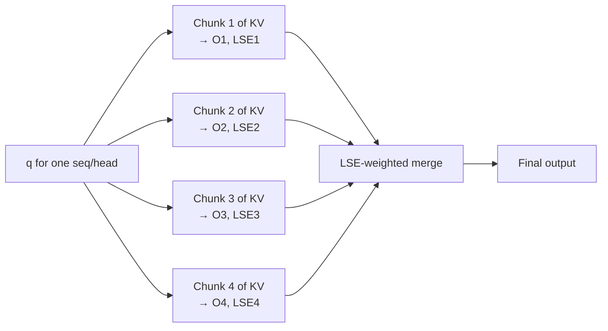
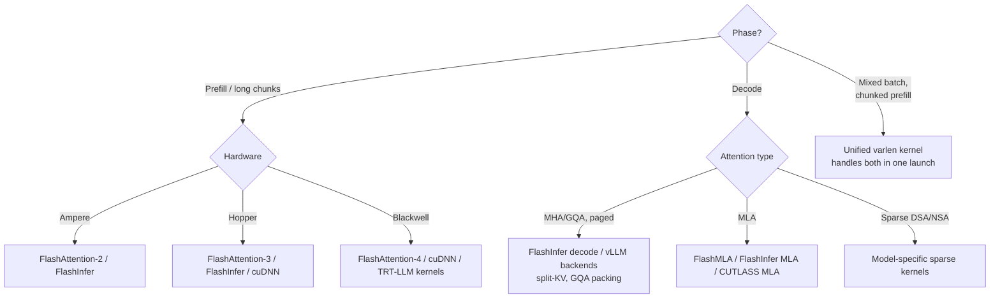

# Attention Kernels

Attention is the one operator in a transformer that is not "just a GEMM". Its cost grows with sequence length, it touches the KV cache (the largest dynamic memory consumer), and its naive implementation is limited by memory bandwidth rather than math. Nearly every serving speedup since 2022 has a kernel story underneath it: FlashAttention for prefill, Flash-Decoding for long-context decode, paged kernels for PagedAttention, FlashInfer for heterogeneous batches, FlashMLA for latent attention, sparse kernels for DeepSeek Sparse Attention.

Prerequisites: [[03 - Accelerator Hardware]] (HBM vs SRAM, tensor cores), [[04 - Roofline and Performance Modeling]], [[05 - KV Cache]].

## The computation

For one head, with `N` queries, `M` keys, head dimension `d`:

```
S = Q Kᵀ / √d          (N × M)    scores
P = softmax(S + mask)  (N × M)    row-wise
O = P V                (N × d)    output
```

FLOPs: `2·N·M·d` for `QKᵀ` plus `2·N·M·d` for `PV` = `4·N·M·d` (halved with causal masking when `N = M`). Softmax adds `O(N·M)` exponentials, which are *not* free: on recent GPUs the exponential unit (MUFU) throughput is far below tensor-core throughput.

Two regimes matter for inference:

| Phase | Query length N | Key length M | Character |
| --- | --- | --- | --- |
| Prefill | prompt length (100s–100Ks) | same | Compute-bound if done right; memory-bound if done naively |
| Decode | 1 per sequence (or k+1 with speculative decoding) | whole context | Memory-bound: read all of K and V to do little math |

## Why naive attention is slow: memory traffic

The naive implementation materializes `S` and `P` in HBM:

1. Read Q, K (`2·N·d` elements), write S (`N·M`).
2. Read S, write P (`2·N·M`).
3. Read P, V, write O.

HBM traffic is `Θ(N·d + N·M)`. With `N = M = 8192`, `d = 128`, BF16, per head: the score matrix alone is `8192² × 2 B = 128 MiB`, written and read twice, versus Q/K/V/O at `4 × 8192 × 128 × 2 B = 8 MiB`. The `N²` term dominates by 30×, and it is pure overhead — S and P are intermediate results nobody needs.

Also, at long contexts S does not even fit: a 128K × 128K score matrix per head is 32 GiB.

## The key trick: online softmax

To avoid materializing S, we need to compute softmax *in tiles* over K, without knowing the row maximum or row sum in advance. Softmax for a row `s_1..s_M`:

```
softmax(s)_j = exp(s_j − m) / ℓ,   m = max_j s_j,   ℓ = Σ_j exp(s_j − m)
```

(Subtracting `m` is for numerical stability; it cancels mathematically.)

Process keys in blocks. Maintain running statistics after seeing blocks `1..b`:

- `m_b` — running max
- `ℓ_b` — running sum of `exp(s_j − m_b)`
- `o_b` — running *unnormalized* output `Σ_j exp(s_j − m_b) · v_j`

When block `b+1` arrives with scores `s^{(b+1)}`:

```
m_new  = max(m_b, max(s^{(b+1)}))
ℓ_new  = exp(m_b − m_new) · ℓ_b  +  Σ_j exp(s_j^{(b+1)} − m_new)
o_new  = exp(m_b − m_new) · o_b  +  Σ_j exp(s_j^{(b+1)} − m_new) · v_j
```

At the end, `O = o_final / ℓ_final`. The correction factor `exp(m_old − m_new)` rescales everything accumulated so far whenever a new max appears. This identity (Milakov & Gimelshein 2018, *Online normalizer calculation for softmax*; also used by Rabe & Staats 2021 for memory-efficient attention) is the mathematical heart of every modern attention kernel.

**Worked check.** Scores `[1, 3]` in block 1, `[2]` in block 2, values `v = [10, 20, 30]`.

- Block 1: `m=3`, `ℓ = e^{-2} + 1 = 1.1353`, `o = 10e^{-2} + 20 = 21.353`.
- Block 2: `m_new = 3` (unchanged), `ℓ = 1.1353 + e^{-1} = 1.5032`, `o = 21.353 + 30e^{-1} = 32.390`.
- `O = 32.390 / 1.5032 = 21.55`.
- Direct: weights `e^1, e^3, e^2 = 2.718, 20.09, 7.389`, sum 30.19; `O = (27.18 + 401.7 + 221.7)/30.19 = 21.55`. ✓

A useful by-product is the **log-sum-exp** `LSE = m + log ℓ`. Partial results over disjoint key sets can be merged exactly given `(O_i, LSE_i)` — the basis of split-KV decoding and of context-parallel attention.

```
merge((O1, L1), (O2, L2)):
    L = log(exp(L1) + exp(L2))            # computed stably as max + log1p(exp(-|L1-L2|))
    O = exp(L1 − L) · O1 + exp(L2 − L) · O2
```

## FlashAttention (v1, 2022)

Dao et al., *FlashAttention: Fast and Memory-Efficient Exact Attention with IO-Awareness*.

- **Tiling:** load blocks of Q, K, V from HBM into on-chip SRAM (shared memory/registers), compute the block's scores, apply online softmax, accumulate into the output, and never write S or P to HBM.
- **Recomputation in backward:** store only `O` and the LSE statistics; recompute S/P during backward. (Irrelevant for inference, crucial for training memory.)
- **IO complexity:** `Θ(N²·d²/M_sram)` HBM accesses versus `Θ(N·d + N²)` for standard attention — fewer by a factor of `M_sram/d²`-ish, which is large for realistic SRAM sizes.
- **Memory:** `O(N)` extra instead of `O(N²)`. This is what made long-context training and serving practical.
- **Exact:** not an approximation. Same output up to floating-point reassociation.

```python
# FlashAttention forward, one head, conceptual
for q_tile in tiles(Q, Br):                   # rows of Q
    m = full(Br, -inf); l = zeros(Br); acc = zeros(Br, d)
    for k_tile, v_tile in tiles(K, V, Bc):     # columns of S
        s = q_tile @ k_tile.T * scale          # in SRAM / registers
        s = apply_mask(s)
        m_new = maximum(m, s.max(axis=1))
        p = exp(s - m_new[:, None])
        corr = exp(m - m_new)
        l = corr * l + p.sum(axis=1)
        acc = corr[:, None] * acc + p @ v_tile
        m = m_new
    write(O_tile, acc / l[:, None]); write(LSE_tile, m + log(l))
```

## FlashAttention-2 (2023)

Dao, *FlashAttention-2: Faster Attention with Better Parallelism and Work Partitioning*. Same math, better mapping to the GPU:

1. **Fewer non-matmul FLOPs.** Defer the `1/ℓ` normalization to the end; keep only the LSE for backward. Non-matmul ops run ~16× slower than tensor-core matmuls on A100, so this matters.
2. **Parallelize over sequence length**, not just batch × heads. With long contexts and small batch, batch × heads may not fill 108 SMs; splitting the Q dimension across thread blocks does.
3. **Better warp partitioning.** In v1, warps split K/V and had to communicate through shared memory to combine results ("split-K"). v2 splits Q across warps instead, so each warp owns its rows and no inter-warp reduction is needed.

Result: about 2× over v1, reaching 50–73% of A100 peak FLOPs in forward. FA2 became the default prefill kernel in nearly every engine.

## FlashAttention-3 (2024, Hopper)

Shah, Bikshandi, Zhang, Thakkar, Ramani, Dao, *FlashAttention-3: Fast and Accurate Attention with Asynchrony and Low-precision*. FA2 reached only ~35% utilization on H100 because Hopper's new features went unused.

- **Warp specialization with TMA.** Producer warps issue asynchronous bulk copies with the Tensor Memory Accelerator (TMA) from HBM into shared memory; consumer warpgroups run WGMMA (asynchronous warpgroup matrix multiply). Synchronization via shared-memory barriers (mbarriers). Data movement and math overlap fully.
- **Ping-pong scheduling.** Two consumer warpgroups alternate: while one does softmax (exp on MUFU), the other does GEMMs on tensor cores. Hides the slow exponentials behind matmuls.
- **Intra-warpgroup pipelining.** Within one warpgroup, overlap the softmax of block `j` with the `QKᵀ` GEMM of block `j+1`.
- **FP8 support** with block quantization and **incoherent processing** (multiply Q and K by a random orthogonal Hadamard transform to spread outliers before quantizing) to reduce FP8 error.

Reported: 1.5–2.0× over FA2 on H100, up to ~740 TFLOPS in BF16 (~75% utilization), and close to 1.2 PFLOPS in FP8.

## FlashAttention-4 (Blackwell)

*FlashAttention-4: Algorithm and Kernel Pipelining Co-Design for Asymmetric Hardware Scaling* (arXiv 2603.05451). Blackwell (B200/GB200) doubles tensor-core throughput but shared-memory bandwidth and exponential units scale much less — so the non-matmul parts become the bottleneck. FA4 responds with:

- redesigned pipelines exploiting fully asynchronous MMA and larger tiles,
- **software-emulated exponentials** (polynomial approximation on FMA units, offloading MUFU) and **conditional softmax rescaling** (skip the `exp(m_old − m_new)` rescale when the max barely changed),
- tensor memory (TMEM) and the **2-CTA MMA** mode to cut shared-memory traffic in backward.

Reported up to 1613 TFLOPS BF16 on B200 (71% utilization), 1.3× over cuDNN 9.13. Notably written entirely in **CuTe-DSL** (Python), with 20–30× faster compile times than C++ templates — a sign of where kernel authoring is heading (see [[13 - Kernels, Compilers, and CUDA Graphs]]).

The lesson across FA1→FA4: the algorithm barely changed; the work was re-mapping it to each hardware generation's bottleneck (HBM → parallelism → async/overlap → exp and smem).

## Decode attention: a different problem

At decode, each sequence has **one** query token per head. Per head, the kernel reads the whole K and V for that sequence and does `4·M·d` FLOPs on `2·M·d·2` bytes (BF16) — **1 FLOP per byte**. H100's ridge point is ~295 FLOP/byte (989 TFLOPS / 3.35 TB/s). Decode attention is therefore 100%+ memory-bound; the goal is simply to **stream KV at full HBM bandwidth**.

Two obstacles:

1. **Not enough parallelism.** FlashAttention parallelizes over batch × heads × query tiles. At decode, the query tile is a single row. With batch 1 and 8 KV heads, you launch 8 thread blocks on a 132-SM GPU — 6% occupancy, a fraction of HBM bandwidth.
2. **Tensor cores need M ≥ 16 or 64.** A 1-row query wastes most of an MMA tile.

### Flash-Decoding / split-KV

Flash-Decoding (Dao, Haziza, Massa, Sizov; Stanford CRFM blog, Oct 2023) adds a parallel dimension over the **key length**:

1. Split each sequence's KV into `S` chunks.
2. Each chunk is processed by an independent thread block, producing a partial `(O_i, LSE_i)`.
3. A small reduction kernel merges partials with the LSE merge formula above.



The blog reported up to 8× faster decode attention at very long sequences (64K), and attention time nearly flat with sequence length for small batches. The number of splits is a heuristic: enough to fill the SMs (`batch × kv_heads × splits ≥ ~#SMs × occupancy`), not so many that the reduction dominates. FlashDecoding++ (arXiv 2311.01282) later proposed avoiding the synchronized merge by using a unified max value.

### GQA packing

With GQA, the `g = n_q_heads / n_kv_heads` query heads in a group share the same K/V. A good decode kernel loads each KV tile **once** and computes all `g` query heads against it, stacking them into the M dimension of the MMA. This raises arithmetic intensity to ~`g` FLOP/byte and finally lets tensor cores help. With speculative decoding verifying `k` draft tokens, the effective M becomes `g × (k+1)` — another reason spec decode is "almost free" for memory-bound attention ([[09 - Speculative Decoding]]).

### MLA decode and FlashMLA

With MLA's absorbed form ([[05 - KV Cache]]), all 128 query heads attend against one shared latent "head" of 576-dim keys and 512-dim values. Per token of KV:

```
FLOPs  ≈ 128 heads × 2 × (576 + 512)  ≈ 278,500
Bytes  = 576 × 2 (BF16)                = 1,152
Intensity ≈ 242 FLOP/byte   (≈ 2× that with FP8 KV)
```

That is near or above H100's ridge — MLA decode attention is **compute-bound**, the opposite of MHA decode. FlashMLA (DeepSeek, open-sourced February 2025) was built for exactly this case: paged KV with 64-token blocks, tuned for H800, reporting up to 660 TFLOPS in compute-bound configurations (April 2025 update). The repository has since moved to Blackwell (SM100) and Huawei Ascend 950 and to token-level **sparse** kernels with FP8/FP4 KV (current README: decoding up to 1024 TFLOPS on B200; a fused Q-norm/RoPE/attention/O-RoPE/FP8-cast kernel up to 950 TFLOPS in decode). As of its 2026-09-30 release, Hopper support was dropped from mainline and kept in an older commit.

## Paged attention kernels

PagedAttention ([[05 - KV Cache]]) means K/V for a sequence live in scattered physical blocks. The kernel receives:

- `block_table[batch, max_blocks]` — physical block id for each logical block,
- `seq_lens[batch]`,
- the KV pool tensor `[num_blocks, block_size, n_kv_heads, head_dim]` (layouts vary).

Inner loop: for logical block `j`, look up `phys = block_table[seq, j]` and load that block. Costs vs contiguous: an extra indirect load (cheap, cached), and smaller contiguous transfers (a 16-token × 128-dim BF16 block is 4 KiB per K head — still large enough for efficient coalesced loads, but too small for some TMA tile shapes, which is why Hopper/Blackwell kernels prefer bigger pages, e.g. 64).

Engines expose the KV layout choice (`NHD` vs `HND`) because it determines which dimension is contiguous and hence coalescing.

## FlashInfer

Ye et al., *FlashInfer: Efficient and Customizable Attention Engine for LLM Inference Serving* (arXiv 2501.01005; MLSys 2025). FlashInfer is the attention library underneath SGLang and one of vLLM's backends.

Key ideas:

- **Block-sparse row (BSR) as the unifying KV format.** Paged KV, radix-tree prefix sharing, ragged batches, and sparse masks are all expressed as block-sparse matrices with configurable block sizes (including column size 1 for token-level sparsity).
- **Customizable via JIT templates.** Attention variants (logits soft-capping, sliding window, custom masks, ALiBi, RoPE fusion) are compiled into specialized kernels.
- **Load-balanced scheduling with plan/run separation.** A CPU-side `plan()` computes a work partition for the current batch (balancing very different sequence lengths across SMs, deciding split-KV); `run()` executes it. Since `plan` is outside the kernel, `run` is **CUDA-graph compatible** even though batch composition changes.
- **Cascade / shared-prefix attention.** When many requests share a long prefix, compute attention against the shared prefix once with all queries batched (high intensity, tensor cores), then attention against each request's unique suffix, and merge with LSE.

## Masking structures and sparse attention

Not all attention is dense causal:

- **Sliding window attention (SWA):** each query attends only to the last `W` tokens (Mistral, Gemma interleaved layers, DeepSeek-V4 decoder SWA). The kernel simply skips KV tiles entirely outside the window — FLOPs and bytes become `O(N·W)`. KV for SWA layers can be a ring buffer of `W` tokens.
- **Attention sinks + window** (StreamingLLM, arXiv 2309.17453): keep the first few tokens plus a recent window — see [[16 - Long Context Inference]].
- **Block-sparse attention:** a block mask says which (Q tile, K tile) pairs to compute. Kernels iterate only non-empty tiles. PyTorch **FlexAttention** lets you write `score_mod` and `mask_mod` in Python and compiles fused kernels with block-sparsity skipping automatically.
- **Native Sparse Attention (NSA)** (DeepSeek, arXiv 2502.11089): hardware-aligned, trainable sparsity combining compressed coarse tokens, selected fine-grained blocks, and a sliding window.
- **DeepSeek Sparse Attention (DSA)** (DeepSeek-V3.2 and later): a lightweight "lightning indexer" scores past tokens; each query then attends only to a fixed top-k set of tokens. The kernel receives an `indices` tensor and gathers just those tokens — **token-level** sparsity. Attention cost per query becomes `O(k)` instead of `O(context)`, at the price of an `O(context)` but much cheaper indexer pass. FlashMLA's sparse kernels implement this.

Design consequence: sparsity only pays off if it is **block- or gather-friendly**. Arbitrary scattered sparsity wastes the memory system; that is why NSA/DSA were designed together with their kernels.

## Hardware concepts that keep showing up

| Concept | What it is | Why attention cares |
| --- | --- | --- |
| Tensor cores | Matrix-multiply units (MMA); Ampere `mma.sync`, Hopper WGMMA (warpgroup, async), Blackwell `tcgen05` with TMEM | QKᵀ and PV run here; everything else is overhead |
| Shared memory / SRAM | ~228 KB per SM on H100 | Holds Q/K/V tiles; size bounds tile sizes |
| TMA | Hopper+ engine for async bulk tensor copies with address generation in hardware | Frees threads from load address math; enables producer/consumer pipelines |
| Warp specialization | Different warps run different roles (load vs compute) | Overlaps memory and math |
| mbarriers | Shared-memory barriers with transaction counts | Synchronize async copies and consumers |
| MUFU / SFU | Special function units (exp, log) | Softmax exp throughput is the FA3/FA4 bottleneck |
| TMEM (Blackwell) | Per-SM tensor memory for MMA accumulators | Frees registers, enables bigger tiles |
| Clusters / 2-CTA MMA | Thread-block clusters sharing distributed shared memory | Larger effective tiles, less smem traffic |

See [[03 - Accelerator Hardware]] and [[13 - Kernels, Compilers, and CUDA Graphs]].

## Choosing a kernel in practice



## What practitioners actually do

1. **Let the engine pick the backend**, then verify: vLLM (`VLLM_ATTENTION_BACKEND`), SGLang (`--attention-backend`) expose choices. Benchmark your actual shapes (head dim, GQA ratio, page size, context distribution).
2. **Profile attention share** with Nsight Systems / the PyTorch profiler: for long-context decode, attention can exceed 50% of step time; for short chat, GEMMs dominate.
3. **Use FP8 KV** where the kernel supports it: halves decode attention time.
4. **Pick page size** compatible with the fastest kernel (64 for FlashMLA; 16–32 typical elsewhere).
5. **Check for kernel cliffs**: unusual head dims (e.g. 80, 96, 256), soft-capping, or custom masks can push you to slower fallback kernels.
6. **Don't hand-write attention** unless you have an unusual variant; when you must, start from FlexAttention, Triton, or CuTe-DSL templates.

## Common mistakes

- Assuming attention FLOPs dominate prefill for normal lengths. For a 70B model at 4K tokens, linear layers dominate; attention overtakes only at long contexts (roughly when `seq_len` approaches a few × `d_model`, depending on architecture).
- Measuring decode attention in TFLOPS. It is memory-bound — measure achieved **GB/s** against HBM peak.
- Using batch-1 microbenchmarks without split-KV and concluding long-context decode is slow.
- Forgetting that numerically "exact" FlashAttention still differs bitwise from naive attention (reassociation), and that split counts changing with batch size break **batch invariance** ([[15 - Sampling, Determinism, and Structured Output]]).
- Expecting unstructured token dropping to speed things up without a kernel that exploits it.

## Check yourself

1. **What intermediate does FlashAttention never write to HBM, and why does that matter?**
   The `N×M` score/probability matrices S and P. They dominate naive HBM traffic and memory (`O(N²)`), so avoiding them cuts IO and enables long sequences.

2. **In online softmax, what happens to the running accumulator when a new block has a larger max?**
   It is multiplied by `exp(m_old − m_new)` to rescale it to the new reference max, as is the running sum.

3. **Why does decode attention need split-KV but prefill does not?**
   Prefill has many query rows to parallelize across SMs; decode has one query row per sequence/head, so with small batches there are too few thread blocks. Splitting along the key length creates parallelism; partial results merge via LSE.

4. **Compute the decode arithmetic intensity of GQA with 8 query heads per KV head in BF16.**
   Roughly 8 FLOP/byte (8× MHA's ~1), still far below H100's ~295 ridge — memory-bound.

5. **What problem in FA3 does ping-pong scheduling solve?**
   Softmax exponentials run on slow special-function units; alternating two warpgroups lets one warpgroup's GEMMs on tensor cores overlap the other's softmax.

6. **Why does FlashInfer separate `plan` and `run`?**
   Planning (load balancing variable-length requests) needs CPU logic and changes per batch; keeping it outside the kernel makes the kernel launch shape-stable and CUDA-graph-capturable.

7. **Why is MLA decode compute-bound while MHA decode is memory-bound?**
   All 128 query heads reuse the same latent KV per token, so each byte loaded feeds ~240 FLOPs versus ~1 for MHA.

## Further reading

- Milakov & Gimelshein, *Online normalizer calculation for softmax* (2018) — https://arxiv.org/abs/1805.02867
- Rabe & Staats, *Self-attention Does Not Need O(n²) Memory* (2021) — https://arxiv.org/abs/2112.05682
- Dao et al., *FlashAttention* (2022) — https://arxiv.org/abs/2205.14135
- Dao, *FlashAttention-2* (2023) — https://arxiv.org/abs/2307.08691
- Shah et al., *FlashAttention-3* (2024) — https://arxiv.org/abs/2407.08608
- *FlashAttention-4: Algorithm and Kernel Pipelining Co-Design for Asymmetric Hardware Scaling* — https://arxiv.org/abs/2603.05451
- FlashAttention repo — https://github.com/Dao-AILab/flash-attention
- Dao, Haziza, Massa, Sizov, *Flash-Decoding for long-context inference* (Stanford CRFM blog, 2023) — https://crfm.stanford.edu/2023/10/12/flashdecoding.html
- Hong et al., *FlashDecoding++* — https://arxiv.org/abs/2311.01282
- Ye et al., *FlashInfer* — https://arxiv.org/abs/2501.01005 and https://github.com/flashinfer-ai/flashinfer
- FlashMLA — https://github.com/deepseek-ai/FlashMLA
- Yuan et al., *Native Sparse Attention* — https://arxiv.org/abs/2502.11089
- PyTorch, *FlexAttention* blog — https://pytorch.org/blog/flexattention/
- Xiao et al., *Efficient Streaming Language Models with Attention Sinks* — https://arxiv.org/abs/2309.17453

## Related

- [[02 - Transformer Inference Anatomy]]
- [[03 - Accelerator Hardware]]
- [[04 - Roofline and Performance Modeling]]
- [[05 - KV Cache]]
- [[09 - Speculative Decoding]]
- [[13 - Kernels, Compilers, and CUDA Graphs]]
- [[15 - Sampling, Determinism, and Structured Output]]
- [[16 - Long Context Inference]]
- [[21 - Case Study - DeepInfer]]
