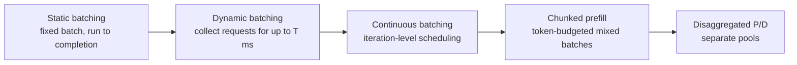
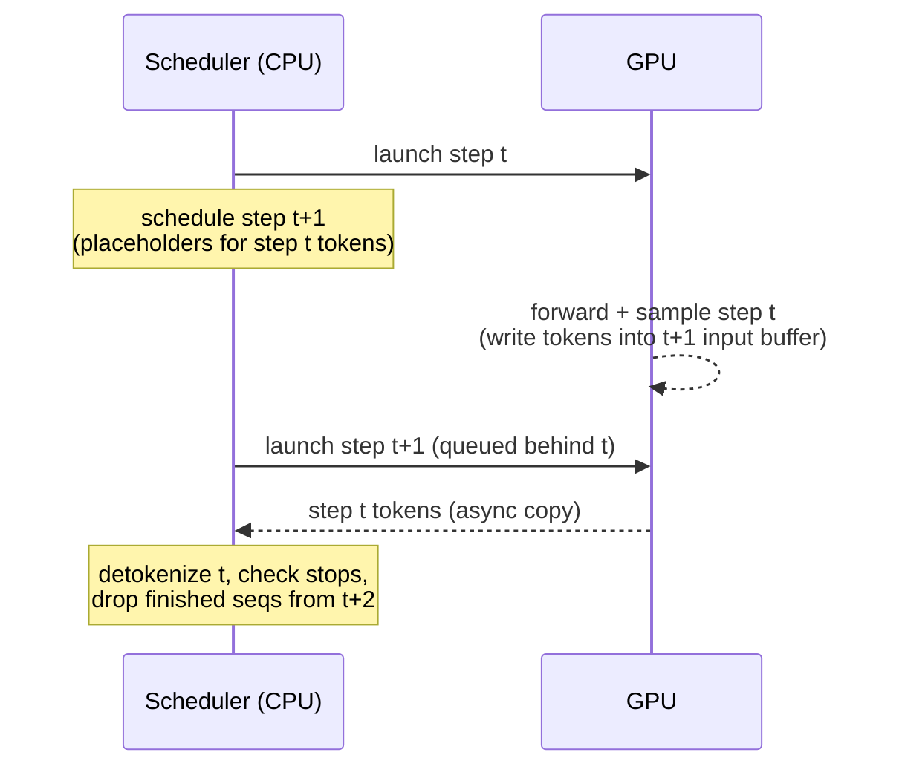

# Batching and Scheduling

A GPU serving one LLM request at a time is mostly idle. Decode reads every weight from HBM to produce *one token per sequence*; the tensor cores sit at a few percent utilization. Batching amortizes that weight read across many sequences — and the **scheduler**, the loop that decides which requests run in each forward pass, is the component that turns batching into throughput without destroying latency.

If [[05 - KV Cache]] is the memory manager of an inference engine, the scheduler is its operating-system kernel.

Prerequisites: [[02 - Transformer Inference Anatomy]], [[04 - Roofline and Performance Modeling]], [[05 - KV Cache]].

## Why batching works: the decode cost model

Take a dense model with `W` bytes of weights and a decode batch of `B` sequences with average context `L`. One decode step must read all weights once plus each sequence's KV:

```
t_step(B) ≈ max( (W + B · L · kv_per_token) / HBM_BW ,   2 · P · B / FLOPS_eff )  + t_overhead
            └─────────── memory term ───────────┘       └─ compute term ─┘
```

where `P` is the parameter count (FLOPs ≈ `2P` per token).

### Worked example: Llama-3-8B on one H100

`W = 16 GB` (BF16), HBM ≈ 3.35 TB/s, `kv_per_token = 128 KiB`, `L = 2048`.

| Batch B | Weight read | KV read | Step time | Tokens/s total | Tokens/s per user |
| --- | --- | --- | --- | --- | --- |
| 1 | 4.8 ms | 0.08 ms | ~4.9 ms | ~205 | ~205 |
| 16 | 4.8 ms | 1.3 ms | ~6.1 ms | ~2,600 | ~164 |
| 64 | 4.8 ms | 5.1 ms | ~9.9 ms | ~6,500 | ~101 |
| 256 | 4.8 ms | 20.5 ms | ~25 ms | ~10,200 | ~40 |

(Compute term at B=256: `2 × 8e9 × 256 = 4.1e12` FLOPs ≈ 4 ms at ~1 PFLOP/s — still not the bottleneck; KV reads are.)

Lessons:

1. Going from B=1 to B=64 gives **~32× throughput** at only ~2× per-user latency. Batching is the biggest single lever in inference.
2. Eventually **KV reads, not weights, dominate** — that's when GQA/MLA, FP8 KV, and shorter contexts pay off.
3. There is an explicit **throughput/latency trade-off** curve. The scheduler's job is to sit at the right point on it for your SLO.

## Generations of batching



### 1. Static batching

Collect B requests, pad to the same length, run prefill + decode until **all** finish. Problems:

- A batch is as slow as its longest output. A 10-token answer waits for a 2,000-token answer.
- Slots of finished sequences are wasted (padding compute).
- New arrivals wait for the whole batch to drain → terrible queueing latency.

Fine for offline jobs with similar lengths; bad for online serving.

### 2. Dynamic batching

Classic model-serving (e.g. Triton's dynamic batcher): wait up to `max_queue_delay` ms or until `max_batch_size` requests arrive, then launch. Great for fixed-cost models (classifiers, embedders, rerankers — still the right tool there). For generative models it inherits static batching's run-to-completion problem.

### 3. Continuous batching (iteration-level scheduling)

Orca (Yu et al., OSDI 2022) changed the unit of scheduling from the **request** to the **iteration** (one forward pass):

- After every decode step, finished sequences leave the batch immediately and waiting requests join.
- New requests' prefill can run in the same iteration as others' decode.
- **Selective batching:** linear layers (QKV projections, MLP) operate on the flattened token dimension of all sequences regardless of their lengths; only attention is computed per sequence (since each has its own KV). This removes padding.

Together with PagedAttention (no per-request contiguous reservation), continuous batching is the foundation of vLLM, SGLang, TensorRT-LLM ("in-flight batching"), TGI, and every serious engine. The vLLM paper reported 2–4× throughput over Orca/FasterTransformer at equal latency, largely by fitting more sequences into memory.

## The prefill/decode interference problem

Prefill and decode have opposite characters:

| | Prefill | Decode |
| --- | --- | --- |
| Tokens per request per step | hundreds–thousands | 1 (or k+1 with spec decode) |
| Bottleneck | compute | memory bandwidth |
| Latency metric | TTFT | TPOT / ITL |

With naive continuous batching, when a long prompt arrives, its prefill runs in an iteration together with ongoing decodes. A 16K-token prefill of a 70B model can take a second or more — and every decoding user sees a **generation stall** of that length. P99 inter-token latency explodes.

Two families of fixes: **chunked prefill** (schedule smarter on the same GPUs) and **disaggregation** (separate GPUs, see [[12 - Disaggregated Serving]]).

## Chunked prefill (Sarathi / Sarathi-Serve)

Sarathi (arXiv 2308.16369) and Sarathi-Serve (arXiv 2403.02310, OSDI 2024) split prefills into chunks and **piggyback decodes** onto them:

- Fix a **token budget** per iteration, e.g. 512 or 2048 tokens.
- First, add all running decodes (1 token each).
- Fill the remaining budget with a **chunk** of a pending prefill. A 16K prompt becomes, say, 8 iterations of 2K-token chunks.
- Every iteration therefore has bounded duration ("stall-free batching"), and decodes keep flowing.

Why it's nearly free: decode tokens are memory-bound and add little compute; prefill chunks are compute-bound and make the weight read "worth it". Mixing them fills both compute and bandwidth. The cost: a chunked prompt's later chunks re-read earlier chunks' KV (attention over the prefix), and TTFT for that prompt grows slightly because it is spread over more iterations.

### Choosing the token budget

```
iteration_time(budget) ≈ weight_read + compute(budget tokens) + attention(KV of all participants)
```

- Small budget (256–512): best ITL, worse TTFT and throughput (less compute per weight read).
- Large budget (4K–8K): better throughput and TTFT, worse ITL tails.
- Pick the budget so that `iteration_time ≤ ITL SLO` at the expected decode batch size. Profile: measure iteration time vs. budget for your model/hardware and choose the knee.

In vLLM: `--max-num-batched-tokens` (token budget) and `--max-num-seqs` (max concurrent sequences); chunked prefill is on by default in V1. SGLang: `--chunked-prefill-size`.

## Preemption: recompute vs swap

When KV blocks run out mid-generation (sequences grew more than expected), the scheduler must evict someone:

| | Recompute | Swap |
| --- | --- | --- |
| Action | Drop the victim's KV; later re-run prefill over prompt + generated tokens | Copy the victim's blocks to CPU memory; copy back later |
| Cost | Compute (prefill is efficient, batched) | PCIe bandwidth both ways, CPU memory |
| Good for | Short/medium sequences | Very long sequences where recompute is expensive |
| Complexity | Low | Higher (async copies, CPU pool) |

Victim choice is usually **the most recently admitted** request (LIFO), which protects requests that have made the most progress, approximating FCFS fairness. Frequent preemption is a symptom: admission is too eager (see KV-aware admission in [[05 - KV Cache]]). vLLM V1 uses recomputation; with prefix caching, recompute may hit the victim's own cached blocks and become cheap.

## Scheduler pseudo-code

A simplified iteration-level scheduler with chunked prefill, prefix caching, and preemption:

```python
def schedule_step(running, waiting, kv, token_budget, max_seqs):
    batch, budget = [], token_budget

    # 1. Running requests first (decode, or remaining prefill chunks).
    for req in sorted(running, key=lambda r: r.arrival):
        need = 1 if req.in_decode else min(req.remaining_prompt, budget)
        while not kv.can_append(req, need):
            victim = running.pop_latest_admitted()       # LIFO victim
            if victim is req:
                break
            kv.free(victim)                               # recompute-style preemption
            waiting.push_front(victim)
        else:
            kv.append_slots(req, need)
            batch.append((req, need))
            budget -= need
        if budget == 0:
            break

    # 2. Admit waiting requests while budget, seq slots, and memory allow.
    while waiting and budget > 0 and len(batch) < max_seqs:
        req = waiting.peek()                     # FCFS, or policy-ordered
        cached = kv.match_prefix(req.prompt)     # prefix cache hit (tokens)
        chunk = min(req.prompt_len - cached, budget)
        if not kv.can_admit(req, chunk, watermark=0.01):
            break                                # head-of-line: wait for memory
        waiting.pop()
        kv.allocate(req, cached, chunk)
        running.add(req)
        batch.append((req, chunk))
        budget -= chunk

    return batch    # one forward pass over all (req, num_tokens) pairs
```

Real schedulers add: per-request priorities, LoRA adapter limits, multimodal encoder budgets, speculative-decoding lookahead slots, structured-output grammar state, and pipeline-parallel micro-batches.

## Scheduling policies beyond FCFS

FCFS is simple and fair in arrival order but suffers **head-of-line blocking** — one huge request delays everyone behind it. Alternatives:

### Shortest-job-first and its approximations

Output length is unknown in advance, so pure SJF is impossible. Approaches:

- **Predict output length** (small classifier or the LLM's own early hidden states) and prioritize short jobs. Improves mean latency; risks starving long jobs — add aging.
- **FastServe** (arXiv 2305.05920): preemptive skip-join **multi-level feedback queue**. Requests start in a queue chosen by their prompt length ("skip-join") and are demoted as they generate more tokens, approximating shortest-remaining-time without knowing lengths. Relies on swapping KV for preempted jobs.

### Fairness across tenants: VTC

*Fairness in Serving Large Language Models* (Sheng et al., arXiv 2401.00588, OSDI 2024):

- Rate limits per client are a crude fairness tool: they leave capacity idle when the system is not saturated.
- Define service in **weighted tokens** (input and output tokens with different weights, reflecting their costs).
- **Virtual Token Counter (VTC):** keep a counter per client of service received; at each scheduling step admit from the backlogged client with the smallest counter; when a client goes idle and returns, lift its counter to the minimum of active clients so it cannot bank credit.
- Work-conserving, with a proven 2× tight bound on the service difference between two backlogged clients.

This is weighted fair queuing adapted to continuous batching.

### SLO-aware and QoE scheduling

Serving is ultimately judged by **goodput**: requests per second that meet both TTFT and TPOT SLOs (term popularized by DistServe, arXiv 2401.09670). Throughput that violates SLOs is worthless.

- **Andes** (arXiv 2404.16283): defines Quality-of-Experience for streaming text — a user reading at a certain speed does not benefit from tokens faster than they read. The scheduler can deprioritize requests that are "ahead" of their reader and serve those falling behind.
- **Deadline-aware admission:** estimate if a request can meet its TTFT given the queue and current iteration times; if not, reject early (429) or route elsewhere instead of serving it late.
- **Multi-SLO serving:** interactive chat (tight TPOT), agents (TTFT matters, TPOT less), batch/offline (only throughput). Systems like SLOs-Serve (arXiv 2504.08784) allocate token budgets across SLO classes. In practice, many teams run separate pools or priority levels.
- **Priority scheduling in engines:** vLLM `--scheduling-policy priority` with a per-request `priority`; lower-priority work is preempted first.

### Cross-instance scheduling

Single-engine scheduling interacts with the fleet: **Llumnix** (arXiv 2406.03243) live-migrates requests (with their KV) between instances to rebalance load, reduce fragmentation, and isolate priorities. Routing and autoscaling are in [[17 - Serving Systems, Routing, and Autoscaling]].

## CPU overhead and asynchronous scheduling

At small per-step times (a few ms for a small model or a large-batch MoE decode step with CUDA graphs), the **CPU work between steps** — scheduling, building input tensors, block-table updates, sampling post-processing, detokenization, stop-string checks — can take 1–5 ms of Python. If done serially, the GPU idles during it. Measured in profiles as gaps between kernel launches.

Fixes:

1. **Overlap scheduling with execution.** Schedule step `t+1` on the CPU while the GPU runs step `t`. The difficulty: step `t+1`'s inputs depend on step `t`'s sampled tokens. Solution: schedule with **placeholders**, i.e. assume each running sequence produces exactly one token, let the GPU write sampled tokens directly into the next step's input buffer, and reconcile finished/stopped sequences one step late (a finished sequence wastes at most one extra token of compute). SGLang's overlap ("zero-overhead batch scheduler", SGLang v0.4 blog), vLLM's `--async-scheduling`, and DeepInfer's asynchronous scheduling all follow this pattern.
2. **Move work out of the hot process.** Tokenization/detokenization and API handling in separate processes (vLLM V1's engine-core/front-end split communicating over ZMQ).
3. **CUDA graphs** to collapse hundreds of kernel launches per step into one replay ([[13 - Kernels, Compilers, and CUDA Graphs]]). Graphs are captured for a set of batch sizes; the scheduler pads to the nearest captured size.
4. **Persistent batch state** on the GPU: update input tensors incrementally (only the diff of which sequences joined/left) rather than rebuilding them each step.



## Queueing theory you need

- **Little's law:** `concurrency = arrival_rate × latency`. 20 req/s with a 10 s mean end-to-end latency means ~200 requests in the system. If your KV capacity supports 150 concurrent sequences at that length, the queue grows without bound.
- **Utilization and tail latency:** as utilization approaches 100%, queueing delay blows up (for M/M/1, mean wait ∝ `ρ/(1−ρ)`). At ρ=0.9, mean wait is ~9× service time. Run online LLM fleets at a utilization that leaves headroom for bursts — see [[19 - Cost and Capacity Planning]].
- **Batching changes service rate with load**: a busier engine processes more tokens/s (bigger batches), which partially self-stabilizes — until KV memory or the token budget saturates, after which latency rises steeply. Benchmark throughput–latency curves at many request rates ([[18 - Benchmarking and Profiling]]).

## What practitioners actually do

1. Use an engine with continuous batching + chunked prefill + prefix caching (all defaults in modern vLLM/SGLang).
2. **Tune two knobs first:** token budget (`max_num_batched_tokens`) for the ITL vs TTFT trade-off, and `max_num_seqs` for memory pressure vs throughput.
3. Sweep request rate with realistic prompt/output length distributions and plot TTFT p50/p99, ITL p50/p99, and throughput. Choose the operating point at your SLO, not at max throughput.
4. Watch **preemptions**, **queue time**, **running vs waiting counts**, and **KV usage %** as first-class metrics.
5. Enable async scheduling / overlap when profiles show CPU gaps between steps.
6. Separate traffic classes (interactive vs batch) with priorities or separate pools; use fair scheduling per tenant if multi-tenant.
7. Consider disaggregated prefill/decode once prefill interference dominates p99 ITL even with chunking ([[12 - Disaggregated Serving]]).

## Common mistakes

- Benchmarking at a single concurrency level and reporting "tokens/s" without latency percentiles.
- Setting `max_num_seqs` very high "for throughput" and getting preemption storms.
- Huge token budgets that make every iteration 200+ ms, ruining streaming smoothness.
- Using FCFS for mixed workloads with very long prompts — head-of-line blocking.
- Ignoring CPU overhead: a "GPU-bound" engine whose profile shows 30% idle gaps.
- Treating output length as known when sizing batches; tail lengths cause late-stage memory blowups.
- Measuring TPOT including the first token (it should exclude TTFT).

## Check yourself

1. **Why does continuous batching beat static batching for chat?**
   Requests leave and join at each iteration, so short answers aren't held hostage by long ones, slots are reused immediately, and new arrivals don't wait for a whole batch to drain.

2. **What is "selective batching" in Orca?**
   Batch the token-wise operations (linear layers) across all sequences' tokens flattened together, but compute attention separately per sequence, since each has a different KV length.

3. **Why are decode tokens "free riders" on prefill chunks?**
   Decode is memory-bound and adds little compute; the prefill chunk is compute-bound. Both share one weight read, so mixing them uses the GPU's compute and bandwidth together.

4. **A token budget of 8192 makes your p99 ITL 400 ms. What do you change and what gets worse?**
   Lower the budget (e.g. 1024–2048). ITL improves; TTFT for long prompts grows and peak throughput may drop slightly.

5. **When would you prefer swap over recompute for preemption?**
   For very long sequences where re-running prefill costs more than the PCIe round trip of their KV, and when CPU memory is available.

6. **How does VTC prevent a returning idle client from monopolizing the GPU?**
   When a client becomes active again, its counter is lifted to the minimum counter among active clients, so it can't spend banked credit.

7. **How does overlap scheduling handle not knowing step t's tokens while scheduling step t+1?**
   It assumes each running sequence emits one token, has the GPU write sampled tokens directly into the next step's input, and processes stops/finishes one step late.

8. **Your service has 30 req/s arrivals and mean latency 8 s. How many concurrent sequences must the KV cache hold?**
   By Little's law, ~240.

## Further reading

- Yu et al., *Orca: A Distributed Serving System for Transformer-Based Generative Models* (OSDI 2022) — https://www.usenix.org/conference/osdi22/presentation/yu
- Kwon et al., *PagedAttention / vLLM* — https://arxiv.org/abs/2309.06180
- Agrawal et al., *SARATHI: Efficient LLM Inference by Piggybacking Decodes with Chunked Prefills* — https://arxiv.org/abs/2308.16369
- Agrawal et al., *Taming Throughput-Latency Tradeoff in LLM Inference with Sarathi-Serve* (OSDI 2024) — https://arxiv.org/abs/2403.02310
- Sheng et al., *Fairness in Serving Large Language Models* (VTC) — https://arxiv.org/abs/2401.00588
- Wu et al., *Fast Distributed Inference Serving for Large Language Models* (FastServe) — https://arxiv.org/abs/2305.05920
- Liu et al., *Andes: Defining and Enhancing Quality-of-Experience in LLM-Based Text Streaming Services* — https://arxiv.org/abs/2404.16283
- Zhong et al., *DistServe* (goodput) — https://arxiv.org/abs/2401.09670
- Sun et al., *Llumnix: Dynamic Scheduling for Large Language Model Serving* — https://arxiv.org/abs/2406.03243
- *SLOs-Serve: Optimized Serving of Multi-SLO LLMs* — https://arxiv.org/abs/2504.08784
- SGLang v0.4 blog (zero-overhead batch scheduler) — https://lmsys.org/blog/2024-12-04-sglang-v0-4/
- vLLM V1 alpha release blog — https://blog.vllm.ai/2025/01/27/v1-alpha-release.html
- *Inside vLLM: Anatomy of a High-Throughput LLM Inference System* — https://blog.vllm.ai/2025/09/05/anatomy-of-vllm.html
- vLLM optimization and tuning docs — https://docs.vllm.ai/en/latest/configuration/optimization.html

## Related

- [[02 - Transformer Inference Anatomy]]
- [[04 - Roofline and Performance Modeling]]
- [[05 - KV Cache]]
- [[09 - Speculative Decoding]]
- [[12 - Disaggregated Serving]]
- [[13 - Kernels, Compilers, and CUDA Graphs]]
- [[17 - Serving Systems, Routing, and Autoscaling]]
- [[18 - Benchmarking and Profiling]]
- [[19 - Cost and Capacity Planning]]
- [[21 - Case Study - DeepInfer]]
