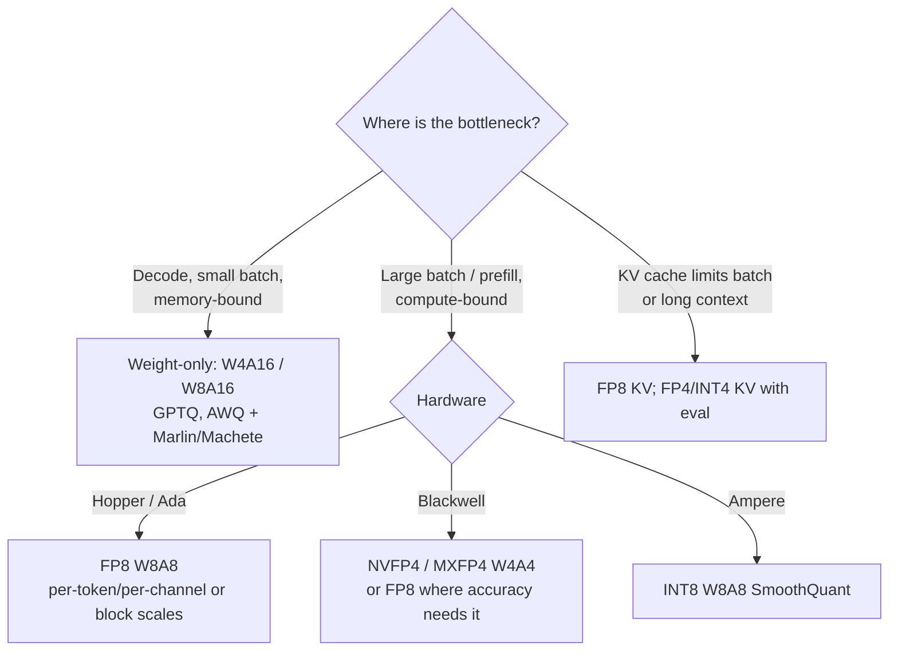

# Quantization

Quantization stores and computes with fewer bits per number. In inference it is the most cost-effective optimization there is: halving the bytes per weight roughly halves memory-bound decode time, doubles how much KV cache fits next to the weights, and — when activations are quantized too — doubles tensor-core throughput. It is also the optimization most likely to silently damage model quality. Inference engineers must understand both the arithmetic and the evaluation.

Prerequisites: [[03 - Accelerator Hardware]] (which formats tensor cores support), [[04 - Roofline and Performance Modeling]] (which phase is memory- vs compute-bound).

## Intuition

A neural network weight is a real number. BF16 represents it with 16 bits; most of those bits are spent on precision the model doesn't need. Quantization maps a group of numbers onto a small grid of representable values, using a **scale** (and sometimes a **zero point**) shared by the group:

```
q = clamp(round(x / s) + z, q_min, q_max)       # quantize
x̂ = s · (q − z)                                 # dequantize
```

The engineering is in three choices:

1. **Format** — the grid: integers (INT8, INT4) or tiny floats (FP8, FP4).
2. **Granularity** — how many numbers share one scale: a whole tensor, a channel, a group of 128, a block of 16/32.
3. **What gets quantized** — weights only, weights + activations, KV cache — and how the scales are chosen (calibration, error compensation, rotations).

## Number formats

Floating point: `value = (−1)^sign × 2^(exponent − bias) × (1.mantissa)`. More exponent bits = more **range**; more mantissa bits = more **precision**.

| Format | Bits (S-E-M) | Max normal | Notes |
| --- | --- | --- | --- |
| FP32 | 1-8-23 | ~3.4e38 | Accumulation precision |
| FP16 | 1-5-10 | 65,504 | Overflow risk on large activations |
| BF16 | 1-8-7 | ~3.4e38 | FP32 range, low precision; training/inference default |
| FP8 E4M3 | 1-4-3 | 448 | Weights/activations; no infinities, NaN only at all-ones (OCP/NVIDIA variant) |
| FP8 E5M2 | 1-5-2 | 57,344 | Gradients (wider range); rarely used for inference |
| INT8 | 8 | 127 | Uniform grid; needs a scale |
| INT4 | 4 | 7 (signed: −8..7) | Uniform; weight-only standard (GPTQ/AWQ) |
| FP4 E2M1 | 1-2-1 | 6 | Grid: ±{0, 0.5, 1, 1.5, 2, 3, 4, 6}; useless without block scales |
| E8M0 | 0-8-0 | 2^127 | Exponent-only scale format (powers of two), used by MX |

### Block-scaled ("microscaling") formats

Low-bit floats only work with fine-grained scales. The modern formats bake the scale into the format definition:

- **MXFP8 / MXFP6 / MXFP4** (OCP Microscaling spec v1.0; Rouhani et al., arXiv 2310.10537): blocks of **32** elements share one **E8M0** (power-of-two) scale. MXFP4 costs `4 + 8/32 = 4.25` bits per element.
- **NVFP4** (NVIDIA Blackwell): E2M1 values in blocks of **16** with an **FP8 E4M3** scale per block, plus one FP32 per-tensor scale (two-level scaling). `4 + 8/16 = 4.5` bits per element. The finer block and non-power-of-two scale fit the data better than MXFP4. NVIDIA reports ~3.5× smaller than FP16, ~1.8× smaller than FP8, and ≤1% accuracy degradation vs FP8 on DeepSeek-R1-0528 benchmarks.

Blackwell tensor cores consume these formats natively (scales applied inside the MMA), so FP4 GEMMs run at ~2× FP8 throughput. On Hopper, FP8 is the lowest native float; INT4 weights need dequantization in software (see "Kernels" below).

A real example of block-scaled formats in a cache: FlashMLA's DeepSeek-V4.1 KV format stores 512 FP8 E4M3 values + one E8M0 scale per 32 values (528 bytes/token), and an FP4 E2M1 variant with an E4M3 scale per 16 values (288 bytes/token) — i.e. MX-style FP8 and NVFP4-style FP4. See [[05 - KV Cache]].

### Quantization error

For a uniform quantizer with step `s`, rounding error is roughly uniform on `[−s/2, s/2]`:

```
E[error²] = s² / 12
```

The step is set by the **largest magnitude in the group**: `s = max|x| / q_max`. That is the crux of everything below: **one outlier inflates the scale for everyone sharing it**, wasting the grid on small values.

### Worked example: why granularity matters

A weight row (one output channel) has values mostly in `[−0.05, 0.05]` and one outlier at `2.0`. INT4 symmetric, `q_max = 7`:

- **Per-row scale:** `s = 2.0/7 = 0.286`. Every small weight (|x| < 0.143) rounds to **0**. The row's information is destroyed except for the outlier.
- **Per-group (128) scale:** the outlier's group has the same problem, but every other group of 128 gets `s ≈ 0.05/7 = 0.0071` — fine resolution.
- **Cost of groups:** one FP16 scale (+ optionally zero point) per 128 weights = `16/128 = 0.125` extra bits/weight (0.25 with zero points). INT4 g128 is effectively ~4.1–4.25 bits.

Granularity options, coarse to fine:

| Granularity | Scales | Typical use |
| --- | --- | --- |
| Per-tensor | 1 | FP8 weights/activations with static scales |
| Per-channel (per output row) | `out_features` | INT8 weights, FP8 weights |
| Per-token (activations) | 1 per token row, dynamic | W8A8 activations |
| Per-group (e.g. 128 along K) | `out × in/128` | INT4 weight-only (GPTQ/AWQ) |
| Block 128×128 (weights) / 1×128 (activations) | | DeepSeek-V3 FP8 recipe |
| Micro-block 16/32 | per 16/32 elements | MXFP4/NVFP4 |

Symmetric (`z = 0`) quantization is simpler and faster; asymmetric (with zero point) fits skewed distributions (e.g. post-ReLU, or INT4 weight groups) better.

## What to quantize: the W/A/KV design space

Notation `WxAy` = x-bit weights, y-bit activations. The GEMM runs in the *lower* common format the hardware supports.

| Scheme | What changes | Helps | Doesn't help |
| --- | --- | --- | --- |
| **W8A16 / W4A16 (weight-only)** | Weights stored low-bit, dequantized to BF16 in the kernel | Memory-bound decode (fewer weight bytes), model fits on fewer GPUs | Compute-bound prefill (math still BF16, plus dequant cost) |
| **W8A8 INT8** | Both quantized, INT8 tensor cores | Both phases; 2× compute vs BF16 | Activation outliers make it hard (SmoothQuant) |
| **W8A8 FP8** | Both FP8, FP8 tensor cores (Hopper+) | Both phases; easiest high-accuracy option on H100/B200 | Needs Hopper/Ada or newer |
| **W4A8** (e.g. QServe) | 4-bit weights, 8-bit activations | Decode bandwidth + INT8/FP8 compute | Complex kernels |
| **W4A4 / NVFP4 / MXFP4** | Both 4-bit, block-scaled | Max throughput on Blackwell | Accuracy needs care (rotations, QAT, or fine scales) |
| **KV quant** (FP8/INT4/FP4) | KV cache | Decode attention bandwidth, capacity | Long-context accuracy risk |

### Sensitivity ladder: what is safe to quantize

Components differ a lot in how much precision loss they tolerate. A useful practitioner ordering, least to most sensitive (after Kiely, *Inference Engineering*):

| Component | Sensitivity | Why |
| --- | --- | --- |
| **Linear-layer weights** | Low | Static, so calibration is easy. Errors average out over large dot products |
| **Activations** (inputs to the linear layers) | Low-moderate | Dynamic, with outlier channels (SmoothQuant and rotations exist for this reason) |
| **KV cache** | Moderate | Every later token reads every earlier token's K/V, so errors **compound across the sequence**. Long context makes it worse |
| **Attention math** (QKᵀ scores, softmax) | High | Softmax needs dynamic range, and errors feed into every later step |

Practical consequences:

- Almost every production scheme keeps **softmax and attention accumulation in high precision**, even when weights, activations, and KV are FP8 or FP4. (FP8 attention kernels such as FlashAttention-3's FP8 path exist, but they are opt-in and need careful scaling; see [[06 - Attention Kernels]].)
- **Keep the first and last layers in the original precision**: the embedding, the first decoder layer or two, the final layers, and `lm_head`. They are disproportionately sensitive and cost little to keep in BF16.
- A conservative default for datacenter serving: **FP8 (ideally block-scaled, such as MXFP8) on selected linear layers and activations, often FP8 KV, attention in BF16.**
- KV quantization also pays off **outside** the attention kernel. Half-size KV means twice the prefix-cache capacity ([[05 - KV Cache]]) and half the bytes to ship in disaggregated serving ([[12 - Disaggregated Serving]]).
- Realistic speedup: dropping one precision step (16 → 8 bit) usually gives about **30-50%** end to end, not 2×, because dequantization, scale handling, unquantized ops, and overheads remain (Kiely's rule of thumb; measure your own).

Key reasoning from the roofline ([[04 - Roofline and Performance Modeling]]):

- At **batch 1–16 decode**, linear layers are memory-bound: W4A16 gives up to ~3.5–4× speedup vs BF16 by reading 4× fewer bytes.
- At **large batch / prefill**, layers are compute-bound: weight-only quantization gives **no** speedup and can be slower (dequant overhead). You need low-bit *activations* too (FP8, INT8, FP4) to use faster tensor cores.
- This is why "INT4 AWQ is fast" on a laptop and "FP8 is fast" in a datacenter — different regimes.

## Post-training quantization (PTQ) methods

### Round-to-nearest (RTN)

Compute scales from min/max, round. Works for INT8 per-channel weights and FP8 almost always; breaks at 4 bits and below for many LLMs. Always the baseline to beat.

### LLM.int8() and the outlier discovery

Dettmers et al. (arXiv 2208.07339) found that from ~6.7B parameters, LLMs develop **emergent outlier features**: a handful of hidden dimensions with magnitudes up to ~20× larger than the rest, consistently across tokens and layers. Per-tensor INT8 activations fail because those few channels blow up the scale. LLM.int8() splits the matmul: outlier columns in FP16, the rest in INT8 (vector-wise quantization). Accurate but slow (mixed decomposition); its main legacy is the diagnosis.

### SmoothQuant (W8A8)

Xiao et al. (arXiv 2211.10438). Observation: **weights are easy to quantize, activations are hard** (outlier channels). Since `Y = X W = (X diag(s)⁻¹) (diag(s) W)`, divide each activation channel by `s_j` and multiply the corresponding weight row by `s_j` — mathematically identical, but moves the difficulty from activations to weights:

```
s_j = max|X_j|^α / max|W_j|^(1−α)        α ≈ 0.5 (0.75+ for harder models)
```

The scaling is folded into the previous LayerNorm/linear offline, so it costs nothing at runtime. Enables INT8 W8A8 for all matmuls; paper reports up to 1.56× speedup and 2× memory reduction with negligible accuracy loss.

### GPTQ (weight-only, 3–4 bit)

Frantar et al. (arXiv 2210.17323). Quantize one layer at a time to minimize the **output** error on calibration data, not the weight error:

```
min_Ŵ || W X − Ŵ X ||²      →  Hessian  H = 2 X Xᵀ
```

Process columns sequentially. After quantizing column `i`, the error `δ = (w_i − ŵ_i) / [H⁻¹]_ii` is propagated to not-yet-quantized columns: `W_{:, i+1:} −= δ · [H⁻¹]_{i, i+1:}`. Remaining weights compensate for the rounding of earlier ones (an Optimal Brain Surgeon idea). Engineering tricks: fixed column order applied to all rows at once, lazy block updates for GPU efficiency, Cholesky of `H⁻¹` for stability, a small dampening term added to `H`'s diagonal. Quantizes a 175B model in about four GPU-hours to 3–4 bits with small accuracy loss. Option `act_order` (process columns in decreasing Hessian diagonal) improves accuracy but complicates group-scale kernels.

### AWQ (activation-aware weight quantization)

Lin et al. (arXiv 2306.00978). Not all weights matter equally: protecting ~1% of **salient** weights — those multiplying large-magnitude activation channels — removes most of the error. Instead of keeping them in FP16 (hardware-unfriendly mixed precision), **scale up** salient input channels of `W` by `s` (and scale down the activation by `1/s`): the relative rounding error on those weights shrinks. The per-channel scale is searched as `s = s_X^α` over `α ∈ [0, 1]` on a small calibration set, minimizing output error. No backprop or reconstruction, so it generalizes well and is fast. AWQ INT4 g128 became a default for weight-only deployment (and on-device; see [[20 - Edge and On-Device Inference]]).

### Rotation methods (for W4A4 and KV4)

Outliers are a basis problem: rotate the hidden space so energy is spread evenly across channels, then quantize.

- **QuaRot** (arXiv 2404.00456): multiplies hidden states by randomized Hadamard matrices, folded into weights where possible (computational invariance of RMSNorm-based transformers), making activations, weights, and KV outlier-free for end-to-end 4-bit inference.
- **SpinQuant** (arXiv 2405.16406): *learns* the rotation matrices (on the Stiefel manifold), closing more of the accuracy gap than random rotations.
- FA3's FP8 "incoherent processing" uses the same trick inside attention ([[06 - Attention Kernels]]).

### System co-design: QServe

QServe (arXiv 2405.04532) — W4A8KV4 with a co-designed kernel and quantization recipe (progressive group quantization, SmoothAttention for KV4) chosen so that dequantization stays cheap on GPU CUDA cores. A reminder that the best scheme is the one your kernels execute efficiently.

### Quantization-aware training (QAT)

When PTQ isn't enough (e.g. 4-bit for small models, or W4A4), fine-tune with fake-quantization in the forward pass (straight-through estimator for gradients). Increasingly, model producers ship models trained or post-trained for low precision (e.g. FP8 training recipes, models released natively in MXFP4/FP8), which removes most of the inference-time risk.

## FP8 recipes in practice

FP8 is the workhorse format on Hopper and Blackwell.

- **Per-tensor static scaling:** compute activation scales from calibration data (max or percentile), weight scales from weights. Fastest; one scale multiply in the GEMM epilogue. Works for most dense models.
- **Per-token dynamic activation + per-channel weight scaling:** compute each token's activation scale on the fly (cheap reduction fused into the previous op). More robust to distribution shift; a common default in vLLM's FP8 "dynamic" mode.
- **Fine-grained block scaling (DeepSeek-V3 style):** activations scaled per `1×128` tile (per token per 128 channels), weights per `128×128` block; partial accumulations promoted to FP32 at intervals to counter limited tensor-core accumulator precision. Designed for FP8 *training*, and inference kernels (e.g. DeepGEMM) implement the same layout so the checkpoint runs natively.
- Keep **sensitive layers** in higher precision: embedding, LM head (logits), sometimes the first/last transformer blocks, routers/gates in MoE.
- E4M3's max of 448 means you **must** scale; values beyond saturate. Check for saturation counts during calibration.

## Kernel implications

Quantization only matters if a kernel turns fewer bits into less time.

- **Weight-only INT4 on Ampere/Hopper:** the kernel loads packed INT4 weights, dequantizes to FP16/BF16 in registers, and runs a BF16 MMA. The dequant must be cheap and overlapped with memory loads.
  - **Marlin** (Frantar et al., arXiv 2408.11743): mixed-precision INT4×FP16 GEMM kernel designed to stay memory-bound under batching: near the ideal **~4× speedup up to batch sizes 16–32**, and still substantial speedups at 64–128. Uses careful weight layouts (pre-shuffled offline), async copies, and pipeline design. Integrated into vLLM.
  - **Machete** (Neural Magic / vLLM): mixed-input GEMM for Hopper using WGMMA and CUTLASS, the successor to Marlin on H100.
- **FP8 on Hopper:** native tensor-core FP8 (2× BF16 FLOPs). Kernels: cuBLASLt, CUTLASS, DeepGEMM (block-scaled FP8 GEMMs and grouped GEMMs for MoE).
- **FP4 on Blackwell:** native NVFP4/MXFP4 MMA with hardware block-scale application.
- **Layout:** quantized weights are usually *repacked* offline into the kernel's preferred interleaved layout. This is why checkpoints in "GPTQ format" need conversion for a given kernel, and why loading time can grow.



## Accuracy evaluation methodology

"Perplexity went up 0.05" is not an evaluation. Quantization damage is often **task- and tail-specific**: math, code, long-context retrieval, tool calling, and multilingual tasks degrade first; averages hide it.

A solid protocol:

1. **Baseline first.** Evaluate the unquantized model with the *same* engine, prompt template, sampling settings, and seeds. Many "regressions" are template or tokenizer differences.
2. **Distribution-level metrics.** On a representative prompt set, compare next-token distributions: mean **KL divergence** from the baseline and **top-1 flip rate** (fraction of positions where the argmax token changes). Sensitive, cheap, no labels needed.
3. **Task suite matched to the product:** general knowledge (MMLU-style), reasoning (GSM8K, MATH), code (HumanEval/LiveCodeBench-style), long context (needle/RULER-style), instruction following, structured output validity (JSON/tool-call parse rate), and your own domain evals.
4. **Report recovery:** `quantized score / baseline score`. Common bars: ≥99% recovery for FP8, ≥97–99% for INT4 weight-only depending on risk tolerance.
5. **Account for noise.** A 1-point difference on a 500-question benchmark is within noise (std error ≈ `sqrt(p(1−p)/n)` ≈ 2.2 points at p=0.5, n=500). Use larger sets, multiple seeds, or paired tests.
6. **Test long generations.** Errors compound over thousands of tokens of reasoning; short-answer benchmarks under-detect this.
7. **Check calibration data match.** GPTQ/AWQ calibrated on generic web text can underperform on code or non-English workloads; calibrate with in-domain data.
8. **A/B in production** with guardrail metrics (user ratings, task success, retries) before full rollout.

## Worked example: picking a scheme for Llama-3-70B

Goal: serve chat, p50 TPOT ≤ 40 ms, minimize GPUs.

- **BF16:** 141 GB weights → needs 2×H100 just for weights, practically 4× (TP=4) to leave KV room.
- **FP8 W8A8:** 70.6 GB → fits on 2×H100 (TP=2) with ~70 GB left for KV (~220K tokens at 320 KiB/token BF16 KV, ~440K with FP8 KV). Decode reads half the bytes → ~2× faster per step than BF16 at the same TP. Accuracy recovery typically ≥99%.
- **INT4 AWQ W4A16:** ~37 GB (with scales) → fits on 1×H100 with ~35 GB for KV. Great for low concurrency; at high batch the BF16 math dominates and FP8 on 2 GPUs gives more throughput per GPU-hour. Accuracy: check math/code.
- **NVFP4 on B200:** ~40 GB; native FP4 compute → highest throughput per GPU, provided evals hold.

Decision: on H100, FP8 + FP8 KV at TP=2 is the usual sweet spot; INT4 weight-only for latency-sensitive low-QPS deployments or memory-constrained hardware.

## What practitioners actually do

1. **Start with FP8 (weights + activations) and FP8 KV** on Hopper/Blackwell; it is close to lossless for most large models.
2. Use **pre-quantized checkpoints** from the model provider when available (they evaluated them); otherwise use maintained tools (e.g. LLM Compressor, NVIDIA Model Optimizer, AutoAWQ/GPTQModel ecosystems).
3. Use **INT4 weight-only (AWQ/GPTQ g128)** for memory-constrained or low-batch deployments, with Marlin/Machete kernels.
4. Go to **FP4 (NVFP4/MXFP4)** on Blackwell with a rigorous eval, rotations or QAT if needed.
5. Keep embeddings, LM head, and MoE routers in higher precision.
6. Run the full eval protocol above **on your traffic** before shipping; monitor post-launch.

## Common mistakes

- Assuming weight-only INT4 speeds up high-throughput serving. It mostly speeds up memory-bound decode.
- Comparing quantized vs baseline with different engines or chat templates.
- Trusting perplexity alone.
- Calibrating on 128 random web samples for a code model.
- Forgetting scale overhead in memory math (INT4 g128 ≈ 4.125–4.25 bits; NVFP4 = 4.5 bits).
- Using per-tensor static FP8 activation scales on a model whose activation range shifts at long context or with unusual inputs — causing saturation.
- Quantizing the KV cache without long-context evals.
- Ignoring that a quantized checkpoint may silently fall back to a slow kernel on unsupported hardware (e.g. FP8 on Ampere is emulated or weight-only).

## Check yourself

1. **Why does FP4 E2M1 require block scaling?**
   It has only 8 magnitudes (0–6). Without a per-block scale, it can't represent the range of real weights or activations; with a scale per 16/32 values, it covers each block's local range.

2. **What is the effective bit-width of NVFP4 and MXFP4?**
   NVFP4: 4 + 8/16 = 4.5 bits (plus a negligible per-tensor FP32). MXFP4: 4 + 8/32 = 4.25 bits.

3. **Why does W4A16 not speed up prefill?**
   Prefill is compute-bound; math still runs in BF16 after dequantization, so fewer weight bytes don't help, and dequant adds work.

4. **What does SmoothQuant's α control?**
   How much of the activation outlier difficulty migrates into weights. α=0 leaves activations unchanged; α=1 pushes everything into weights. ~0.5 balances.

5. **What does GPTQ do after quantizing a column?**
   Uses the inverse Hessian (from calibration activations) to update the not-yet-quantized columns to compensate for that column's rounding error.

6. **How does AWQ protect salient weights without mixed precision?**
   It scales up input channels with large activations (and scales the activations down equivalently), reducing relative rounding error for those weights, using a scale searched on calibration data.

7. **Your quantized model scores 71.2 vs baseline 72.0 on a 500-question benchmark. Is that a regression?**
   Not demonstrably: the standard error is ~2 points. Use paired comparison, more data, KL/flip-rate metrics, and task-specific evals.

8. **Why do rotation methods (QuaRot, SpinQuant) help 4-bit activations?**
   Orthogonal rotations spread outlier energy across all channels, making distributions flatter so per-token scales waste less range; the rotation is folded into weights so outputs are unchanged.

## Further reading

- Micikevicius et al., *FP8 Formats for Deep Learning* — https://arxiv.org/abs/2209.05433
- Rouhani et al., *Microscaling Data Formats for Deep Learning* — https://arxiv.org/abs/2310.10537
- OCP Microscaling (MX) Formats Specification v1.0 — https://www.opencompute.org/documents/ocp-microscaling-formats-mx-v1-0-spec-final-pdf
- NVIDIA, *Introducing NVFP4 for Efficient and Accurate Low-Precision Inference* — https://developer.nvidia.com/blog/introducing-nvfp4-for-efficient-and-accurate-low-precision-inference/
- Dettmers et al., *LLM.int8()* — https://arxiv.org/abs/2208.07339
- Xiao et al., *SmoothQuant* — https://arxiv.org/abs/2211.10438
- Frantar et al., *GPTQ* — https://arxiv.org/abs/2210.17323
- Lin et al., *AWQ* — https://arxiv.org/abs/2306.00978
- Ashkboos et al., *QuaRot* — https://arxiv.org/abs/2404.00456
- Liu et al., *SpinQuant* — https://arxiv.org/abs/2405.16406
- Lin et al., *QServe: W4A8KV4 Quantization and System Co-design* — https://arxiv.org/abs/2405.04532
- Frantar et al., *MARLIN: Mixed-Precision Auto-Regressive Parallel Inference on LLMs* — https://arxiv.org/abs/2408.11743 and https://github.com/IST-DASLab/marlin
- Neural Magic, *Introducing Machete* — https://neuralmagic.com/blog/introducing-machete-a-mixed-input-gemm-kernel-optimized-for-nvidia-hopper-gpus/
- DeepSeek-AI, *DeepSeek-V3 Technical Report* (fine-grained FP8) — https://arxiv.org/abs/2412.19437
- KV cache quantization: KIVI https://arxiv.org/abs/2402.02750, KVQuant https://arxiv.org/abs/2401.18079

## Related

- [[03 - Accelerator Hardware]]
- [[04 - Roofline and Performance Modeling]]
- [[05 - KV Cache]]
- [[06 - Attention Kernels]]
- [[11 - Mixture of Experts Inference]]
- [[13 - Kernels, Compilers, and CUDA Graphs]]
- [[18 - Benchmarking and Profiling]]
- [[19 - Cost and Capacity Planning]]
- [[20 - Edge and On-Device Inference]]
- [[98 - Formula Cheatsheet]]
