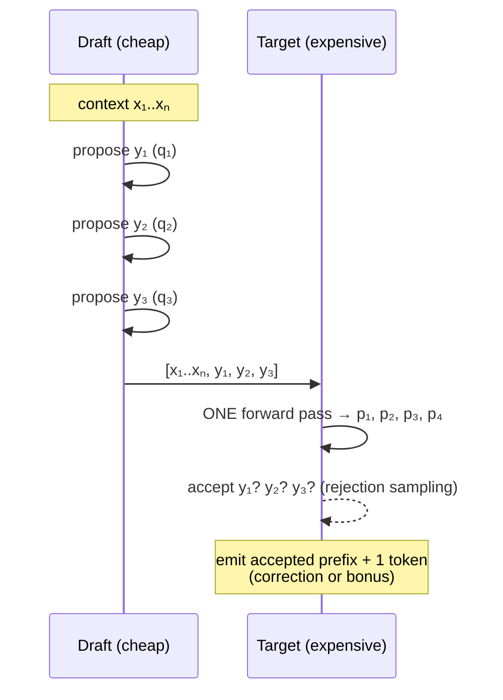
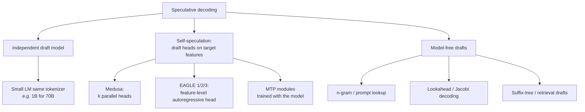
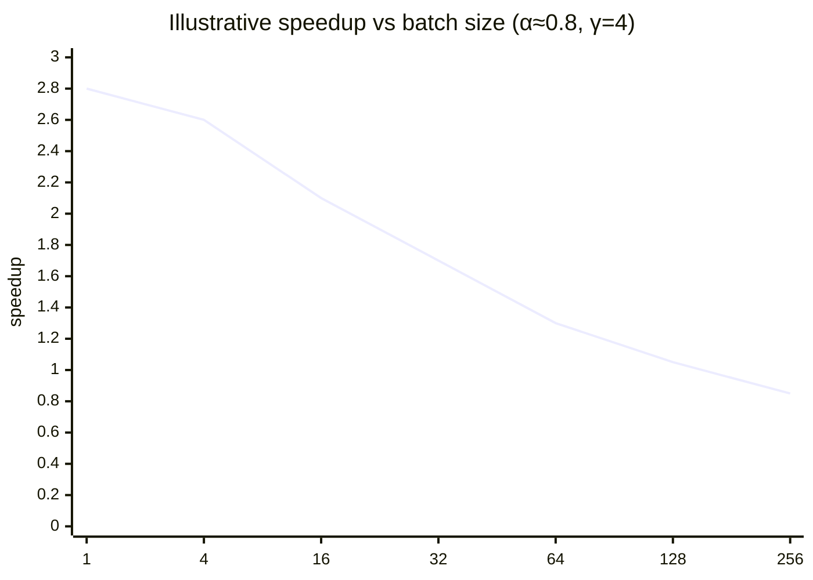

# Speculative Decoding

Decode is memory-bandwidth-bound: every step streams all the weights (and the KV cache) through the chip to produce **one** token per sequence. At batch size 1 on an H100, a 70B FP16 model reads ~140 GB per token and the tensor cores sit mostly idle (see [[04 - Roofline and Performance Modeling]]). Speculative decoding exploits that idle compute: guess several tokens cheaply, then check all of them in **one** forward pass of the big model. If the guesses are good, you emit several tokens for roughly the price of one.

The remarkable property: done correctly, speculative decoding is **lossless**. The output distribution is *exactly* the target model's distribution — not an approximation. It is a pure systems optimization, not a quality trade.

## The core loop



1. A **draft** mechanism proposes `γ` tokens `y₁..y_γ` autoregressively, recording its probabilities `q_i(·)`.
2. The **target** model runs one forward pass over the context plus all `γ` drafted tokens. Because of the causal mask, this pass yields target distributions `p₁..p_{γ+1}` at every drafted position — exactly what the target would have computed if it had generated those tokens itself. This is just a mini-prefill of `γ+1` tokens, and prefill is cheap per token because it is compute-bound.
3. Walk left to right, accepting or rejecting each draft token. At the first rejection, sample a **correction** token and stop. If all `γ` are accepted, sample one **bonus** token from `p_{γ+1}` for free.

Every iteration emits at least 1 token (so you never do worse than plain decoding in token count) and at most `γ + 1`.

## Why it is lossless: the rejection sampling rule

Leviathan et al. (2023) and Chen et al. (2023) independently gave the rule. For a drafted token `x ~ q`:

```
accept x with probability   min(1, p(x) / q(x))
if rejected, sample from    p'(x) = norm( max(0, p(x) − q(x)) )
```

**Proof sketch.** Probability that the procedure emits token `x`:

```
P(emit x) = q(x) · min(1, p(x)/q(x))  +  P(reject) · p'(x)
          = min(q(x), p(x))           +  P(reject) · p'(x)
```

The total rejection probability is

```
P(reject) = 1 − Σₓ min(p(x), q(x)) = Σₓ max(0, p(x) − q(x))
```

(both equal the total-variation distance between `p` and `q`). And `p'(x) = max(0, p(x) − q(x)) / Σ max(0, p − q)`. So

```
P(emit x) = min(p(x), q(x)) + max(0, p(x) − q(x)) = p(x)   ∎
```

Each emitted token is distributed exactly as the target would have sampled it. Chaining positions works because acceptance of position `i+1` is evaluated only if positions `≤ i` were accepted, conditioning on exactly the prefix the target saw.

**Greedy special case.** With temperature 0, `p` and `q` are one-hot. Accept iff draft token equals target argmax; on mismatch emit the target argmax. Most production deployments at temperature 0 use this exact-match form.

**Acceptance rate.** The per-token acceptance probability is

```
α = E_x[ Σₓ min(p(x), q(x)) ] = 1 − E[ TV(p, q) ]
```

α measures how well the draft imitates the target. It depends on the draft, the target, the *task* (code and structured text are far more predictable than creative writing), and the sampling temperature (higher temperature usually lowers α).

## How many tokens do you get per iteration?

Assume each draft token is accepted independently with probability α (a simplification; real acceptance decays along the draft). The number of tokens emitted per target forward pass is

```
E[tokens per step] = 1 + α + α² + … + α^γ = (1 − α^{γ+1}) / (1 − α)
```

| α \ γ | 1 | 2 | 3 | 4 | 5 | 7 | ∞ |
|---|---|---|---|---|---|---|---|
| 0.5 | 1.50 | 1.75 | 1.88 | 1.94 | 1.97 | 1.99 | 2.0 |
| 0.7 | 1.70 | 2.19 | 2.53 | 2.77 | 2.94 | 3.14 | 3.33 |
| 0.8 | 1.80 | 2.44 | 2.95 | 3.36 | 3.69 | 4.16 | 5.0 |
| 0.9 | 1.90 | 2.71 | 3.44 | 4.10 | 4.69 | 5.70 | 10.0 |

Two lessons from the table:

- **α dominates γ.** Going from α = 0.7 to 0.9 helps far more than drafting more tokens. Long drafts are wasted unless the draft is very good: at α = 0.5 the ceiling is 2× no matter how long you draft.
- **Diminishing returns in γ.** Each extra draft token contributes `α^k`, a geometric tail.

## The speedup model

Tokens per step is not wall-clock speedup. You pay for drafting and for verifying `γ+1` tokens instead of 1. Let

- `T_t` = time of one target decode step (1 token),
- `c = T_d / T_t` = cost of one draft step relative to the target,
- `v = T_verify(γ+1) / T_t` = verification cost relative to a 1-token step (≈ 1 when memory-bound, grows when compute-bound).

Then

```
speedup ≈ (1 − α^{γ+1}) / (1 − α)  /  (γ·c + v)
```

**Worked example.** Llama-class 70B target, 1B draft, batch 1. Draft step costs ~4% of the target step (`c = 0.04`), verifying 5 tokens costs ~1.05× a single-token step (`v = 1.05`, still bandwidth-bound). α = 0.8, γ = 4:

```
tokens/step = (1 − 0.8⁵)/(1 − 0.8) = (1 − 0.328)/0.2 = 3.36
cost/step   = 4 × 0.04 + 1.05       = 1.21
speedup     = 3.36 / 1.21           ≈ 2.78×
```

Now the same at a batch where the target is near the compute roof, so verifying 5 tokens per sequence costs ~4× a single step (`v = 4`):

```
speedup = 3.36 / (0.16 + 4) ≈ 0.81×    ← slower than not speculating
```

This is the single most important practical fact about speculative decoding: **it converts spare compute into lower latency, and when there is no spare compute it loses.**

### Choosing γ

Maximize `f(γ) = (1 − α^{γ+1}) / ((1 − α)(γc + v))`. With small `c` and `v ≈ 1`, the optimum is typically γ = 3–6 for α ≈ 0.7–0.85. Engines often tune γ per workload; some adapt it dynamically from observed acceptance (e.g., confidence-based early stopping of the draft, as in EAGLE-2 or DeepInfer's "confidence-scheduled verification" — see [[21 - Case Study - DeepInfer]]).

## Families of draft mechanisms



### 1. Independent small draft model

The classic setup (Leviathan, Chen): a smaller model from the same family, sharing the tokenizer — e.g., Llama-3.2-1B drafting for Llama-3.1-70B.

- **Pros:** no training if a family member exists; works with any target.
- **Cons:** the draft has its own KV cache (memory, scheduling complexity), its own weights to load, and α is often only 0.6–0.75 because the small model "thinks differently." Drafting is sequential and the draft step is not free (`c` of 0.03–0.1).
- **Distillation** of the draft on target outputs (DistillSpec) raises α substantially.

### 2. Medusa (Cai et al., 2024)

Add `k` extra LM heads on the target's last hidden state; head `i` predicts the token at offset `+i+1`. All heads fire in **one** pass, so drafting is nearly free. Since each head predicts independently (it does not see the previous head's choice), Medusa takes the top-few candidates per head and builds a **tree** of combinations, verified with tree attention (below).

- Medusa-1: freeze backbone, train heads (hours on one GPU). Reported >2.2× speedup.
- Medusa-2: fine-tune backbone jointly; reported 2.3–3.6×.
- Weakness: head `i` ignores what heads `<i` chose, so accuracy falls quickly with offset.
- Caveat: Medusa also proposes a *typical acceptance* scheme that accepts plausible tokens without the exact rejection-sampling rule. It raises acceptance but is **not** lossless — the output distribution changes. Use standard rejection sampling if exactness matters.

### 3. EAGLE family (Li et al.)

EAGLE's insight: autoregression at the **feature** level (the second-to-top hidden state) is easier than at the token level, and feeding the *sampled token* back in resolves the uncertainty that hurts Medusa.

- **EAGLE-1 (2024):** a single lightweight transformer layer takes `(feature_t, embedding of token_{t+1})` and predicts `feature_{t+1}`, then reuses the target's LM head. Drafts autoregressively but each step is ~one layer, so `c` is tiny. Uses a static draft tree.
- **EAGLE-2 (2024):** **dynamic draft trees**. The draft model's confidence is well-calibrated with acceptance, so expand the tree where the draft is confident and prune elsewhere. Reported 3.05–4.26× on chat benchmarks.
- **EAGLE-3 (2025):** drops feature-prediction loss in favor of direct token prediction, fuses low-, mid-, and high-level features from the target, and uses "training-time test" (training the draft on its own rolled-out predictions). This lets it benefit from scaling draft training data. Reported up to 6.5× speedup (about 1.4× over EAGLE-2) and a 1.38× throughput gain in SGLang at batch size 64 — one of the few published results showing benefit at a non-trivial batch.

EAGLE-style heads are the de facto default in vLLM, SGLang, and TensorRT-LLM in 2025–2026 when a trained head exists for the target.

### 4. Multi-Token Prediction (MTP) modules

DeepSeek-V3 trains **MTP modules** during pre-training: sequential modules that each predict one further token, sharing the embedding and output head with the main model, with a full causal chain (unlike Medusa's independent heads). Training benefit: denser training signal. Inference benefit: the MTP module is a ready-made, high-quality draft.

The DeepSeek-V3 report states the second-token acceptance rate is **85–90%** across topics, yielding about **1.8× tokens per second**. Because the draft was co-trained with the model, α is high and there is no separate model to maintain. Several later open models (e.g., GLM-4.5, Qwen3-Next, MiMo) also ship MTP layers; inference engines expose them as "MTP" or "NextN" speculative methods. DeepInfer's DSpark exposes the max draft length as `DEEPINFER_USE_NEXTN_DECODE` (default 5).

### 5. Model-free drafts

- **Prompt lookup / n-gram drafting:** find the last `n` generated tokens earlier in the prompt (or in the generated text) and propose whatever followed them. Zero cost, zero training. Superb when the output copies the input — code editing, RAG answers quoting sources, summarization, "rewrite this file" — where α on the copied spans approaches 1. Useless for open-ended writing.
- **Lookahead decoding (Fu et al., 2024):** run Jacobi-iteration "guessing" in parallel within the target pass itself and cache n-grams that emerge; no draft model.
- **Suffix-based drafting:** build a suffix tree over prior outputs (across requests) to propose continuations; strong for agentic loops that repeat similar outputs.

## Tree attention: verifying many candidates at once

Instead of one linear draft, propose a **tree**: e.g., top-2 at depth 1, top-2 under each at depth 2. Flatten the tree into a sequence of nodes and give the target a custom attention mask where each node attends only to its ancestors (and the context).

```
context ─┬─ "the" ─┬─ "cat"
         │         └─ "dog"
         └─ "a"  ──┬─ "cat"
                   └─ "big"

Flattened: [the, a, cat, dog, cat, big]
Mask row for node "dog" (index 3): attends {context, the, dog}
```

One forward pass scores all branches; pick the longest accepted path. SpecInfer (Miao et al.) introduced token-tree verification with a proof that multi-branch verification remains lossless (with a modified sampling procedure for stochastic decoding). Trees raise the expected accepted length for a given draft quality at the cost of more verification tokens — great at batch 1 where those extra tokens are nearly free, harmful at high batch.

Implementation detail: positions in the tree use the depth for RoPE, not the flattened index; the KV for rejected branches must be discarded (or never committed). Paged KV caches (see [[05 - KV Cache]]) make this cheap: allocate drafts speculatively, then free or overwrite.

## Interaction with batching (the part people get wrong)

At batch size `B`, one decode step already processes `B` tokens. Verification processes `B·(γ+1)` tokens. Arithmetic intensity grows with tokens per weight read, so speculation **pushes decode toward the compute roof** — which is the whole point at small B, and a liability at large B.



(Shape is illustrative; the crossover batch depends on model, GPU, and attention cost. Measure it.)

Consequences:

- **Speculation is a latency tool.** It reduces TPOT for interactive users; throughput-oriented batch jobs often turn it off.
- **MoE models stretch the useful range.** In MoE decode, each expert sees only a sliver of the batch, so expert GEMMs stay memory-bound to much larger total batches. That is part of why DeepSeek and others run MTP in production at high load (see [[11 - Mixture of Experts Inference]]).
- **Attention cost grows too.** Verification tokens attend over the full context; at long context the attention part of verification is not free (see [[16 - Long Context Inference]]).
- **Dynamic speculation:** good schedulers shrink γ (or disable speculation) as load rises and raise it when the batch thins out. vLLM, SGLang, and TensorRT-LLM have various forms of this.
- **Ragged acceptance:** sequences in the same batch accept different numbers of tokens. The KV cache and position bookkeeping must handle per-sequence variable advance, which is why "varlen" verification kernels exist.

## Systems costs that the formula hides

- **Draft KV cache** (independent draft model): extra memory, competes with target KV for HBM.
- **CPU overhead:** an extra scheduling round-trip per step. Without CUDA graphs for the draft loop, launch overhead can eat the gain (see [[13 - Kernels, Compilers, and CUDA Graphs]]).
- **Sampling on GPU:** rejection sampling must run on device for every position; done on CPU it serializes the pipeline.
- **Interaction with structured output:** the grammar mask must be applied to the target distribution at each verified position, and the draft should ideally be masked too or acceptance collapses (see [[15 - Sampling, Determinism, and Structured Output]]).
- **Determinism:** verification with a different batch shape than plain decode can change numerics; batch-invariant kernels are needed if bit-exact reproducibility matters.

## What practitioners actually do

1. **Check whether you are latency-bound and under-utilized.** Look at decode MFU or tensor-core utilization at your real operating batch. If it is already high, skip speculation.
2. **Use the model's own MTP / an EAGLE-3 head if one exists.** Highest α, lowest cost.
3. **Add n-gram/prompt lookup for copy-heavy workloads** (code edits, RAG). It stacks with or substitutes for learned drafts.
4. **Measure α on your traffic**, not on MT-Bench. Chat vs code vs JSON vs reasoning traces give very different acceptance.
5. **Tune γ (and tree width) per batch regime**, ideally adaptively.
6. **Report speedup at the operating point**: TPOT at p50/p99 and throughput at your SLO, not batch-1 tokens/s.

## Common mistakes

- Quoting batch-1 speedups for a server that runs at batch 128.
- Training a draft on generic data and deploying on a narrow domain (α collapses) — or the reverse, overfitting to one domain.
- Ignoring temperature: α at T=0 can be much higher than at T=1.
- Implementing "speculative" acceptance as exact token match under sampling — that is *not* lossless for stochastic decoding; you must use the `min(1, p/q)` rule with residual resampling.
- Forgetting the bonus token, or forgetting to roll back KV entries of rejected tokens (silently corrupting later steps).
- Applying RoPE with flattened-tree indices instead of tree depth.

## Check yourself

1. **Why can the target verify γ tokens for about the cost of one?**
   Decode at small batch is memory-bound: the cost is reading weights. Verifying γ+1 tokens reads the weights once, and the extra FLOPs fit in idle compute.

2. **Prove the residual distribution must be `max(0, p − q)` normalized.**
   Accepted mass at `x` is `min(p, q)`; to make the total `p(x)` you need extra mass `p − min(p,q) = max(0, p − q)`, scaled by the rejection probability, which equals its total mass.

3. **α = 0.6, γ = 8. Expected tokens per step?**
   `(1 − 0.6⁹)/0.4 = (1 − 0.0101)/0.4 ≈ 2.47`. The ceiling is 2.5; most of γ is wasted.

4. **Why does Medusa use a tree while a sequential draft model often does not need one?**
   Medusa heads predict offsets independently, so their top-1 combinations are often inconsistent; a tree of top-k combinations recovers accuracy. A sequential draft conditions each token on the previous one.

5. **Why does speculation help MoE decode at larger batch than dense decode?**
   With top-k routing over many experts, each expert receives few tokens, so expert GEMMs remain memory-bound even when the global batch is large; extra verification tokens are still nearly free.

6. **Your server runs at 95% tensor-core utilization during decode. Should you enable EAGLE?**
   Probably not; verification adds compute that is not free, so speedup will likely be below 1. Consider it only for a latency-tier with small batches.

7. **Which workloads benefit most from prompt lookup decoding?**
   Ones whose output copies long spans of the input: code editing, document rewriting, extractive RAG answers.

## Further reading

- Leviathan, Kalman, Matias — *Fast Inference from Transformers via Speculative Decoding* (2023): https://arxiv.org/abs/2211.17192
- Chen et al. — *Accelerating Large Language Model Decoding with Speculative Sampling* (2023): https://arxiv.org/abs/2302.01318
- Miao et al. — *SpecInfer: Tree-based Speculative Inference and Verification*: https://arxiv.org/abs/2305.09781
- Cai et al. — *Medusa: Simple LLM Inference Acceleration Framework with Multiple Decoding Heads*: https://arxiv.org/abs/2401.10774
- Li et al. — *EAGLE*: https://arxiv.org/abs/2401.15077 ; *EAGLE-2*: https://arxiv.org/abs/2406.16858 ; *EAGLE-3*: https://arxiv.org/abs/2503.01840
- Fu et al. — *Break the Sequential Dependency of LLM Inference Using Lookahead Decoding*: https://arxiv.org/abs/2402.02057
- Zhou et al. — *DistillSpec*: https://arxiv.org/abs/2310.08461
- DeepSeek-AI — *DeepSeek-V3 Technical Report* (MTP, §2.2 and §5.4.3): https://arxiv.org/abs/2412.19437
- Prompt lookup decoding: https://github.com/apoorvumang/prompt-lookup-decoding
- vLLM speculative decoding docs: https://docs.vllm.ai/en/latest/features/spec_decode.html

## Related

- [[04 - Roofline and Performance Modeling]] — why decode has spare compute
- [[05 - KV Cache]] — rollback of rejected tokens
- [[07 - Batching and Scheduling]] — the batch-size trade-off
- [[11 - Mixture of Experts Inference]] — why MTP is used at scale
- [[15 - Sampling, Determinism, and Structured Output]]
- [[21 - Case Study - DeepInfer]] — DSpark and confidence-scheduled verification
- [[98 - Formula Cheatsheet]]
