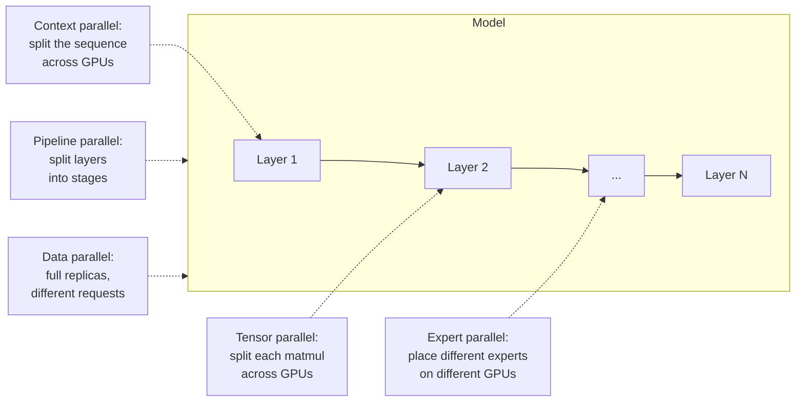
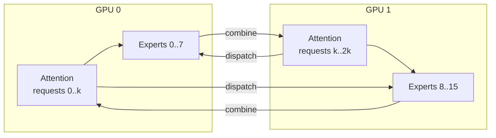
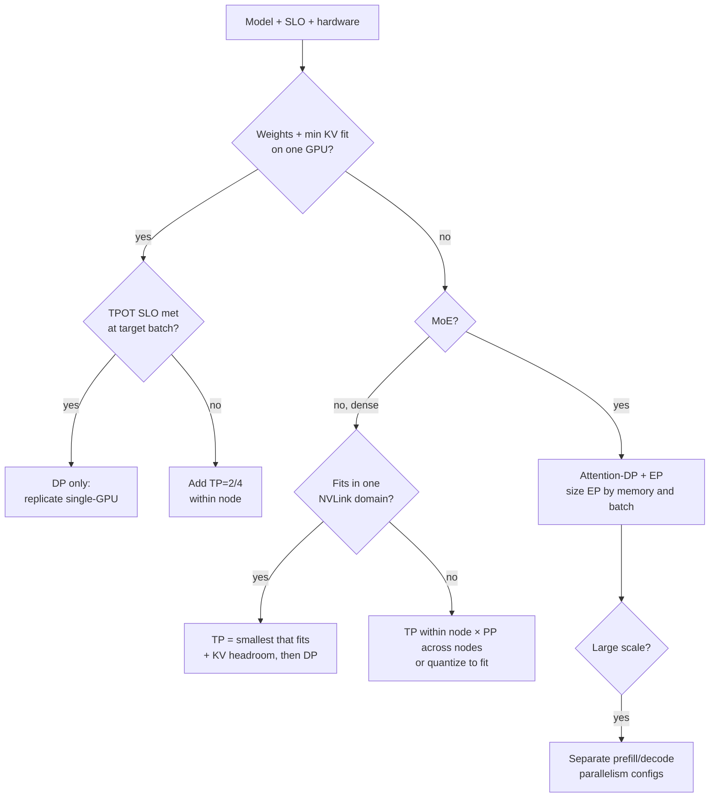

# Parallelism

A single accelerator runs out of something — memory capacity, memory bandwidth, or compute — long before a frontier model runs out of parameters. Parallelism is how you spread one model (and its KV cache) across many chips. In training the questions are about gradients and optimizer state; in **inference** the questions are different:

- Does the model *fit* (weights + KV cache + activations)?
- What does the split do to **per-token latency** (TPOT) — the thing users feel?
- What does it do to **throughput per GPU** — the thing finance feels?
- How much **communication** sits on the critical path of every decode step?

This note covers each axis — tensor (TP), pipeline (PP), data (DP), sequence/context (SP/CP), attention-DP, and expert (EP) parallelism — with the communication math, and finishes with worked configuration choices.

## The axes at a glance



| Axis | What is split | Comm pattern | Comm per decode step | Helps latency? | Helps capacity? |
|---|---|---|---|---|---|
| DP | requests | none (router only) | 0 | no | no (replicates) |
| TP | weight matrices (heads, FFN columns) | all-reduce ×2 per layer | `2L` all-reduces of `B·h` | **yes** (less weight per GPU per step) | yes |
| PP | layers | point-to-point activations | `S−1` sends of `B·h` | no (adds hops) | yes |
| CP/SP | sequence tokens | ring/all-gather of KV | large in prefill | yes for long prefill | yes for KV |
| EP | experts (MoE) | all-to-all dispatch + combine | `2·L_moe` all-to-alls | indirectly | yes |
| Attention-DP | requests, within attention | none in attention; feeds EP | 0 (attention) | — | avoids KV duplication |

## Tensor parallelism (TP)

### The Megatron split

Megatron-LM (Shoeybi et al., 2019) observed that a transformer MLP `Y = GeLU(X·A)·B` can be split across `N` GPUs with only **one** collective:

1. **Column-parallel first matmul.** Split `A` by columns: `A = [A₁ … A_N]`. GPU `i` computes `X·Aᵢ` — no communication, since `X` is replicated. The nonlinearity is elementwise, so `GeLU(X·Aᵢ)` is still correct per shard.
2. **Row-parallel second matmul.** Split `B` by rows. GPU `i` computes a partial `GeLU(X·Aᵢ)·Bᵢ`. The true output is the **sum** of partials → **all-reduce**.

Attention splits the same way: heads are distributed across GPUs (column-parallel QKV projection, each GPU computes its own heads' attention locally with its own KV cache shard), and the output projection is row-parallel → **all-reduce**.

```
Per transformer layer, forward pass:
  attention block:  [column QKV] → local attention → [row O-proj] → ALL-REDUCE
  MLP block:        [column up/gate] → act → [row down] → ALL-REDUCE
=> 2 all-reduces per layer
```

**KV cache under TP.** Each GPU holds the KV for its heads only, so KV memory per GPU falls by `N` — as long as `N ≤ n_kv_heads`. With GQA (e.g., 8 KV heads), TP=16 forces KV heads to be **replicated**; the KV saving stops at TP = `n_kv_heads`. For MLA (DeepSeek), there is effectively a single latent KV "head," so TP replicates the entire KV cache on every rank — this is why DeepSeek deployments use attention-DP instead (below).

### All-reduce cost

Ring all-reduce of `S` bytes across `N` GPUs, link bandwidth `β` (bytes/s per direction), per-hop latency `λ`:

```
T_allreduce ≈ 2·(N−1)/N · S/β  +  2·(N−1)·λ
```

(reduce-scatter + all-gather, each moving `(N−1)/N · S`). On NVLink/NVSwitch systems NCCL often uses tree or NVLS (in-switch reduction) algorithms that cut the latency term, but the shape is the same: a **bandwidth term** that matters in prefill and a **latency term** that dominates decode.

**Message size per all-reduce:** `S = B_tokens × h × bytes`.

**Worked example — decode, Llama-3-70B, TP=8 on H100 HGX.** `h = 8192`, `L = 80`, BF16.

- Batch of 64 decode tokens: `S = 64 × 8192 × 2 = 1 MiB`.
- Per step: `2 × 80 = 160` all-reduces.
- Bandwidth term per all-reduce at ~450 GB/s unidirectional NVLink: `2 × 7/8 × 1 MiB / 450 GB/s ≈ 4 µs`.
- Latency term: realistically ~5–15 µs per small all-reduce including kernel launch/sync.
- Total ≈ 160 × (4 + 10) µs ≈ **2.2 ms per decode step** of pure communication, versus a compute/memory time of roughly `140 GB / 8 GPUs / 3.35 TB/s ≈ 5.2 ms` for streaming weights.

So TP=8 on 70B spends on the order of 30% of each decode step in collectives unless they are overlapped or fused (e.g., custom one-shot all-reduce kernels, all-reduce fused with RMSNorm, NVLS). This is why engines ship their own "custom all-reduce" for small messages.

**Prefill is different:** with 8k tokens in a chunk, `S = 8192 × 8192 × 2 = 128 MiB` per all-reduce; bandwidth term ≈ 0.5 ms each, but compute per layer is also large, so the ratio is similar and overlap is easier.

### Why TP is the latency lever

Decode time ≈ (weight bytes per GPU + KV bytes per GPU) / HBM bandwidth. TP=N divides weight bytes per GPU by `N`, so TPOT drops nearly `N`× **until** communication latency dominates. Past TP=8 across the NVLink domain, gains flatten fast and crossing to InfiniBand is almost never worth it for TP: IB at 400 Gb/s ≈ 50 GB/s per GPU is ~9× less than H100 NVLink and with much higher latency.

**Rule:** keep TP inside the NVLink domain (8 GPUs on HGX H100/H200/B200; up to 72 on GB200/GB300 NVL72).

## Pipeline parallelism (PP)

Split layers into `S` stages on different GPUs/nodes. Each stage sends a `B × h` activation to the next.

- **Communication** is small and point-to-point — tolerable over InfiniBand. That is PP's selling point: it lets a model span nodes without all-reduce over IB.
- **Latency:** a token must traverse all stages sequentially. PP does **not** reduce per-token latency — each stage still processes its layers serially, plus `S−1` network hops. TPOT ≈ sum of stage times + hops.
- **Throughput and bubbles:** in training, pipeline bubbles come from filling and draining the pipe. In inference serving, the scheduler can keep `S` independent micro-batches in flight (batch A on stage 2 while batch B is on stage 1), so in steady state there is no structural bubble. Bubbles return when: the micro-batches are unbalanced in size, there are fewer in-flight batches than stages, or decode iterations depend on the previous step's output (each micro-batch can only advance once per full pipeline round trip — so with `S` stages you need `≥ S` micro-batches to keep all stages busy).
- **KV cache**: each stage holds KV only for its layers — capacity scales cleanly.

Use PP when the model does not fit in one NVLink domain at acceptable TP, mostly for throughput-oriented deployments (e.g., 405B dense across 2 nodes as TP=8 × PP=2). For latency-sensitive serving, prefer fitting into one node (quantize, see [[08 - Quantization]]) or using a bigger NVLink domain.

## Data parallelism (DP)

Independent replicas, each serving different requests; a router spreads load. No communication between replicas, linear throughput scaling. The only questions are routing (load- and cache-aware, see [[17 - Serving Systems, Routing, and Autoscaling]]) and whether each replica's batch is large enough to be efficient.

DP is always the outermost axis: decide the smallest model-parallel unit that meets your latency SLO, then replicate it.

## Sequence and context parallelism (SP/CP)

Two different ideas share confusing names:

- **Megatron sequence parallelism** (Korthikanti et al.): in the regions *between* TP matmuls (LayerNorm, dropout, residual), shard activations along the sequence dimension and replace each all-reduce with reduce-scatter + all-gather. Same total bytes, less activation memory. Mostly a training/large-prefill memory optimization.
- **Context parallelism** (ring attention, Liu et al.; Striped/Ulysses variants): split a long sequence's tokens across GPUs. Each GPU computes attention of its query chunk against all KV chunks, which rotate around a ring (ring attention) or are exchanged via all-to-all over heads (DeepSpeed-Ulysses).

In inference, CP matters for **long-context prefill**: a 1M-token prefill on one GPU takes too long (attention is quadratic) and the KV does not fit. With CP=8, each GPU handles 125k query tokens and KV transfer overlaps with block attention. For decode, CP is less natural (one query token), but KV can be sharded across GPUs with partial-softmax merging (flash-decoding style across devices). See [[16 - Long Context Inference]].

Balancing matters: with causal masking, later chunks do more work. "Zig-zag"/striped assignment (each GPU takes one early and one late chunk) balances it. DeepInfer's "balanced CP" is this idea (see [[21 - Case Study - DeepInfer]]).

## Expert parallelism (EP)

For MoE models, place different experts on different GPUs. Each token's hidden state is **dispatched** (all-to-all) to the GPUs holding its top-k experts, processed, and **combined** (all-to-all back, weighted sum). Full treatment in [[11 - Mixture of Experts Inference]]; the parallelism-level facts:

- EP divides expert weights across GPUs, so each GPU reads only its experts each step — this is how a 671B-parameter model gets fast decode.
- Communication per token per MoE layer ≈ `k × h × bytes` for dispatch plus the same for combine (less with node-limited routing and deduplication).
- EP pairs naturally with **attention-DP**.

**Comm volume example — DeepSeek-V3.** `h = 7168`, top-k = 8, 58 MoE layers, FP8 dispatch (1 B/elem), BF16 combine (2 B/elem):

```
dispatch per token per layer ≈ 8 × 7168 × 1 B ≈ 57 KB
combine  per token per layer ≈ 8 × 7168 × 2 B ≈ 115 KB
per token per forward pass   ≈ 58 × 172 KB ≈ 10 MB
```

At 15k output tokens/s per 8-GPU node, that is ~150 GB/s of all-to-all traffic per node — which is why DeepSeek overlaps communication with computation using two micro-batches (and why the upper bound is network, not FLOPs). Node-limited routing (each token routed to experts on at most 4 nodes) and intra-node NVLink forwarding cut the inter-node share.

## Attention data parallelism (attention-DP)

For MoE models with small attention (relative to experts) or with MLA, a hybrid works better than TP everywhere:

- **Attention layers: DP.** Each GPU runs full attention for *its own* requests with its own KV cache. No KV replication (critical for MLA, whose single latent head would be replicated under TP), no all-reduce in attention.
- **MoE layers: EP across all GPUs.** Tokens from all attention-DP ranks are dispatched to experts.



DeepSeek's production decode runs "Routed Expert EP144, MLA/Shared Expert DP144" across 18 nodes; prefill runs EP32/DP32 across 4 nodes. SGLang and vLLM expose this as `--enable-dp-attention` / `--data-parallel-size` with `--enable-expert-parallel`.

The new problem attention-DP creates: **load balance across DP ranks**. If GPU 3 holds three 100k-token requests and GPU 4 holds short ones, GPU 3's attention is slow and every EP all-to-all waits for it. DeepSeek's decode load balancer equalizes KV usage and request count per GPU for exactly this reason.

## Topology: map the axes to the wires

The bandwidth hierarchy dictates placement:

| Link | Typical per-GPU bandwidth | Latency | Use for |
|---|---|---|---|
| HBM | 3.35 TB/s (H100), ~8 TB/s (B200) | ~ns | — |
| NVLink 4 (H100) | 900 GB/s bidirectional | ~µs | TP, EP intra-node |
| NVLink 5 (B200/GB200) | 1.8 TB/s bidirectional | ~µs | TP, EP across NVL72 |
| InfiniBand NDR / RoCE 400G | 50 GB/s per direction | ~µs + switch hops | EP inter-node, PP, KV transfer |
| PCIe Gen5 x16 | ~64 GB/s per direction | higher | host offload |

Rules of thumb:

1. **Most chatty axis innermost.** TP (all-reduce on every layer, latency-critical) inside NVLink. EP next (all-to-all, bandwidth-heavy, overlappable). PP and DP outermost.
2. **Rack-scale NVLink (NVL72) changes the calculus.** With 72 GPUs in one NVLink domain, wide EP no longer needs IB on the critical path. This is a major reason GB200 NVL72 posts large per-GPU gains on DeepSeek-class MoE.
3. **One NIC per GPU** (rail-optimized topologies) means GPU *i* in each node talks to GPU *i* in other nodes through one switch hop. All-to-all libraries (DeepEP, NCCL) route inter-node traffic rail-aligned and forward within the node over NVLink.

## Choosing a configuration

Decision procedure:



### Worked example 1: Llama-3.1-8B on H100s, chat

- BF16 weights 16 GB; 80 GB GPU leaves ~55 GB for KV after activations/overheads.
- KV per token (32 layers, 8 KV heads, d=128, BF16): `2 × 32 × 8 × 128 × 2 = 128 KB`. 55 GB ≈ 430k tokens of KV — plenty.
- TPOT at batch 64: weights 16 GB + KV read; ~5–7 ms at batch 64. Easily meets a 30 ms SLO.
- **Choice:** TP=1, DP=N. TP=2 would only help if you need < 4 ms TPOT, and you would pay all-reduce overhead and halve DP replicas.

### Worked example 2: Llama-3.1-70B, interactive, H100

- BF16 weights 140 GB → does not fit on one GPU; FP8 70 GB fits but leaves no KV room.
- TP=4 BF16: 35 GB weights/GPU, ~35 GB KV/GPU. KV per token: `2 × 80 × 8 × 128 × 2 = 320 KB`, split across 4 GPUs (2 KV heads each) → 80 KB/GPU/token → ~440k tokens per replica.
- TPOT ≈ (35 GB + KV) / 3.35 TB/s ≈ 11–14 ms + comm.
- TP=8: ~6–8 ms + comm (~2 ms). Better latency, half the replicas per node.
- **Choice:** FP8 + TP=4 (two replicas per node) for throughput-cost; BF16/FP8 TP=8 for a premium low-latency tier. Never PP here.

### Worked example 3: DeepSeek-V3 (671B MoE, 37B active), large-scale serving

- FP8 weights ≈ 671 GB. One 8×H200 node (141 GB each → 1128 GB) fits with modest KV; 8×H100 (640 GB) does not.
- Single-node TP=8: each decode step reads all expert weights that any token in the batch routes to — at batch 256 essentially *all* 256 experts per layer — so ~670 GB / 8 = 84 GB per GPU per step → ~20+ ms TPOT, mediocre.
- Wide EP (DeepSeek's choice: decode EP144 over 18 nodes, ~2 routed experts + 1 shared per GPU, attention-DP): each GPU reads only ~3 experts per layer + attention weights, and the global batch is huge so each expert sees a reasonable number of tokens. Communication becomes the bottleneck, hidden by dual micro-batch overlap.
- **Choice:** at small scale, TP=8 (or TP×DP-attention) on one H200/B200 node; at large scale, PD disaggregation (see [[12 - Disaggregated Serving]]) with wide EP for decode.

## What practitioners actually do

- Start from **memory**: weights + KV for target concurrency + activation/workspace + CUDA graph pools. Pick the smallest model-parallel unit that fits with headroom.
- Then check the **TPOT SLO** at the operating batch with a roofline estimate; increase TP within NVLink if needed.
- Use **attention-DP + EP** for MoE, especially MLA models.
- Overlap communication: custom all-reduce, fused AR+norm, two-batch overlap for EP.
- Run separate configs for prefill and decode when the scale justifies disaggregation.
- Benchmark the actual collective latency on your fabric (`nccl-tests`), don't trust datasheet bandwidth at small message sizes.

## Common mistakes

- Using TP across nodes over InfiniBand for decode.
- Raising TP beyond the number of KV heads and expecting KV memory to keep shrinking.
- Using TP for MLA attention (replicates the latent KV on every rank).
- Expecting PP to lower latency.
- Ignoring DP-rank imbalance in attention-DP + EP: the slowest rank sets the pace of every all-to-all.
- Sizing for weights alone and discovering there is no room for KV at the target concurrency.

## Check yourself

1. **Why are there exactly two all-reduces per layer in Megatron TP?**
   Column-then-row splitting lets each block (attention, MLP) keep sharded intermediates and only sum partial outputs once at the block's end.

2. **A model has 8 KV heads. What happens to per-GPU KV memory going from TP=8 to TP=16?**
   It stops shrinking; KV heads must be replicated (each pair of GPUs shares a head), so per-GPU KV stays the same while weights halve.

3. **Compute the all-reduce message size for a 2048-token prefill chunk with h=5120, BF16.**
   `2048 × 5120 × 2 = 20 MiB`.

4. **Why does PP not reduce TPOT?**
   A token still traverses every layer sequentially; PP only distributes *where* layers run, and adds inter-stage hops.

5. **Why is attention-DP preferred over TP for MLA models?**
   MLA's compressed KV is shared across heads; TP would replicate the full latent KV on every rank, wasting memory, while DP keeps each request's KV on one GPU.

6. **Estimate EP dispatch bytes per token per layer for top-k=8, h=7168, FP8.**
   ≈ 57 KB (before node-level deduplication).

7. **Where should TP, EP, and PP sit on a 4-node H100 cluster?**
   TP within a node (NVLink); EP spanning nodes with intra-node forwarding; PP or DP across nodes.

## Further reading

- Shoeybi et al. — *Megatron-LM: Training Multi-Billion Parameter Language Models Using Model Parallelism*: https://arxiv.org/abs/1909.08053
- Korthikanti et al. — *Reducing Activation Recomputation in Large Transformer Models* (sequence parallelism): https://arxiv.org/abs/2205.05198
- Pope et al. — *Efficiently Scaling Transformer Inference* (partitioning layouts for inference): https://arxiv.org/abs/2211.05102
- Liu, Zaharia, Abbeel — *Ring Attention with Blockwise Transformers*: https://arxiv.org/abs/2310.01889
- Jacobs et al. — *DeepSpeed Ulysses*: https://arxiv.org/abs/2309.14509
- DeepSeek-V3/R1 inference system overview: https://github.com/deepseek-ai/open-infra-index/blob/main/202502OpenSourceWeek/day_6_one_more_thing_deepseekV3R1_inference_system_overview.md
- NCCL tests: https://github.com/NVIDIA/nccl-tests
- vLLM parallelism and scaling docs: https://docs.vllm.ai/en/latest/serving/parallelism_scaling.html

## Related

- [[03 - Accelerator Hardware]] — NVLink, NVSwitch, IB
- [[04 - Roofline and Performance Modeling]]
- [[05 - KV Cache]]
- [[11 - Mixture of Experts Inference]]
- [[12 - Disaggregated Serving]]
- [[16 - Long Context Inference]]
- [[19 - Cost and Capacity Planning]]
- [[98 - Formula Cheatsheet]]
