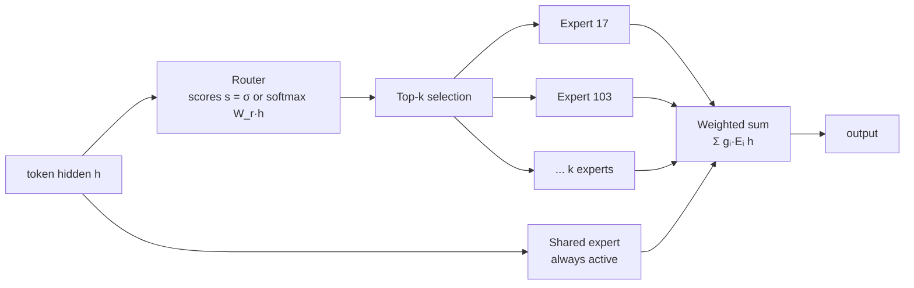
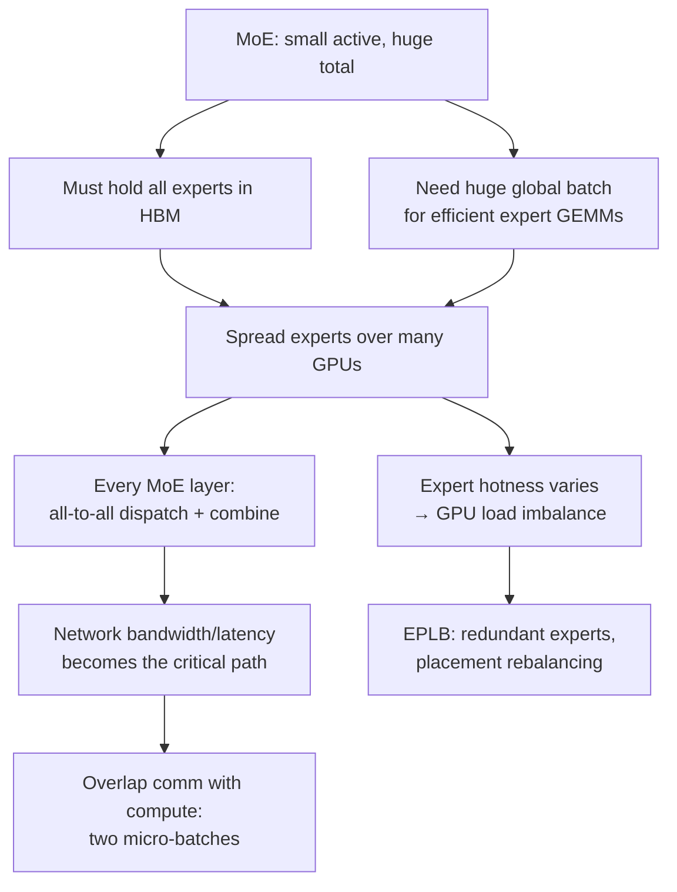
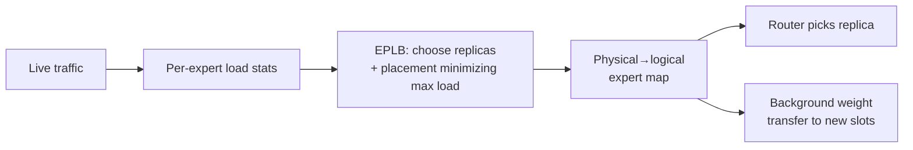

# Mixture of Experts Inference

A Mixture-of-Experts (MoE) model replaces each dense feed-forward block with many smaller "expert" FFNs and a **router** that sends each token to only a few of them. DeepSeek-V3 has **671B total** parameters but only **37B active** per token: each MoE layer has 1 shared expert plus 256 routed experts, of which 8 are activated per token. You get the knowledge capacity of a huge model at the per-token FLOPs of a mid-size one.

For inference engineers, MoE flips the usual intuitions:

- **FLOPs per token are small**, but **all weights must live somewhere in HBM**. Capacity, not compute, decides the minimum deployment.
- **Each expert sees only a slice of the batch**, so expert GEMMs stay memory-bound until the *global* batch is enormous. The way out is to aggregate tokens from many GPUs — which means **all-to-all communication on every layer**.
- **Load balance** across experts and GPUs becomes a first-class serving problem, not just a training regularizer.

## Anatomy of an MoE layer



Formally, for token hidden state `u`:

```
s_i      = affinity(u, e_i)                      # router score per expert
G        = TopK({s_i}, k)                        # selected experts
g_i      = normalize(s_i for i in G)             # gating weights
h_out    = u + Σ_{shared} FFN_j(u) + Σ_{i∈G} g_i · FFN_i(u)
```

### Routing variants

- **Top-k softmax gating** (GShard, Switch with k=1, Mixtral with 8 experts top-2).
- **Fine-grained experts + shared experts** (DeepSeekMoE): many small experts (better specialization, more combinatorial flexibility) plus always-on shared experts that capture common knowledge, so routed experts do not all relearn it.
- **Device- or node-limited routing** (DeepSeek-V2/V3): each token may only go to experts on at most `M` nodes (`M = 4` in V3), chosen by the sum of the highest affinity scores on each node. This caps cross-node traffic. DeepSeek notes that with their IB+NVLink forwarding, a token averages 3.2 experts per node, so they could scale to up to 13 experts at the same communication cost.
- **Auxiliary-loss-free load balancing** (DeepSeek-V3; Wang et al., 2024): add a per-expert bias `b_i` to the affinity **only for top-k selection**, not for the gating weight. After each step, decrease `b_i` for overloaded experts and increase it for underloaded ones. Balance improves without the quality penalty that an auxiliary balancing loss imposes on the gradients.

```
selection score  = s_i + b_i         # used for TopK only
gating weight    = s_i (normalized)  # used in the weighted sum
```

Inference consequence: the router is cheap but **non-negotiable** — it decides communication patterns every layer, and a trained-in balance is a statistical property of the *training* distribution, not of your production traffic. Real traffic (say, all-code or all-Chinese) can concentrate on a subset of experts.

## Active vs total parameters: the core asymmetry

| Model | Total | Active/token | Experts (routed, top-k) |
|---|---|---|---|
| Mixtral 8×7B | 47B | ~13B | 8, top-2 |
| DeepSeek-V3 / R1 | 671B | 37B | 256 + 1 shared, top-8 |
| Qwen3-235B-A22B | 235B | 22B | 128, top-8 |

Two numbers matter differently:

- **Compute per token ∝ active params** → prefill FLOPs and arithmetic per decode token are like a 37B dense model.
- **Memory capacity ∝ total params** → 671B at FP8 ≈ 671 GB of weights must be resident.
- **Memory traffic per decode step ∝ number of *distinct* experts touched by the batch.** This is the subtle one.

### How many experts does a batch touch?

With `E` routed experts, top-`k`, batch `B` tokens, and uniform routing, the probability an expert is untouched is `(1 − k/E)^B`. Expected experts touched:

```
E_touched = E · (1 − (1 − k/E)^B)
```

DeepSeek-V3, `E = 256`, `k = 8` (`k/E = 1/32`):

| Batch B (per layer, total) | Fraction touched | Avg tokens per touched expert |
|---|---|---|
| 1 | 3.1% | 1 |
| 8 | 22% | 1.1 |
| 32 | 64% | 1.6 |
| 128 | 98.3% | 4.1 |
| 1024 | ~100% | 32 |
| 8192 | ~100% | 256 |

The lesson: **past a batch of ~128, every decode step reads every expert**, but each expert does only a handful of tokens' worth of work. An expert GEMM of `[tokens × 7168] × [7168 × 2048]` with 4 tokens has arithmetic intensity ~4 FLOPs/byte at FP8 → deeply memory-bound (H100 ridge ≈ 300 FLOPs/byte for FP8 — see [[04 - Roofline and Performance Modeling]]). To get each expert to ~256 tokens per step you need a global batch of ~8k tokens per layer. No single GPU's KV cache holds that many concurrent sequences at long context. Hence: **spread experts across many GPUs, pool the batch from many attention-DP ranks.** That is the logic of wide EP.

## Why MoE shifts the bottleneck



## Expert parallelism: dispatch and combine

With EP across `N` GPUs, each GPU hosts `E/N` experts (plus possibly redundant copies). Per MoE layer:

1. **Route** locally: compute top-k for each local token.
2. **Dispatch** (all-to-all): send each token's hidden state to the GPUs owning its selected experts. Variable-size messages; the receiver learns how many tokens to expect per expert.
3. **Expert compute**: each GPU runs grouped GEMMs over its experts on the tokens it received.
4. **Combine** (all-to-all): send outputs back to the token's home GPU, where they are scaled by gating weights and summed.

Bytes per token per MoE layer (DeepSeek-V3: `h = 7168`, k = 8):

```
dispatch (FP8, + small scale factors) ≈ 8 × 7168 × 1 B ≈ 57 KB
combine  (BF16)                       ≈ 8 × 7168 × 2 B ≈ 115 KB
```

Node-limited routing plus "send once per node over IB, then fan out over NVLink" deduplicates inter-node traffic: a token that picks 3 experts on node 2 crosses IB once, not three times.

DeepSeek's production setup sends dispatch in FP8 and combine in BF16, matching training precision.

### DeepEP: communication kernels built for this

DeepSeek open-sourced **DeepEP** (Feb 2025), a library of all-to-all kernels specialized for MoE. Its original (V1) design shipped two kernel families, which map to the two serving phases:

| | Normal (high-throughput) kernels | Low-latency kernels |
|---|---|---|
| Phase | Prefill, training | Decode |
| Message sizes | Large (thousands of tokens) | Small (tens–hundreds of tokens per GPU) |
| Strategy | Hierarchical: IB across nodes → NVLink forward within node; asymmetric-domain bandwidth forwarding | Pure RDMA point-to-point, minimal hops |
| SM usage | Configurable number of SMs reserved for comm | Hook-based: no SMs occupied while data is in flight |
| CUDA graph | Not compatible (dynamic shapes, CPU sync for counts) | Compatible (fixed max shapes) |

The **hook-based overlap** of the low-latency kernels is a key idea: the dispatch call issues RDMA writes and returns immediately; a later "receive hook" waits for arrival. Between the two, the GPU does other work (e.g., attention of the other micro-batch) with all SMs available.

As of 2026 DeepEP has moved on: **V2** unified high-throughput and low-latency modes into a single `EPBuffer` interface, added an NCCL "Gin" device-side backend (dropping the NVSHMEM dependency in V2.5), supports larger scale-up/scale-out domains, and added primitives for dynamic redundant experts. The concepts above still hold; check the current README for APIs. Alternatives include pplx-kernels (Perplexity) and vendor equivalents on AMD and Ascend (DeepEP itself now has an Ascend port).

### Computation–communication overlap: two micro-batches

Split the batch into two micro-batches A and B. While A is in all-to-all, compute B's attention or experts, and vice versa.

```
time →
uB A:  [attn] [dispatch ~~~~] [experts] [combine ~~~~] [attn] ...
uB B:         [attn] [dispatch ~~~~] [experts] [combine ~~~~] ...
GPU SMs busy: ███████████████████████████████████████████████
```

DeepSeek's inference overview describes dual-batch overlap for prefill and, for decode where stage durations are uneven, a **5-stage pipeline** that splits attention into two steps to line up the overlap. SGLang reimplemented this as "two-batch overlap (TBO)". The cost: each micro-batch is half the size, so you need a large enough batch for halves to stay efficient.

## Expert compute: grouped GEMM

After dispatch, a GPU holds tokens for several local experts with varying counts:

```
expert 40: 312 tokens
expert 41:  17 tokens
expert 42: 288 tokens
expert 43:   0 tokens
```

Launching one GEMM per expert wastes launches and leaves SMs idle on tiny GEMMs. **Grouped GEMM** runs all experts' GEMMs in one kernel, with a scheduler distributing tiles across SMs. Two layouts:

- **Contiguous (prefill):** tokens for each expert packed back-to-back, each expert segment padded to the tile size. Good for large, variable counts.
- **Masked (decode):** fixed max tokens per expert buffer + a per-expert valid count. Shapes are static → CUDA-graph-capturable, which matters because decode is launch-bound.

DeepGEMM (DeepSeek) provides FP8 grouped GEMMs in both layouts with fine-grained (block-wise) scaling; CUTLASS, TensorRT-LLM, vLLM (fused MoE Triton kernels), and SGLang have their own. Fused MoE kernels also fold in the gate/up projection, activation (SiLU·mul), and sometimes the routing-weight multiplication.

**Small-batch regime (one GPU, few experts touched):** a different trick wins — a single fused kernel that loops over selected experts per token, reading only the needed expert weights ("fused MoE" in vLLM). Here the goal is just to stream the touched weights at full HBM bandwidth.

## Load balancing at inference: EPLB

Even with balanced training, production traffic makes some experts hot. With EP, the GPU holding a hot expert receives more tokens, finishes last, and every all-to-all waits on it. The step time is set by the **max** load across GPUs, not the mean.

**Expert-Parallel Load Balancer (EPLB)** (DeepSeek, open-sourced):

1. **Measure** per-expert load from live traffic over a window.
2. **Replicate** heavy experts: add `R` redundant expert slots (DeepSeek-V3 used 32 redundant experts in both prefill and decode deployments).
3. **Pack** experts (and replicas) onto GPUs to minimize the maximum load, using a greedy/bin-packing heuristic.
4. **Hierarchical mode** (when nodes divide expert groups): first balance expert groups across nodes to respect node-limited routing, then replicate and place within nodes. **Global mode** for decode with large EP.
5. The router now picks *which replica* of an expert to send each token to (round-robin or by load).
6. **Re-run periodically** — the DeepSeek-V3 report says high-load experts are re-detected and adjusted periodically (e.g., every 10 minutes), which means hot-swapping expert weights on a live system.



There are also **dynamic redundancy** schemes (DeepSeek mentions exploring them; MoonEP/UltraEP and DeepEP V2.5 add primitives) that select per-step which redundant experts to load, at the cost of moving weights more often.

Balance is also needed **upstream** of the experts: with attention-DP, each DP rank's attention work and dispatch-send volume must be equalized (balance KV usage and request counts across ranks during decode; balance input tokens and attention compute during prefill).

## Wide-EP production deployments (published numbers)

**DeepSeek-V3 technical report (Dec 2024)** — deployment described for H800 clusters:

- *Prefill:* minimum unit 4 nodes / 32 GPUs. Attention: TP4 + SP, DP8. MoE: EP32. 32 redundant experts; each GPU hosts its 8 original experts plus 1 redundant. Two micro-batches overlap attention/MoE of one with dispatch/combine of the other.
- *Decode:* minimum unit 40 nodes / 320 GPUs. Attention: TP4 + SP, DP80. MoE: EP320 — each GPU hosts **one** expert; 64 GPUs host redundant and shared experts. Dispatch/combine via direct point-to-point IB with IBGDA. The shared expert is treated as a routed expert that is always selected, so each token selects 9.

**DeepSeek inference system overview (Feb 2025, "Open Source Week" day 6)** — the configuration in production at that time:

- *Prefill:* Routed experts EP32, MLA/shared experts DP32; 4 nodes per unit, 32 redundant routed experts, each GPU handles 9 routed experts + 1 shared expert.
- *Decode:* Routed experts EP144, MLA/shared experts DP144; 18 nodes per unit, 32 redundant routed experts, each GPU manages 2 routed experts + 1 shared expert.
- Throughput per H800 node: **~73.7k input tokens/s** during prefill (including cache hits) or **~14.8k output tokens/s** during decode.
- 24-hour stats: peak 278 nodes, average 226.75 nodes; 608B input tokens (56.3% hit the on-disk KV cache), 168B output tokens; average output speed 20–22 tokens/s per user; average KV length per output token 4,989. Theoretical cost-profit margin 545% at R1 list prices (actual revenue lower).

Notice the evolution: attention moved from TP4×DP to pure DP (MLA prefers DP), and decode EP shrank from 320 to 144 with 2 routed experts per GPU — a trade between per-GPU memory and unit size/fault domain.

**SGLang reproduction (May 2025)**: DeepSeek-V3 on 12 nodes × 8 H100 with PD disaggregation and large-scale EP (DeepEP, DeepGEMM, two-batch overlap, EPLB): **52.3k input tokens/s and 22.3k output tokens/s per node** for 2000-token inputs, estimated at ~$0.20 per 1M output tokens. Note this is a benchmark with fixed input lengths, not DeepSeek's mixed production traffic — the two are not directly comparable.

## Large-batch decode economics

Why wide EP pays off: per GPU per decode step, a GPU reads
`attention weights + KV for its own requests + weights of ~2–3 experts per layer`
instead of `1/8 of all 671B weights`. Weight traffic per GPU drops by an order of magnitude, freeing HBM bandwidth for KV reads — so each GPU can run a larger batch at the same TPOT. Meanwhile each expert receives tokens from all 144 DP ranks, so expert GEMMs are reasonably large.

The costs:

- **Fault domain:** 18–40 nodes behave as one unit; one GPU failure stalls the unit. Requires fast detection, removal, and re-placement.
- **Tail latency:** every layer has two global synchronizations; the slowest GPU, NIC, or straggling request sets the pace.
- **Scheduling coupling:** all DP ranks must step in lockstep (each forward pass is a collective). Idle ranks must still participate with dummy batches.
- **Ops complexity:** EPLB re-placement, weight hot-swap, multi-node CUDA graphs.

Small-scale alternative: on one 8×H200/B200 node, run attention-DP8 + EP8 or TP8. Simpler, single fault domain, but weight traffic per GPU is much higher, so throughput per GPU is lower.

## Speculative decoding and MoE

MTP/speculative decoding fits MoE decode well: verification adds tokens per step, but each expert still sees few tokens, so the extra work stays memory-bound and cheap. DeepSeek-V3's MTP module achieves 85–90% second-token acceptance (≈1.8× TPS). See [[09 - Speculative Decoding]].

## Quantization specifics

- **Expert weights dominate memory** (~95%+ of DeepSeek-V3's parameters are in routed experts), so expert quantization (FP8, FP4/NVFP4, INT4 weight-only) gives most of the capacity win.
- **Block-wise FP8** (DeepSeek: 128×128 weight blocks, 1×128 activation tiles) is native for V3; NVFP4 on Blackwell halves it again.
- Routers and shared experts are often kept at higher precision; router errors change *which* experts run, an error mode dense models do not have.
- Communication payloads can be quantized too (FP8 dispatch). See [[08 - Quantization]].

## What practitioners actually do

1. **Estimate memory first**: total params × bytes + KV for target concurrency. This sets the minimum GPU count.
2. **Pick the scale regime**: single node (TP or DP-attention + EP) for modest traffic; wide EP + PD disaggregation for large, steady traffic.
3. **Use attention-DP for MLA models**, EP for experts.
4. **Turn on two-batch overlap** once per-rank batches are big enough.
5. **Deploy EPLB** and monitor per-expert and per-GPU load; re-balance periodically.
6. **Balance DP ranks** in the router: equalize KV usage and request count.
7. **Profile all-to-all** latency at real message sizes; look for stragglers.
8. **Use MTP** if the model ships with it.

## Common mistakes

- Sizing compute by active parameters and forgetting all experts must be resident.
- Benchmarking MoE at small batch and concluding it is "fast like a 37B model" — at real batch every expert is read every step.
- Running TP across nodes for MoE instead of EP.
- Ignoring expert skew from production traffic; trusting training-time balance.
- Using non-graph-capturable dispatch kernels in decode, then losing to launch overhead.
- Comparing tokens/s/node between a fixed-length benchmark and a mixed production workload.

## Check yourself

1. **DeepSeek-V3: why is decode memory traffic closer to 671B than 37B per step at batch 256 on one node?**
   With 256 tokens × top-8 over 256 experts, essentially every expert is selected by some token, so all expert weights are read each step.

2. **Compute the expected fraction of experts touched for E = 64, k = 2, B = 16.**
   `1 − (1 − 2/64)^16 = 1 − 0.969^16 ≈ 1 − 0.60 = 0.40` → ~40%.

3. **What does the auxiliary-loss-free bias change, and what does it not change?**
   It changes which experts are selected (bias added to selection score); it does not change the gating weights used to combine outputs.

4. **Why were DeepEP low-latency kernels designed to be CUDA-graph compatible?**
   Decode steps are short and launch-bound; graph capture removes CPU launch overhead, but requires static shapes — so the kernels use fixed max buffer sizes.

5. **What is the role of redundant experts?**
   Replicating hot experts lets their tokens be split across multiple GPUs, lowering the maximum per-GPU load that sets the step time.

6. **Why does attention-DP need its own load balancer?**
   Each DP rank's attention cost depends on its requests' KV lengths; one overloaded rank delays every all-to-all.

7. **Prefill vs decode: which uses masked grouped GEMM, and why?**
   Decode — static shapes per expert enable CUDA graphs; prefill uses contiguous layout for large variable token counts.

8. **Why might decode EP be smaller (144) than the theoretical "one expert per GPU" (320)?**
   Smaller units mean smaller fault domains and less all-to-all fan-out; with enough HBM, hosting 2 experts per GPU keeps expert GEMMs efficient while reducing nodes per unit.

## Further reading

- Lepikhin et al. — *GShard*: https://arxiv.org/abs/2006.16668
- Fedus, Zoph, Shazeer — *Switch Transformers*: https://arxiv.org/abs/2101.03961
- Dai et al. — *DeepSeekMoE*: https://arxiv.org/abs/2401.06066
- DeepSeek-AI — *DeepSeek-V2* (MLA, device-limited routing): https://arxiv.org/abs/2405.04434
- DeepSeek-AI — *DeepSeek-V3 Technical Report* (§2.1.2, §3.4): https://arxiv.org/abs/2412.19437
- Wang et al. — *Auxiliary-Loss-Free Load Balancing Strategy for MoE*: https://arxiv.org/abs/2408.15664
- DeepSeek-V3/R1 inference system overview: https://github.com/deepseek-ai/open-infra-index/blob/main/202502OpenSourceWeek/day_6_one_more_thing_deepseekV3R1_inference_system_overview.md
- DeepEP: https://github.com/deepseek-ai/DeepEP
- DeepGEMM: https://github.com/deepseek-ai/DeepGEMM
- EPLB: https://github.com/deepseek-ai/EPLB
- Profile data (overlap traces): https://github.com/deepseek-ai/profile-data
- SGLang — *Deploying DeepSeek with PD Disaggregation and Large-Scale Expert Parallelism on 96 H100 GPUs*: https://lmsys.org/blog/2025-05-05-large-scale-ep/

## Related

- [[04 - Roofline and Performance Modeling]] — why tiny expert GEMMs are memory-bound
- [[08 - Quantization]]
- [[09 - Speculative Decoding]]
- [[10 - Parallelism]] — EP and attention-DP
- [[12 - Disaggregated Serving]]
- [[13 - Kernels, Compilers, and CUDA Graphs]]
- [[21 - Case Study - DeepInfer]] — MoE EP + EPLB in a production engine
- [[98 - Formula Cheatsheet]]
