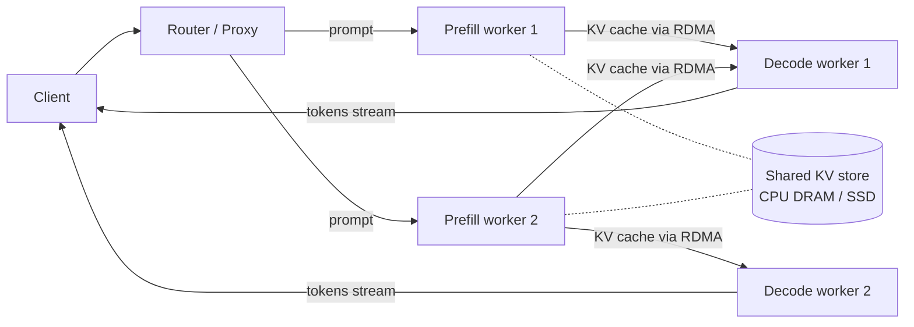
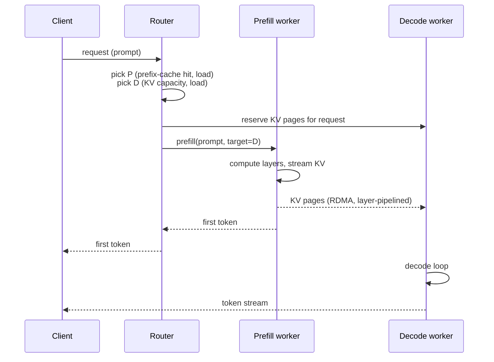

# Disaggregated Serving

Every LLM request has two phases with opposite personalities:

| | Prefill | Decode |
|---|---|---|
| Work | Process all `n` prompt tokens at once | Generate one token per step per sequence |
| Bottleneck | **Compute** (big GEMMs, quadratic attention) | **Memory bandwidth** (weights + KV re-read every step) |
| Latency metric | TTFT (time to first token) | TPOT / ITL (time per output token) |
| Duration | One burst: tens of ms to seconds | Many short steps: 10–50 ms each, for seconds to minutes |
| Ideal parallelism | Enough to finish fast; little TP needed for throughput | High TP / wide EP to cut per-step weight reads |
| Ideal batch | A few thousand tokens fills the GPU | As many sequences as KV memory allows |

Running both on the same GPUs (**colocated** serving) forces one scheduler, one parallelism config, and one hardware choice to serve two different workloads. **Prefill–decode (PD) disaggregation** runs them on separate GPU pools and ships the KV cache from prefill workers to decode workers.



## The interference problem

In a colocated engine with continuous batching (see [[07 - Batching and Scheduling]]), each iteration mixes decode tokens of running requests with prefill tokens of new ones. Two pathologies:

1. **Prefill stalls decode.** A 32k-token prompt takes, say, 1.5 s to prefill on a 70B model. Without chunking, every running sequence's next token waits 1.5 s — a massive TPOT spike. With **chunked prefill** (Sarathi-Serve), the prompt is split into chunks (e.g., 2048 tokens) mixed with decode; decode steps slow from ~25 ms to ~80 ms instead of stalling, but TPOT still degrades for everyone during prefill-heavy periods.
2. **Decode slows prefill.** Each iteration's token budget is shared; decode tokens take a slice, so prompts finish later → higher TTFT. Prioritizing prefill to protect TTFT hurts TPOT, and vice versa.

You can tune the chunk size to trade TTFT against TPOT, but the two SLOs are **coupled** in a colocated system. Disaggregation decouples them.

**Worked illustration.** Llama-70B on 8×H100, TP=8. A pure decode step at batch 64 ≈ 25 ms. Mixing a 2048-token prefill chunk into that step adds roughly the chunk's compute: `2 × 70e9 × 2048 ≈ 2.9e14 FLOPs`; at ~4 PFLOP/s effective across 8 GPUs (8 × 989 TFLOP/s BF16 at ~50% MFU) ≈ 72 ms. Step time jumps to ~100 ms — a 4× TPOT spike for 64 users while one user's prompt is processed. Chunking smaller reduces the spike but lengthens TTFT and adds per-chunk overhead.

## Goodput: the metric that motivates disaggregation

DistServe (Zhong et al., OSDI 2024) argues that raw throughput is the wrong objective. Define:

```
goodput = max request rate such that ≥ X% of requests (e.g., 90%)
          meet BOTH the TTFT SLO and the TPOT SLO
```

Normalized **per-GPU goodput** (goodput / number of GPUs) is the cost metric. A colocated system can have high throughput but low goodput because interference pushes many requests over one of the SLOs.

DistServe co-optimizes resource allocation and parallelism per phase and places the phases according to cluster bandwidth. It reports serving **7.4× more requests or 12.6× tighter SLOs** than state-of-the-art colocated systems of the time, while keeping > 90% of requests within latency constraints.

## The lineage

- **Splitwise** (Patel et al., ISCA 2024, Microsoft): characterizes the phases on production traces; shows prompt computation is compute-heavy while token generation underutilizes compute and can run on cheaper/lower-power hardware. Designs clusters with same or different machine types per phase, using fast back-plane interconnects for state transfer. Reports **1.4× higher throughput at 20% lower cost**, or **2.35× more throughput at the same cost and power**.
- **DistServe** (Zhong et al., OSDI 2024): goodput framing, per-phase parallelism search, bandwidth-aware placement.
- **Mooncake** (Qin et al., FAST 2025, Moonshot AI / Kimi): a **KVCache-centric** disaggregated architecture. Separates prefill and decode clusters and also builds a disaggregated KV cache pool from underused CPU DRAM, SSD, and NIC resources. Scheduler is KV-centric (place prefill where the reusable prefix lives) and includes **prediction-based early rejection** for overload. Reports up to **525% throughput increase** in certain simulated scenarios while meeting SLOs, and **75% more requests** under real Kimi workloads.
- **DeepSeek-V3/R1 production** (2025): PD disaggregation with different EP widths per phase (prefill EP32 over 4 nodes, decode EP144 over 18 nodes) plus an on-disk KV cache; 56.3% of input tokens hit the disk KV cache over a 24-hour window. See [[11 - Mixture of Experts Inference]].
- **TetriInfer**, **Llumnix** (live migration across instances), **LoongServe** (elastic sequence parallelism for long context) explore related ideas.

## KV cache transfer

After prefill, the request's KV must move to the decode worker before the first decode step.

### How big is it?

```
KV bytes = n_tokens × n_layers × 2 (K and V) × n_kv_heads × d_head × bytes
```

| Model | KV per token | 8k-token prompt |
|---|---|---|
| Llama-3.1-8B (GQA 8 heads, BF16) | 128 KB | 1.0 GB |
| Llama-3.1-70B (GQA 8 heads, BF16) | 320 KB | 2.6 GB |
| DeepSeek-V3 (MLA, 576-dim latent × 61 layers, BF16) | ~70 KB | 0.57 GB |

MLA's compressed KV makes DeepSeek-class models unusually cheap to disaggregate. FP8 KV halves all of these.

### How long does it take?

70B, 8k prompt, TP=8 on both sides; each GPU ships 1/8 of the KV (its heads) ≈ 330 MB over its own 400 Gb/s NIC (≈ 50 GB/s):

```
transfer ≈ 330 MB / 50 GB/s ≈ 6.6 ms   (ideal)
prefill  ≈ 2 × 70e9 × 8192 FLOPs / ~4 PFLOP/s ≈ 290 ms
```

Transfer is ~2% of prefill time, and it can be **pipelined layer by layer**: send layer `ℓ`'s KV while computing layer `ℓ+1`. Done well, KV transfer adds a few ms to TTFT. Done badly (CPU staging, TCP, serialized after prefill, many tiny messages for small pages), it adds hundreds of ms.

### Transfer mechanics

- **RDMA (InfiniBand / RoCE), GPU-direct**: NIC reads/writes GPU memory directly, no CPU copy. Essential.
- **Paged layouts**: KV lives in pages (see [[05 - KV Cache]]). Prefill and decode may use different page sizes or TP layouts (e.g., prefill TP=4, decode TP=8), so the transfer may need **re-sharding** — head splitting/merging, page remapping. Mismatched layouts are a common source of bugs and slowness.
- **Pull vs push**: decode can pull KV when it has allocated pages (backpressure-friendly) or prefill pushes into pre-allocated decode pages (lower latency, needs reservation protocol).
- **Libraries**:
  - **NIXL** (NVIDIA Inference Xfer Library): point-to-point transfer library for inference frameworks such as Dynamo, abstracting CPU/GPU memory and file/block/object storage via a plug-in architecture (UCX and others as backends). Used by vLLM's and SGLang's PD connectors.
  - **Mooncake Transfer Engine**: RDMA transfer engine and distributed KV store from the Mooncake project, integrated into SGLang and vLLM.
  - **LMCache**: KV cache layer that can offload/share KV across instances and storage tiers; supports PD transfer in vLLM.
  - Framework connectors: vLLM's KV-connector API, SGLang's PD disaggregation backends, TensorRT-LLM's disaggregated serving.

## Sizing pools: the xPyD ratio

Deployments are described as `xPyD` — `x` prefill instances and `y` decode instances. The right ratio depends on the workload's input/output lengths, prefix-cache hit rate, and SLOs.

**Worked example.** Llama-70B, 8×H100 per instance (TP=8). Traffic: λ = 10 req/s, mean input 2,000 tokens (no cache hits), mean output 400 tokens. SLOs: TTFT p90 < 1 s, TPOT p90 < 40 ms.

*Prefill demand:* `10 × 2000 = 20k tokens/s`. A TP=8 instance at ~50% MFU prefills roughly `0.5 × 8 × ~990 TFLOP/s / (2 × 70e9) ≈ 28k tokens/s`. Utilization would be ~70% on one instance — queueing at that utilization threatens the TTFT p90 under bursts → **2 prefill instances** (~35% each).

*Decode demand:* each request decodes for `400 × ~25 ms ≈ 10 s`, so concurrent decoding sequences ≈ `λ × 10 s = 100` (Little's law). One instance at batch 100 with average context ~2,200 tokens holds `100 × 2200 × 320 KB ≈ 70 GB` of KV (spread over 8 GPUs) and runs ~25–30 ms/step → **1 decode instance**, with headroom check.

→ **2P1D**. Now change the workload to a reasoning model: input 1,000, output 4,000. Prefill demand drops to 10k tokens/s (1 instance), decode concurrency jumps to `10 × 4000 × 0.025 = 1000` sequences → ~8–10 decode instances → **1P8D**. Same model, opposite ratio. This is why static ratios fail and autoscalers resize each pool independently (see [[17 - Serving Systems, Routing, and Autoscaling]] and [[19 - Cost and Capacity Planning]]).

General rules:

```
prefill instances ∝ λ × uncached_input_tokens / prefill_throughput_per_instance
decode  instances ∝ λ × output_tokens × TPOT / max_batch_per_instance
                    (also constrained by KV memory: concurrency × avg_context × kv_bytes)
```

## Different configs per phase

Once separated, each pool can be optimized independently:

- **Prefill:** modest TP (or TP + SP), chunked long prompts, maximize MFU; hardware with the most FLOP/s per dollar; can use CP for very long prompts.
- **Decode:** high TP or wide EP, large batch, CUDA graphs, speculative decoding; hardware with the most HBM bandwidth and capacity per dollar.
- Heterogeneous hardware becomes possible (Splitwise's idea): e.g., compute-dense GPUs for prefill, high-HBM GPUs for decode.

DeepSeek's choice illustrates it: prefill EP32 (4 nodes) to keep the unit small and per-expert batches large thanks to long prompts; decode EP144 (18 nodes) to minimize per-GPU weight reads and pool a huge batch.

## Control plane



Routing decisions:

- **Prefill placement:** prefer the worker with the longest cached prefix (KV-aware routing), then lowest queue.
- **Decode placement:** enough free KV pages for the full expected length; balance batch sizes; for attention-DP+EP decode, balance KV usage across DP ranks.
- **First token:** emitted by prefill (it computes logits for the last prompt token), so TTFT does not wait for transfer.
- **Failure handling:** if transfer or decode fails, retry prefill or recompute; idempotent request IDs.

## Production stacks

- **NVIDIA Dynamo** (open source): orchestration layer above inference engines — it does not replace SGLang, TensorRT-LLM, or vLLM but coordinates them into a multi-node system: disaggregated serving, KV-aware routing, multi-tier KV caching, and automatic scaling. Uses NIXL for transfers. Built in Rust with Python extensibility.
- **llm-d** (CNCF sandbox; founded by Red Hat, Google Cloud, IBM Research, CoreWeave, NVIDIA): Kubernetes-native distributed serving above vLLM/SGLang — prefix-cache- and load-aware routing (built on the Kubernetes Gateway API Inference Extension), tiered KV offload, PD disaggregation, and wide EP. Its README cites e.g. up to 70% higher tokens/s with PD on GPT-OSS/B200 (AWS) and 10–30% on MI300X (Oracle) — vendor-reported, workload-specific numbers.
- **SGLang PD disaggregation:** prefill and decode servers plus a router; Mooncake or NIXL transfer backends; combined with DP-attention and DeepEP for DeepSeek-class models.
- **vLLM disaggregated prefill:** KV-connector abstraction (NIXL, LMCache, P2P NCCL, Mooncake connectors) with a proxy routing requests.
- **TensorRT-LLM** disaggregated serving with its own KV transfer.

## When disaggregation loses

Disaggregation is not free. It tends to lose when:

1. **Scale is small.** Two pools each need enough traffic to batch well. With 1–4 GPUs, you fragment capacity and lose statistical multiplexing.
2. **Prompts are short or mostly cached.** With high prefix-cache hit rates (multi-turn chat, agents), uncached prefill is tiny; chunked prefill hides it, and the transfer overhead plus extra hop dominates.
3. **The interconnect is slow.** No RDMA, or TCP-only across zones: transfer time rivals prefill time.
4. **Traffic mix shifts fast.** A fixed xPyD ratio is wrong half the day; if you cannot rebalance pools quickly, one side idles while the other queues.
5. **SLOs are loose.** Batch/offline workloads care about throughput, not TTFT/TPOT tails; colocated with large chunks maximizes utilization.
6. **Operational complexity matters more than the gain.** Two fleets, transfer failures, KV layout mismatches, more moving parts in the critical path.

Colocated alternatives that close part of the gap: chunked prefill with a tuned token budget (Sarathi-Serve), prefill/decode priority scheduling, and SM- or stream-level partitioning on the same GPU ("intra-GPU disaggregation"). Several engines also support a hybrid: colocated for small deployments, disaggregated above a threshold.

## What practitioners actually do

1. Measure TTFT and TPOT p90/p99 **under realistic mixed load** on a colocated baseline with chunked prefill. If both SLOs are met at the target cost, stop.
2. Compute **goodput per GPU** for colocated vs disaggregated configurations — not peak throughput.
3. Estimate KV bytes per request and check transfer time against TTFT budget; verify RDMA paths work end-to-end (GPUDirect, correct NIC affinity).
4. Size `xPyD` from the workload's ISL/OSL distribution and cache hit rate; autoscale pools independently.
5. Use KV-aware routing and a shared KV tier for prefix reuse.
6. Monitor transfer latency, KV-page reservation failures, and per-pool utilization.

## Common mistakes

- Comparing disaggregated vs colocated on throughput alone instead of SLO-constrained goodput.
- Benchmarking with fixed ISL/OSL that happens to suit one ratio, then deploying on real traffic with very different lengths.
- Ignoring prefix-cache hits in prefill sizing (overprovisioning prefill).
- Serializing transfer after the full prefill instead of pipelining per layer.
- Mismatched KV page sizes / TP layouts between pools causing slow scatter-gather transfers.
- Forgetting decode KV reservation, causing transfers into a worker that then preempts or OOMs.

## Check yourself

1. **Why do prefill and decode want different parallelism?**
   Prefill is compute-bound, so extra TP mostly adds communication; decode is bandwidth-bound per step, so TP/EP that reduces weight reads per GPU directly cuts TPOT.

2. **Define goodput.**
   The maximum request rate at which a target fraction of requests meets both TTFT and TPOT SLOs (often normalized per GPU).

3. **Why is MLA favorable for disaggregation?**
   Its compressed KV (~70 KB/token for DeepSeek-V3 in BF16) is several times smaller than GQA KV for comparable models, so transfer cost is low.

4. **Workload: input 500 tokens with 80% prefix-cache hits, output 1,500. Prefill- or decode-heavy?**
   Strongly decode-heavy: uncached prefill is ~100 tokens per request; the ratio skews toward decode (or disaggregation may not be worth it at all).

5. **Where does the first token come from in PD serving?**
   The prefill worker, which computes the logits for the last prompt position; TTFT need not wait for KV transfer.

6. **What does Mooncake add beyond PD separation?**
   A disaggregated KV cache pool across CPU DRAM/SSD/NIC resources, a KV-centric scheduler, and prediction-based early rejection under overload.

7. **Give two reasons a 4-GPU deployment should stay colocated.**
   Too little traffic to batch two pools efficiently; transfer and operational overheads outweigh interference savings, which chunked prefill already mitigates.

## Further reading

- Zhong et al. — *DistServe: Disaggregating Prefill and Decoding for Goodput-optimized LLM Serving*: https://arxiv.org/abs/2401.09670
- Patel et al. — *Splitwise: Efficient Generative LLM Inference Using Phase Splitting*: https://arxiv.org/abs/2311.18677
- Qin et al. — *Mooncake: A KVCache-centric Disaggregated Architecture for LLM Serving*: https://arxiv.org/abs/2407.00079 ; code: https://github.com/kvcache-ai/Mooncake
- Agrawal et al. — *Taming Throughput-Latency Tradeoff in LLM Inference with Sarathi-Serve* (chunked prefill): https://arxiv.org/abs/2403.02310
- Wu et al. — *LoongServe: Elastic Sequence Parallelism for Long-Context LLMs*: https://arxiv.org/abs/2404.09526
- DeepSeek-V3/R1 inference system overview: https://github.com/deepseek-ai/open-infra-index/blob/main/202502OpenSourceWeek/day_6_one_more_thing_deepseekV3R1_inference_system_overview.md
- NVIDIA Dynamo: https://github.com/ai-dynamo/dynamo ; NIXL: https://github.com/ai-dynamo/nixl
- llm-d: https://github.com/llm-d/llm-d
- SGLang PD disaggregation docs: https://docs.sglang.ai/advanced_features/pd_disaggregation.html
- vLLM disaggregated prefill docs: https://docs.vllm.ai/en/latest/features/disagg_prefill.html
- SGLang large-scale EP + PD blog: https://lmsys.org/blog/2025-05-05-large-scale-ep/

## Related

- [[05 - KV Cache]] — paging, prefix caching, KV size math
- [[07 - Batching and Scheduling]] — chunked prefill, continuous batching
- [[10 - Parallelism]] — per-phase parallelism
- [[11 - Mixture of Experts Inference]] — wide EP with PD
- [[16 - Long Context Inference]]
- [[17 - Serving Systems, Routing, and Autoscaling]]
- [[18 - Benchmarking and Profiling]] — measuring goodput
- [[19 - Cost and Capacity Planning]]
- [[98 - Formula Cheatsheet]]
