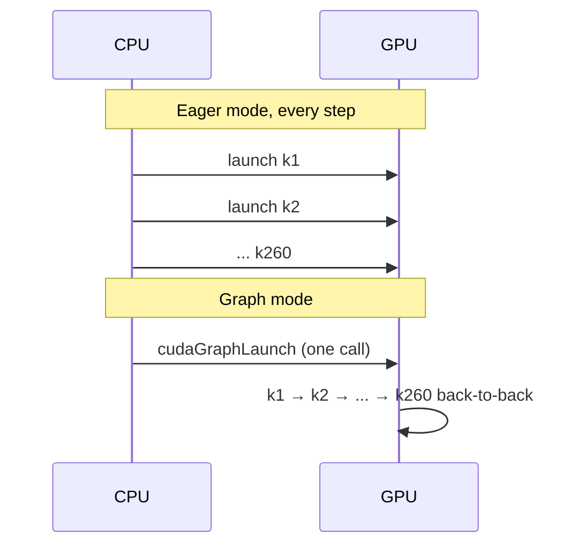
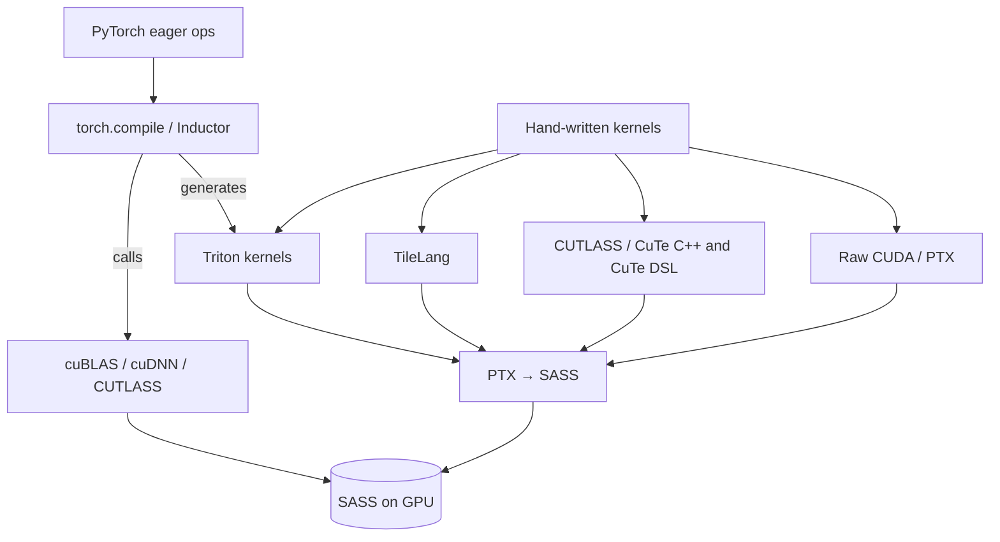

# Kernels, Compilers, and CUDA Graphs

Every token an LLM produces is, physically, a sequence of a few hundred GPU kernels: GEMMs, attention, norms, activations, rotary embeddings, sampling. The roofline in [[04 - Roofline and Performance Modeling]] tells you the *best possible* time for each of them. This note is about the gap between that bound and what actually happens — and the three tools engineers use to close it:

1. **Better kernels** — tiling, fusion, and hardware-specific tricks (CUTLASS, Triton, TileLang, DeepGEMM).
2. **Compilers** — generating fused kernels automatically (`torch.compile` / Inductor, TensorRT).
3. **CUDA graphs** — removing the CPU from the critical path so kernel *launch* stops being the bottleneck.

If you only remember one sentence: **prefill is usually compute-bound, decode at large batch is memory-bound, and decode at small batch is often launch-bound** — and each regime is fixed by a different tool.

## 1. CUDA execution model in five minutes

You need just enough of the model to reason about performance.

| Concept | What it is | Inference-relevant numbers (H100 SXM) |
| --- | --- | --- |
| **Thread** | One scalar instruction stream | — |
| **Warp** | 32 threads executing in lockstep (SIMT) | Unit of scheduling |
| **Thread block (CTA)** | Group of warps sharing **shared memory**, scheduled onto one SM | Up to 1024 threads |
| **Cluster** (Hopper+) | Group of CTAs on neighbouring SMs that can read each other's shared memory (DSMEM) | Up to 16 CTAs (non-portable) |
| **Grid** | All CTAs of one kernel launch | — |
| **SM** | Streaming multiprocessor: tensor cores, registers, shared memory/L1 | 132 SMs, up to 228 KB shared memory each |
| **HBM** | Off-chip DRAM | 80 GB, ~3.35 TB/s |
| **L2** | Shared cache | 50 MB |

The memory hierarchy is the whole game:

```
registers   (~256 KB/SM, ~1 cycle)
shared mem  (up to 228 KB/SM, ~20-30 cycles, programmer-managed)
L2          (50 MB, ~200 cycles)
HBM         (80 GB, ~500+ cycles, 3.35 TB/s aggregate)
```

A kernel is fast when it (a) reads each byte of HBM as few times as possible, (b) keeps the tensor cores fed from shared memory and registers, and (c) has enough parallel work (CTAs × warps) to hide latency. Everything else in this note is a variation on those three points.

**Tensor cores.** Matrix-multiply units that consume small tiles (e.g. on Hopper, `wgmma` instructions issued by a *warpgroup* of 4 warps operate on tiles such as 64×N×16 in BF16). On Hopper, data is moved into shared memory by the **TMA** (Tensor Memory Accelerator), an asynchronous copy engine that frees threads from address arithmetic. On Blackwell (SM100), the `tcgen05` MMA instructions accumulate into dedicated **tensor memory (TMEM)** rather than registers, and MMAs can span a pair of SMs (2-CTA mode). You do not need to write these by hand, but you need to know they exist, because "this library supports Hopper but not Blackwell" usually means "this library hard-codes `wgmma`".

## 2. Kernel launch overhead, and why small-batch decode is launch-bound

Launching a kernel from PyTorch costs CPU time: Python dispatch, the PyTorch dispatcher, argument packing, and the driver call. Typical numbers:

- Raw CUDA driver launch: ~2–5 µs of CPU time.
- Through eager PyTorch (Python → ATen → CUDA): ~5–20 µs per op, more for ops with complicated argument handling.

The GPU executes kernels asynchronously from a queue, so launch cost only hurts if **the CPU cannot enqueue kernels faster than the GPU drains them**.

### Worked example: a 1B model vs an 8B model, batch size 1

A decoder layer in eager PyTorch launches roughly 10–20 kernels (two norms, QKV GEMM, rotary, attention, output GEMM, residual add, gate/up GEMM, activation, down GEMM, residual add...). Call it 15.

**Llama-3.2-1B-ish** (16 layers, ~1.2B params, BF16 → ~2.5 GB of weights):

- Kernels per step: 16 × 15 + ~20 (embedding, final norm, LM head, sampling) ≈ **260 kernels**.
- CPU launch time at ~10 µs each: **~2.6 ms**.
- GPU memory-bound time: 2.5 GB / 3.35 TB/s ≈ **0.75 ms** (and realistically ~1 ms at 75% of peak bandwidth).

The GPU would finish in ~1 ms but the CPU needs ~2.6 ms to tell it what to do. The GPU sits idle ~60% of the time. Throughput: ~380 tokens/s instead of ~1000. **This is launch-bound.**

**Llama-3.1-8B** (32 layers, 16 GB of BF16 weights):

- Kernels: 32 × 15 + 20 ≈ 500 → **~5 ms** of CPU launches.
- GPU time: 16 GB / 3.35 TB/s ≈ **4.8 ms**, ~6 ms realistic.

Now CPU and GPU are roughly balanced — any Python hiccup (garbage collection, scheduler bookkeeping, detokenization) stalls the GPU.

At batch 256, GPU time grows (more KV reads, larger GEMMs) but launch count stays constant, so the problem disappears. **Launch overhead is a small-batch, small-model, decode-phase problem** — exactly the latency-sensitive regime users notice.

Two fixes:

1. **Fewer kernels** — fusion (Section 4).
2. **No CPU per kernel** — CUDA graphs (Section 3).

A third, complementary fix is **asynchronous scheduling**: overlap the CPU work of preparing step `t+1` (scheduling, building input metadata) with GPU execution of step `t`. vLLM V1, SGLang's overlap scheduler, and DeepInfer's "zero-overhead batch scheduler" all do this. See [[07 - Batching and Scheduling]].

## 3. CUDA graphs

A **CUDA graph** records a sequence of kernel launches (with their arguments and memory addresses) once, then replays the whole sequence with a single `cudaGraphLaunch`. Replay costs a few microseconds total instead of a few microseconds *per kernel*.



### Capture rules

Capture works by running the code on a special stream with recording turned on. The consequences are strict:

- **Static addresses.** The graph bakes in pointer values. Inputs must be copied into *pre-allocated, persistent* buffers before replay; outputs are read from persistent buffers after. This is why engines keep `input_ids_buffer`, `positions_buffer`, `slot_mapping_buffer`, `block_table_buffer` and so on.
- **Static shapes.** Kernel grid sizes are baked in. A graph captured for batch 8 cannot run batch 9.
- **No CPU synchronization** during capture (`.item()`, `.cpu()`, data-dependent Python control flow). These either error out or silently freeze one branch into the graph.
- **No dynamic allocation** inside the captured region unless it comes from the graph's private memory pool.

### Bucketing and padding

Since shapes are static, engines capture **one graph per batch-size bucket**, e.g. `[1, 2, 4, 8, 16, 24, 32, 40, ..., 256, 512]`, and pad each real batch up to the next bucket.

Worked example. Buckets `{1, 2, 4, 8, 16, 24, 32, 48, 64}`. A decode batch of 37 sequences runs the 48-graph, so 11 slots are dummy — 23% of the GEMM rows are wasted. But at batch 37 decode is memory-bound on the weights, so the wasted rows cost almost nothing (weight reads are the same for 37 or 48 rows). That is why padding is cheap in decode and why engines use coarse buckets at large sizes.

Costs of graphs:

- **Memory.** Each graph holds its own intermediate activations from a shared pool; dozens of buckets can cost hundreds of MB to a few GB. Engines expose knobs (vLLM's `cudagraph_capture_sizes`, SGLang's `--cuda-graph-max-bs`) partly for this reason.
- **Startup time.** Capturing 30–60 graphs takes seconds to a minute.
- **What can't be captured.** Prefill with variable sequence lengths is the classic case — the token count differs every step. Engines therefore traditionally used graphs for **decode only** and eager (or `torch.compile`d) execution for prefill. Newer engines use **piecewise CUDA graphs**: capture everything *except* attention (whose metadata varies) as graph pieces keyed on total token count, and run attention eagerly between them. vLLM V1 does this.
- **Attention metadata** (block tables, sequence lengths) must live in persistent buffers, and the attention backend must support a "graph-safe" mode with fixed grid sizes. This is why some attention backends are flagged as "CUDA-graph compatible" and others are not.

Speculative decoding complicates graphs further — the number of tokens per sequence changes with draft length. DeepInfer, for example, ships a separate `dflash_cuda_graph_runner.py` alongside the ordinary `cuda_graph_runner.py` for its draft/verify path. See [[09 - Speculative Decoding]].

### Minimal capture in PyTorch

```python
import torch

model = ...  # decode-step function: (input_ids, positions, kv_meta) -> logits
static_ids = torch.zeros(48, dtype=torch.long, device="cuda")
static_pos = torch.zeros(48, dtype=torch.long, device="cuda")

# Warm up on a side stream so lazy init/allocations happen outside capture.
s = torch.cuda.Stream()
s.wait_stream(torch.cuda.current_stream())
with torch.cuda.stream(s):
    for _ in range(3):
        model(static_ids, static_pos)
torch.cuda.current_stream().wait_stream(s)

g = torch.cuda.CUDAGraph()
with torch.cuda.graph(g):
    static_logits = model(static_ids, static_pos)

# Each step: copy real data in, replay, read out.
def step(ids, pos):
    n = ids.numel()
    static_ids[:n].copy_(ids); static_ids[n:].zero_()
    static_pos[:n].copy_(pos)
    g.replay()
    return static_logits[:n]
```

## 4. Operator fusion

Fusion merges several ops into one kernel so intermediate tensors stay in registers or shared memory instead of round-tripping through HBM. It wins on two axes at once: **fewer HBM bytes** and **fewer launches**.

### Byte-count argument

Take `y = rmsnorm(x + residual) * w` followed by FP8 quantization, for 256 tokens × hidden 8192 in BF16. One activation tensor is 256 × 8192 × 2 B = 4 MB.

Unfused:

| Kernel | Reads | Writes |
| --- | --- | --- |
| add | 8 MB | 4 MB |
| rmsnorm | 4 MB | 4 MB |
| quantize to FP8 | 4 MB | 2 MB |
| **Total** | | **26 MB** |

Fused "add + RMSNorm + quant": reads 8 MB (x, residual), writes 4 MB (new residual, needed later) + 2 MB (FP8) = **14 MB**, one launch instead of three. At 3 TB/s that is ~8.7 µs → ~4.7 µs, repeated twice per layer for 80 layers. Small per op; across the model it adds up to several percent of step time, and these elementwise ops dominate *non-GEMM* time.

### The standard fusions in LLM inference

| Fusion | Why |
| --- | --- |
| **Residual add + RMSNorm** | Both elementwise/row-reduction over the same tensor |
| **RMSNorm + quantize** (FP8/INT8/FP4) | Quantization needs the row/block max, which the norm kernel is already scanning — see [[08 - Quantization]] |
| **SwiGLU**: `silu(gate) * up` | Gate and up projections are concatenated into one GEMM; the activation kernel reads both halves once and writes half the bytes |
| **Rotary embedding (RoPE) fused into QKV epilogue or attention prologue** | Avoids a separate read/write of Q and K |
| **KV-cache write fused with RoPE** | Rotate K and scatter it into the paged cache in one pass |
| **GEMM epilogue fusion**: bias, activation, dequant scales, residual add | Applied while the output tile is still in registers |
| **Attention** itself (FlashAttention) | The canonical fusion: QKᵀ, softmax, ·V without materializing the score matrix — see [[06 - Attention Kernels]] |
| **Sampling**: temperature + top-k/top-p + softmax + draw | FlashInfer's sampling kernels avoid sorting the whole vocabulary — see [[15 - Sampling, Determinism, and Structured Output]] |
| **MoE**: routing top-k + permute + grouped GEMM + unpermute | See [[11 - Mixture of Experts Inference]] |

## 5. GEMM tiling: why matmul kernels look the way they do

Almost all FLOPs are GEMMs: `C[M,N] = A[M,K] · B[K,N]`. In decode `M` is the batch size (small), `N` and `K` are model dimensions (large).

A tiled GEMM assigns each CTA an output tile `BM × BN`. It loops over `K` in chunks of `BK`, loading an `BM × BK` slice of A and a `BK × BN` slice of B into shared memory, and accumulating with tensor cores.

**Arithmetic intensity of one tile:**

```
FLOPs per K-step   = 2 · BM · BN · BK
Bytes per K-step   = (BM·BK + BK·BN) · bytes_per_elem
Intensity          = 2·BM·BN / ((BM + BN) · bytes_per_elem)
```

For BF16 (2 bytes) and `BM = BN = 128`: intensity = 2·128·128 / (256·2) = **64 FLOP/byte** against shared memory/L2 traffic. Bigger tiles → higher intensity, but more registers and shared memory per CTA → fewer CTAs → harder to fill 132 SMs.

**Decode-shaped GEMMs** (`M` = 8, say) can't use a 128-row tile without wasting 15/16 of the tensor core work — but they don't need to, since they're memory-bound on B (the weights). Libraries ship specialized "skinny" or **split-K** kernels: split the K dimension across several CTAs to create enough parallelism, then reduce partial sums. Split-K matters for determinism too: the reduction order changes with the split count (see [[15 - Sampling, Determinism, and Structured Output]]).

**Wave quantization.** With 132 SMs and tiles that produce, say, 140 CTAs, the first wave runs 132 CTAs and the second wave runs 8 — the GPU is ~53% utilized for the second half. Good GEMM libraries choose tile shapes per problem size, or use **persistent kernels** (a fixed number of CTAs = number of SMs that loop over tiles) with **stream-K** decomposition to balance work.

**Pipelining.** Hopper/Blackwell kernels are *warp-specialized*: producer warps issue TMA loads for future K-steps into a multi-stage shared-memory ring buffer while consumer warpgroups run MMAs on the current stage. The epilogue (scale, cast, store) of tile `i` overlaps the main loop of tile `i+1` in persistent kernels. That overlap is the difference between ~60% and ~80%+ of peak.

## 6. The kernel-authoring stack



### cuBLAS / cuBLASLt

NVIDIA's closed-source GEMM library. Excellent default for plain BF16/FP8 GEMMs; heuristics pick a kernel per shape. Limitations: fixed menu of epilogues, limited control over fine-grained quantization scales and grouped (MoE) GEMMs.

### CUTLASS and CuTe

CUTLASS is NVIDIA's open-source C++ template library for GEMMs and convolutions. Since CUTLASS 3.x it is built on **CuTe**, a layout algebra: a `Layout` is a (shape, stride) pair, and tensors are pointer + layout. CuTe lets you express "partition this 128×128 tile across 4 warps, each owning a 64×N slice laid out for `wgmma`" as composable algebra instead of index arithmetic. Newer releases add a Python **CuTe DSL** that compiles to the same IR. FlashAttention-3 and many TensorRT-LLM kernels are CUTLASS/CuTe code.

Use CUTLASS when you need peak performance on a specific architecture and are willing to pay in compile times and template error messages.

### Triton

OpenAI's Python DSL where you program at the level of **blocks**, not threads. You write what one program instance (≈ one CTA) does to a tile; Triton handles thread mapping, shared memory, coalescing, and (partially) pipelining. Inductor emits Triton, vLLM and SGLang ship many Triton kernels (fused MoE, prefix-prefill attention, sampling helpers), and it runs on NVIDIA and AMD.

Strengths: fast to write, good for elementwise/reduction fusions and moderately good for GEMMs. Weakness: the newest hardware features (warp specialization, TMEM, 2-CTA MMA) arrive later and with less control than in CUTLASS.

### TileLang

A tile-level DSL (Python-embedded, built on TVM) that sits between Triton and CUTLASS: you write tile programs, but you can explicitly control layouts, pipelining stages, and thread binding when you need to. DeepSeek uses it heavily — DeepInfer's README lists custom TileLang kernels under `deepinfer/model_executor/layers/tilelang_ops`, and DeepSeek's FlashMLA/sparse-attention work has TileLang reference implementations. Paper: TileLang (arXiv 2504.17577).

### DeepGEMM

DeepSeek's open-source GEMM library, written for FP8 (and later more formats) with **fine-grained scaling**: per-1×128 activation blocks and per-128×128 weight blocks, matching DeepSeek-V3's FP8 training recipe. Key ideas worth studying:

- **JIT compilation** at runtime for each shape, so the kernel is fully specialized (no template-explosion at install time).
- Scale application in CUDA cores between tensor-core MMA chunks, promoting partial sums to FP32 to fix FP8's limited accumulation precision on Hopper.
- **Grouped GEMMs for MoE** in two layouts: *contiguous* (tokens of all experts concatenated, used in prefill) and *masked* (fixed per-expert capacity with a mask, CUDA-graph friendly, used in decode).
- Small, readable code base — one of the best ways to learn modern Hopper/Blackwell GEMM structure.

### torch.compile / Inductor

`torch.compile` traces the model with **Dynamo** (Python bytecode capture into an FX graph), then **Inductor** lowers the graph: it fuses pointwise and reduction ops into generated Triton kernels and calls cuBLAS (or Triton templates) for matmuls. Inference engines use it to:

- Automatically fuse the long tail of elementwise ops (norms, activations, residuals, quantization) without hand-writing each fusion.
- Apply **custom graph passes** — vLLM runs passes that pattern-match "RMSNorm then FP8 quant" or "all-reduce then RMSNorm" and replace them with hand-tuned fused kernels.
- Feed into CUDA graph capture (`mode="reduce-overhead"`, or the engine's own piecewise capture).

Practical issues: compile time (tens of seconds to minutes; cache it), **graph breaks** from unsupported Python (each break splits the graph and costs a launch), and **recompilation** on new shapes — mark the token dimension as dynamic (`torch._dynamo.mark_dynamic`) so one compiled artifact serves all batch sizes.

### TensorRT and the TensorRT-LLM approach

TensorRT compiles a whole network into an optimized engine with kernel auto-tuning per shape. TensorRT-LLM started as a "build an engine per model/config" workflow and has moved toward a PyTorch-native runtime that still uses TensorRT-LLM's hand-tuned kernels. See [[14 - Inference Engines Landscape]].

## 7. A worked Triton kernel: fused RMSNorm

RMSNorm: `y = x / sqrt(mean(x²) + ε) · w`. One program instance handles one row (one token). For hidden size ≤ ~16K the row fits in one block.

```python
import torch
import triton
import triton.language as tl


@triton.jit
def rmsnorm_kernel(
    x_ptr, w_ptr, y_ptr,
    row_stride,          # elements between consecutive rows
    N,                   # hidden size
    eps,
    BLOCK: tl.constexpr, # power of two >= N
):
    row = tl.program_id(0)
    cols = tl.arange(0, BLOCK)
    mask = cols < N

    # Load one row, upcast to fp32 for the reduction.
    x = tl.load(x_ptr + row * row_stride + cols, mask=mask, other=0.0).to(tl.float32)
    w = tl.load(w_ptr + cols, mask=mask, other=0.0).to(tl.float32)

    mean_sq = tl.sum(x * x, axis=0) / N
    rstd = tl.rsqrt(mean_sq + eps)
    y = x * rstd * w

    tl.store(y_ptr + row * row_stride + cols, y.to(y_ptr.dtype.element_ty), mask=mask)


def rmsnorm(x: torch.Tensor, w: torch.Tensor, eps: float = 1e-6) -> torch.Tensor:
    assert x.is_contiguous()
    M, N = x.shape
    y = torch.empty_like(x)
    BLOCK = triton.next_power_of_2(N)
    num_warps = 8 if BLOCK >= 4096 else 4
    rmsnorm_kernel[(M,)](x, w, y, x.stride(0), N, eps, BLOCK=BLOCK, num_warps=num_warps)
    return y


if __name__ == "__main__":
    x = torch.randn(4096, 8192, device="cuda", dtype=torch.bfloat16)
    w = torch.randn(8192, device="cuda", dtype=torch.bfloat16)
    ref = (x.float() * torch.rsqrt(x.float().pow(2).mean(-1, keepdim=True) + 1e-6) * w.float()).bfloat16()
    torch.testing.assert_close(rmsnorm(x, w), ref, atol=2e-2, rtol=2e-2)

    ms = triton.testing.do_bench(lambda: rmsnorm(x, w))
    gbytes = (2 * x.numel() * x.element_size() + w.numel() * w.element_size()) / 1e9
    print(f"{ms*1e3:.1f} us, {gbytes / (ms / 1e3):.0f} GB/s")
```

How to read the result: the kernel moves 4096 × 8192 × 2 B × 2 (read + write) ≈ 134 MB. On an H100 at a realistic ~2.8–3.0 TB/s that is ~45–48 µs. If you measure 100 µs you are at ~40% of bandwidth and something is wrong (uncoalesced loads, too few warps, register spills). **Always report memory-bound kernels as achieved GB/s against peak** — that one number tells you whether further work is worthwhile.

Exercises: (1) fuse the residual add (take `residual_ptr`, write the new residual); (2) add an FP8 output with a per-row scale (`amax = tl.max(tl.abs(y))`, `scale = amax / 448.0`); (3) handle hidden sizes larger than one block by looping over chunks.

## 8. Profiling kernels

A practical order of operations:

1. **End-to-end timeline: Nsight Systems (`nsys`) or `torch.profiler`.** Look for gaps between kernels (launch-bound or CPU-bound), unexpected synchronizations (`cudaStreamSynchronize`, `.item()`), NCCL kernels that don't overlap compute, and which kernels dominate total time.

   ```bash
   nsys profile -t cuda,nvtx,osrt --cuda-graph-trace=node -o decode python bench_decode.py
   ```

   `--cuda-graph-trace=node` is essential; otherwise a captured graph appears as one opaque block.

2. **Per-kernel: Nsight Compute (`ncu`).** For the top kernels, check:
   - **DRAM throughput % of peak** — memory-bound kernels should be 70–90%.
   - **Tensor pipe / SM throughput %** — compute-bound GEMMs should be 60–80%+.
   - **Achieved occupancy** and **warp stall reasons** (`long_scoreboard` = waiting on global memory; `barrier` = waiting at `__syncthreads`; `mio_throttle` = shared-memory pressure).
   - **Register spills** ("local memory" traffic) — usually a sign the tile is too big.

   ```bash
   ncu --set full -k regex:rmsnorm -c 5 -o rmsnorm_report python bench.py
   ```

3. **Compare with the roofline.** For each hot kernel compute bytes and FLOPs by hand ([[04 - Roofline and Performance Modeling]]) and see whether it is near its bound. Optimize the kernel that has the largest *(actual time − bound time)*, not the one with the largest time.

4. **Microbenchmark in isolation** with `triton.testing.do_bench` or CUDA events, after warmup, with L2 flushed if the real workload would not have the data cached.

See [[18 - Benchmarking and Profiling]] for system-level methodology.

## What practitioners actually do

- **Don't write a kernel first.** Profile; find whether the step is launch-bound (gaps in the timeline), memory-bound, or compute-bound. Turn on CUDA graphs and `torch.compile` before touching kernels.
- **Reuse kernel libraries**: FlashAttention / FlashInfer / FlashMLA for attention, cuBLAS / CUTLASS / DeepGEMM for GEMM, DeepEP for MoE all-to-all, engine-provided fused norms and activations.
- **Write Triton for fusions** of elementwise/reduction chains and for odd shapes; write CUTLASS/CuTe or TileLang only for hot GEMM/attention variants where the last 20% matters.
- **Tune per shape.** GEMM performance depends heavily on M (batch). Engines profile GEMM configs over a grid of M values at startup or ship tuned config files (vLLM's fused-MoE JSON configs keyed by expert count, N, and GPU type).
- **Keep decode under a CUDA graph**, including sampling where possible, and use async scheduling so the CPU is never on the critical path.
- **Test numerics**, not just speed: compare against a float32 reference with appropriate tolerances, and check that greedy outputs match the unoptimized path on a regression prompt set.

## Common mistakes

- Benchmarking without warmup (first call includes JIT compilation and autotuning) or without `torch.cuda.synchronize()` (you time the launch, not the kernel).
- Reading a profile of eager code and optimizing kernels when the real problem is the 60% idle time between them.
- Capturing a CUDA graph that contains a `.item()` or a Python branch on tensor data — the branch is frozen at capture time and silently wrong later.
- Capturing too many graph buckets and running out of KV-cache memory, or too few and paying 2× padding.
- Assuming a kernel tuned on H100 is fast on B200 or MI300X — tile sizes, shared memory, and instructions differ.
- Fusing ops so aggressively that the kernel spills registers and runs slower than the unfused version.
- Reporting FLOP/s for memory-bound kernels (meaningless) or GB/s for compute-bound GEMMs.

## Check yourself

1. **Why does a 1B model at batch 1 benefit far more from CUDA graphs than a 70B model at batch 1?**
   The GPU work per step scales with weight bytes; launch overhead scales with kernel count, which is similar. For the 1B model launch time exceeds GPU time; for the 70B model GPU time dominates.
2. **A graph is captured for batch 32. A step has 27 sequences. What happens and what does it cost?**
   Inputs are copied into the persistent buffers and padded to 32; outputs for the 5 dummy rows are discarded. In decode the extra rows cost almost nothing because the step is memory-bound on weights and KV for real sequences only.
3. **Why do engines historically not use CUDA graphs for prefill?**
   Prefill's token count and attention metadata vary every step; a graph needs static shapes. Piecewise graphs (capture non-attention segments keyed by token count) partially fix this.
4. **Compute the HBM bytes saved by fusing `add + RMSNorm` for 1024 tokens × 4096 hidden in BF16.**
   Unfused: add reads 2×8 MB, writes 8 MB; norm reads 8 MB, writes 8 MB → 40 MB. Fused: read 16 MB, write residual 8 MB + output 8 MB → 32 MB. Saves 8 MB and one launch.
5. **What is split-K and when is it used?**
   Splitting the reduction dimension across CTAs and summing partial results. Used when M and N are too small to produce enough output tiles to fill the GPU — typical of decode GEMMs.
6. **Why does DeepGEMM provide a "masked" grouped-GEMM layout?**
   The number of tokens per expert varies per step; a fixed-capacity masked layout keeps shapes static so the MoE decode path can be captured in a CUDA graph.
7. **Your RMSNorm kernel runs at 900 GB/s on an H100. Is it worth optimizing?**
   Yes: peak is ~3.35 TB/s and well-written memory-bound kernels reach ~2.5–3 TB/s, so it is ~3× off its bound.
8. **What does `torch.compile` add on top of CUDA graphs?**
   Fusion (fewer kernels, fewer bytes) and graph-level rewrites. CUDA graphs only remove launch cost; they do not reduce HBM traffic.

## Further reading

- NVIDIA, *CUDA C++ Programming Guide* — https://docs.nvidia.com/cuda/cuda-c-programming-guide/
- NVIDIA, CUDA Graphs section of the programming guide and PyTorch docs — https://pytorch.org/docs/stable/notes/cuda.html#cuda-graphs
- CUTLASS and CuTe — https://github.com/NVIDIA/cutlass
- Triton documentation and tutorials (the fused softmax and layer-norm tutorials are the canonical starting point) — https://triton-lang.org/main/getting-started/tutorials/index.html
- TileLang paper (arXiv 2504.17577) — https://arxiv.org/abs/2504.17577 and repo https://github.com/tile-ai/tilelang
- DeepGEMM — https://github.com/deepseek-ai/DeepGEMM
- FlashInfer (attention and sampling kernels for serving) — https://github.com/flashinfer-ai/flashinfer
- PyTorch `torch.compile` docs — https://pytorch.org/docs/stable/torch.compiler.html
- Nsight Systems / Nsight Compute — https://developer.nvidia.com/nsight-systems, https://developer.nvidia.com/nsight-compute
- Simon Boehm, "How to Optimize a CUDA Matmul Kernel for cuBLAS-like Performance" — https://siboehm.com/articles/22/CUDA-MMM

## Related

- [[04 - Roofline and Performance Modeling]] — the bound every kernel is measured against
- [[03 - Accelerator Hardware]] — SMs, tensor cores, HBM, interconnect
- [[06 - Attention Kernels]] — the most important fused kernel
- [[08 - Quantization]] — FP8/FP4 GEMMs and fused quantization
- [[07 - Batching and Scheduling]] — async scheduling and padding
- [[14 - Inference Engines Landscape]] — where these kernels live
- [[18 - Benchmarking and Profiling]]
- [[21 - Case Study - DeepInfer]]
