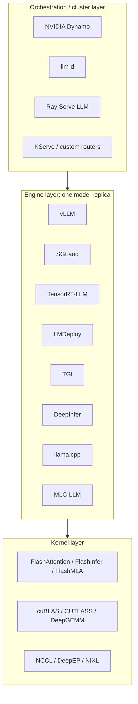
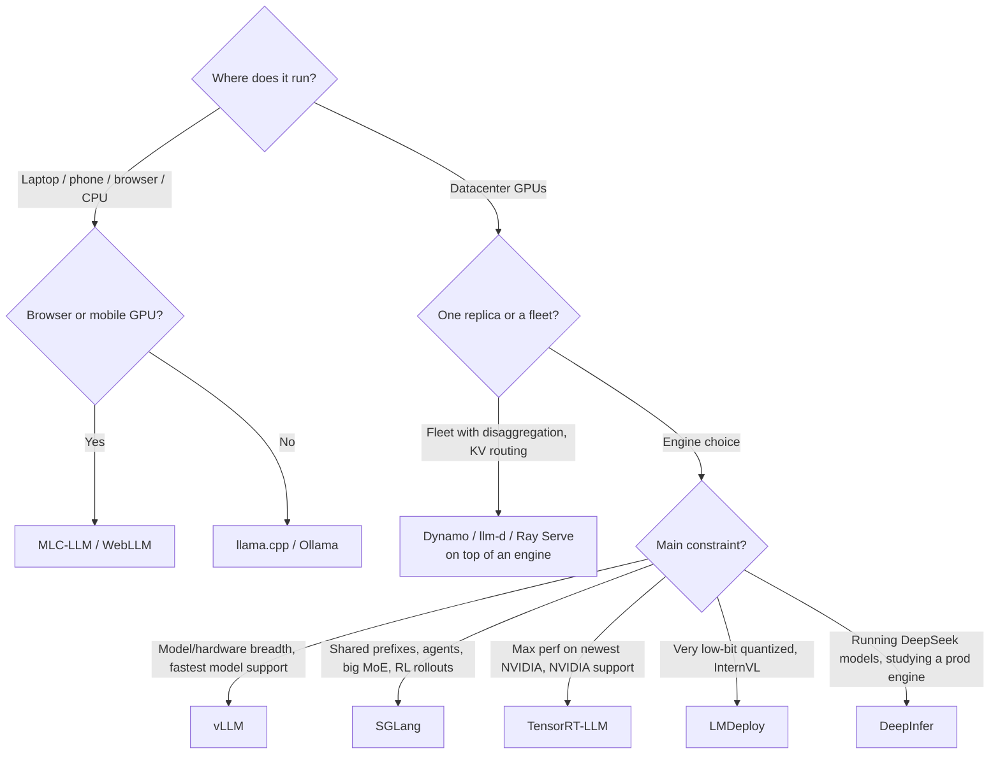
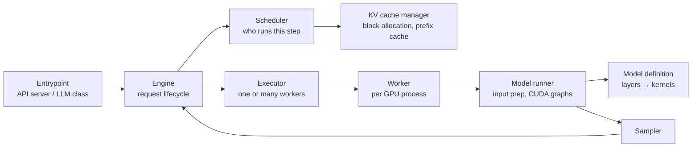

# Inference Engines Landscape

An **inference engine** is the program that turns "here is a model checkpoint and a stream of requests" into "here are tokens, fast and cheaply". Every engine re-implements the same core ideas from this vault — paged KV cache ([[05 - KV Cache]]), continuous batching ([[07 - Batching and Scheduling]]), fused attention ([[06 - Attention Kernels]]), quantization ([[08 - Quantization]]), speculative decoding ([[09 - Speculative Decoding]]), parallelism ([[10 - Parallelism]]) — and differs in which hardware it targets, which workloads it optimizes, and how hackable it is.

This note maps the landscape, gives you a decision procedure, and — most importantly — teaches you how to read any engine's source code, because the engine you use in two years may not exist yet.

> Version caveat: this field moves monthly. Feature lists below reflect the state of each project as of late 2026. Check the project's README and release notes before relying on a specific feature.

## 1. The layers of an inference stack

It helps to separate three layers, because projects are often confused across them:



- **Kernel layer** — libraries of fast GPU functions. Shared by most engines. See [[13 - Kernels, Compilers, and CUDA Graphs]].
- **Engine layer** — one model replica (possibly spanning many GPUs): scheduler, KV cache manager, model runner, sampler, OpenAI-compatible API.
- **Orchestration layer** — many replicas: request routing (KV-cache-aware), prefill/decode disaggregation, KV transfer, autoscaling. See [[12 - Disaggregated Serving]] and [[17 - Serving Systems, Routing, and Autoscaling]].

## 2. The engines

### vLLM

- **Origin**: UC Berkeley Sky Computing Lab, 2023, with the PagedAttention paper (SOSP 2023). Now a broad community project (PyTorch Foundation).
- **Positioning**: the default open-source serving engine. Widest model coverage, widest hardware coverage (NVIDIA, AMD ROCm, Intel, TPU, AWS Neuron, Ascend and others via plugins).
- **V1 architecture** (default since 2025): the original "V0" engine was rewritten. Key points from the V1 announcement:
  - An isolated **EngineCore** process runs only the scheduler + model executor loop. Tokenization, multimodal preprocessing, detokenization, and streaming run in other processes and overlap with GPU work.
  - A **unified scheduler** that does not distinguish prefill and decode phases: every request has "tokens computed so far" and "tokens wanted"; each step assigns a token budget across requests. Chunked prefill, prefix caching, and speculative decoding fall out of this one abstraction.
  - **Near-zero-overhead prefix caching**, on by default.
  - **Persistent batch** tensors updated incrementally instead of rebuilt each step.
  - **torch.compile + piecewise CUDA graphs** by default.
  - The V1 blog reported up to 1.7× throughput over V0 (without multi-step scheduling).
- **Strengths**: breadth, ecosystem, OpenAI-compatible server, quantization formats (GPTQ, AWQ, FP8, NVFP4, MXFP4...), LoRA, structured output, disaggregated prefill connectors.
- **Weaknesses**: breadth costs per-model peak performance; the code base is large.

### SGLang

- **Origin**: LMSYS / UC Berkeley, 2023–24 (paper: *SGLang: Efficient Execution of Structured Language Model Programs*). Now under the `sgl-project` org.
- **Signature ideas**:
  - **RadixAttention**: KV cache stored in a radix tree keyed by token sequences, so any shared prefix (system prompts, few-shot examples, multi-turn history, agent tool loops) is reused automatically with LRU eviction. See [[05 - KV Cache]].
  - **Overlap (zero-overhead) scheduler**: CPU scheduling of the next batch runs while the GPU executes the current one.
  - Fast structured output (integrates XGrammar / llguidance), compressed FSMs.
  - Strong large-scale MoE deployment: DP attention, expert parallelism with DeepEP, EPLB, prefill/decode disaggregation — widely used for DeepSeek-style models.
- **Strengths**: agentic and multi-turn workloads (prefix reuse), MoE at scale, RL rollout generation (used by many RL frameworks such as verl and slime).
- **Learning aid**: **Mini-SGLang** is a deliberately small re-implementation for education.

### TensorRT-LLM

- **Origin**: NVIDIA.
- **Positioning**: peak performance on NVIDIA hardware, especially newest generations (Hopper, Blackwell), with hand-tuned kernels for FP8/FP4, attention, MoE, and all-reduce.
- **Architecture evolution**: started as "compile a TensorRT engine per model and configuration" (slow builds, rigid shapes). It is now described as "architected on PyTorch" with a high-level Python `LLM` API; models are defined in native PyTorch and call TensorRT-LLM kernels. In-flight batching, paged KV, speculative decoding (Medusa, EAGLE, MTP), disaggregated serving.
- **Strengths**: best-in-class kernels on new NVIDIA GPUs, NVIDIA support, integrates with Triton Inference Server and Dynamo.
- **Weaknesses**: NVIDIA-only; historically harder to modify; model coverage narrower than vLLM.

### Text Generation Inference (TGI)

- **Origin**: Hugging Face, 2022–23, with a Rust router and Python/C++ model servers.
- **Status**: its README states TGI is now in **maintenance mode** (minor fixes and docs only). Hugging Face recommends vLLM and SGLang as backends for new deployments. Worth knowing historically (it popularized continuous batching in open source and its Rust router design is instructive), not as a new-project choice.

### LMDeploy

- **Origin**: Shanghai AI Lab / InternLM team.
- **Two engines**: **TurboMind** (C++/CUDA, derived from FasterTransformer, very fast for quantized weights — AWQ INT4, KV-cache INT8/INT4, MXFP4) and a **PyTorch engine** for faster model enablement and non-NVIDIA hardware (e.g. Ascend).
- **Strengths**: low-bit quantized inference, VLMs (InternVL family).

### llama.cpp (and the GGML ecosystem)

- **Origin**: Georgi Gerganov, 2023. Pure C/C++ with the GGML tensor library.
- **Positioning**: run LLMs *anywhere* — CPUs (x86 AVX2/AVX-512, ARM NEON), Apple Silicon (Metal), CUDA, ROCm, Vulkan, SYCL. Basis of Ollama, LM Studio and many desktop apps.
- **Signature ideas**: the **GGUF** single-file format; a rich family of block quantizations (`Q4_K_M`, `Q5_K`, `IQ` "i-quants" using importance matrices); memory-mapped weights; CPU+GPU layer offload; a built-in OpenAI-compatible `llama-server` with continuous batching.
- **Strengths**: portability, single-user latency on consumer hardware, tiny dependencies.
- **Weaknesses**: not designed for high-concurrency multi-GPU datacenter serving. See [[20 - Edge and On-Device Inference]].

### MLC-LLM

- **Origin**: CMU / OctoML / MLC community, built on **Apache TVM** compiler technology.
- **Positioning**: compile once, deploy everywhere — CUDA, ROCm, Vulkan, Metal, WebGPU (WebLLM runs models in the browser), iOS, Android.
- **Strengths**: the compiler approach (auto-generated kernels per target) makes it the go-to for browser and mobile GPU deployment. XGrammar came out of this group.

### DeepInfer

- **Origin**: DeepSeek, open-sourced in 2026 (Apache-2.0). Its README says it "powers DeepSeek's large-scale production services" and that it "was originally built primarily on vLLM, with additional inspiration from SGLang and TensorRT-LLM".
- **Scope of the release**: offline inference for DeepSeek-V4.1-Flash on NVIDIA SM100 (Blackwell) GPUs and Huawei Ascend 950 NPUs. Explicitly **not included**: the KV cache system, VE/prefill/decode disaggregation glue, and DP load balancing — i.e. the orchestration layer.
- **Features to study**: DeepSeek's kernel stack (FlashMLA, DeepGEMM, DeepEP, TileLang kernels), attention DP / balanced context parallel, MoE EP + EPLB, draft-token decoding with confidence-scheduled verification, sliding-window bounded replay, asynchronous scheduling, batch-invariant inference and deterministic sampling.
- **Why it matters for learning**: it is a rare look at a single-model-family production engine where every layer is specialized for one architecture. Full walkthrough in [[21 - Case Study - DeepInfer]].

### Orchestration layer: NVIDIA Dynamo, llm-d, Ray Serve

- **NVIDIA Dynamo** (open source, announced 2025): describes itself as "the orchestration layer above inference engines — it doesn't replace SGLang, TensorRT-LLM, or vLLM". Provides disaggregated prefill/decode, **KV-aware routing** (route requests to the worker that already has their prefix cached), a **KV Block Manager** that offloads KV across GPU → CPU → SSD → remote storage, and **NIXL**, a low-latency transfer library for moving KV between nodes.
- **llm-d**: a Kubernetes-native distributed serving stack built around vLLM (a CNCF sandbox project founded by Red Hat, Google Cloud, IBM Research, CoreWeave, and NVIDIA), with prefix-cache-aware and latency-predicting routing plus disaggregation.
- **Ray Serve LLM**: Ray's serving library with LLM-specific deployments wrapping vLLM (and SGLang), handling autoscaling, multi-model, multi-node placement in Python.

## 3. Comparison table

| Engine | Primary hardware | Best at | Paged KV | Prefix cache | Spec. decode | MoE EP at scale | Disaggregation | Hackability |
| --- | --- | --- | --- | --- | --- | --- | --- | --- |
| vLLM | NVIDIA, AMD, TPU, Intel, others | Breadth, general serving | Yes | Yes (default) | Yes (EAGLE, MTP, n-gram...) | Yes | Via connectors (NIXL, LMCache, ...) | Medium (big code base) |
| SGLang | NVIDIA, AMD, others | Prefix-heavy/agentic, MoE at scale, RL rollouts | Yes | RadixAttention | Yes (EAGLE family, MTP) | Strong (DeepEP, DP attn) | Yes | Medium–high |
| TensorRT-LLM | NVIDIA only | Peak perf on newest NVIDIA | Yes | Yes | Yes | Yes | Yes | Medium |
| LMDeploy | NVIDIA, Ascend | Low-bit quantized models, VLMs | Yes | Yes | Yes | Partial | Partial | Medium |
| TGI | NVIDIA, AMD, others | Legacy deployments (maintenance mode) | Yes | Yes | Limited | No | No | — |
| llama.cpp | CPU, Apple, consumer GPUs | Local, single-user, portability | Different design (ring of cells) | Prompt caching | Draft-model spec. | No | No | High (C/C++) |
| MLC-LLM | Any GPU incl. WebGPU, mobile | Browser/mobile deployment | Yes | Yes | Limited | No | No | Medium (compiler) |
| DeepInfer | NVIDIA SM100, Ascend 950 | DeepSeek models at production scale | Yes | (KV system not released) | Draft tokens + confidence-scheduled verify | Strong (EP + EPLB) | Engine side only | Low–medium (specialized) |

Treat the table as a starting map, not a scorecard: "Yes" hides large quality differences, and features land monthly.

## 4. How to choose



Practical procedure:

1. **Shortlist two engines** that support your model, hardware, and quantization format *today* (not "on the roadmap").
2. **Benchmark your workload**, not a generic one: your prompt-length and output-length distributions, your prefix-sharing ratio, your concurrency, your latency SLOs (TTFT, TPOT p99). See [[18 - Benchmarking and Profiling]].
3. **Plot throughput vs per-user speed (Pareto curves)** at several concurrency levels; pick the engine that dominates in the region your SLO allows. DeepInfer's README publishes exactly this kind of plot (prefill: throughput vs latency; decode: output throughput vs per-user speed).
4. **Weigh operability**: metrics, health checks, graceful drain, model-loading speed, upgrade cadence, how fast bugs get fixed.
5. **Re-evaluate every ~6 months.** Leadership changes per model and per GPU generation.

## 5. How to read an engine's code base

Every serious engine has the same skeleton. Learn it once and you can navigate any of them in an afternoon.



### The loop you are looking for

```python
while has_requests():
    batch = scheduler.schedule()          # choose requests + token budget, allocate KV blocks
    inputs = model_runner.prepare(batch)  # build input_ids, positions, block tables, slot mapping
    logits = model_runner.forward(inputs) # CUDA graph replay or eager/compiled forward
    tokens = sampler.sample(logits, batch.sampling_params)
    engine.update(batch, tokens)          # append tokens, check stop conditions, free KV
    engine.stream_outputs()
```

Find this loop first. Everything else is detail around it.

### Reading order and what to look for

| Step | Look for | Questions to answer |
| --- | --- | --- |
| 1. **Entrypoint** | `entrypoints/`, `api_server.py`, `LLM` class | How is a request represented? Where does tokenization happen? Which process? |
| 2. **Engine** | `engine/`, `llm_engine.py`, `engine_core.py` | Where is the main loop? Sync or async? How are outputs streamed back? |
| 3. **Scheduler** | `scheduler.py`, `core/sched/` | Token budget per step? Prefill/decode mixing? Preemption policy (recompute vs swap)? Priority? |
| 4. **KV cache manager** | `block_manager`, `kv_cache_manager`, `radix_cache` | Block size? How are prefix hashes computed? Eviction policy? |
| 5. **Worker / executor** | `worker/`, `executor/` | One process per GPU? How are TP/PP/EP groups initialized? |
| 6. **Model runner** | `model_runner.py`, `cuda_graph_runner.py` | Which buffers are persistent? Which batch sizes are captured? How is attention metadata built? |
| 7. **Model definition** | `models/<arch>.py`, `layers/` | Which attention backend? Which fused ops? How are weights loaded and sharded? |
| 8. **Sampler** | `sampler.py`, `sampling_params.py` | Which logits processors? Are penalties and top-p done on GPU? Seed handling? |

DeepInfer's top-level package mirrors this almost exactly: `entrypoints/`, `engine/llm_engine.py`, `worker/` (`worker.py`, `model_runner.py`, `cuda_graph_runner.py`, `cache_engine.py`), `model_executor/` (`models/`, `layers/`, `eplb/`, `model_loader.py`), `sampling_params.py`, `structure_output/`.

### Techniques that make it faster

- **Run a tiny model with a debugger** and step from `generate()` down to the first kernel call. One full trace teaches more than a day of reading.
- **Read a mini-engine first**: `nano-vllm` (a ~1,200-line vLLM-style engine) or `mini-sglang`. Then the full engine's extra code is "the same thing plus production concerns".
- **Grep for the environment variables and CLI flags** — they enumerate every feature switch and point to where it is implemented.
- **Read the tests** for the scheduler and KV manager; they encode the invariants.
- **Profile one step** with Nsight Systems and map each kernel back to its source line.
- **Follow one PR** that adds a model; it shows exactly which files a model touches.

## What practitioners actually do

- Most teams run **vLLM or SGLang** as the engine, with a router or orchestrator (Dynamo, llm-d, custom) on top, and TensorRT-LLM where NVIDIA-specific peak performance justifies it.
- Large labs with one dominant model family often **fork an open engine and specialize it** (DeepInfer is a public example: originally built on vLLM, now DeepSeek-specific).
- Teams **pin versions** and run their own regression benchmark (throughput, latency, *and* output quality / greedy-equality checks) before every upgrade.
- Engineers who become experts **contribute** to one of these engines: fixing a kernel or adding a model is the fastest route to understanding.

## Common mistakes

- Choosing an engine from a vendor's benchmark that used a different workload, GPU, or quantization.
- Comparing engines at a single concurrency level instead of along the throughput/latency Pareto frontier.
- Ignoring default differences (prefix caching on/off, chunked prefill size, max batch size, CUDA graph sizes) that dominate benchmark results.
- Confusing the engine layer with the orchestration layer ("should we use Dynamo or vLLM?" — usually both).
- Starting a new deployment on a project in maintenance mode.
- Reading an engine's code top-down from the API server, getting lost in HTTP plumbing, and never reaching the scheduler.

## Check yourself

1. **What is the difference between vLLM and NVIDIA Dynamo?**
   vLLM is an engine (one replica: scheduler, KV manager, model execution). Dynamo is an orchestration layer that coordinates many engine replicas (routing, disaggregation, KV offload/transfer). Dynamo can run vLLM underneath.
2. **Why does vLLM V1 put the scheduler and model executor in a separate EngineCore process?**
   So CPU work (tokenization, detokenization, streaming, multimodal preprocessing) overlaps with the GPU loop instead of stalling it.
3. **Your workload is a coding agent that re-sends a 30K-token conversation each turn. Which engine feature matters most?**
   Prefix caching (SGLang's RadixAttention or vLLM's prefix cache), plus KV-aware routing at the fleet layer so turns hit the replica holding the cache.
4. **When would you pick llama.cpp over vLLM?**
   Single-user or low-concurrency local inference on CPUs, Apple Silicon, or consumer GPUs, where portability and GGUF quantization matter more than high-concurrency throughput.
5. **What parts of a full inference service does the DeepInfer release explicitly omit?**
   The KV cache system, VE/prefill/decode disaggregation, and load balancing across data-parallel replicas.
6. **Name the eight components you trace when reading an engine.**
   Entrypoint, engine loop, scheduler, KV cache manager, worker/executor, model runner, model definition, sampler.
7. **Why compare engines with Pareto curves instead of single numbers?**
   Throughput and per-user latency trade off with batch size; an engine can win at high concurrency and lose at low. Only the curve shows which one is better under your SLO.

## Further reading

- Kwon et al., *Efficient Memory Management for Large Language Model Serving with PagedAttention* (SOSP 2023) — https://arxiv.org/abs/2309.06180
- vLLM V1 announcement — https://blog.vllm.ai/2025/01/27/v1-alpha-release.html ; repo https://github.com/vllm-project/vllm
- Zheng et al., *SGLang: Efficient Execution of Structured Language Model Programs* — https://arxiv.org/abs/2312.07104 ; repo https://github.com/sgl-project/sglang
- TensorRT-LLM — https://github.com/NVIDIA/TensorRT-LLM
- LMDeploy — https://github.com/InternLM/lmdeploy
- llama.cpp — https://github.com/ggml-org/llama.cpp
- MLC-LLM — https://github.com/mlc-ai/mlc-llm
- Text Generation Inference — https://github.com/huggingface/text-generation-inference
- NVIDIA Dynamo — https://github.com/ai-dynamo/dynamo
- llm-d — https://github.com/llm-d/llm-d
- Ray Serve LLM — https://docs.ray.io/en/latest/serve/llm/index.html
- Learning engines: nano-vllm https://github.com/GeeeekExplorer/nano-vllm ; mini-sglang https://github.com/sgl-project/mini-sglang
- DeepInfer — local copy at `projects/DeepInfer/` in this repository (README and `deepinfer/` package)

## Related

- [[07 - Batching and Scheduling]] — the scheduler in every engine
- [[05 - KV Cache]] — paged KV and prefix caching
- [[12 - Disaggregated Serving]] and [[17 - Serving Systems, Routing, and Autoscaling]] — the orchestration layer
- [[13 - Kernels, Compilers, and CUDA Graphs]] — the kernel layer
- [[18 - Benchmarking and Profiling]] — how to compare engines honestly
- [[21 - Case Study - DeepInfer]] — a production engine read end to end
- [[22 - Projects and Learning Roadmap]] — build your own mini-engine
