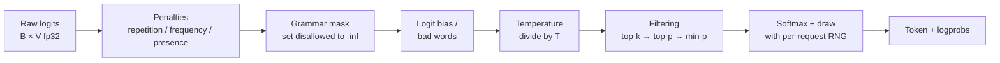
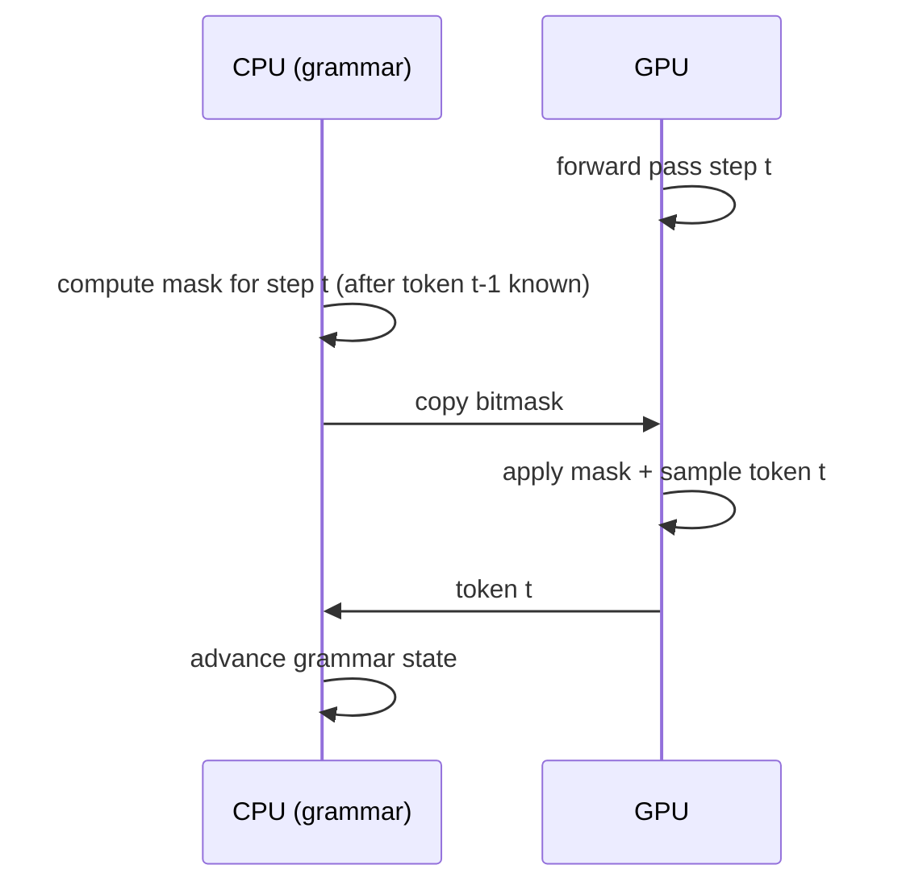

# Sampling, Determinism, and Structured Output

The model's forward pass ends with a vector of **logits** — one score per vocabulary entry (often 128K–256K entries). Everything that happens between those logits and the token you emit is the **sampler**. It looks like a tiny piece of the system, but it is where three practical problems live:

1. **Quality knobs** — temperature, top-k, top-p, min-p, penalties — that users tune and expect to behave identically across engines.
2. **Determinism** — why `temperature=0` still gives different outputs from run to run, and what it costs to fix.
3. **Structured output** — forcing the output to be valid JSON, match a schema, or call a tool correctly, by masking logits with a grammar.

An inference engineer must make all three fast (they run on the critical path of *every* decode step) and correct.

## 1. The logits-processing pipeline



The exact order varies by engine (and the order matters: applying top-p before temperature gives different results than after), which is one reason the "same" sampling parameters can produce different distributions across vLLM, SGLang, TensorRT-LLM, and hosted APIs. Typical order: penalties and masks first (they act on raw scores), temperature, then truncation, then sample.

Engineering constraints:

- **Batched and per-request.** Each sequence in the batch has its own parameters. Implementations vectorize: a `temperatures` tensor of shape `[B]`, `top_p` of shape `[B]`, and so on.
- **On GPU, no host sync.** A `.item()` or Python loop over the batch stalls the pipeline and breaks CUDA graphs ([[13 - Kernels, Compilers, and CUDA Graphs]]).
- **Vocabulary is large.** A full sort of 152K logits for each of 256 sequences is not free. Good samplers avoid full sorts.

## 2. Decoding strategies

Let `z ∈ ℝ^V` be the logits and `p = softmax(z)`.

### Greedy

`token = argmax(z)`. Deterministic in exact arithmetic. Used for evaluations, code, extraction, and as the "temperature 0" mode.

### Temperature

```
p_i(T) = exp(z_i / T) / Σ_j exp(z_j / T)
```

`T < 1` sharpens, `T > 1` flattens, `T → 0` approaches greedy. Engines special-case `T = 0` (or very small T) to argmax to avoid dividing by zero.

**Worked example.** Logits `z = [2.0, 1.0, 0.0]`.

- `T = 1`: `exp = [7.39, 2.72, 1.00]`, sum 11.11 → `p = [0.665, 0.245, 0.090]`.
- `T = 0.5`: `z/T = [4, 2, 0]`, `exp = [54.6, 7.39, 1.00]`, sum 63.0 → `p = [0.867, 0.117, 0.016]`.
- `T = 2`: `z/T = [1, 0.5, 0]`, `exp = [2.72, 1.65, 1.00]`, sum 5.37 → `p = [0.506, 0.307, 0.186]`.

### Top-k

Keep the `k` highest logits, renormalize. Simple, but a fixed `k` is too wide when the model is confident and too narrow when it is uncertain.

### Top-p (nucleus sampling)

Sort probabilities descending, keep the smallest prefix whose cumulative probability ≥ `p`, renormalize (Holtzman et al., *The Curious Case of Neural Text Degeneration*). Adapts the candidate set to model confidence.

Example with `p = [0.50, 0.25, 0.15, 0.06, 0.04]` and `top_p = 0.9`: cumulative `[0.50, 0.75, 0.90, ...]` → keep first three tokens, renormalize by 0.90 → `[0.556, 0.278, 0.167]`.

### Min-p

Keep tokens with `p_i ≥ min_p · p_max` (Nguyen et al., *Turning Up the Heat: Min-p Sampling*). With `min_p = 0.1` and `p_max = 0.5`, any token below 0.05 is dropped. It scales the cutoff to the top token's confidence and needs no sort — only a max and a comparison — which also makes it cheap.

### Efficient top-k/top-p on GPU

A naive implementation sorts the whole vocabulary per row: `O(V log V)` per sequence plus large memory traffic. Faster approaches:

- **Partial selection** (radix select / `topk`) when `k` is small.
- **Rejection-based sampling** (used by FlashInfer's sampling kernels): sample from the full distribution, then check whether the drawn token satisfies the top-p/top-k constraint against a pivot; if not, raise the pivot and resample. Expected passes are few, and no sort is needed.
- **Gumbel-max trick**: `argmax(z/T + g)`, where `g_i = -log(-log(u_i))` with `u_i ~ Uniform(0,1)`, is an exact sample from `softmax(z/T)`. It turns sampling into an argmax, which is easy to fuse and parallelize. (Some engines instead draw `q ~ Exponential(1)` and take `argmax(p_i / q_i)`, which is equivalent.)

### Penalties

Penalties discourage repetition by editing logits of tokens already seen.

| Penalty | Formula (per token `i`, `c_i` = count in output so far) | Notes |
| --- | --- | --- |
| **Repetition** (CTRL-style, `r > 1`) | `z_i ← z_i / r` if `z_i > 0`, else `z_i · r` (for tokens that appeared) | From the CTRL paper; often applied over prompt + output |
| **Frequency** (OpenAI-style) | `z_i ← z_i − α_f · c_i` | Grows with each repeat |
| **Presence** (OpenAI-style) | `z_i ← z_i − α_p · 1[c_i > 0]` | One-time penalty for any appearance |

Implementation cost: you need per-sequence token counts over the vocabulary. Engines keep a `[B, V]` bin-count tensor or scatter-add output tokens each step. That is a real memory cost at large batch: 256 × 152K × 4 bytes ≈ 156 MB. This is why some engines make penalties optional and compute them lazily only for requests that set them.

### Beam search, and why serving systems avoid it

Beam search keeps the `b` highest-probability partial sequences and expands each by its top tokens per step. It was standard for machine translation. In LLM serving it is rare because:

- Chat and creative outputs sampled with beam search are **bland and repetitive** — high-likelihood text is not high-quality text (the core finding of the nucleus-sampling paper).
- It multiplies KV cache and compute by `b`, and requires forking and pruning sequences every step, which complicates the scheduler and prefix sharing.
- Better alternatives exist for the cases where search helps: best-of-n with a verifier or reward model, or self-consistency voting.

Engines support it (vLLM keeps a beam-search API) but it is not a performance-tuned path.

### Logprobs

APIs often return the log-probability of the chosen token and the top-`n` alternatives. Engineering notes:

- Compute logprobs with `log_softmax` in **fp32** over the full vocabulary — and decide whether they reflect the distribution **before or after** temperature/penalties/truncation. vLLM, for example, has made this a configurable choice (raw vs processed logprobs); getting it wrong confuses RL users who need the exact sampling distribution.
- Returning top-20 logprobs for every token costs a `topk` per row plus host transfer and serialization — non-trivial at high throughput.
- **Prompt logprobs** (scoring the input) require keeping logits for every prompt position, which defeats the usual "only compute LM head for the last token" optimization.

## 3. Seeds and reproducible sampling

A per-request `seed` should make sampling reproducible. The subtlety is that the RNG must be **per request**, not per batch. If the engine draws one random tensor for the whole batch from a global generator, then a request's random numbers depend on which other requests are in the batch and in what order.

Correct designs derive the random number for request `r` at step `t` from `(seed_r, t)` alone — for example with a counter-based RNG (Philox) keyed on the request seed and offset by the step index. DeepInfer exposes a `seq_seed` on `SamplingParams` for exactly this purpose.

But even a perfect per-request RNG is not enough for determinism, because the **logits themselves** can change. That is the next section.

## 4. Why temperature 0 is not deterministic

### The original sin: floating-point non-associativity

In floating point, `(a + b) + c ≠ a + (b + c)` in general. Example in fp32:

```
(1e8 + 1) - 1e8 = 0       # 1e8 + 1 rounds back to 1e8
1e8 - 1e8 + 1   = 1
```

Any reduction — a dot product in a GEMM, the sum of squares in RMSNorm, the softmax denominator in attention — gives slightly different results depending on the order in which partial sums are combined. Two logits that are nearly tied can swap order, greedy picks a different token, and from then on the continuations diverge completely.

### The common myth: "concurrency + atomics"

A popular explanation is that GPU threads finishing in random order, with atomic adds, makes results random. Horace He's analysis for Thinking Machines (*Defeating Nondeterminism in LLM Inference*, September 2025) points out that the forward pass of a typical LLM **does not need atomic adds** and is run-to-run deterministic *for a fixed input batch*: the same kernel on the same shapes produces bitwise-identical results.

### The real cause: lack of batch invariance

The nondeterminism users see comes from the fact that **the batch changes**. On a server, your request is batched with whatever else is in flight. Kernels choose different strategies for different batch sizes and sequence layouts:

- **Matmul**: for small `M`, a library may use split-K or a different tile shape, changing the reduction order along `K`.
- **RMSNorm**: with few rows, a kernel may split one row's reduction across several thread blocks.
- **Attention**: in decode, split-KV ("flash-decoding") splits the key sequence into chunks whose number depends on batch size and sequence length; chunked prefill and prefix caching change how a sequence's keys are partitioned between cached and new.

So the output for *your* request depends on *other people's* requests — nondeterministic from your point of view even though every kernel is deterministic.

**Measured effect.** In the Thinking Machines experiment, Qwen3-235B-A22B-Instruct-2507 sampled 1000 completions at temperature 0 for "Tell me about Richard Feynman" (1000 tokens each) on vLLM: **80 unique completions**, the most common appearing 78 times. All were identical for the first 102 tokens; at token 103, 992 said "Queens, New York" and 8 said "New York City". With batch-invariant kernels, all 1000 were identical.

### Making kernels batch-invariant

The fix is to make every reduction's order independent of batch size and of how the sequence is chunked:

| Op | Batch-invariant strategy |
| --- | --- |
| RMSNorm | One row per CTA ("data-parallel" over rows), never split a row's reduction, even when the batch is small and the GPU is underused |
| Matmul | Fix one kernel configuration (tile sizes, no split-K or a fixed split) for all shapes; accept lower performance on small `M` |
| Attention | Make the KV-cache layout and the reduction identical whether keys come from the cache or the current chunk; for split-KV decoding use a **fixed split size** (not a fixed number of splits), so the reduction order over keys is always the same |

The reference implementation is a PyTorch library of batch-invariant ops plus a vLLM "deterministic mode". Reported cost (Qwen3-8B, one GPU, 1000 sequences of 90–110 output tokens): vLLM default **26 s**, unoptimized deterministic **55 s**, with an improved attention kernel **42 s**. DeepInfer offers the same idea as `DEEPINFER_BATCH_INVARIANT=1`, and its deterministic sampling recipe combines batch invariance, disabling its variable-length draft-token decoding, and a fixed `seq_seed`.

### Why you might care

- **Evaluation and debugging**: reproduce a bad output exactly.
- **RL training**: on-policy RL assumes the trainer computes the same probabilities as the sampler that generated the rollouts. Numeric mismatch between inference and training engines silently makes it off-policy; batch-invariant, numerically matched kernels remove this source of drift.
- **Caching and auditing**: identical inputs → identical outputs is a property customers ask for.

### Other sources of nondeterminism to check

- Speculative decoding with probabilistic acceptance (the accepted prefix depends on draft-model numerics and batch composition).
- MoE routing ties and capacity limits (token dropping depends on other tokens in the batch) — see [[11 - Mixture of Experts Inference]].
- Different tensor-parallel degree or different GPU types across replicas (different reduction trees).
- Non-deterministic communication algorithms in all-reduce (different algorithms or ring orders by message size).
- Prefix-cache hits vs misses changing the computation path for the same prompt.

## 5. Structured output (constrained decoding)

Goal: guarantee the output matches a format — a regex, a JSON Schema, a context-free grammar (EBNF) — by forbidding tokens that would make the output invalid.

### The mechanism

At each step:

1. The grammar engine, given the text generated so far, computes the set of **allowed tokens**.
2. The sampler sets all other logits to `-inf` (a bitmask of `V` bits per sequence — 152K bits ≈ 19 KB).
3. Sample as usual; advance the grammar state with the chosen token.

The hard part is step 1: tokens are multi-character strings that don't align with grammar terminals. The token `"},"` closes an object *and* emits a comma; checking every one of 150K tokens against the grammar each step would be far too slow.

### Regex → FSM (Outlines)

Willard and Louf (*Efficient Guided Generation for Large Language Models*, the Outlines paper) compile a regex into a deterministic finite automaton over characters, then precompute, for every DFA state, which vocabulary tokens can be consumed from that state and where they lead. At runtime the mask is a table lookup: `O(1)` per step after an offline index build. JSON Schemas are converted into regexes.

Limits: the index build can take seconds to minutes for complex schemas, and regexes cannot express unbounded recursion (nested JSON of arbitrary depth), so recursive schemas must be depth-limited.

### Context-free grammars (XGrammar, llguidance)

JSON with arbitrary nesting, programming languages, and tool-call formats need a **pushdown automaton** (a stack). Checking token validity then depends on the stack, which can't be fully precomputed.

**XGrammar** (MLC; Dong et al., arXiv 2411.15100) splits tokens into:

- **Context-independent tokens** — validity can be decided from the current automaton position alone. Precomputed into an adaptive token-mask cache. This is the vast majority of tokens.
- **Context-dependent tokens** — need the stack; checked at runtime, a small set.

It also overlaps mask computation on the CPU with the GPU forward pass, so the grammar work is hidden. It is integrated into vLLM, SGLang, TensorRT-LLM, and MLC-LLM.

**llguidance** (Microsoft, Rust) uses an Earley parser for the grammar plus a lexer based on derivatives of regular expressions, computing masks on the fly by walking a trie of all tokens. Its README reports a full mask for a typical JSON schema at about 1.5 ms (128K-token tokenizer), but with its "slicer" optimization the average across JSON Schema Bench is under 50 µs — fast enough to need little precomputation, which helps when schemas change per request. It is integrated into vLLM and SGLang, and OpenAI announced in May 2025 that it powers their JSON-Schema structured outputs.

### Overlapping grammar work with the GPU



Mask computation for step `t` only depends on tokens up to `t-1`, so it can run concurrently with the forward pass of step `t`. If the mask takes longer than the forward pass, structured output becomes the bottleneck — watch for this with large batches of complex schemas.

### Interaction with the rest of the engine

- **Speculative decoding**: draft tokens must be verified against the grammar too; the grammar state must support rollback when drafts are rejected.
- **Jump-forward decoding** (SGLang): when the grammar admits exactly one continuation (e.g. the key `"name": "` after `{`), append it without running the model token by token — prefill it in one step.
- **Tokenization artifacts**: forcing text like `"name"` can produce token sequences the model rarely saw in training (different from how its tokenizer would encode it), slightly degrading quality. Grammar engines handle token healing and canonical tokenization with varying care.
- **Quality**: constrained decoding guarantees *syntax*, not *semantics*. A model that doesn't understand the schema will produce valid but wrong JSON. Put the schema in the prompt too.

### Tool calling

Tool (function) calling is structured output plus a protocol:

1. Tool definitions (JSON Schemas) are rendered into the prompt by the **chat template**.
2. The model emits a tool-call block in a model-specific format (special tokens, XML-like tags, or JSON).
3. A **tool-call parser** in the server extracts the call and returns it as structured `tool_calls` in the API response — streaming parsers must handle partial output.
4. Optionally, the engine **enforces** the schema with a grammar once the model enters a tool-call block ("strict" mode).

Most production bugs here are not kernels but **parsers and chat templates**: a mismatch between the template the model was trained with and the one the server uses degrades tool-calling accuracy badly. Every engine ships per-model-family tool parsers and reasoning parsers (to separate "thinking" content from the answer).

## What practitioners actually do

- Expose a small set of sampling parameters with documented order of application; default to the model provider's recommended settings (e.g. temperature 0.6–0.7, top-p 0.95 for many reasoning models).
- Keep the sampler fully on GPU, fused (FlashInfer sampling kernels or Gumbel-max), and inside the CUDA graph where possible.
- Make seeds per-request with counter-based RNG; offer a batch-invariant "deterministic mode" for evals and RL, accepting the throughput cost, and keep it off for general serving.
- Use XGrammar or llguidance for JSON/tool output; cache compiled grammars by schema hash; monitor mask-computation time per step.
- Test tool-calling and structured output end to end against the model's official chat template on every engine upgrade.

## Common mistakes

- Assuming `temperature=0` means reproducible across requests on a shared server.
- Using a single global RNG so seeded requests change when batch composition changes.
- Sorting the full vocabulary per sequence for top-p at large batch, and wondering why sampling takes 10% of step time.
- Returning post-temperature logprobs to an RL trainer that expects the raw distribution (or vice versa).
- Using a regex-based FSM for deeply recursive JSON schemas and silently truncating nesting.
- Treating valid JSON as correct JSON.
- Shipping a chat template that differs from the model's training template.

## Check yourself

1. **Logits `[3, 1, 0]`, temperature 1. What is p(token 0)? With top-p 0.85, which tokens survive?**
   `exp = [20.09, 2.72, 1.00]`, sum 23.81 → `p = [0.844, 0.114, 0.042]`. Cumulative `[0.844, 0.958]`: 0.844 < 0.85, so tokens 0 and 1 survive.
2. **With min-p 0.1 on the same distribution, which survive?**
   Threshold 0.0844: tokens 0 (0.844) and 1 (0.114) survive; token 2 (0.042) is dropped.
3. **Why is a GPU forward pass usually run-to-run deterministic yet a serving endpoint is not?**
   Kernels are deterministic for a fixed batch, but they are not batch-invariant: reduction order changes with batch size and chunking, and the batch changes with server load.
4. **Why does batch-invariant attention need a fixed split size rather than a fixed number of splits?**
   With a fixed number of splits, the chunk boundaries move as sequence length changes, changing the reduction order for keys already processed. A fixed split size keeps boundaries the same regardless of how many tokens are processed.
5. **What does the frequency penalty do to a token that appeared 3 times with α_f = 0.5?**
   Subtracts 1.5 from its logit.
6. **Why can't a plain regex FSM handle arbitrary JSON?**
   JSON nesting is recursive (needs a stack); regular languages can't count unbounded nesting depth, so the schema must be depth-limited or handled with a pushdown automaton.
7. **What is XGrammar's key optimization?**
   Precomputing masks for context-independent tokens per automaton position and only checking the small set of context-dependent tokens at runtime, overlapped with GPU execution.
8. **Why is beam search rare in LLM serving?**
   It produces bland/repetitive text for open-ended generation and multiplies KV and compute by the beam width while complicating scheduling; best-of-n with a verifier is usually preferred.

## Further reading

- Holtzman et al., *The Curious Case of Neural Text Degeneration* (top-p) — https://arxiv.org/abs/1904.09751
- Fan et al., *Hierarchical Neural Story Generation* (top-k sampling) — https://arxiv.org/abs/1805.04833
- Nguyen et al., *Turning Up the Heat: Min-p Sampling for Creative and Coherent LLM Outputs* — https://arxiv.org/abs/2407.01082
- Keskar et al., *CTRL* (repetition penalty) — https://arxiv.org/abs/1909.05858
- Horace He and Thinking Machines Lab, *Defeating Nondeterminism in LLM Inference* (Sep 2025) — https://thinkingmachines.ai/blog/defeating-nondeterminism-in-llm-inference/ ; code https://github.com/thinking-machines-lab/batch_invariant_ops
- Willard and Louf, *Efficient Guided Generation for Large Language Models* (Outlines) — https://arxiv.org/abs/2307.09702 ; https://github.com/dottxt-ai/outlines
- Dong et al., *XGrammar* — https://arxiv.org/abs/2411.15100 ; https://github.com/mlc-ai/xgrammar
- llguidance — https://github.com/microsoft/llguidance
- FlashInfer sampling kernels — https://github.com/flashinfer-ai/flashinfer
- DeepInfer README (batch-invariant inference, deterministic sampling, structured outputs) — `projects/DeepInfer/README.md`

## Related

- [[02 - Transformer Inference Anatomy]] — where logits come from
- [[09 - Speculative Decoding]] — acceptance rules that preserve the sampling distribution
- [[13 - Kernels, Compilers, and CUDA Graphs]] — split-K, fused sampling kernels
- [[11 - Mixture of Experts Inference]] — routing-induced nondeterminism
- [[17 - Serving Systems, Routing, and Autoscaling]] — API surface for tools and structured output
- [[21 - Case Study - DeepInfer]] — batch-invariant mode and deterministic sampling in a production engine
