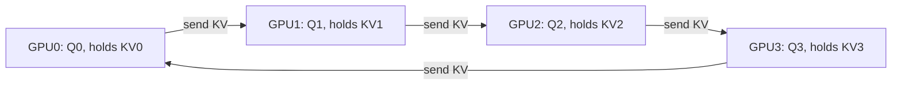

# Long Context Inference

Context windows went from 2K tokens (GPT-3, 2020) to 128K as a commodity and 1M+ at the frontier. Workloads followed: whole-repository coding agents, document QA over hundreds of pages, multi-hour agent sessions, and reasoning models that *generate* tens of thousands of tokens. Long context changes the economics of inference in two ways:

1. **Memory**: KV cache grows linearly with tokens and quickly dwarfs model weights.
2. **Compute**: attention FLOPs grow quadratically with prompt length during prefill, and attention *bytes* grow linearly per decode step.

This note works through the numbers, then covers the four families of fixes: **position-encoding extension** (so the model works at all), **architectural changes** (sliding-window, hybrid, sparse attention), **system techniques** (context parallelism, chunked prefill, prefix caching, KV offload), and **approximations** (KV eviction and compression).

## 1. The numbers

### KV cache per token

For standard multi-head or grouped-query attention ([[05 - KV Cache]]):

```
KV bytes per token = 2 (K and V) × n_layers × n_kv_heads × head_dim × bytes_per_elem
```

| Model (config) | Per token | 32K | 128K | 1M |
| --- | --- | --- | --- | --- |
| Llama-3.1-8B (32 L, 8 KV heads, d=128, BF16) | 128 KiB | 4 GiB | 16 GiB | 128 GiB |
| Llama-3.1-70B (80 L, 8 KV heads, d=128, BF16) | 320 KiB | 10 GiB | 40 GiB | 320 GiB |
| Same 70B with FP8 KV | 160 KiB | 5 GiB | 20 GiB | 160 GiB |
| DeepSeek-V3 MLA (61 L, 512 latent + 64 RoPE dims, BF16) | ~68.6 KiB | ~2.1 GiB | ~8.6 GiB | ~67 GiB |

Derivation for Llama-3.1-70B: `2 × 80 × 8 × 128 × 2 B = 327,680 B = 320 KiB`. At 131,072 tokens: `320 KiB × 131,072 = 40 GiB` — **for one sequence**. The BF16 weights are ~140 GB. Eight concurrent 128K-token users need 320 GiB of KV, more than double the weights.

MLA's compressed latent ([[06 - Attention Kernels]], [[11 - Mixture of Experts Inference]]) is the reason DeepSeek models can serve long contexts with large batches: `(512 + 64) × 2 B × 61 layers ≈ 70 KB` per token.

### Prefill compute

Per layer, for prompt length `L` and total attention width `d_attn = n_heads × head_dim`:

```
Linear layers ≈ 2 × P_layer × L          (P_layer = params per layer)
Attention     ≈ 2 × L² × d_attn           (QKᵀ and PV each 2·L²·d_attn, halved by causal mask)
```

**Worked example, Llama-3.1-70B** (`d_attn = 64 × 128 = 8192`, 80 layers, ~70B params):

| L | Linear FLOPs (2·70e9·L) | Attention FLOPs (80 · 2 · L² · 8192) | Attention share |
| --- | --- | --- | --- |
| 8K | 1.15e15 | 8.8e13 | 7% |
| 32K | 4.6e15 | 1.4e15 | 23% |
| 128K | 1.8e16 | 2.25e16 | 55% |
| 1M | 1.4e17 | 1.4e18 | 91% |

At 128K, total ≈ 4.1e16 FLOPs. At an effective ~600 TFLOP/s per H100 that is ~68 GPU-seconds — about **8.5 s TTFT on 8 GPUs** even with perfect scaling. At 1M tokens attention dominates completely and TTFT is measured in minutes without sparsity or more GPUs. This is why long-context prefill motivates context parallelism and sparse attention.

### Decode bandwidth

Each decode step reads all weights once (shared across the batch) plus **each sequence's own KV**. For the 70B model in BF16 at batch 8, 128K context each:

- Weights: 140 GB.
- KV: 8 × 40 GiB ≈ 344 GB.

KV reads are 2.5× the weight reads; per-token latency is set by KV bandwidth, and batching no longer amortizes the dominant cost. Long-context decode is **KV-bandwidth-bound**, which is the case for KV quantization (FP8/INT4 KV), MLA, sparse attention, and GQA with few KV heads.

## 2. Making positions work: RoPE and context extension

### RoPE in one paragraph

Rotary Position Embedding (Su et al., RoFormer) rotates each pair of dimensions `(2i, 2i+1)` of Q and K by angle `m · θ_i` at position `m`, with

```
θ_i = base^(−2i/d),   i = 0 .. d/2 − 1,   base typically 10,000 (Llama 3: 500,000)
```

The dot product `q_m · k_n` then depends only on `m − n`. High-frequency pairs (small `i`) rotate fast and encode local position; low-frequency pairs rotate slowly and encode long-range position. A pair whose wavelength `2π/θ_i` exceeds the training length never completes a rotation in training — at longer positions it sees angles it has never seen, and the model breaks.

### Extension methods

| Method | Idea | Formula sketch |
| --- | --- | --- |
| **Position Interpolation (PI)** (Chen et al., 2023) | Squeeze new positions into the trained range | `m → m · L_train / L_target` for all dims; needs fine-tuning; blurs local resolution |
| **NTK-aware scaling** (community, 2023) | Increase the base so low frequencies stretch more than high ones | `base' = base · s^(d/(d−2))`, `s = L_target / L_train`; works partially without fine-tuning |
| **YaRN** (Peng et al., 2023) | Per-frequency treatment: don't interpolate high-frequency dims, fully interpolate low-frequency dims, ramp between; plus an attention temperature | scale logits by `t` with `√(1/t) = 0.1 ln s + 1` |
| **Llama 3.1 "llama3" scaling** | YaRN-like piecewise frequency scaling with factor 8 from 8K to 128K | configured via `rope_scaling` in the HF config |
| **LongRoPE** (Ding et al., 2024) | Search for non-uniform per-dimension rescale factors; extended beyond 2M tokens | — |

**Inference-engineering consequences:**

- The engine must implement the **exact** RoPE variant from the model's config (`rope_scaling` type, factors, original max position). A mismatch produces a model that works at short context and silently degrades at long context — the hardest kind of bug to catch. (A real example: DeepSeek's V3.2-Exp repository posted a fix in November 2025 because the inference demo applied RoPE with the wrong layout — interleaved vs non-interleaved — inside the sparse-attention indexer, degrading quality.)
- RoPE cos/sin tables for 1M positions are precomputed and cached; dynamic schemes ("dynamic NTK") recompute when the sequence crosses a length threshold, which breaks prefix caching if not handled carefully.
- A model's **advertised** context length is not its **effective** context length. Benchmarks like RULER (synthetic retrieval, multi-hop tracing, aggregation) routinely show models degrading well before their nominal limit. Measure on your task.

## 3. Architectural fixes: attend to less

### Sliding-window attention (SWA)

Each token attends only to the previous `W` tokens. KV per layer is capped at `W` tokens; attention cost becomes `O(L · W)`.

- Mistral 7B used a 4096-token window in all layers. Information beyond `W` can still propagate through stacked layers, but weakly.
- **Interleaved local/global** is now the common design: Gemma 3 alternates 5 local layers (1024-token window) with 1 global layer, so only one in six layers keeps a full-length KV cache. gpt-oss alternates dense layers with locally banded (128-token) layers.

Worked example: a 48-layer model with 5:1 local/global, window 1024, at 128K context: global layers hold 8 × 128K = 1M token-layer entries; local layers hold 40 × 1024 ≈ 41K. Versus 48 × 128K = 6.3M for all-global — **~84% less KV**.

Engine implications: the KV manager must support **heterogeneous layers** (different capacity per layer type), free blocks that fall out of the window, and prefix caching where local layers no longer hold old tokens. vLLM's hybrid KV-cache manager and DeepInfer's **SWA bounded replay** address this. DeepInfer's README describes reducing decoder prefill work by "replaying only a bounded suffix", where "the retained suffix must cover the SWA window plus the maximum backtracking length" — i.e. for SWA layers you only need to recompute/keep the last `W` (+ slack for speculative rollback) tokens, not the whole prompt.

### Hybrid linear-attention / state-space models

Replace most attention layers with layers whose state is **constant-size** regardless of context (Mamba-style SSMs, linear attention, Gated DeltaNet), keeping a few full-attention layers for precise retrieval. Examples: Jamba (Mamba + attention), MiniMax-01 (lightning attention), Qwen3-Next (Gated DeltaNet + gated attention). For inference this means two kinds of per-sequence state — a paged KV cache for attention layers and a fixed-size recurrent state for the others — and prefix caching of recurrent state requires checkpointing it at block boundaries.

### Sparse attention

Keep a full KV cache, but let each query attend to only a selected subset of keys.

**Native Sparse Attention (NSA)** (DeepSeek, arXiv 2502.11089): three branches per query — compressed coarse-grained block summaries, selected fine-grained blocks (chosen using the compressed scores), and a sliding window — combined with learned gates. Designed for hardware alignment (block-wise selection keeps memory access contiguous) and trained natively.

**DeepSeek Sparse Attention (DSA)** (DeepSeek-V3.2-Exp, September 2025; DeepSeek-V3.2 paper arXiv 2512.02556):

- A **lightning indexer** — a few heads, ReLU activations, run in FP8 — computes an index score `I_{t,s}` between query token `t` and every preceding token `s`.
- A **fine-grained token selection** keeps only the key-value entries with the **top-k** index scores; main attention (MLA) runs over those. During sparse training DeepSeek selected **2048** key-value tokens per query.
- Core attention complexity drops from `O(L²)` to `O(L·k)`. The indexer is still `O(L²)` but far cheaper than MLA attention.
- Training: a dense warm-up stage trains only the indexer to match the main attention distribution, then sparse training of the whole model.
- Kernels: indexer logit kernels (including paged versions) in DeepGEMM, sparse attention kernels in FlashMLA.

**Training-free sparsity** for existing models: MInference (dynamic sparse patterns to accelerate prefill), Quest (query-aware selection of KV pages in decode), MoBA (mixture of block attention). These trade a little accuracy for speed without retraining.

Rule of thumb: **sparsity designed into training** (NSA, DSA, SWA) preserves quality much better than sparsity bolted on at inference time.

## 4. System techniques

### Context parallelism and ring attention for prefill

Tensor parallelism splits heads, not sequence; it doesn't reduce per-GPU activation memory for a 1M-token prompt, and its all-reduces grow with `L`. **Context parallelism (CP)** splits the *sequence* across GPUs.

**Ring Attention** (Liu et al., 2023): each of `N` devices holds `L/N` query tokens and the matching KV block. KV blocks rotate around a ring; at each of `N` steps a device computes blockwise attention of its queries against the KV block it currently holds (with online-softmax accumulation, as in FlashAttention), while sending that block to its neighbour. Communication overlaps compute when the block is large enough:

```
compute per step ∝ (L/N)² · d        comm per step ∝ (L/N) · d_kv
```

so overlap improves with longer sequences.



**Causal load balancing.** With a causal mask, the device holding the last chunk does far more work than the one holding the first. Fixes: split the sequence into `2N` chunks and give device `i` chunks `i` and `2N−1−i` ("zigzag"/balanced CP), or stripe tokens round-robin. DeepInfer's "balanced CP" refers to this kind of scheme.

Alternatives: **all-gather KV** CP (gather all KV, compute local queries — simpler, used for Llama 3 training), and **Ulysses** sequence parallelism (all-to-all to switch from sequence-sharding to head-sharding around attention).

CP is mostly a **prefill** technique. For decode, a single new token is too little work to split; instead long-context decode uses KV sharded across GPUs with split-KV attention and a cross-GPU reduction, or accepts the per-GPU KV limit.

### Chunked prefill

A 128K prompt processed in one step would block every decoding user for ~8 s (from the example above). **Chunked prefill** splits it into chunks (e.g. 8K tokens) and schedules one chunk per step alongside the ongoing decodes ([[07 - Batching and Scheduling]]).

Long-context nuance: chunk `j` attends to all `j × C` previous tokens, so later chunks cost more attention than early ones; total attention FLOPs are the same as unchunked, but each chunk re-reads all prior KV from HBM, adding bandwidth. Choose chunk size to balance decode latency (smaller chunks) against prefill efficiency (larger chunks keep GEMMs compute-bound and reduce KV re-reads).

### Prefix caching for long documents

If 50 users ask questions about the same 200K-token contract, prefill it once and reuse the KV ([[05 - KV Cache]]). With the 70B model a 200K-token prefill is ~8e16 FLOPs (attention alone ~5e16), so each reuse saves ~130 GPU-seconds. Practical points:

- Put the long, stable content **first** and the question **last** so the shared part is a prefix.
- 200K tokens × 320 KiB = 61 GiB of KV — it will not stay in HBM for long under load. **Tiered KV storage** (HBM → CPU DRAM → local SSD → remote, e.g. LMCache, Dynamo's KV Block Manager, Mooncake's KV store) makes long-document reuse practical. Reloading 61 GiB over PCIe Gen5 (~50 GB/s effective) takes ~1.3 s — far less than ~17 s of recompute on 8 GPUs.
- **KV-aware routing** sends requests for the same document to the replica that holds it ([[17 - Serving Systems, Routing, and Autoscaling]]).
- Hosted APIs expose this as "prompt caching" or "context caching" with discounted cached-token prices — the price discount is the cost structure above.

### Prefill/decode disaggregation

Long prompts make prefill/decode interference worst, which is why long-context serving strongly favours putting prefill and decode on separate GPU pools and transferring KV ([[12 - Disaggregated Serving]]). Note the transfer size: 40 GiB for one 128K-token sequence on the 70B model (BF16) — transfer bandwidth (RDMA, NVLink) becomes a first-class design constraint, and MLA's KV (~4.7× smaller than this 70B model's BF16 GQA cache) helps here too.

## 5. Approximations: evict or compress KV

When the cache is too big and the model was not trained to be sparse, drop or shrink entries.

| Method | Keeps | Notes |
| --- | --- | --- |
| **StreamingLLM / attention sinks** (Xiao et al., 2023) | First few tokens (e.g. 4 "sink" tokens) + a recent window | Observed that much attention mass goes to initial tokens; keeping them stabilizes infinite-length streaming. Does **not** recall content from the evicted middle. |
| **H2O, Heavy-Hitter Oracle** (Zhang et al., 2023) | Recent tokens + tokens with the highest accumulated attention scores | Greedy eviction during decode; needs attention scores, which fused kernels don't normally output |
| **SnapKV** (Li et al., 2024) | Per head, the prompt positions most attended by an "observation window" at the end of the prompt (with pooling to keep neighbours) | Compresses the prompt's KV once after prefill; good for long-document QA where the question is at the end |
| **KV quantization** (FP8, INT4; KIVI's 2-bit asymmetric scheme, per-channel K and per-token V) | All tokens, fewer bits | Usually the first thing to try: FP8 KV halves memory with minimal quality loss ([[08 - Quantization]]) |
| **Prompt compression** (e.g. LongLLMLingua) | A shorter prompt chosen by a small model | Changes the input rather than the cache |

Engineering caveats:

- Eviction makes caches **per-query**: SnapKV's selection depends on the question at the end of the prompt, so the compressed cache can't be shared as a prefix with a different question.
- Score-based eviction needs attention probabilities, which FlashAttention-style kernels never materialize; you need extra kernels or approximations.
- Quality loss is task-dependent: summarization tolerates eviction; needle retrieval and code editing often don't. Always evaluate with RULER-style tasks and your own workload.

## 6. Long outputs: reasoning models

Reasoning models flip the usual shape: a modest prompt and **10K–100K output tokens**. Consequences:

- **Decode dominates cost.** A 32K-token answer at 50 tokens/s per user takes over 10 minutes; total GPU time is decode-bound, so decode throughput per GPU (large batches, MLA/GQA, FP8 KV, speculative decoding — [[09 - Speculative Decoding]]) matters most.
- **KV grows during decode.** The scheduler can't know a request's final length. Admitting too many requests leads to running out of KV mid-generation and **preemption** (recompute or swap), wasting work. Engines use watermarks, output-length predictions, or priority to manage this ([[07 - Batching and Scheduling]]).
- **Per-step cost rises over time**: later tokens attend over more KV. Throughput at token 30,000 is lower than at token 1,000; benchmark with realistic output lengths.
- **Multi-turn reasoning**: many APIs strip previous turns' reasoning from the context to save KV; this interacts with prefix caching (the stripped history is a different prefix).
- **Sparse attention pays off in decode too**: DSA reduces the per-token attention cost from `O(L)` to `O(k)` in decode, which is exactly where reasoning workloads spend their time.

## What practitioners actually do

- **Start with the math**: compute KV per token and the KV budget per GPU before choosing a deployment. Most long-context capacity problems are visible on a napkin.
- **Use FP8 KV cache** by default for long-context serving after a quality check.
- **Prefer models whose architecture is built for long context** (GQA with few KV heads, MLA, interleaved SWA, trained sparse attention) over extending a short-context model with RoPE scaling alone.
- **Chunked prefill always on**, chunk size tuned; **disaggregate** prefill and decode once long prompts are common.
- **Exploit reuse**: structure prompts for prefix caching, add tiered KV storage and KV-aware routing for document and agent workloads.
- **Set max context per deployment tier** — serving a 1M window to everyone reserves memory nobody uses; offer separate long-context endpoints with different pricing.
- **Validate effective context** with RULER-like tests at the lengths you advertise, after every engine change touching RoPE, attention, or KV.

## Common mistakes

- Advertising the model's nominal context length without checking that the engine has enough KV memory to serve it at useful concurrency.
- Implementing RoPE scaling slightly wrong (wrong factor, wrong original length, wrong layout) — passes short-context tests, fails at long context.
- Benchmarking long-context throughput with short outputs only, or reasoning workloads with short contexts.
- Ignoring that chunked prefill re-reads prior KV, and picking tiny chunks that make prefill bandwidth-bound.
- Applying StreamingLLM-style eviction and expecting retrieval from the evicted middle of the document.
- Using CP for decode, where the per-step work is too small to split profitably.
- Forgetting that SWA and hybrid layers need special handling in prefix caching and KV accounting.

## Check yourself

1. **Compute KV per token and at 64K for a model with 40 layers, 8 KV heads, head dim 128, FP8 KV.**
   `2 × 40 × 8 × 128 × 1 B = 81,920 B = 80 KiB`; at 65,536 tokens: 5 GiB.
2. **At what prompt length does attention FLOPs equal linear-layer FLOPs for Llama-3.1-70B, using the formulas above?**
   Set `2·70e9·L = 80·2·L²·8192` → `L = 70e9 / (80·8192) ≈ 107K` tokens.
3. **Why does long-context decode not benefit much from larger batches?**
   Batching amortizes weight reads, but each sequence's KV must be read separately; when KV dominates bytes per step, larger batches add proportionally more bytes.
4. **What does YaRN do differently from Position Interpolation?**
   PI scales all frequencies uniformly; YaRN leaves high-frequency dimensions untouched, interpolates low-frequency ones, ramps between them, and adds an attention temperature.
5. **In DSA, what is still quadratic, and why is it acceptable?**
   The lightning indexer scoring every preceding token; it has few heads, ReLU, and runs in FP8, so it's far cheaper than full MLA attention, which becomes `O(L·k)`.
6. **Why does ring attention need causal load balancing?**
   Under a causal mask, later query chunks attend to more keys; naive contiguous splits leave the last device with the most work. Zigzag/striped assignment evens it out.
7. **A 200K-token document's KV (61 GiB) is evicted to CPU memory. Reload or recompute?**
   Reload: ~1.3 s at ~50 GB/s PCIe vs ~17 s of prefill recompute on 8 GPUs (~8e16 FLOPs at ~600 TFLOP/s per GPU, for the 70B example).
8. **Why can't SnapKV-compressed caches be shared across different questions about the same document?**
   Its selection uses attention from the observation window at the end of the prompt (the question), so the kept positions are question-specific.

## Further reading

- Su et al., *RoFormer: Enhanced Transformer with Rotary Position Embedding* — https://arxiv.org/abs/2104.09864
- Chen et al., *Extending Context Window of Large Language Models via Positional Interpolation* — https://arxiv.org/abs/2306.15595
- Peng et al., *YaRN: Efficient Context Window Extension of Large Language Models* — https://arxiv.org/abs/2309.00071
- Ding et al., *LongRoPE* — https://arxiv.org/abs/2402.13753
- Beltagy et al., *Longformer* (sliding window + global attention) — https://arxiv.org/abs/2004.05150
- Gemma Team, *Gemma 3 Technical Report* (5:1 local/global) — https://arxiv.org/abs/2503.19786
- Yuan et al., *Native Sparse Attention* — https://arxiv.org/abs/2502.11089
- DeepSeek-AI, *DeepSeek-V3.2* (DSA) — https://arxiv.org/abs/2512.02556 ; https://github.com/deepseek-ai/DeepSeek-V3.2-Exp
- Liu et al., *Ring Attention with Blockwise Transformers for Near-Infinite Context* — https://arxiv.org/abs/2310.01889
- Xiao et al., *Efficient Streaming Language Models with Attention Sinks* — https://arxiv.org/abs/2309.17453
- Zhang et al., *H2O: Heavy-Hitter Oracle* — https://arxiv.org/abs/2306.14048
- Li et al., *SnapKV* — https://arxiv.org/abs/2404.14469
- Liu et al., *KIVI: 2-bit KV cache quantization* — https://arxiv.org/abs/2402.02750
- Jiang et al., *MInference 1.0* — https://arxiv.org/abs/2407.02490
- Tang et al., *Quest: Query-Aware Sparsity* — https://arxiv.org/abs/2406.10774
- Lu et al., *MoBA: Mixture of Block Attention* — https://arxiv.org/abs/2502.13189
- Hsieh et al., *RULER: What's the Real Context Size of Your Long-Context LMs?* — https://arxiv.org/abs/2404.06654
- Agrawal et al., *Sarathi-Serve* (chunked prefill) — https://arxiv.org/abs/2403.02310

## Related

- [[05 - KV Cache]] — paging, prefix caching, KV quantization
- [[06 - Attention Kernels]] — FlashAttention, split-KV decode, MLA kernels
- [[07 - Batching and Scheduling]] — chunked prefill and preemption
- [[10 - Parallelism]] — TP/PP/EP and where CP fits
- [[12 - Disaggregated Serving]] — KV transfer for long prompts
- [[17 - Serving Systems, Routing, and Autoscaling]] — KV-aware routing and tiered KV
- [[19 - Cost and Capacity Planning]] — pricing long context
- [[21 - Case Study - DeepInfer]] — SWA bounded replay and balanced CP
