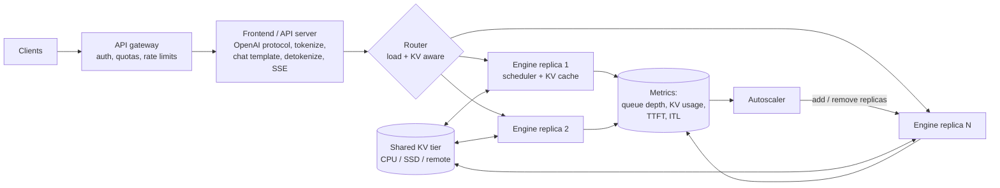
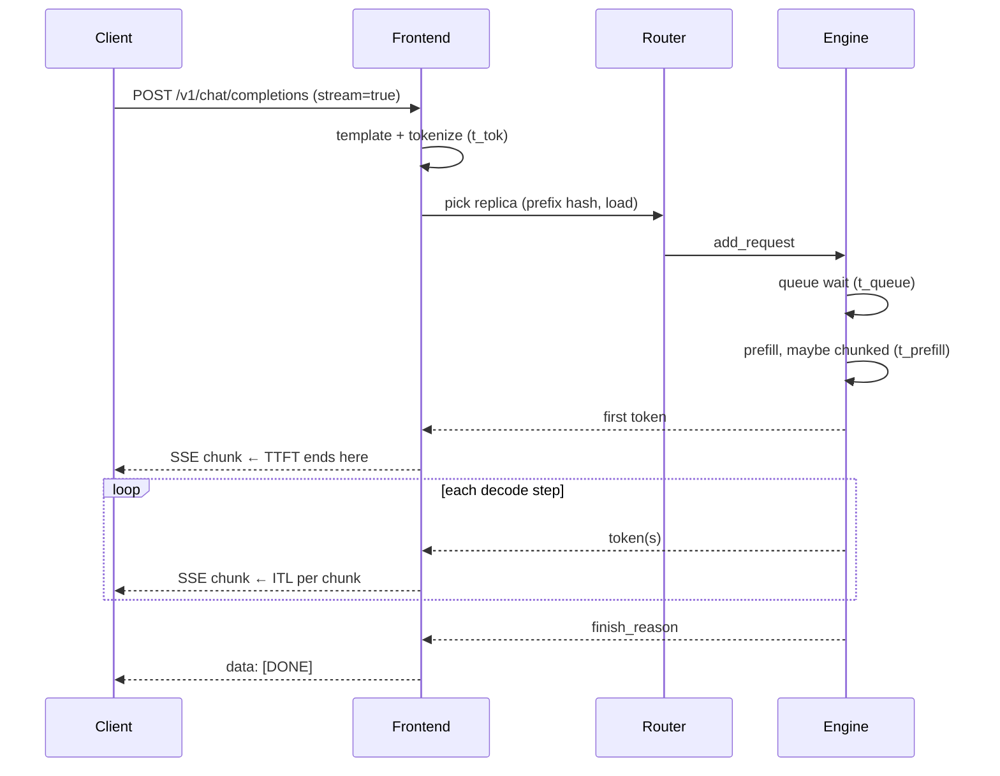
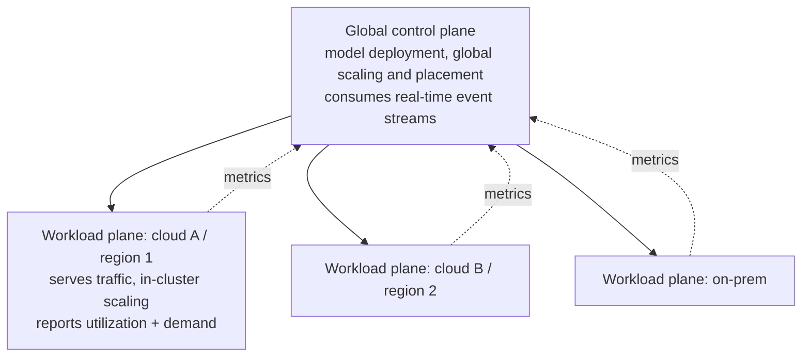

# Serving Systems, Routing, and Autoscaling

An inference engine (vLLM, SGLang, TensorRT-LLM, DeepInfer) turns one GPU group into a fast token generator. A **serving system** turns a fleet of those engines into a product: an API that thousands of clients hit concurrently, that stays up when GPUs die, that scales with traffic, and that does not waste the most expensive hardware in the building.

Most of the latency and cost wins after the first month of a deployment come from this layer, not from kernels. A 10% faster attention kernel is nice; a router that raises the prefix-cache hit rate from 30% to 70% can halve prefill compute.

## The mental model



Three loops run at very different time scales:

| Loop | Time scale | Decides |
| --- | --- | --- |
| Engine scheduler | ~10–50 ms (one step) | Which sequences run in the next forward pass ([[07 - Batching and Scheduling]]) |
| Router | ~1 ms per request | Which replica gets a new request |
| Autoscaler | 30 s – 10 min | How many replicas exist |

Mixing them up is the root of many bad designs: an autoscaler cannot fix a router that sends every long prompt to the same replica, and a router cannot fix an engine whose batch is capped too low.

## 1. The API layer

### The OpenAI-compatible protocol

The de-facto wire format is the OpenAI API: `POST /v1/chat/completions`, `POST /v1/completions`, `POST /v1/embeddings`, and increasingly the Responses API. Anthropic's Messages API is the other common protocol. Every major engine ships an OpenAI-compatible server so clients can switch backends by changing a base URL.

What the frontend actually does per request:

1. **Validate and normalize** — model name, `max_tokens`, sampling params, tool schemas.
2. **Render the chat template** — turn `messages[]` into one token sequence with role markers. This is model-specific and a classic source of quality bugs (wrong template → model behaves "dumber").
3. **Tokenize** — CPU work, can be tens of milliseconds for 100K-token prompts. Production systems parallelize it. The DeepInfer deployment notes describe splitting the prompt at known special-token boundaries and encoding segments in parallel, which also prevents users from injecting control tokens as text (`projects/DeepInfer/doc/inference_deployment_qa.md`).
4. **Compile constraints** — JSON schema / regex → grammar, see [[15 - Sampling, Determinism, and Structured Output]].
5. **Submit to an engine** and **stream back** detokenized deltas.
6. **Parse output** — reasoning blocks, tool calls, stop strings — into protocol events.

Rule of thumb: the frontend must never be the bottleneck. At 50K output tokens/s per node, detokenization and JSON serialization alone are significant; this is why vLLM split the API server into separate processes, and why Dynamo and SGLang put the frontend/router in Rust.

### Streaming with Server-Sent Events

Generation is streamed token-by-token over **SSE** (`Content-Type: text/event-stream`):

```
data: {"id":"c1","choices":[{"delta":{"content":"Hel"}}]}

data: {"id":"c1","choices":[{"delta":{"content":"lo"}}]}

data: [DONE]
```

Details that bite:

- **Detokenization is not per-token.** A token can be half of a UTF-8 character or half of a word piece. Incremental detokenizers keep a small window and emit only stable text.
- **Stop strings span tokens.** You must hold back output that could be the prefix of a stop string until it is resolved.
- **Tool-call arguments stream as JSON fragments.** Clients reassemble them.
- **Proxies buffer.** Nginx and some load balancers buffer responses unless told not to (`X-Accel-Buffering: no`, `proxy_buffering off`). A buffered stream turns a 200 ms TTFT into a 20 s TTFT.
- **Disconnect = abort.** When the client closes the socket, the server must abort the request inside the engine, or the GPU keeps generating tokens nobody reads.

### The request lifecycle



TTFT as the user sees it:

```
TTFT = t_network + t_tokenize + t_route + t_queue + t_prefill + t_first_detok + t_network
```

Under load, `t_queue` dominates. A system that shows 150 ms TTFT at idle and 8 s at peak has a capacity or routing problem, not a kernel problem.

## 2. Load balancing and routing

### Why HTTP load balancing is wrong for LLMs

Classic L7 load balancers assume requests are roughly equal and short. LLM requests vary by **three orders of magnitude** in cost (a 50-token chat vs a 200K-token codebase prompt with 4K output), last seconds to minutes, and have state on the replica (KV cache) that makes some replicas much cheaper than others for a given request.

### Policies, from naive to good

**Round robin.** Even request counts, uneven work. One replica gets three 100K-token prompts in a row and its queue explodes while others idle.

**Least outstanding requests / least load.** Route to the replica with the fewest running + waiting requests, or better, the fewest *tokens* outstanding. Much better than round robin. Still blind to cache.

**Session affinity / consistent hashing.** Hash a session ID or the first N tokens to a replica. Multi-turn conversations hit their own cached prefix. Breaks balance when one session or one system prompt is hot.

**Prefix-cache-aware (KV-aware) routing.** The router keeps an approximate index of which prefix blocks live on which replica (hash chain of token blocks, the same hashing used by [[05 - KV Cache]] prefix caching). For each request it estimates:

```
cost(replica) = α · (prompt_tokens − cached_prefix_tokens(replica))   # prefill work left
              + β · outstanding_tokens(replica)                         # queue
              + γ · kv_utilization(replica)                             # eviction / preemption risk
```

and picks the minimum. SGLang's router uses a radix tree per worker; NVIDIA Dynamo's KV router consumes KV events (block stored / evicted) from workers; llm-d's inference scheduler scores endpoints on prefix-cache and load. The weights matter: pure cache affinity overloads the replica that holds a popular system prompt.

**Worked example.** 4 replicas, a 30K-token prompt whose first 28K tokens (a shared agent system prompt + repo context) are cached on replica B only.

| Replica | Cached prefix | Prefill left | Queue (tokens) | Cost (α=1, β=0.2) |
| --- | --- | --- | --- | --- |
| A | 0 | 30,000 | 5,000 | 31,000 |
| B | 28,000 | 2,000 | 40,000 | 10,000 |
| C | 0 | 30,000 | 0 | 30,000 |
| D | 0 | 30,000 | 12,000 | 32,400 |

B wins despite the longest queue: it needs to prefill 2K tokens instead of 30K. With prefill at ~10K tokens/s per replica, that is 0.2 s vs 3 s of compute.

**Global cache instead of affinity.** The alternative to routing-to-the-cache is moving-the-cache-to-the-route: a shared KV store that any replica can read. DeepSeek's V4.1 Flash deployment stores block KV cache on a dedicated 3FS SSD cluster precisely so that "every prefill machine can hit any prefix", which removes the conflict between prefix affinity and load balance; their prefill balancer therefore does no prefix-affinity routing (`projects/DeepInfer/doc/inference_deployment_qa.md`). This only works if KV is small enough to move faster than recomputing it — see [[16 - Long Context Inference]] for compressed KV designs and [[12 - Disaggregated Serving]] for transfer math.

**Push vs pull.** Routers usually *push* requests to replicas. An alternative is replicas *pulling* work when they have spare capacity. Pull is self-balancing and naturally overlaps fetching the next batch with the current step; DeepSeek's prefill engines pull, while their decode balancer pushes because decode placement needs a global view of per-engine sequence counts and total KV length (same source).

### Routing for disaggregated serving

With prefill/decode disaggregation ([[12 - Disaggregated Serving]]) there are two routing decisions: which prefill worker (cache affinity, compute load) and which decode worker (KV memory headroom, current batch). Decode routing should balance **both** request count (sets batch size) and total KV length (sets attention cost).

## 3. Autoscaling

### Wrong signals

- **CPU utilization.** The CPU is nearly idle on a saturated GPU server.
- **GPU utilization (`nvidia-smi` "util").** Reports the fraction of time *any* kernel runs. A decode server at batch 1 shows ~100% utilization while delivering a tiny fraction of its throughput. Useless for capacity.
- **Request rate alone.** 10 req/s of 200-token chats and 10 req/s of 50K-token RAG calls are different universes.

### Right signals

| Signal | Why | Typical use |
| --- | --- | --- |
| **Queue depth** (waiting requests or waiting tokens) | Leading indicator of TTFT blowup | Scale out when > threshold for N seconds |
| **KV cache utilization** | Near 100% → preemption, recompute, latency spikes | Scale out at 80–90% sustained |
| **TTFT / ITL p90 vs SLO** | What you actually promise | SLO-driven planners |
| **Running batch size vs profiled optimum** | Distance from the throughput knee | Capacity planning |
| **Non-cached prompt tokens/s** | True prefill demand | Scale prefill pool |
| **Running sequences** | True decode demand | Scale decode pool |

The DeepSeek deployment scales prefill by the number of non-cached tokens and decode by the number of running requests, rate-limits adjustments, keeps idle "ready" machines as scale-out inventory, and forbids scale-in when quota utilization is above 0.8 (`projects/DeepInfer/doc/inference_deployment_qa.md`). Dynamo's Planner and llm-d's variant autoscaler are SLO-driven versions of the same idea.

### The cold-start problem

Scaling out an LLM replica is slow, and you must design around it:

| Phase | Typical time (70B FP8, 8×H100) |
| --- | --- |
| Node provision (if no warm node) | 1–10 min |
| Container pull (10–20 GB image) | 30 s – 5 min |
| Weight download (~70 GB) | 1–10 min from object store; seconds from local NVMe |
| Weight load to HBM | 10–60 s |
| `torch.compile` / CUDA graph capture / autotune | 10 s – several minutes |
| Warm-up | seconds |

Mitigations:

- **safetensors + mmap.** The safetensors format is a header plus raw tensors; it can be memory-mapped and copied to the GPU without unpickling (and without arbitrary-code-execution risk that pickle carries).
- **Pre-staged weights** on local NVMe or a node-local cache; never download from the internet on the hot path.
- **Weight streaming GPU-to-GPU.** Copy weights from an already-running replica over NVLink/RDMA instead of from storage; Dynamo's ModelExpress component does this and reports large startup gains.
- **Cache compile artifacts** (Inductor cache, Triton/DeepGEMM JIT caches, TensorRT engines) in the image or a shared volume.
- **Warm pools.** Keep pre-provisioned nodes (and possibly loaded-but-idle replicas) so that scale-out is "flip routing", not "boot a machine".
- **Scale on leading indicators** (queue growth rate), not lagging ones (p99 already blown).

### Utilization signals vs traffic signals

Autoscaling decisions come from two families of signals, and they disagree often enough that you need both:

- **Utilization** (KV usage, compute busy, memory pressure) measures what the replica is doing *now*. It is a **lagging** indicator.
- **Traffic** (requests or tokens in flight, queue depth, arrival rate) measures demand. It can be **proactive**.

They diverge on prefill. A few requests with hundreds of thousands of uncached input tokens can saturate a replica, while many short requests with high prefix-cache hit rates barely load it. Count *uncached tokens*, not requests.

### The five knobs of a traffic-based autoscaler

| Knob | Question it answers | Turning it up | Turning it down |
| --- | --- | --- | --- |
| **Min replicas** | How many stay up at zero traffic? | No cold starts; you pay for idle GPUs | Cheaper; first burst waits on cold start |
| **Max replicas** | Ceiling on spend and capacity | Absorbs big spikes | Protects budget; sheds load at peak |
| **Autoscaling window** | Over what sliding period is traffic measured? | Smoother, slower to react | Reacts to blips; risks flapping |
| **Scale-down delay** | How long to wait after a scale-down is suggested? | Rides out spiky traffic | Saves money once traffic truly drops |
| **Concurrency target** | How many concurrent requests per replica? | Higher throughput per GPU, worse TPOT | Better latency, more replicas |

Set the **concurrency target** from a measured latency-throughput curve ([[18 - Benchmarking and Profiling]]). Use the largest concurrency at which p90 TTFT and TPOT still meet the SLO. Then desired replicas ≈ `ceil(in_flight_requests / concurrency_target)`, clamped to `[min, max]`. Set min replicas from cold-start time: if a new replica needs 5 minutes to load weights, min replicas must cover traffic growth over 5 minutes.

### Beyond one cluster: multi-region and multi-cloud

At large scale (thousands of GPUs, global users), one cluster is not enough, for four reasons:

- **Capacity.** No single provider or region has enough GPUs of the type you need.
- **Redundancy.** You survive a region or provider outage.
- **Latency.** Serving near users cuts network round-trips, which matters for TTFT in voice and autocomplete.
- **Compliance.** Data residency and sovereignty rules pin some traffic to specific jurisdictions.

The easy version is siloed: separate deployments per cloud, moved by hand. It wastes capacity, because one silo starves while another idles. The real version is a **global bin-packer** that treats all pools as interchangeable. It splits responsibilities like Kubernetes, one level up:



Key design rule: **workload planes must keep serving if the control plane fails**, and the failure of one workload plane must not affect the others. The control plane decides where capacity *should* go. Each workload plane serves traffic and makes local scaling decisions on its own. Weights must be pre-staged near every workload plane, because pulling hundreds of GB across clouds at scale-out time defeats the purpose.

### Scale-in is dangerous too

A decode replica holds in-flight sequences. Killing it loses their KV cache; the requests must be recomputed or fail. Graceful scale-in: stop routing new requests, drain (with a deadline), then migrate or abort stragglers. DeepSeek gives a decode engine a 1-minute grace period after a shutdown notice and then forwards unfinished requests *with their KV cache* to other engines in one shot (same source).

## 4. Multi-LoRA and multi-model serving

### Multi-LoRA

Fine-tuned variants are often LoRA adapters: `W' = W + B·A` with rank `r` ≪ hidden size. Serving 1,000 customers' adapters as 1,000 full models is absurd; serving them as one base model plus adapters is the norm.

- **S-LoRA** (Sheng et al., 2023) keeps adapters in host memory, pages active ones into a unified GPU memory pool shared with KV cache, and uses custom kernels for heterogeneous-rank batches. Reported serving thousands of adapters on one GPU.
- **Punica** (Chen et al., 2023) introduced the SGMV (segmented gather matrix-vector) kernel: one batch can contain requests for different adapters, and the LoRA part is computed per-segment while the base model GEMM is shared.

Cost model: base GEMM `[B, d] × [d, d]` is shared; LoRA adds `[B, d] × [d, r]` and `[B, r] × [r, d]` per adapter segment. With `r = 16` and `d = 8192`, LoRA FLOPs are ~0.4% of the base layer — but the extra kernel launches and gather overhead are real, typically 5–20% throughput cost in practice.

Routing implication: adapter affinity. Sending all requests for adapter X to the replicas that already have X loaded avoids swap-in latency. llm-d and the Gateway API Inference Extension include LoRA-aware endpoint picking.

### Multi-model

Small models individually under-utilize a GPU. Options: co-locate several on one GPU (MIG partitions, MPS, or separate processes with `gpu_memory_utilization` fractions), or swap models on demand (slow — see cold start). For many small models with spiky traffic, swapping plus warm pools beats static allocation. For a few big models, dedicate hardware.

## 5. Rate limiting and admission control

Inference capacity is measured in tokens, so limits should be too:

- **Requests per minute (RPM)** — protects the frontend.
- **Input tokens per minute (ITPM)** and **output tokens per minute (OTPM)** — protect the GPU. Count output against `max_tokens` at admission (reserve), then refund the unused part.
- **Concurrency limits** per tenant — protects KV cache memory.
- **Priority classes** — interactive vs batch. Batch work fills valleys; interactive work preempts it at the engine scheduler.

Admission control at the engine: if KV cache is near full and the queue is long, rejecting with `429` and a `Retry-After` is kinder than accepting and blowing everyone's latency. Return 429 early; queuing a request you cannot serve within its deadline wastes the prefill.

## 6. Fault tolerance

GPUs fail far more often than CPUs. At scale (thousands of GPUs) you see Xid errors, NVLink faults, ECC errors, and hung NCCL collectives daily.

- **Health checks must exercise the GPU.** A process that answers `/health` while its CUDA context is wedged is the worst failure. Use a tiny canary generation.
- **Blast radius.** With tensor/expert parallelism, one bad GPU takes down the whole replica (all ranks share a communication domain). Wide-EP deployments with 64+ GPUs per replica make this acute. DeepSeek re-forms the instance with an EP size equal to the number of healthy GPUs it actually receives on restart (same source).
- **Request-level retry / migration.** For prefill failures, retry on another replica (idempotent). For decode, migrate with KV or restart from prompt + tokens generated so far (the client sees a stall, not an error). Dynamo calls this request migration.
- **Timeouts at every hop**, and cancellation propagation, so a dead downstream does not pin upstream resources.
- **Redundant capacity** (N+k) rather than fast restart: engine restarts take minutes.

## 7. Kubernetes patterns

| Project | Layer | Key ideas |
| --- | --- | --- |
| **KServe** | Model-serving CRDs on K8s | `InferenceService` abstraction, autoscaling, canary rollouts; LLM support via vLLM runtime and llm-d integration |
| **Gateway API Inference Extension** | K8s networking standard | `InferencePool` + endpoint picker: route by model, LoRA, queue, KV cache instead of plain round robin |
| **llm-d** (CNCF sandbox; founded by Red Hat, Google Cloud, IBM Research, CoreWeave, NVIDIA) | Distributed serving on K8s above vLLM/SGLang | Prefix-cache and load-aware routing, tiered KV cache, P/D disaggregation, wide-EP recipes |
| **NVIDIA Dynamo** | Datacenter-scale orchestration above SGLang / TRT-LLM / vLLM | Disaggregated P/D, KV-aware router, KV Block Manager (GPU→CPU→SSD→remote), SLA Planner, ModelExpress weight streaming, Grove gang scheduling |
| **Ray Serve / AIBrix / others** | Varies | Autoscaling, multi-model, LoRA management |

K8s specifics that matter for LLMs:

- **Gang scheduling.** A TP8 or EP64 replica needs all its pods placed together, topology-aware (same NVLink domain). Default K8s scheduling does not guarantee it; use LeaderWorkerSet, Grove, Kueue, or Volcano.
- **Long startup** → set generous `startupProbe`, separate from `livenessProbe`, or K8s kills pods mid-load.
- **Shared memory.** NCCL and multiprocess engines need a large `/dev/shm` (`emptyDir: {medium: Memory}`).
- **HPA on custom metrics** (queue depth, KV usage) via Prometheus adapter or KEDA, never on CPU.

## What practitioners actually do

1. Start with one engine replica behind a simple least-load router. Measure.
2. Add prefix-cache-aware routing as soon as you have shared system prompts or multi-turn traffic. It is usually the single largest serving-layer win.
3. Autoscale on queue depth + KV utilization with a warm pool; scale-in slowly with draining.
4. Put token-based rate limits and priority classes at the gateway.
5. Add P/D disaggregation and a shared KV tier only when TTFT and ITL SLOs conflict at your scale ([[12 - Disaggregated Serving]]).
6. Instrument the full TTFT breakdown (tokenize, route, queue, prefill) per request. Without it you cannot tell which loop is broken.

## Common mistakes

- Autoscaling on CPU or `nvidia-smi` utilization.
- Round-robin routing with heavy-tailed prompt lengths.
- Pure cache affinity with no load term → one hot replica.
- Forgetting to abort the engine request on client disconnect.
- A proxy that buffers SSE.
- Liveness probes that kill pods during weight loading.
- Downloading weights from the internet during scale-out.
- Scaling in by killing pods with in-flight decodes.
- Treating the chat template as an afterthought (silent quality regressions).

## Check yourself

1. **Why is `nvidia-smi` GPU utilization a bad autoscaling signal?** It measures the fraction of time a kernel is running, not how much useful work is done. A decode server at batch 1 shows near-100% yet is far below its throughput capacity.
2. **A request has a 40K-token prompt; 36K tokens are cached on replica X, which has a deeper queue than replica Y (no cache). How do you decide?** Compare estimated completion: X needs 4K tokens of prefill plus its queue; Y needs 40K tokens of prefill plus its queue. Unless X's queue exceeds ~36K tokens of extra work, X wins.
3. **Why do DeepSeek's prefill engines not use prefix-affinity routing?** Their KV cache is in a shared 3FS SSD cluster that any prefill machine can read, so affinity buys nothing and would hurt balance.
4. **What is the cheapest way to cut cold-start time for a new replica?** Avoid the network on the hot path: weights pre-staged on local NVMe (or streamed from a peer GPU), compile caches baked in, warm node pool.
5. **Why limit output tokens at admission using `max_tokens` instead of actual output?** Actual output is unknown at admission; reserving against `max_tokens` prevents overcommitting KV/compute, and refunding afterwards keeps quotas fair.
6. **Why is scale-in harder than scale-out for decode?** Decode replicas hold live KV state; removing one requires draining or migrating sequences, otherwise requests fail or recompute.
7. **What does Punica's SGMV kernel enable?** Batching requests for different LoRA adapters in one forward pass: the base GEMM is shared and the low-rank parts are computed per adapter segment.

8. **Your autoscaler flaps: it adds replicas during brief spikes, then removes them a minute later. Which knobs do you change?** Lengthen the autoscaling window, so blips are smoothed out, and the scale-down delay, so the replicas survive the next spike. Accept a slightly higher idle cost.
9. **Why must a multi-cloud workload plane keep serving when the global control plane is down?** The control plane only decides placement and global scaling. If serving depended on it, it would be a single point of failure for every region, which defeats the redundancy multi-cloud was meant to provide.
10. **Traffic is flat but utilization doubled. What happened?** Most likely the request mix shifted toward long uncached prompts, for example a customer pushing large documents, or the prefix-cache hit rate dropped. Scale on uncached tokens, not request count.

## Further reading

- vLLM docs (OpenAI-compatible server, prefix caching, LoRA): https://docs.vllm.ai
- SGLang (RadixAttention, router): https://github.com/sgl-project/sglang
- NVIDIA Dynamo: https://github.com/ai-dynamo/dynamo
- llm-d: https://github.com/llm-d/llm-d
- Gateway API Inference Extension: https://github.com/kubernetes-sigs/gateway-api-inference-extension
- KServe: https://kserve.github.io/website/
- S-LoRA paper: https://arxiv.org/abs/2311.03285
- Punica paper: https://arxiv.org/abs/2310.18547
- safetensors: https://github.com/huggingface/safetensors
- DeepSeek V4.1 Flash deployment Q&A (local): `projects/DeepInfer/doc/inference_deployment_qa.md`

## Related

- [[07 - Batching and Scheduling]] — the per-step loop inside each replica
- [[05 - KV Cache]] — prefix caching that routers exploit
- [[12 - Disaggregated Serving]] — P/D split and KV transfer
- [[18 - Benchmarking and Profiling]] — measuring the whole system
- [[19 - Cost and Capacity Planning]] — sizing the fleet
- [[21 - Case Study - DeepInfer]] — a production engine's internals
