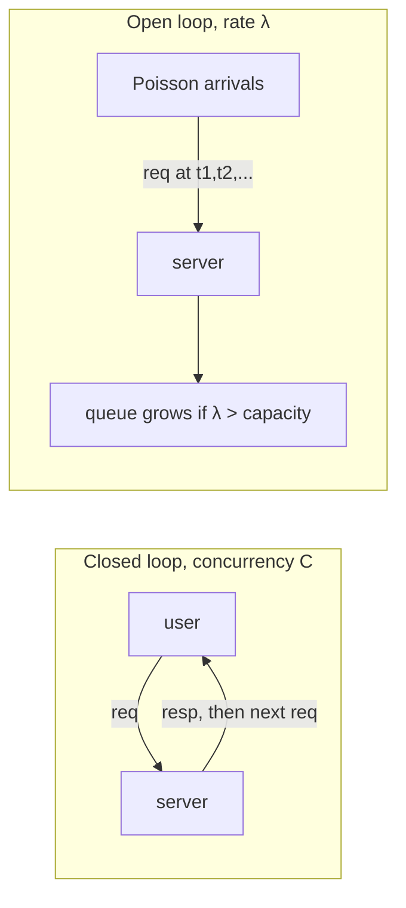

# Benchmarking and Profiling

Every claim in inference engineering — "FP8 is 1.6× faster", "speculative decoding cuts latency 2×", "our engine beats vLLM" — is a benchmark result. Most published LLM benchmark numbers are wrong in at least one way: wrong load model, wrong dataset, cache contamination, missing warm-up, or a metric that does not match what users feel. Benchmarking well is the core skill that separates an inference engineer from someone who tunes flags.

Two different activities:

- **Benchmarking** answers *how fast is the system* (black box: send requests, measure latency and throughput).
- **Profiling** answers *why* (white box: where does each microsecond on the CPU and GPU go).

You need both. A benchmark without profiling cannot tell you what to fix; profiling without a benchmark optimizes something that may not matter end to end.

## 1. The metrics

| Metric | Definition | User feels it as |
| --- | --- | --- |
| **TTFT** (time to first token) | request sent → first output token received | "How long until it starts typing" |
| **ITL** (inter-token latency) | time between consecutive streamed tokens | Smoothness of typing |
| **TPOT** (time per output token) | `(E2E − TTFT) / (output_tokens − 1)`, per request | Average typing speed |
| **E2E latency** | request sent → last token | Total wait for non-streaming / agent calls |
| **Output throughput** | total output tokens / wall time | Fleet capacity |
| **Total throughput** | (input + output tokens) / wall time | Mixes prefill and decode — read carefully |
| **Request throughput** | completed requests / s | Capacity in requests |
| **Per-user tokens/s** | `1 / TPOT` | Interactivity, the x-axis of most Pareto plots |
| **Goodput** | requests/s that meet all SLOs | What you can actually sell |

Report **distributions, not means**: p50, p90, p99 for TTFT, TPOT, ITL. A mean TTFT of 400 ms with a p99 of 12 s is a broken system.

Note the subtle difference between ITL and TPOT: TPOT is a per-request average; ITL is the distribution over all token gaps. With speculative decoding or multi-token chunks, ITL is bimodal (many ~0 gaps inside a chunk, then a step gap), so use TPOT for speed and ITL p99 for stalls.

### Goodput

Throughput alone rewards a system that serves many requests slowly. DistServe (Zhong et al., 2024) popularized **goodput**: the maximum request rate at which a target fraction (say 90%) of requests meet *both* a TTFT SLO and a TPOT SLO.

```
goodput(SLO) = max λ  such that  P(TTFT ≤ T₁ and TPOT ≤ T₂) ≥ 0.9  at arrival rate λ
```

Goodput is the number to optimize when you sell an interactive product.

## 2. Load models: open loop vs closed loop

This is the most common benchmarking error.

**Closed loop** (fixed concurrency): `C` virtual users, each sends a request, waits for the full response, then immediately sends the next. Throughput is limited by latency: `λ = C / E2E`. When the server slows down, the load generator *automatically sends less*. The server can never be overloaded — so you never see the queueing collapse that production traffic causes.

**Open loop** (fixed arrival rate): requests arrive at times drawn from a process (usually Poisson with rate `λ`) regardless of whether earlier ones finished. When the server falls behind, the queue grows without bound, just like real traffic from many independent users.



Use both, deliberately:

- **Closed loop** to map the **throughput vs per-user speed Pareto curve** of an engine (each concurrency level is one point). Engine papers and the DeepInfer README decode chart ("output throughput vs per-user speed") are this kind.
- **Open loop** to find **goodput** and **SLO-capacity** of a deployment, and to see tail behavior.

### Poisson arrivals and burstiness

Poisson: inter-arrival times are exponential with mean `1/λ`. Real traffic is burstier (diurnal cycles, retries, agents fanning out 20 calls at once). Good tools let you use a gamma distribution with a burstiness parameter (shape `< 1` = burstier than Poisson), or replay real traces.

### Coordinated omission

A closed-loop load generator that waits for slow responses *stops sending requests exactly when the system is slow*, so slow periods are under-sampled and percentiles look great. Gil Tene named this "coordinated omission"; `wrk2` was written to correct it. Open-loop generation with timestamps taken from the *intended* send time avoids it. If your p99 looks suspiciously close to your p50 under heavy load, suspect this.

## 3. The latency–throughput curve and the knee

Sweep load (concurrency or request rate) and plot latency against throughput.

```
p90 TTFT
  │                                  ╱
  │                                ╱   ← saturated: queue grows, latency explodes
  │                             ╱
  │                      ___--´
  │            ____----´´        ← the knee
  │ ___----´´´
  └──────────────────────────────────── throughput (tok/s)
```

Below the knee, adding load mostly adds throughput (the GPU batches more). Past the knee, adding load mostly adds queueing delay. Operate somewhat below the knee: utilization headroom is what absorbs bursts. Queueing theory says why: for an M/M/1-like queue, waiting time scales like `ρ / (1 − ρ)`; at 80% utilization the wait is 4× service time, at 95% it is 19×.

For decode-heavy engines, the canonical plot is **output tokens/s per GPU (y)** vs **tokens/s per user (x)**. Each point is a batch size. Moving right (faster per user) costs aggregate throughput. Hardware and engine comparisons are only meaningful at a fixed per-user speed — "GPU A does 5,000 tok/s" is meaningless without "at 50 tok/s/user".

**Worked example.** Measured on one replica (made-up but realistic shape):

| Concurrency | Output tok/s (total) | TPOT p50 | Per-user tok/s |
| --- | --- | --- | --- |
| 1 | 95 | 10.5 ms | 95 |
| 8 | 700 | 11.4 ms | 88 |
| 32 | 2,300 | 13.9 ms | 72 |
| 64 | 3,600 | 17.8 ms | 56 |
| 128 | 4,900 | 26 ms | 38 |
| 256 | 5,600 | 46 ms | 22 |

If the product SLO is ≥ 40 tok/s/user (TPOT ≤ 25 ms), the usable operating point is ~concurrency 120 and ~4,800 tok/s, not the 5,600 peak. Capacity planning ([[19 - Cost and Capacity Planning]]) must use the SLO-constrained number.

## 4. Datasets and workload realism

Performance depends on input and output length distributions far more than on the text itself.

- **Synthetic fixed lengths** (e.g. 1024 in / 128 out): reproducible, good for kernel and engine comparisons, poor for capacity.
- **ShareGPT** (conversation dumps): the classic chat workload used by vLLM's benchmarks; short-ish prompts, medium outputs.
- **Long-context / RAG** sets: thousands to 100K+ input tokens, short outputs — prefill-bound.
- **Agentic traces**: long, growing prompts with huge shared prefixes and many short calls — prefix-cache-bound.
- **Reasoning workloads**: short prompts, very long outputs (thousands of thinking tokens) — decode-bound.
- **Your production trace** (input length, output length, prefix-sharing structure, arrival times): the only one that predicts your production numbers.

### Output length control: `ignore_eos`

If the model stops early, output lengths vary run to run and engine to engine, so throughput comparisons are meaningless. Benchmarks usually set `ignore_eos=True` with a fixed `max_tokens` (or sample target lengths from a distribution and force them). DeepInfer's own offline example does exactly this in long-context mode: `params.ignore_eos = True` with a fixed `OFFLINE_OUTPUT_LEN` (`projects/DeepInfer/examples/offline_inference.py`).

Caveat: with `ignore_eos`, the model generates past its natural end and may produce degenerate repetition. That changes speculative-decoding acceptance rates (repetition is easy to predict) and makes spec-decode look better than it is. Benchmark spec decoding on natural stops with real prompts.

## 5. Benchmarking pitfalls checklist

1. **No warm-up.** First requests pay CUDA graph capture, JIT compilation (Triton, DeepGEMM), cuBLAS heuristics, allocator growth. Discard the first N requests or run a warm-up phase.
2. **Prefix-cache contamination.** Running the same prompts twice means the second run is mostly cache hits. Either randomize prompts (unique prefix per request) or measure cache-hit and cache-miss scenarios explicitly. Report the hit rate.
3. **Synthetic random tokens.** Random token IDs make terrible spec-decode drafts and unusual MoE routing; routing imbalance on real text differs.
4. **Client bottleneck.** A Python client parsing SSE at 50K tok/s is CPU-bound. Watch client CPU; use Rust/async tools or multiple client processes.
5. **Tokenizer mismatch.** Counting tokens with a different tokenizer than the server's gives wrong throughput.
6. **Mixed metrics.** "Total throughput" including input tokens inflates numbers for prefill-heavy runs.
7. **Too short runs.** At least several minutes and thousands of requests for stable p99.
8. **Thermal/power throttling.** GPUs clock down under sustained load; short benchmarks miss it.
9. **Different defaults.** Engines differ in default `max_num_seqs`, chunked prefill, CUDA graphs, sampling (greedy vs temperature). Pin everything and publish configs.
10. **Comparing at different per-user speeds** (see §3).
11. **MoE load balance on idle data.** Expert routing on synthetic prompts can be unrealistically balanced or imbalanced. DeepInfer's memory profiling deliberately forces an imbalance ratio of 1.8 during the profile run to size memory for the worst case (`projects/DeepInfer/deepinfer/worker/model_runner.py`, `profile_run`).

## 6. Tools

| Tool | Notes |
| --- | --- |
| **`vllm bench serve`** (formerly `benchmarks/benchmark_serving.py`) | OpenAI-compatible endpoints, ShareGPT/random/sonnet datasets, `--request-rate` with Poisson or gamma burstiness, `--max-concurrency`, goodput SLOs |
| **SGLang `bench_serving`** | Similar, plus SGLang-specific workloads |
| **GuideLLM** (vLLM project) | SLO-aware sweeps: synchronous, throughput, constant, Poisson, concurrent profiles; real or synthetic datasets; reports |
| **AIPerf** (NVIDIA, ai-dynamo) | Comprehensive gen-AI benchmarking with dashboards; NVIDIA's successor-generation tool to GenAI-Perf |
| **GenAI-Perf** (Triton perf_analyzer) | Earlier NVIDIA tool, still widely referenced |
| **inference-benchmarker** (Hugging Face) | Rust, open-loop constant arrival rates, automatic sweep to max throughput, profiles per use case |
| **LLMPerf** (Anyscale) | Older, simple; useful for API provider comparisons |
| **Custom harness** | For production-trace replay; often the most important |

A minimal vLLM open-loop sweep:

```bash
for rate in 1 2 4 8 16 32; do
  vllm bench serve \
    --model meta-llama/Llama-3.1-8B-Instruct \
    --dataset-name sharegpt --dataset-path ShareGPT_V3_unfiltered_cleaned_split.json \
    --num-prompts 2000 --request-rate $rate --burstiness 1.0 \
    --percentile-metrics ttft,tpot,itl,e2el --metric-percentiles 50,90,99 \
    --save-result --result-filename rate_${rate}.json
done
```

Check the current CLI flags in the vLLM docs before running; they change between releases.

## 7. Profiling

### Layers of the stack and the right tool

| Question | Tool |
| --- | --- |
| Is the GPU idle between kernels? CPU overhead? Sync stalls? | **Nsight Systems** (`nsys`) timeline, or **PyTorch profiler** → Perfetto/Chrome trace |
| Why is *this* kernel slow? Memory- or compute-bound? Occupancy? Bank conflicts? | **Nsight Compute** (`ncu`) per-kernel analysis, roofline section |
| Where does Python time go? | `py-spy`, `cProfile`, engine CPU timers |
| Memory: who allocated what? | `torch.cuda.memory._record_memory_history` + snapshot viewer |
| Collectives: is NCCL / all-to-all the bottleneck? | `nsys` with NCCL/NVTX ranges, NCCL debug logs |
| AMD GPUs | `rocprof`, Omnitrace/Omniperf |

### Nsight Systems workflow

```bash
nsys profile -t cuda,nvtx,osrt,cudnn,cublas \
  --capture-range=cudaProfilerApi --capture-range-end=stop \
  -o decode_trace python serve_bench.py
```

Wrap a few steady-state steps with `torch.cuda.profiler.start()/stop()` (or NVTX ranges). In the timeline look for:

- **Gaps between kernels** on the GPU row → CPU launch overhead or Python scheduling. Fix: CUDA graphs ([[13 - Kernels, Compilers, and CUDA Graphs]]), async scheduling.
- **`cudaStreamSynchronize` / `.item()` / `.cpu()`** in the CPU row → hidden syncs. DeepInfer wraps forward and sample launches in a `forbid_cuda_sync()` context to catch these (`projects/DeepInfer/deepinfer/worker/model_runner.py`, `execute_main_model`).
- **Long single kernels** → candidates for `ncu`.
- **Communication not overlapped with compute** in TP/EP runs.

### Nsight Compute workflow

```bash
ncu --set full -k regex:attention --launch-skip 50 --launch-count 5 -o attn python bench_kernel.py
```

Read: achieved DRAM bandwidth vs peak (memory-bound kernels should hit 70–90%), achieved tensor-core FLOP/s vs peak, occupancy, warp stall reasons. Compare with the roofline from [[04 - Roofline and Performance Modeling]]. A decode GEMV at 40% of peak HBM bandwidth has 2× headroom; one at 88% does not.

### PyTorch profiler

```python
from torch.profiler import profile, ProfilerActivity, schedule
with profile(activities=[ProfilerActivity.CPU, ProfilerActivity.CUDA],
             schedule=schedule(wait=5, warmup=5, active=3),
             record_shapes=True, with_stack=True) as prof:
    for _ in range(13):
        engine.step(); prof.step()
prof.export_chrome_trace("trace.json")  # open in ui.perfetto.dev
print(prof.key_averages().table(sort_by="cuda_time_total", row_limit=20))
```

vLLM and SGLang expose profiler start/stop endpoints; DeepInfer exposes a runtime profiling HTTP interface when `DEEPINFER_PROFILE_HTTP_ENABLE` is set (`projects/DeepInfer/deepinfer/engine/profile_server.py`).

### Timing GPU work correctly

GPU work is asynchronous. `time.time()` around a kernel launch measures the launch, not the kernel. Use CUDA events:

```python
start, end = torch.cuda.Event(enable_timing=True), torch.cuda.Event(enable_timing=True)
start.record(); out = model(x); end.record()
torch.cuda.synchronize()
ms = start.elapsed_time(end)
```

DeepInfer's `profile_decode_perf` is a clean reference: per captured CUDA graph size, 1 warm-up replay, 5 timed replays with CUDA events, drop the min and max, average the rest, then all-reduce across the EP group to get the group mean (`projects/DeepInfer/deepinfer/worker/model_runner.py`). The resulting batch-size → latency curve feeds the speculative-decoding scheduler.

## 8. Accuracy regression testing

Every optimization (quantization, new kernel, spec decoding, KV compression) risks silently changing outputs. Performance work without accuracy checks is how you ship a "2× faster" model that is quietly worse.

- **Logit/logprob comparison** against a reference implementation on fixed prompts: max abs diff, KL divergence per token.
- **Perplexity** on held-out text: cheap, sensitive to quantization damage. DeepInfer's offline example asserts all decode logprobs are finite and the repo ships a PPL refresh script (`projects/DeepInfer/examples/refresh_offline_decode_ppl.py`).
- **Task evals**: `lm-evaluation-harness`, plus a small domain-specific set (GSM8K, MMLU-Pro, HumanEval, long-context retrieval like RULER). Run with fixed seeds and greedy decoding where possible.
- **Determinism tests**: same input twice → same output, and same input in different batch compositions → same output (batch invariance, see [[15 - Sampling, Determinism, and Structured Output]]).
- **Spec decoding must be lossless** in distribution: verify greedy output is identical with and without it.

## 9. MLPerf Inference

MLCommons' MLPerf Inference is the industry's audited benchmark. Key ideas worth copying even if you never submit:

- **Scenarios**: *Offline* (all queries at once, max throughput), *Server* (Poisson arrivals with a latency bound — open loop), *SingleStream* and *MultiStream* (edge latency).
- **LoadGen**: a standard load generator that issues queries and enforces rules, so results are comparable.
- **Accuracy targets**: a submission must reach e.g. 99% or 99.9% of the reference model's quality; you cannot trade accuracy for speed silently.
- **LLM benchmarks** with TTFT and TPOT constraints in the Server scenario.

The benchmark suite and rules live at https://github.com/mlcommons/inference.

## What practitioners actually do

1. Keep a **benchmark matrix**: {short chat, long prompt, long output, agentic prefix-heavy} × {closed-loop sweep, open-loop sweep}, run in CI on every engine upgrade.
2. Always report **config + hardware + dataset + load model + cache hit rate** with numbers.
3. Plot **Pareto curves** (throughput per GPU vs per-user speed) and **goodput vs SLO**, not single numbers.
4. When something is slow, go top-down: E2E breakdown → `nsys` timeline → `ncu` on the top kernels.
5. Gate every perf change on an accuracy check.

## Common mistakes

- Closed-loop only, then surprised by production queue blowups.
- Measuring with warm prefix cache and claiming cold-start TTFT.
- Comparing two engines at different batch sizes / per-user speeds.
- Using `time.time()` around asynchronous GPU code.
- Using `nvidia-smi` utilization as a performance metric.
- Benchmarking spec decoding with `ignore_eos` on degenerate continuations.
- Reporting mean latency only.

## Check yourself

1. **Why can a closed-loop benchmark never show queueing collapse?** Each virtual user waits for its response before sending again, so arrival rate falls automatically as latency rises; the system is never offered more than it can handle.
2. **Define goodput.** The maximum request rate at which a target fraction of requests meet all latency SLOs (e.g. TTFT and TPOT).
3. **You run the same 1,000 prompts twice; the second run's TTFT is 5× better. Why?** Prefix cache hits — the KV cache from the first run is reused. Randomize or report cache-hit rate.
4. **Why is ITL bimodal with speculative decoding?** Several tokens arrive together after one verify step (near-zero gaps), then a full step gap.
5. **An `nsys` trace shows 30% gaps between kernels during decode. First fix?** Remove CPU launch overhead: CUDA graphs and asynchronous (overlapped) scheduling; hunt hidden syncs.
6. **A decode attention kernel achieves 1.2 TB/s on an H100 SXM (3.35 TB/s peak). What does that tell you?** It is memory-bound at ~36% of peak bandwidth; significant headroom remains (better tiling, more parallelism over KV splits, larger batch).
7. **Why compare engines at a fixed tokens/s per user?** Throughput can always be raised by batching more at the cost of per-user speed; only same-interactivity comparisons are fair.
8. **Why does MLPerf require accuracy targets?** To prevent trading model quality for speed (aggressive quantization, approximations) without disclosure.

## Further reading

- DistServe (goodput): https://arxiv.org/abs/2401.09670
- vLLM benchmark docs: https://docs.vllm.ai/en/latest/contributing/benchmarks.html
- GuideLLM: https://github.com/vllm-project/guidellm
- AIPerf: https://github.com/ai-dynamo/aiperf
- inference-benchmarker: https://github.com/huggingface/inference-benchmarker
- wrk2 and coordinated omission: https://github.com/giltene/wrk2
- Nsight Systems: https://docs.nvidia.com/nsight-systems/
- Nsight Compute: https://docs.nvidia.com/nsight-compute/
- lm-evaluation-harness: https://github.com/EleutherAI/lm-evaluation-harness
- MLPerf Inference paper: https://arxiv.org/abs/1911.02549 and repo https://github.com/mlcommons/inference
- ShareGPT dataset used by vLLM benchmarks: https://huggingface.co/datasets/anon8231489123/ShareGPT_Vicuna_unfiltered

## Related

- [[04 - Roofline and Performance Modeling]] — what "good" means for a kernel
- [[07 - Batching and Scheduling]] — what drives the latency–throughput trade
- [[13 - Kernels, Compilers, and CUDA Graphs]] — fixing what profiles reveal
- [[15 - Sampling, Determinism, and Structured Output]] — determinism tests
- [[19 - Cost and Capacity Planning]] — turning benchmark numbers into fleet size
- [[21 - Case Study - DeepInfer]] — `profile_decode_perf` and CPU/GPU timers in a real engine
