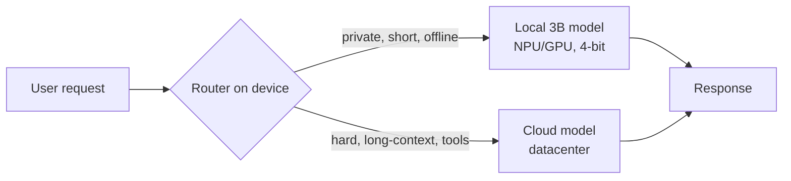

# Edge and On-Device Inference

Datacenter inference optimizes **throughput per dollar** across thousands of concurrent users. On-device inference optimizes **latency, privacy, and offline availability for one user** on hardware you do not control: laptops, phones, browsers, cars, robots. The physics is the same — decode is memory-bandwidth-bound ([[04 - Roofline and Performance Modeling]]) — but the constraints flip:

| | Datacenter | Device |
| --- | --- | --- |
| Batch size | 32–512 | 1 (sometimes a few) |
| Memory | 80–288 GB HBM per GPU | 8–128 GB shared with OS and apps |
| Bandwidth | 3–8 TB/s per GPU | 50–800 GB/s |
| Power | 700–1,200 W per GPU | 5–150 W total, thermals throttle |
| Software | You control the stack | Fragmented: CUDA, Metal, Vulkan, NPUs, WebGPU |
| Cost model | $/token | Free per token; cost is battery, heat, app size, UX |

## 1. The one formula that matters

At batch 1, every decoded token reads (almost) every weight once. So:

```
max decode tokens/s ≈ effective memory bandwidth / bytes of weights read per token
bytes per token     ≈ active parameters × bits per weight / 8   (+ KV cache read)
```

Prefill is compute-bound and benefits from GPU/NPU matrix throughput; decode speed is set by bandwidth and quantization.

### Worked examples (theoretical ceilings; real results are ~50–80% of this)

| Device (memory bandwidth) | Model | Format | Weight bytes | Ceiling tok/s |
| --- | --- | --- | --- | --- |
| Apple M4 (120 GB/s) | 8B dense | Q4_K_M (~4.9 bpw) | ~4.9 GB | ~24 |
| Apple M4 Pro (273 GB/s) | 8B dense | Q4_K_M | ~4.9 GB | ~56 |
| Apple M4 Max (546 GB/s) | 70B dense | Q4_K_M | ~43 GB | ~13 |
| Apple M3 Ultra (800+ GB/s) | 30B-A3B MoE (3B active) | 4-bit | ~1.8 GB active | ~440 (other overheads dominate long before) |
| Flagship phone (~60 GB/s, approx.) | 3B dense | 4-bit | ~1.7 GB | ~35 |
| RTX 4090 (~1 TB/s) | 8B dense | Q4_K_M | ~4.9 GB | ~200 |

Apple bandwidth numbers are from Apple's announcements (M4 Pro 273 GB/s, M4 Max 546 GB/s in its top configuration, M3 Ultra "over 800 GB/s", M5 153 GB/s). Phone bandwidth varies by SoC and memory; treat ~50–80 GB/s for current LPDDR5X flagships as an order-of-magnitude estimate.

Lessons:

- **Quantization is not optional on device.** Going from 16-bit to ~4.5-bit is a ~3.5× decode speedup *and* the difference between fitting and not fitting.
- **MoE models are ideal for big-memory, modest-bandwidth devices** (Macs): total parameters must fit in memory, but only active parameters are read per token ([[11 - Mixture of Experts Inference]]).
- **Memory capacity decides *which* model; bandwidth decides *how fast*.**

### Prefill on device

Prefill is compute-bound. A laptop GPU at ~30 TFLOP/s effective FP16 prefilling an 8B model: `2 × 8e9 = 16 GFLOP/token` → ~2,000 tok/s at full efficiency; real numbers are lower. A 10K-token prompt (a document, a long chat) can take several seconds to tens of seconds on a phone. Long-context on device is prefill-limited, which is why prompt caching (saving KV state to disk between sessions) matters on device too.

### KV cache on device

At batch 1, KV is small relative to weights for short contexts but grows linearly. Llama-3-8B: 128 KB/token in FP16 → 32K tokens = 4 GB. On a 16 GB laptop that competes with the weights. Hence KV quantization (Q8_0/Q4_0 KV in llama.cpp), sliding-window models, and modest default context lengths ([[05 - KV Cache]], [[16 - Long Context Inference]]).

## 2. llama.cpp and GGUF

**llama.cpp** (ggml-org) is the reference portable engine: C/C++, no Python at runtime, backends for CPU (AVX2/AVX-512/NEON/AMX), Metal, CUDA, ROCm/HIP, Vulkan, SYCL, and more. **GGUF** is its single-file format: weights, tokenizer, chat template, and metadata together, memory-mappable.

### Quantization types

GGUF quantizes in **blocks**: a group of weights shares a scale (and sometimes a min). The trailing letters mean:

- **Legacy `Q4_0`, `Q5_0`, `Q8_0`**: block of 32 weights + one FP16 scale. `Q4_0` = (32×4 + 16)/32 = 4.5 bits/weight; `Q8_0` = 8.5 bpw.
- **K-quants `Q2_K` … `Q6_K`**: super-blocks of 256 weights with sub-block scales quantized themselves; better quality per bit. The `_S/_M/_L` suffixes are *mixes*: e.g. `Q4_K_M` keeps some sensitive tensors (parts of attention V and FFN down projections) at higher precision.
- **I-quants `IQ1_S` … `IQ4_XS`**: lattice/codebook-based quantization for very low bit rates; best used with an **importance matrix** (`imatrix`) computed from calibration text, which weights quantization error by how much each weight matters.

Measured bits/weight from the llama.cpp quantize README (for an ~8B model):

| Type | bits/weight | Notes |
| --- | --- | --- |
| IQ2_XXS | 2.38 | Extreme; noticeable quality loss, needs imatrix |
| Q3_K_M | 4.00 | Low-memory option |
| IQ4_XS | 4.46 | Strong quality per bit |
| Q4_K_M | 4.89 | The common default |
| Q5_K_M | 5.70 | Near-lossless for most use |
| Q6_K | 6.56 | Practically lossless |
| Q8_0 | 8.50 | Reference-quality quantized |
| F16 | 16.00 | Baseline |

The same README's table shows text-generation speed on the benchmark GPU rising from ~29 tok/s at F16 to ~51 at Q8_0 and ~72 at Q4_K_M — the bandwidth law in action, with diminishing returns at the lowest bit rates where dequantization compute starts to matter.

Practical guidance: start at `Q4_K_M` (or `IQ4_XS` with an imatrix); go to `Q5_K_M`/`Q6_K` if memory allows; drop below 4 bits only for models too big to fit otherwise, and prefer a smaller model at 4–5 bits over a larger one at 2 bits for many tasks (measure on your task).

### Key llama.cpp knobs

```bash
llama-server -m model-Q4_K_M.gguf \
  -c 16384            `# context length (KV memory!)` \
  -ngl 99             `# layers offloaded to GPU; partial offload when VRAM is short` \
  -fa on              `# flash attention` \
  --cache-type-k q8_0 --cache-type-v q8_0   `# quantized KV cache` \
  -np 4               `# parallel slots (small continuous batching)`
```

Check `llama-server --help` for the current flag syntax; it evolves quickly. `llama-server` exposes an OpenAI-compatible API, so the serving concepts in [[17 - Serving Systems, Routing, and Autoscaling]] still apply in miniature. Ollama and LM Studio wrap llama.cpp (and, in some cases, MLX) with model management.

**Partial offload** (`-ngl` less than the layer count) runs some layers on GPU and the rest on CPU. Decode speed then follows the *slowest* memory: layers on CPU read from system RAM at CPU bandwidth. A model 80% on GPU can easily be 3× slower than 100%.

## 3. Apple silicon and MLX

Apple SoCs have **unified memory**: CPU, GPU, and Neural Engine share one pool of LPDDR memory. Implications:

- A 128 GB Mac can hold a 70B model at 8-bit or a ~200B-total-parameter MoE at 4-bit — impossible on any single consumer discrete GPU.
- No PCIe copy between host and device.
- Bandwidth (120–800+ GB/s) is lower than a datacenter GPU's HBM, so decode tok/s is modest; MoE models shine.
- macOS limits how much of unified memory the GPU may wire by default; it is adjustable via a sysctl (`iogpu.wired_limit_mb`) on recent macOS versions.

**MLX** (ml-explore) is Apple's array framework: NumPy-like API, lazy evaluation, unified-memory-aware, Metal kernels, with Python, Swift, and C++ bindings. **mlx-lm** provides LLM loading, quantization (typically 4/8-bit group-wise), generation, LoRA fine-tuning, and a server. Typical use:

```bash
pip install mlx-lm
mlx_lm.generate --model mlx-community/<model>-4bit --prompt "hello" --max-tokens 200
```

On Apple silicon, MLX and llama.cpp's Metal backend are the two main choices; which is faster depends on model and version — benchmark both on your machine.

The **Apple Neural Engine (ANE)** is a fixed-function matrix accelerator reached through Core ML. It is power-efficient for prefill-like dense compute but has constraints (static shapes, specific layouts, limited ops), so LLM decode on Mac typically runs on the GPU.

## 4. Mobile NPUs and frameworks

Phones combine CPU, mobile GPU, and an **NPU** (Qualcomm Hexagon, Apple ANE, MediaTek APU, Google Tensor TPU). NPUs offer the best performance per watt for INT8/INT4 matmuls but are the hardest to program: vendor SDKs, static graphs, operator coverage gaps, and quantization formats you must match exactly.

| Framework | Owner | Targets | Notes |
| --- | --- | --- | --- |
| **ExecuTorch** | PyTorch (Meta) | iOS, Android, embedded, with backends such as XNNPACK (CPU), Core ML, MPS, Vulkan, Qualcomm, MediaTek | Export a PyTorch model ahead-of-time (`torch.export`) → `.pte` program; small runtime |
| **ONNX Runtime** (+ GenAI extension) | Microsoft | CPU, GPU, DirectML, QNN (Qualcomm), Core ML, others via execution providers | Broad hardware reach; Windows Copilot+ PCs |
| **Core ML** | Apple | ANE/GPU/CPU on Apple devices | Apple's native path |
| **LiteRT** (formerly TensorFlow Lite) / MediaPipe LLM | Google | Android, web, edge | Google's on-device stack |
| **MLC LLM** | MLC / TVM community | iOS, Android, GPU, web | Compiler-based (TVM) |
| **llama.cpp** | ggml-org | Everywhere, including Android CPU/Vulkan | Most portable |

Mobile-specific realities:

- **Thermal throttling**: sustained generation heats the SoC; clocks drop after tens of seconds. Benchmarks must run long enough to see it.
- **Memory pressure**: the OS kills background apps (or yours) under memory pressure. A 4 GB model in a 12 GB phone is the practical upper range for an app.
- **App size and download**: multi-GB model downloads need background download, resumable transfers, and storage UX.
- **Battery**: energy per token matters; NPUs win here.
- **Model choice**: 1–4B parameter models (often distilled) at 4-bit are the sweet spot. OS-level models (Apple Intelligence's on-device model, Gemini Nano) are shared across apps so each app does not ship its own.

## 5. In the browser: WebGPU and WebLLM

**WebGPU** gives JavaScript access to the GPU's compute shaders. **WebLLM** (MLC) compiles models with TVM into WebGPU kernels and runs them fully client-side, with an OpenAI-style JS API; its paper reports retaining a large share of native performance on the same device. Transformers.js (Hugging Face) runs ONNX models via ONNX Runtime Web (WebGPU/WASM).

Browser constraints: per-tab memory limits, model downloads cached via the Cache API / IndexedDB, shader compilation on first load, varying WebGPU support across browsers and OSes. Good for privacy-preserving demos and small models (≤ 3–4B at 4-bit).

## 6. Speculative decoding and other tricks on device

Batch 1 leaves compute idle while waiting on memory, which is the ideal regime for **speculative decoding** ([[09 - Speculative Decoding]]): a small draft model (or n-gram/prompt-lookup drafting, which costs almost nothing) proposes tokens, the big model verifies several in one bandwidth-bound pass. llama.cpp and MLX both support draft models. Gains of 1.5–2.5× are common on code and structured text.

Other device techniques:

- **Prompt/KV caching to disk** between sessions (system prompt prefill once).
- **Layer streaming / flash offload** for models larger than RAM (very slow; research-grade).
- **Hybrid on-device + cloud routing**: small local model for easy queries, cloud for hard ones; decide per request.

## 7. Hybrid architectures



The device router can be a tiny classifier, heuristics (input length, task type), or the local model's own confidence. Privacy-sensitive designs keep the decision and data on device unless the user consents.

## 8. Worked example: choosing a model for a 16 GB laptop

Target: a local coding assistant on a 16 GB Apple M4 laptop (120 GB/s), 16K-token context, ≥ 15 tok/s.

**Memory budget.** macOS, browser, and IDE use ~6–8 GB. Budget ~8 GB for the model process.

| Candidate | Weights | KV at 16K (FP16 / Q8_0) | Total | Fits? | Decode ceiling |
| --- | --- | --- | --- | --- | --- |
| 14B dense, Q4_K_M | ~8.6 GB | ~3 GB / ~1.6 GB (GQA, 48 layers × 8 KV heads × 128) | 10–12 GB | No | ~14 tok/s |
| 8B dense, Q4_K_M | ~4.9 GB | 2 GB / 1 GB | 6–7 GB | Yes | ~24 tok/s |
| 8B dense, Q6_K | ~6.6 GB | 2 GB / 1 GB | 7.6–8.6 GB | Borderline | ~18 tok/s |
| 3B dense, Q8_0 | ~3.2 GB | ~0.9 GB | ~4 GB | Yes | ~37 tok/s |

KV for an 8B Llama-3-like model: 32 layers × 2 × 8 heads × 128 × 2 bytes = 128 KB/token → 16K tokens ≈ 2 GB in FP16, ~1 GB with Q8_0 KV.

Decision: 8B at Q4_K_M with Q8_0 KV cache; expected real decode ~15–20 tok/s (60–80% of the 24 tok/s ceiling). Prefill of a 16K-token prompt is the pain point — at a few hundred tok/s on this GPU it takes tens of seconds — so cache the system prompt and repo context KV between turns.

## 9. Benchmarking on device

Device benchmarks need the same discipline as datacenter ones ([[18 - Benchmarking and Profiling]]) plus thermals and power.

```bash
# llama.cpp's bundled benchmark: prompt processing (pp) and text generation (tg)
llama-bench -m model-Q4_K_M.gguf -p 512,4096 -n 128,512 -ngl 99 -fa 1 -r 5

# MLX: generation stats are printed after a run
mlx_lm.generate --model mlx-community/<model>-4bit --prompt "$(cat prompt.txt)" --max-tokens 512
```

Checklist:

- Report **pp tok/s and tg tok/s separately**, at several prompt lengths; tg falls as context grows (more KV to read).
- Run **sustained** tests (5–10 minutes of continuous generation) to capture throttling, especially on phones and fanless laptops.
- Measure **energy**: `powermetrics` on macOS, Android battery stats / Perfetto power rails; report joules per token.
- Measure **peak resident memory**, not just model file size.
- Measure **time-to-first-token on cold start** (model load from disk + first prefill): users feel this every app launch.
- Record OS version, framework version, and quantization; numbers shift with every release.

## 10. Privacy, security, and updates

- **Privacy**: on-device inference keeps prompts local, but telemetry, crash logs, and cloud fallbacks can leak them. Be explicit about which requests leave the device.
- **Model integrity**: verify model downloads with hashes/signatures; a swapped GGUF is a supply-chain attack vector. Prefer safetensors/GGUF over pickle-based formats.
- **Model updates**: shipping a new 2 GB model is a product release. Use delta updates where possible and keep the old model until the new one is verified.
- **Licensing**: open-weight licenses differ (commercial use, attribution, usage restrictions); check before shipping in an app.

## What practitioners actually do

1. Compute the bandwidth ceiling first; it tells you in 30 seconds whether the target tok/s is possible.
2. Pick the largest model that fits in ~60–70% of available memory at Q4–Q5 with your target context length's KV cache.
3. Benchmark llama.cpp vs MLX (Mac) or llama.cpp vs ExecuTorch/ONNX Runtime (mobile) on the actual target device, with sustained runs.
4. Evaluate quality at the chosen quantization on your task, not just perplexity.
5. Ship model downloads as a separate, resumable asset, not inside the app binary.

## Common mistakes

- Expecting datacenter-style throughput from batch-1 decode.
- Quoting tok/s from a 10-second run on a phone (before thermal throttling).
- Forgetting the KV cache when checking whether a model fits.
- Partial GPU offload without realizing CPU-resident layers set the speed.
- Using 2-bit quantization of a large model when a 4-bit smaller model would be better and faster.
- Ignoring the chat template embedded in GGUF metadata (or overriding it wrongly).

## Check yourself

1. **A laptop has 273 GB/s bandwidth. Max decode tok/s for a 14B dense model at Q4_K_M (~4.9 bpw)?** Weights ≈ 14e9 × 4.9 / 8 ≈ 8.6 GB → 273 / 8.6 ≈ 32 tok/s ceiling; expect ~20–25.
2. **Why do MoE models fit Macs well?** Unified memory is large (holds all experts) but bandwidth is modest; per-token reads depend only on active parameters.
3. **What does `Q4_K_M`'s "M" mean?** A mix: most tensors at 4-bit K-quant, some sensitive tensors at higher precision.
4. **What is an importance matrix for?** It weights quantization error by activation statistics from calibration data, so important weights are preserved; essential for very low-bit I-quants.
5. **Why is prefill slow on phones even with a fast NPU path?** Prefill is compute-bound and long prompts need many GFLOPs per token; mobile compute is limited and often thermally throttled.
6. **Why is speculative decoding especially effective on device?** Batch-1 decode leaves compute idle while memory-bound; verifying several draft tokens costs nearly the same bandwidth as generating one.
7. **You offload 28 of 32 layers to a GPU and the rest run on CPU. Why is it much slower than full offload?** Per-token time is the sum of per-layer times; the CPU layers read weights at system-RAM bandwidth, which can dominate.

## Further reading

- llama.cpp: https://github.com/ggml-org/llama.cpp (quantize README: https://github.com/ggml-org/llama.cpp/blob/master/tools/quantize/README.md)
- MLX: https://github.com/ml-explore/mlx and mlx-lm: https://github.com/ml-explore/mlx-lm
- ExecuTorch: https://github.com/pytorch/executorch
- ONNX Runtime: https://onnxruntime.ai
- WebLLM: https://github.com/mlc-ai/web-llm and paper https://arxiv.org/abs/2412.15803
- Apple M4 Pro/Max announcement (bandwidth figures): https://www.apple.com/newsroom/2024/10/apple-introduces-m4-pro-and-m4-max/

## Related

- [[04 - Roofline and Performance Modeling]] — the bandwidth law
- [[08 - Quantization]] — the methods behind GGUF and MLX quantization
- [[09 - Speculative Decoding]] — big wins at batch 1
- [[11 - Mixture of Experts Inference]] — active vs total parameters
- [[03 - Accelerator Hardware]] — datacenter contrast
