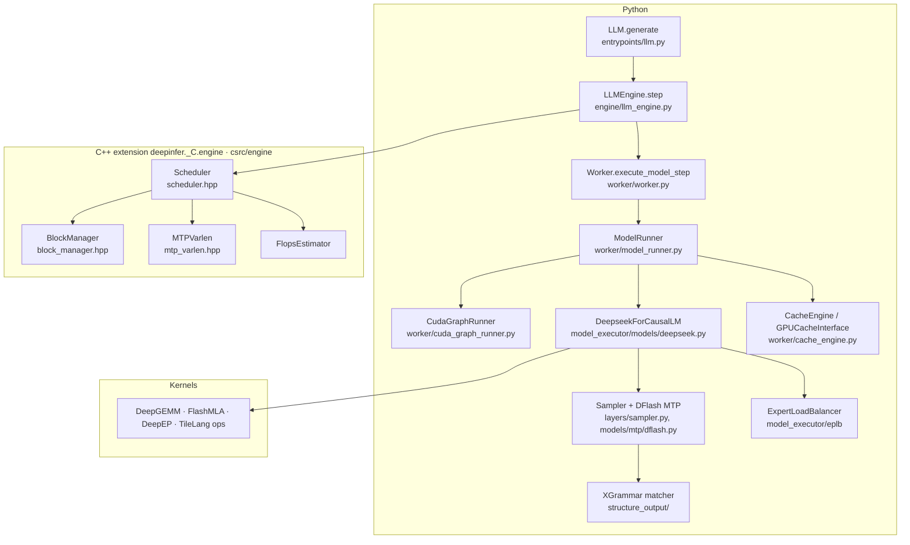
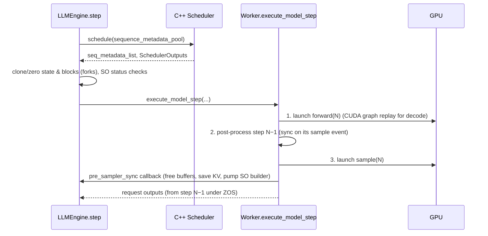

# Case Study: DeepInfer

DeepInfer is DeepSeek's open-sourced inference framework, the engine behind their DeepSeek V4.1 Flash service. A copy of the source lives in this repo at `projects/DeepInfer/`. This note is a guided code-reading tour: it maps the concepts from notes 05–17 onto real production code, with file and line references so you can follow along.

Ground rules for this note: it states only what the code and the bundled docs show. Where the code is in a compiled extension we cannot read here, it says so. Numbers about the production deployment come from `projects/DeepInfer/doc/inference_deployment_qa.md` (cited as "the deployment Q&A").

## 1. What the release is (and is not)

From `projects/DeepInfer/README.md`:

- **Model**: DeepSeek-V4.1-Flash. **Hardware**: NVIDIA SM100 (Blackwell) GPUs and Huawei Ascend 950 NPUs.
- **Features**: optimized kernels (FlashMLA, DeepGEMM, DeepEP, TileKernels, DeepSelect, custom TileLang kernels), attention DP / balanced CP, MoE EP + EPLB, DSpark speculative decoding with confidence-scheduled verification, SWA bounded replay, asynchronous ("zero-overhead") scheduling, batch-invariant inference, deterministic sampling, structured outputs.
- **Scope**: *offline* inference. Not included: the KV cache storage system, VE/prefill/decode disaggregation glue, and the cross-replica load balancers. The `LLMEngine` docstring says so too: "This release does not include an online-serving wrapper" (`projects/DeepInfer/deepinfer/engine/llm_engine.py:130`).
- **Lineage**: "originally built primarily on vLLM, with additional inspiration from SGLang and TensorRT-LLM". You will recognize vLLM's `LLM` / `LLMEngine` / `Worker` / `ModelRunner` / `CacheEngine` shape, with the scheduler and block manager moved into C++.
- **Published performance**: prefill measured on 4 SM100 GPUs, decode on 64, each within one scale-up domain (Pareto charts in `projects/DeepInfer/doc/images/`).

The deployment Q&A adds production context: a single cluster serves 155 trillion tokens per day; prefill uses EP2–8/DP2–8, decode uses EP64–128/DP64–128 ("Wide-EP"); TP and CP are not used; KV cache is retained on an SSD cluster for days.

## 2. Architecture at a glance



The C++ side is in `projects/DeepInfer/csrc/engine/` (~4,100 lines across headers and sources). Moving the scheduler out of Python is itself a lesson: in vLLM-style engines, per-step Python scheduling overhead becomes visible at large batch sizes ([[07 - Batching and Scheduling]], [[13 - Kernels, Compilers, and CUDA Graphs]]). Note the `py::gil_scoped_release` at the top of `_schedule()` (`projects/DeepInfer/csrc/engine/scheduler.hpp:275`) so other Python threads (e.g. structured-output compilation) keep running while scheduling.

## 3. Engine construction: following `LLMEngine.__init__`

Read `projects/DeepInfer/deepinfer/engine/llm_engine.py:155` onward. The order matters, and it is the same order every serious engine uses:

1. **Tokenizer and model class** resolved from the config.
2. **Workers created** (`_init_workers`, line 368). With context parallelism `cp_size > 1`, extra worker processes are spawned; rank 0 is the in-process *driver worker*. The driver receives `EngineCallbacks(post_process_fn=..., pre_sampler_sync_fn=...)` — the hooks that let the worker call back into the engine mid-step, which is how asynchronous scheduling is wired (section 5).
3. **Load weights** (`_run_workers("load_model")`).
4. **Profile memory, size the KV cache** (`_init_cache`, line 416 → `WorkerBase.profile_num_available_blocks`, `projects/DeepInfer/deepinfer/worker/base.py:212`).
5. **Allocate cache, capture CUDA graphs, warm up** (`init_cache_engine`, `warm_up_model`).
6. **Create block managers and the C++ scheduler** (`_create_scheduler`, line 307), handing it a `FlopsEstimator`, the YOCO truncation length, and later the measured decode performance curve.

### KV sizing by profiling (concept: [[05 - KV Cache]])

`profile_num_available_blocks` (`projects/DeepInfer/deepinfer/worker/base.py:212`) is the classic vLLM recipe with production details:

```
available_kv = total_gpu_memory × gpu_memory_utilization − peak_allocated_during_profile_run
available_kv −= 2 × state_cache_size      # fixed per-sequence state slots (SWA etc.), ×2 for store + copy buffers
num_gpu_blocks = available_kv // bytes_per_block
```

Two details to notice:

- The profile run deliberately forces an MoE routing imbalance (`DEEPINFER_FORCE_IMBALANCE_RATIO = 1.8` inside `ModelRunner.profile_run`, `projects/DeepInfer/deepinfer/worker/model_runner.py:444`) so that peak activation memory reflects a skewed expert load, not the idealized balanced case.
- The cross-rank reduction is `all_reduce(SUM)` then `// world_size // 2 * 2`: the **average** block count across ranks, rounded down to an even number. The `_init_cache` docstring (inherited wording) says "we take the minimum number of blocks across all workers". Exercise 3 asks you to reason about which is right for this deployment.

The engine then refuses to start if `runtime_max_model_len` exceeds 80% of total KV tokens (`llm_engine.py`, inside `_init_cache`) — a guard against a configuration where a single maximum-length request could starve everything else.

### Two kinds of cache memory

`projects/DeepInfer/deepinfer/worker/cache_engine.py` manages two pools:

- **Paged block KV cache** (`BlockManager(num_gpu_blocks)`) for the compressed main KV and indexer keys — vLLM-style PagedAttention blocks ([[05 - KV Cache]], [[06 - Attention Kernels]]).
- **Per-sequence state slots** (`StateBlock`, `cache_engine.py:221`; managed by a second `BlockManager(num_state_seqs)`) for sliding-window attention (SWA) KV and compression accumulators. A fixed-size slot per sequence fits SWA well, because the window does not grow with context ([[16 - Long Context Inference]]).

The `StateBlock` docstring explains the layout `[stored region: SWA] [dropped region: YOCO consumer SWA | compression state]`: only the stored region is persisted to the KV store. This matches the deployment Q&A, which gives the persisted size as 20 layers × 134 tokens × 528 B = 1,415,040 B per sequence (528 B/token is their MXFP8 SWA format).

## 4. One step, end to end

Entry: `LLM.generate` → `LLM._run_engine` (`projects/DeepInfer/deepinfer/entrypoints/llm.py:168`) loops `llm_engine.step()` while requests are unfinished, then calls `flush_inflight_reqs()` once to drain the step that asynchronous scheduling left in flight.

`LLMEngine.step()` (`projects/DeepInfer/deepinfer/engine/llm_engine.py:860`):



The key method is `Worker.execute_model_step` (`projects/DeepInfer/deepinfer/worker/worker.py:89`). Its docstring lays out the four phases:

1. Forward current step (main model).
2. Post-process previous step.
3. Sample current step.
4. Post-process current step — immediately for prefill or when ZOS is off; **deferred to the next step** for ZOS decode steps.

`ModelRunner.execute_main_model` and `execute_sample` (`projects/DeepInfer/deepinfer/worker/model_runner.py:308` and `:337`) both carry the comment "IMPORTANT: This function must NOT contain any cuda synchronize", and both launch inside a `forbid_cuda_sync()` context. That is how you keep a CPU-ahead-of-GPU pipeline honest: a stray `.item()` would silently serialize the whole thing.

## 5. Feature-by-feature map

### 5.1 Asynchronous ("zero-overhead") scheduling — concept: [[07 - Batching and Scheduling]], [[13 - Kernels, Compilers, and CUDA Graphs]]

**Problem** (deployment Q&A): step N runs `schedule(N) → forward(N) → sample(N) → post-process(N)`; schedule and post-process are CPU-only, and a GPU→CPU sync before post-process leaves the GPU idle during `post-process(N)` and `schedule(N+1)`.

**Solution in code**: while the GPU runs forward(N) and sample(N), the CPU does post-process(N−1) and then schedule(N+1). Concretely, in `execute_model_step` the forward for step N is *launched* first, then `_post_process_step(self.prev_step_state)` synchronizes only on step N−1's `sample_end_evt` (`worker.py:248`), and finally `self.prev_step_state = curr_step_state` defers step N's post-processing (end of `execute_model_step`). Enabled with `DEEPINFER_ZERO_OVERHEAD_SCHEDULING` (`projects/DeepInfer/deepinfer/environ.py:186`).

**The hard part — stale metadata.** When scheduling step N+1, the CPU does not yet know what step N sampled (how many draft tokens were accepted, so how long each sequence now is). `Worker._correct_seqlens_qk` (`worker.py:191`) handles this: the C++ side builds a `remap` from the current batch to the previous batch (`MetadataZOS`, `projects/DeepInfer/deepinfer/worker/zos_status.py:24`), and GPU kernels (`compute_seqlens_k_zos`, `compute_seqlens_q_by_confidence_rates`) fix up `seqlens_q/k` on the device using the previous step's GPU-resident `num_accepted_tokens` and confidence rates. The CPU never waits.

This is the same idea as SGLang's overlap scheduler and NanoFlow, which the deployment Q&A cites.

### 5.2 CUDA graphs — concept: [[13 - Kernels, Compilers, and CUDA Graphs]]

`projects/DeepInfer/deepinfer/worker/cuda_graph_runner.py`:

- `build_graph_batch_sizes` (line 41): powers of two up to an interval, then fixed-width steps (`DEEPINFER_CUDAGRAPH_BATCH_SIZE_INTERVAL`, default 8), plus the max. E.g. max 64, interval 8 → `[1, 2, 4, 8, 16, 24, 32, 40, 48, 56, 64]`.
- `capture` (line 82): captures from the **largest** size down, sharing one memory pool (`graph.pool()` from the first capture) and one set of max-size input buffers that smaller graphs view as slices — the standard trick to keep graph memory bounded.
- `select` (line 143): `bisect_left` to the smallest captured size ≥ `total_q`; the batch is padded up to it. Note the key is `total_q` (total query tokens including draft tokens), not number of sequences — with speculative decoding each sequence contributes `1 + drafts` tokens.
- Graph capture uses `keep_graph=True` on GPUs so a custom `graph_timer` can find event-record nodes inside the graph and time graph replays without breaking them.
- `destroy_cuda_graphs` (`model_runner.py`, end of file) documents a real-world hang: NCCL resources captured in graphs must be released before process-group destruction (links PyTorch issue 115388).

### 5.3 Measured performance curve → scheduling decisions — concept: [[18 - Benchmarking and Profiling]]

`ModelRunner.profile_decode_perf` (`projects/DeepInfer/deepinfer/worker/model_runner.py:562`) replays each captured decode graph: 1 warm-up, 5 timed runs with CUDA events, trimmed mean, all-reduced across the EP group, cached to disk. The resulting `(batch_size, ms)` curve is handed to the scheduler (`self.scheduler.decode_perf_curve = self.driver_worker.decode_perf_curve` in `LLMEngine.__init__`). The engine uses its own measured cost model to make decisions at runtime — a pattern worth copying.

### 5.4 DSpark speculative decoding with confidence-scheduled verification — concept: [[09 - Speculative Decoding]]

Pieces:

- **Draft module**: `DFlash` (`projects/DeepInfer/deepinfer/model_executor/models/mtp/dflash.py:82`), a small set of decoder layers attached to the main model (multi-token-prediction style), with its own CUDA graphs (`capture_dflash_model`, `model_runner.py:532`). Default draft length is `DEEPINFER_USE_NEXTN_DECODE = 5` (`environ.py:136`).
- **Confidence head**: `ConfidenceHead` (`dflash.py:46`), docstring "Predict the acceptance probability of each draft token", a linear projection over hidden state plus a Markov-rank feature.
- **Variable-length verification**: `MTPVarlen::schedule` (`projects/DeepInfer/csrc/engine/mtp_varlen.hpp:150`). All draft tokens of all scheduled sequences are put in one queue sorted by predicted acceptance rate (descending). Starting from "one golden token per sequence", it adds draft tokens one at a time, tracking expected accepted tokens, and estimates step time as `baseline_ms(graph_size) + slope × graph_size + sampler_ms` using the measured decode curve and online-updated slopes (`update_runtime`, line 139). It keeps the total token budget `best_bsz` that **maximizes expected tokens per millisecond**, then distributes it to sequences by the same ordering.

This is speculative decoding treated as an optimization problem: at low batch sizes verification is nearly free, so verify everything; at high batch sizes each verified token costs real compute, so verify only likely-accepted drafts. The deployment Q&A table shows the effect: dynamic verification lowers average verified length from 5.00 to ~3.2–4.4 while accepted length barely moves (3.29 vs 3.20 averaged), worth −1.5% at 16 sequences/rank but +5.4% at 60 and +11% at 96.

**Interaction with async scheduling**: the comment block in `MTPVarlen::schedule` explains that under ZOS the CPU only has acceptance rates from step N−2 when choosing the total budget for step N, and from N−1 (or N−2) for per-sequence allocation; the GPU then recomputes per-request lengths with fresh confidences (`compute_seqlens_q_by_confidence_rates` in `worker.py:191`).

### 5.5 Batch-invariant inference and deterministic sampling — concept: [[15 - Sampling, Determinism, and Structured Output]]

**Batch invariance** (`DEEPINFER_BATCH_INVARIANT=1`, NVIDIA only): results for a sequence must not depend on what else is in the batch. Where it shows up:

- `configure_worker_kernels` (`projects/DeepInfer/deepinfer/worker/runtime_config.py:54`) calls `deep_gemm.use_deterministic_algorithms(True)` and `tile_kernels.use_deterministic_algorithms(True)` when batch-invariant mode is on (and always on NPU), and asserts it is off on NPU.
- Attention passes `batch_invariant=envs.DEEPINFER_BATCH_INVARIANT` into its kernels and disables a fused norm/RoPE/cast path for prefill in that mode (`projects/DeepInfer/deepinfer/model_executor/models/v4_modules/attn.py:89`).
- Communication: the userbuffer setup disallows multiple-reduction mode when batch invariance and expert rearrangement are both enabled (`projects/DeepInfer/deepinfer/model_executor/parallel_utils/userbuffer.py:79`), because reduction order changes floating-point results.

The underlying problem is the one popularized by Thinking Machines' "Defeating Nondeterminism in LLM Inference": kernels choose different split/reduction strategies for different batch sizes, so the same row gets different rounding.

**Deterministic sampling**: `SamplingParams.seq_seed` (`projects/DeepInfer/deepinfer/sampling_params.py:13`) is a per-sequence uint64 seed (random if not given). The sampling kernel `random_sampling` (`projects/DeepInfer/deepinfer/model_executor/layers/tilelang_ops/random_sampling.py:11`) is documented as "Deterministic in (seq_seeds, sample_positions, is_nextn_predict): independent of batch size and row order". Randomness is a pure function of (seed, position), not of a global RNG stream consumed in batch order. The README says full determinism needs `DEEPINFER_BATCH_INVARIANT=1 DEEPINFER_ENABLE_MTP_VARLEN=0` plus a fixed `seq_seed` — variable-length verification is turned off because it makes the verified prefix depend on batch-level scheduling.

Also note: `temperature < SAMPLING_EPS` is clamped to `SAMPLING_EPS` with `top_p=1, top_k=-1` — greedy is implemented as near-zero-temperature sampling through the same kernel path.

### 5.6 Expert parallelism and EPLB — concept: [[11 - Mixture of Experts Inference]], [[10 - Parallelism]]

`projects/DeepInfer/deepinfer/model_executor/eplb/`:

- **Logical vs physical experts** (`policy.py` header): physical experts = logical + redundant replicas; maps `physical_to_logical_map` and `logical_to_physical_map` are kept per MoE layer (`ExpertLoadBalancer`, `__init__.py:42`).
- **Statistics**: `expert_count` per local physical expert is accumulated every step and pushed into a sliding window of size `DEEPINFER_EXPERT_COUNT_WINDOW_SIZE` (default 100, `environ.py:122`).
- **Rearrangement cadence**: every `DEEPINFER_EXPERT_REARRANGEMENT_STEP_INTERVAL` steps (`_update_rearrangement`, `__init__.py:146`), with the first rearrangement pulled forward to 1/4 of the interval to fix cold-start imbalance. The step hook is called from `DeepseekForCausalLM.sample` (`projects/DeepInfer/deepinfer/model_executor/models/deepseek.py:383`).
- **Placement algorithm** (`_batch_greedy_indices`, `policy.py:12`): the objective (comment in code) is to minimize `Σ_step max_rank load(rank, step)` — the sum over historical steps of the *slowest* rank, which is what actually sets step time in a synchronous EP all-to-all. Greedy: place physical experts in descending load order, each onto the rank that least increases that objective.
- **Weight shuffling**: within a node via `torch.distributed._symmetric_memory` buffers (IPC over NVLink); otherwise point-to-point (`shuffle.py`).

Deployment settings from the Q&A: prefill uses 4 redundant experts per GPU, 100-step window, rearrange every 1,000 steps, measured `moe_lb` (slowest/mean) 1.045–1.074; decode uses 1 redundant expert per GPU, 1,000-step window, every 10,000 steps, `moe_lb` 1.090.

### 5.7 Scheduling policy details — concept: [[07 - Batching and Scheduling]]

In `projects/DeepInfer/csrc/engine/scheduler.hpp`:

- **Engine types**: `PROMPT` (prefill only), `COMPLETION` (decode only), `NORMAL` (both) — the hooks for P/D disaggregation ([[12 - Disaggregated Serving]]) even though the transfer layer is not open-sourced.
- **DP-wide prefill/decode voting** (`_schedule`, around lines 295–340): in a `NORMAL` engine, all DP ranks must run the same step type because attention-DP ranks share EP collectives in the MoE layers. Every `prefill_attempt_interval` decode steps (default 70, `environ.py:181`) is an "ALL point" (prefill only if *every* rank wants to); a separate "ANY point" lets an isolated rank's prefill proceed after a bounded wait. A rank only "wants" prefill if GPU KV usage is ≤ 0.9 (`GPU_CACHE_PREFILL_WATERMARK`, line 80) and it has waiting prefills. A second vote prevents an infinite loop of empty prompt steps. Ranks with nothing to do run an empty "placeholder" step to keep collectives aligned — see `is_placeholder` in `worker.py`.
- **Chunked prefill** with `_adjust_chunk_size` (line 235) that refuses to cut a chunk inside an image token span.
- **Decode preemption** (around lines 620–640): `running` is sorted by number of output tokens, descending; sequences are admitted from the end of the list (fewest outputs) and, when blocks run out, victims are taken from the front (most outputs). The code comment labels the policy "LCFS".
- **Preemption outcome** (`_preempt`, line 766): either recompute (put back at the front of `waiting`) or, if `stop_preempted_request` is set or the request has structured-output state, finish it with `FINISHED_PREEMPTED`. The `COMPLETION` engine *must* use stop-on-preempt because it has no prefill path to recompute with (constructor check, line ~102).

### 5.8 SWA bounded replay (YOCO prefill truncation) — concept: [[16 - Long Context Inference]], [[05 - KV Cache]]

The deployment Q&A describes the idea: when sliding-window KV must be rebuilt, recompute only the last 128 tokens with attention truncated to the replayed segment, making recomputation cost constant in context length. In the decoder ("YOCO consumer") layers, prefill recomputes only the last ~128 prompt tokens, "nearly halving total prefill computation".

In code: `DEEPINFER_YOCO_PREFILL_TRUNCATION_MODE` ∈ {`off`, `mask`, `compact`} and `DEEPINFER_YOCO_PREFILL_KEEP_TOKENS` (`environ.py:195–198`; README recommends `compact` with 140 tokens for V4.1). `LLMEngine.__init__` passes `yoco_truncate_len` to the C++ scheduler and to the `FlopsEstimator` (so cost estimates know prefill is truncated). `DeepseekModel._init_yoco` (`deepseek.py:118`) sets the boundary at `n_prefill_layer` and asserts compatibility constraints (DFlash target layers all on one side of the boundary; no Engram in consumer layers). The README constraint "the retained suffix must cover the SWA window plus the maximum backtracking length" matches the Q&A's 134 = 128 + 6 speculative backtracking tokens.

### 5.9 Structured output — concept: [[15 - Sampling, Determinism, and Structured Output]]

`projects/DeepInfer/deepinfer/structure_output/`:

- **Compiler**: `XGrammarCompiler` (`compiler.py:14`) wraps XGrammar with a size-limited cache; the code warns that an unbounded grammar cache is a DoS vector (citing CVE-2025-32381).
- **Asynchronous compilation**: `SOMatcherBuilder` (`so_matcher_builder.py:19`) builds matchers on a background thread pool (optionally CPU-pinned; the engine constructs it lazily via an idle-CPU lookup); `pump()` is called from `pre_sampler_sync` each step, i.e. off the critical path. The deployment Q&A says production does compilation on dedicated SO machines.
- **Runtime**: `XGrammarMatcher.accept_token` (`matcher.py:134`), `fill_vocab_mask`, and `rollback` (needed because speculative decoding may reject tokens the matcher already accepted). Triggers (`trigger_token_ids`, matched with a KMP failure table, `matcher.py:24`) let the model generate freely until a trigger sequence (e.g. a tool-call opener) appears, then enforce the grammar.
- **Failure isolation**: in `LLMEngine.step`, a request whose SO bookkeeping is inconsistent is killed alone with `FINISHED_SO_FAILED` rather than crashing the batch.

## 6. Mapping table

| Concept note | Where it lives in DeepInfer |
| --- | --- |
| [[05 - KV Cache]] | `worker/cache_engine.py`, `BlockManager` (C++), `profile_num_available_blocks` |
| [[06 - Attention Kernels]] | `model_executor/models/v4_modules/attn.py`, `index_attn.py`, FlashMLA, TileLang ops (`load_paged_kv_cache.py`, `store_kv_cache.py`) |
| [[07 - Batching and Scheduling]] | `csrc/engine/scheduler.hpp`, ZOS in `worker/worker.py` |
| [[08 - Quantization]] | FP8/FP4 formats per deployment Q&A (main KV per-16 e4m3; indexer KV and routed-expert weights MXFP4); DeepGEMM |
| [[09 - Speculative Decoding]] | `models/mtp/dflash.py`, `csrc/engine/mtp_varlen.hpp` |
| [[10 - Parallelism]] | attention DP, EP, CP (`--cp`), `parallel_utils/` |
| [[11 - Mixture of Experts Inference]] | `models/v4_modules/mlp.py`, `eplb/` |
| [[12 - Disaggregated Serving]] | `EngineType.PROMPT/COMPLETION`, `init_pd_split`, `pe_*_save_kvcache` hooks |
| [[13 - Kernels, Compilers, and CUDA Graphs]] | `worker/cuda_graph_runner.py`, TileLang kernels, `forbid_cuda_sync` |
| [[15 - Sampling, Determinism, and Structured Output]] | `sampling_params.py`, `tilelang_ops/random_sampling.py`, `structure_output/` |
| [[16 - Long Context Inference]] | SWA state slots, YOCO truncation, sparse indexer attention |
| [[18 - Benchmarking and Profiling]] | `examples/benchmark.py`, `examples/sweep/`, `profile_decode_perf`, `engine/profile_server.py`, `engine/stats_logger.py` |

## 7. Exercises

1. **Trace a request.** Starting at `LLM.generate`, list every function a single prompt passes through until its first token is returned, with file:line. Mark which run on CPU only and which launch GPU work.
2. **Draw the ZOS timeline.** For three consecutive decode steps N−1, N, N+1, draw CPU and GPU lanes using the four phases of `execute_model_step`. Where is the only CPU–GPU synchronization? What would break if `execute_main_model` called `.item()`?
3. **Min vs mean.** `profile_num_available_blocks` averages block counts across ranks, while the `_init_cache` docstring says minimum. Under what conditions do they differ? Why might the mean be acceptable here (hint: identical hardware and symmetric model shards across DP ranks; what happens on a rank with less free memory)? What would you change, if anything?
4. **Graph padding cost.** With `max_batch_size = 256` and interval 8, list the captured sizes. If `total_q = 129`, which graph runs and what fraction of the work is padding? How would you choose the interval?
5. **Variable-length verification by hand.** Two sequences with predicted acceptance rates [0.9, 0.8, 0.5, 0.2, 0.1] and [0.95, 0.6, 0.3, 0.1, 0.05]. Step-time model: `ms = 10 + 0.05 × total_q`. Run `MTPVarlen`'s greedy: what `total_q` maximizes expected tokens per ms? Now change the model to `ms = 10 + 0.5 × total_q`.
6. **EPLB objective.** Why does `_batch_greedy_indices` minimize `Σ_step max_rank load` instead of the variance of total load per rank? Construct a two-step, two-rank example where the two objectives choose different placements.
7. **Preemption policy.** The decode path preempts sequences with the most generated tokens first. Compare with vLLM's default (preempt the most recently arrived). What are the trade-offs for recompute cost, fairness, and tail latency?
8. **Determinism.** Why must `DEEPINFER_ENABLE_MTP_VARLEN=0` for deterministic outputs even with batch-invariant kernels and fixed seeds?
9. **Run it (if you have SM100 GPUs).** Follow `projects/DeepInfer/examples/README.md`, run `examples/benchmark.py` with tracing, and identify the top 5 kernels by time in decode.

## Check yourself

1. **Why is the scheduler in C++?** Per-step CPU scheduling time would otherwise eat into GPU time at large batch sizes; C++ also releases the GIL so Python threads (SO compilation) run concurrently.
2. **What does "zero-overhead scheduling" overlap?** CPU work for post-process(N−1) and schedule(N+1) with GPU forward(N) and sample(N).
3. **How does the engine fix sequence lengths it does not yet know under ZOS?** A remap between consecutive batches plus GPU kernels that correct `seqlens_q/k` using the previous step's accepted-token counts, without a CPU sync.
4. **Why does `CudaGraphRunner.select` key on `total_q` rather than number of sequences?** With speculative decoding, each sequence contributes a variable number of query tokens; graph shapes depend on total tokens.
5. **What makes DeepInfer's sampling deterministic across batch compositions?** Per-sequence seeds and a sampling kernel whose randomness depends only on (seed, position, draft flag), combined with batch-invariant compute kernels.
6. **What does EPLB's greedy placement optimize?** The sum over recent steps of the maximum per-rank load, i.e. the straggler that sets synchronous EP step time.
7. **Why must all DP ranks agree on prefill vs decode in a `NORMAL` engine?** The MoE layers use collective EP communication across ranks; mismatched step types would desynchronize or deadlock collectives.

## Further reading

- DeepInfer README and examples: `projects/DeepInfer/README.md`, `projects/DeepInfer/examples/README.md`
- Deployment Q&A: `projects/DeepInfer/doc/inference_deployment_qa.md`
- vLLM / PagedAttention paper: https://arxiv.org/abs/2309.06180
- SGLang paper: https://arxiv.org/abs/2312.07104
- NanoFlow (intra-device overlap): https://arxiv.org/abs/2408.12757
- Defeating Nondeterminism in LLM Inference (Thinking Machines): https://thinkingmachines.ai/blog/defeating-nondeterminism-in-llm-inference/

## Related

- [[14 - Inference Engines Landscape]] — where DeepInfer sits among vLLM, SGLang, TensorRT-LLM
- [[17 - Serving Systems, Routing, and Autoscaling]] — the parts DeepSeek did not open-source (load balancers, KV store)
- [[22 - Projects and Learning Roadmap]] — build a mini version of these pieces yourself
