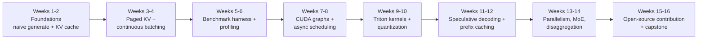

# Projects and Learning Roadmap

You become an inference engineer by building inference engines, measuring them honestly, and reading the code of the good ones. Reading papers alone produces people who can explain PagedAttention but cannot tell why their decode step takes 40 ms instead of 12. This note is a 16-week plan (compressible to 12 if you already know CUDA or PyTorch internals) built around one growing project: a **nano inference engine** that you extend each week, plus a benchmark harness that keeps you honest.

## Prerequisites

| Skill | Minimum level | If missing |
| --- | --- | --- |
| Python + PyTorch | Write a training loop, understand tensors, devices, dtypes | PyTorch tutorials, 1–2 weeks |
| Transformer architecture | Can implement attention and an MLP block from scratch | Karpathy's nanoGPT / "Let's build GPT" |
| Linear algebra | Matmul shapes, FLOP counting | — |
| Systems basics | Processes, threads, memory hierarchy, latency vs throughput | Any OS/architecture course |
| GPU access | One NVIDIA GPU (a 24 GB consumer card is enough for weeks 1–12) | Cloud rental by the hour |
| C++/CUDA | Helpful, not required until week 8 | Learn alongside |

## The plan at a glance

Pick a small dense model with a standard architecture for the whole project — e.g. a 0.5B–1.5B Qwen or a 1B Llama-family checkpoint from Hugging Face — so a forward pass fits easily and you can compare against vLLM's outputs.

---

## Weeks 1–2: Foundations and the naive engine

**Read**: [[01 - What Inference Engineering Is]], [[02 - Transformer Inference Anatomy]], [[03 - Accelerator Hardware]], [[04 - Roofline and Performance Modeling]].

**Build (Project 1: `nanoinfer` v0)**:

1. Load weights from safetensors into your own PyTorch module (no `transformers` model classes at runtime — write RMSNorm, RoPE, GQA attention, SwiGLU MLP yourself).
2. Greedy `generate()` *without* KV cache (recompute the whole sequence each token). Measure tok/s.
3. Add a contiguous KV cache: prefill once, then decode one token at a time. Measure again.
4. Verify correctness: logits match Hugging Face `transformers` to within ~1e-3 (BF16) on 20 prompts.

**Measure**: TTFT and tok/s vs prompt length; plot no-cache vs cache. Compute the roofline prediction for decode (`weight bytes / HBM bandwidth`) and compare to measured. Write down the gap.

**Done when**: you can explain, with numbers from your own GPU, why prefill is compute-bound and decode is memory-bound.

## Weeks 3–4: Paged KV cache and continuous batching

**Read**: [[05 - KV Cache]], [[06 - Attention Kernels]], [[07 - Batching and Scheduling]]; the vLLM paper (PagedAttention) and the Orca paper (iteration-level scheduling).

**Build (`nanoinfer` v1)**:

1. **Static batching** first: pad a batch of prompts, decode together. Observe wasted compute on finished sequences.
2. **Paged KV**: a block pool (`[num_blocks, block_size, num_kv_heads, head_dim]`), a free list, per-sequence block tables. Write a gather-based attention in PyTorch (slow but correct), then switch to FlashAttention/FlashInfer's paged decode kernel if available.
3. **Continuous batching scheduler**: a `waiting` and `running` queue; each step admits new sequences while blocks are available, runs one forward over mixed sequences, retires finished ones. Use flattened (varlen) token batches instead of padding.
4. **Preemption**: when blocks run out, evict a sequence (recompute policy).
5. **Chunked prefill**: cap tokens per step (`max_num_batched_tokens`) and split long prompts.

**Measure**: throughput vs number of concurrent requests for static vs continuous batching; KV memory waste (contiguous max-length allocation vs paged).

**Done when**: 64 concurrent requests with different lengths run correctly, outputs match single-request greedy runs, and continuous batching beats static by a large factor on mixed-length workloads.

**Reference code**: nano-vllm (https://github.com/GeeeekExplorer/nano-vllm) is a compact (~1,200-line) vLLM-style engine — read it *after* your own attempt.

## Weeks 5–6: Benchmark harness and profiling

**Read**: [[18 - Benchmarking and Profiling]], [[19 - Cost and Capacity Planning]].

**Build (Project 2: `benchharness`)**:

1. An OpenAI-compatible HTTP server around `nanoinfer` with SSE streaming and abort-on-disconnect ([[17 - Serving Systems, Routing, and Autoscaling]]).
2. An **async load generator**: open-loop Poisson arrivals at a given rate, closed-loop at a given concurrency, ShareGPT and synthetic datasets, `ignore_eos` option.
3. Metrics: TTFT, TPOT, ITL, E2E with p50/p90/p99; output and request throughput; goodput for given SLOs.
4. Plots: latency vs throughput sweep; throughput-per-GPU vs per-user-tokens/s Pareto.
5. Run the same harness against vLLM and SGLang serving the same model. Reproduce their numbers with `vllm bench serve` to validate your harness.

**Profile**: capture an `nsys` trace and a PyTorch profiler trace of your decode loop. Find the CPU gaps.

**Done when**: you can produce a one-page report comparing `nanoinfer`, vLLM, and SGLang at three load levels, with a profile-based explanation of the biggest gap.

## Weeks 7–8: CUDA graphs and asynchronous scheduling

**Read**: [[13 - Kernels, Compilers, and CUDA Graphs]], [[21 - Case Study - DeepInfer]] sections 5.1–5.2.

**Build (`nanoinfer` v2)**:

1. **CUDA graphs for decode**: capture one graph per batch-size bucket (1, 2, 4, 8, 16, 24, 32, …), static input buffers, pad to the nearest bucket. Shared memory pool across graphs.
2. **Remove hidden syncs**: find every `.item()`, `.tolist()`, `.cpu()` in the step loop. Add a guard that raises if the stream synchronizes during forward (like DeepInfer's `forbid_cuda_sync`).
3. **Overlap scheduling**: run CPU scheduling for step N+1 while the GPU executes step N; resolve the "I don't know what step N sampled yet" problem by keeping sampled tokens on the GPU and feeding them directly to the next step's input buffer.
4. Optional: `torch.compile` the model and compare.

**Measure**: decode step time at batch 1, 8, 64 before/after; `nsys` timeline showing gaps gone.

**Done when**: GPU idle time between decode steps is < 5% in `nsys`.

## Weeks 9–10: Kernels and quantization

**Read**: [[06 - Attention Kernels]], [[08 - Quantization]]; the FlashAttention papers; Triton tutorials.

**Build**:

1. **Triton kernels** (Project 3): fused RMSNorm + residual; fused SiLU-and-mul; a paged-decode attention kernel (split-K over the KV length). Benchmark each against PyTorch eager and the library kernel; profile with `ncu` and place them on a roofline.
2. **Weight-only quantization**: implement INT8 per-channel and INT4 group-wise (group 128) weight quantization with a dequant-in-kernel GEMM (Triton), or integrate an existing kernel library. Compare tok/s and perplexity.
3. **FP8 KV cache**: store K/V in FP8 with per-tensor or per-head scales; measure memory saved, throughput gained, and accuracy change.

**Measure**: kernel achieved bandwidth as % of peak; end-to-end decode speedup; perplexity and a small task eval for each quantization config.

**Done when**: your decode attention kernel reaches ≥ 70% of peak HBM bandwidth at long contexts, and you have an accuracy table for every quantization you ship.

## Weeks 11–12: Speculative decoding and prefix caching

**Read**: [[09 - Speculative Decoding]], [[15 - Sampling, Determinism, and Structured Output]], [[16 - Long Context Inference]].

**Build (`nanoinfer` v3)**:

1. **Sampling**: temperature, top-k, top-p, per-request seeds; a test that greedy output is batch-composition-invariant (it probably is not — find out why; read the Thinking Machines batch-invariance post).
2. **Speculative decoding**: start with prompt-lookup (n-gram) drafting, then a small draft model. Implement the rejection-sampling verify step; prove losslessness empirically (greedy outputs identical; sampled distributions match on a toy vocabulary). Measure acceptance length and speedup vs batch size — watch the speedup shrink as batch grows.
3. **Prefix caching**: hash-chained block keys, reference counting, LRU eviction of free blocks. Benchmark a multi-turn chat workload; report hit rate and TTFT improvement.
4. **Structured output**: integrate XGrammar or llguidance to constrain output to a JSON schema; measure mask-computation overhead per step.

**Done when**: spec decoding gives ≥ 1.5× at batch 1 on code-like text, with verified identical greedy outputs.

## Weeks 13–14: Parallelism, MoE, and disaggregation

**Read**: [[10 - Parallelism]], [[11 - Mixture of Experts Inference]], [[12 - Disaggregated Serving]], [[14 - Inference Engines Landscape]]; DistServe, Splitwise, Mooncake papers; DeepSeek's inference system notes; DeepInfer EPLB code.

**Build** (needs ≥ 2 GPUs; rent a 2–8 GPU node for a few days):

1. **Tensor parallelism** for your dense model: column/row-parallel linears with all-reduce (NCCL via `torch.distributed`). Measure scaling 1→2→4 GPUs for prefill and decode.
2. **MoE**: load a small MoE (e.g. a Qwen MoE or OLMoE checkpoint), implement top-k routing with grouped GEMM; then expert parallelism with all-to-all. Log per-expert load and compute the imbalance ratio (max/mean).
3. **Toy EPLB**: replicate the hottest experts and re-place them greedily; measure imbalance before/after on real prompts.
4. **Toy P/D disaggregation**: one prefill process, one decode process, transfer KV blocks over NCCL or shared memory; measure TTFT/TPOT interference vs colocated.

**Done when**: you can explain from your own measurements when TP helps, when it hurts, and how much of decode step time is communication.

## Weeks 15–16: Contribute and capstone

**Contribute to vLLM or SGLang** (Project 4):

- Start with issues labeled `good first issue` / `help wanted`; reproduce a performance bug with your harness; improve a benchmark script; add a test; port a model.
- Read the contributor docs; run their benchmarks before and after your change; include numbers in the PR.
- Review others' perf PRs to learn how maintainers judge evidence.

**Capstone** (Project 5), pick one:

- **Reproduce a paper result** (e.g. Sarathi-Serve's chunked prefill trade-off, or DistServe's goodput gain) on rented hardware with your harness. Write it up honestly, including where you could not reproduce.
- **Production-grade deployment**: a K8s deployment of vLLM/SGLang behind a prefix-aware router (llm-d or Dynamo), autoscaling on queue depth, Grafana dashboards, a load test, and a cost model.
- **Kernel deep dive**: a CUTLASS/CuTe or Triton kernel for a specific bottleneck (e.g. MLA decode, FP8 grouped GEMM) with a roofline analysis.
- **Code-reading report**: a DeepInfer or SGLang subsystem walkthrough at the level of [[21 - Case Study - DeepInfer]], with your own experiments.

---

## Skills checklist by level

### Level 1 — Practitioner (end of week 6)

- [ ] Compute FLOPs, weight bytes, and KV bytes per token for any decoder-only model
- [ ] Predict decode tok/s from bandwidth within ~2×
- [ ] Explain TTFT/TPOT/ITL/goodput and measure them correctly (open vs closed loop)
- [ ] Deploy vLLM/SGLang with sensible flags (`max_num_seqs`, `max_num_batched_tokens`, `gpu_memory_utilization`, chunked prefill, prefix caching)
- [ ] Read an `nsys` timeline and spot CPU gaps

### Level 2 — Engineer (end of week 12)

- [ ] Implement paged KV, continuous batching, chunked prefill, preemption
- [ ] Implement CUDA-graph decode and overlapped scheduling
- [ ] Write and profile a Triton kernel; place it on a roofline
- [ ] Choose and validate a quantization scheme (weights, KV, activations) with accuracy evals
- [ ] Implement lossless speculative decoding and explain why gains shrink with batch size
- [ ] Size a deployment for a QPS + SLO target and compute $/1M tokens

### Level 3 — Expert (ongoing)

- [ ] Design parallelism for a large MoE (attention DP + wide EP, or TP+EP) and predict communication cost
- [ ] Design P/D disaggregation with KV transfer and a P:D ratio for a workload
- [ ] Design a multi-tier KV cache (HBM → DRAM → SSD → remote) and its eviction/retention economics
- [ ] Diagnose numerical nondeterminism and build batch-invariant pipelines
- [ ] Tune kernels at the SASS/PTX level or with CUTLASS/CuTe/TileLang for new hardware (FP4, TMA, warp specialization)
- [ ] Read a new model architecture paper and list every inference-system change it requires (KV layout, attention kernel, parallelism, spec-decode heads)
- [ ] Lead a benchmark methodology that others trust

## What experts know that intermediates don't

1. **Always start from the roofline.** Before optimizing anything, compute the theoretical step time. If you are at 85% of it, stop.
2. **The scheduler is the product.** Kernels set the ceiling; scheduling, batching, caching, and routing decide how close you get under real traffic.
3. **Measure at the SLO, not at the peak.** "Throughput" without a per-user speed is marketing.
4. **CPU overhead is the silent killer** at small models, small batches, and with speculative decoding.
5. **Every optimization is a workload bet.** Spec decoding helps low batch; wide EP helps high batch; prefix caching helps agents; chunked prefill helps mixed traffic. Know your workload distribution first.
6. **Accuracy regressions hide in fast numbers.** Quantization, KV compression, approximate kernels — always paired with evals.
7. **Communication is part of the model.** At scale, all-to-all and all-reduce are as important as GEMMs.
8. **Memory is the real constraint.** KV capacity limits batch size, batch size limits throughput.
9. **Production is about the tail.** p99 TTFT, stragglers in EP, failed GPUs, cold starts.
10. **Read the code.** vLLM, SGLang, TensorRT-LLM, DeepInfer, FlashInfer, DeepGEMM — the details that matter are rarely in the papers.

## Interview-style questions

Use these as self-tests. Answers are in the linked notes.

1. A 70B dense model in FP8 on one H100 SXM: what is the best possible batch-1 decode speed? What changes at batch 64? ([[04 - Roofline and Performance Modeling]])
2. Why does PagedAttention improve throughput if it does not make attention faster? ([[05 - KV Cache]])
3. Explain continuous batching to someone who knows only static batching. What new problem does it create for prefill-heavy traffic, and how does chunked prefill fix it? ([[07 - Batching and Scheduling]])
4. Your TTFT p99 is 10× p50 under load, but GPU utilization looks fine. Walk through your diagnosis. ([[17 - Serving Systems, Routing, and Autoscaling]], [[18 - Benchmarking and Profiling]])
5. Why can speculative decoding hurt throughput at high batch sizes? How would you decide the draft length per request? ([[09 - Speculative Decoding]], [[21 - Case Study - DeepInfer]])
6. Compare TP, PP, DP, and EP for serving a 600B-parameter MoE. ([[10 - Parallelism]], [[11 - Mixture of Experts Inference]])
7. When does prefill/decode disaggregation pay off, and what does it cost? ([[12 - Disaggregated Serving]])
8. A customer says the same prompt at temperature 0 gives different answers. List every possible cause. ([[15 - Sampling, Determinism, and Structured Output]])
9. FP8 weights gave a 1.7× speedup but a 2-point drop on your eval. What would you try? ([[08 - Quantization]])
10. Estimate the monthly GPU cost to serve 50 req/s of 3K-in / 600-out chat at TTFT ≤ 1 s and 30 tok/s/user. ([[19 - Cost and Capacity Planning]])
11. How would you route requests across 20 replicas to maximize prefix-cache hits without hot-spotting? ([[17 - Serving Systems, Routing, and Autoscaling]])
12. What is the KV cache size per token for a model with 61 layers using MLA with a 512-dim latent plus 64-dim RoPE key, in BF16? Compare with a GQA model with 8 KV heads × 128 dims × 61 layers. ([[05 - KV Cache]], [[16 - Long Context Inference]])
13. What breaks when you capture a CUDA graph around code that calls `.item()`? ([[13 - Kernels, Compilers, and CUDA Graphs]])
14. Design the inference stack for a coding agent that sends 80K-token contexts with 95% overlap between consecutive calls. ([[05 - KV Cache]], [[17 - Serving Systems, Routing, and Autoscaling]], [[19 - Cost and Capacity Planning]])

Quick answer for 12: MLA stores `(512 + 64) × 2 bytes × 61 layers ≈ 70 KB/token`; GQA stores `2 × 8 × 128 × 2 bytes × 61 ≈ 250 KB/token` — about 3.6× more.

## Weekly rhythm that works

- **Monday**: read the concept note and one primary paper.
- **Tuesday–Thursday**: build; write tests that compare against a reference implementation.
- **Friday**: benchmark and profile; write a short log entry (what you expected, what you measured, why they differ).
- **Weekend (optional)**: read code of a production engine for the same feature.

Keep a single `RESULTS.md` with every measurement, hardware, config, and commit hash. In three months it becomes your portfolio.

## Common mistakes in learning

- Reading papers for weeks without building anything.
- Building without measuring; measuring without a roofline to compare against.
- Jumping to CUDA kernels before understanding scheduling and memory.
- Copying vLLM code instead of writing your own version first.
- Benchmarking only at batch 1 (or only at max batch).
- Skipping correctness tests against a reference implementation.

## Check yourself

1. **Why build a naive engine without KV cache first?** It makes the cost of recomputation concrete and gives a correctness baseline for every later optimization.
2. **What is the minimum evidence for a performance PR to an open-source engine?** Before/after benchmark numbers on a specified workload and hardware, at relevant batch sizes, with accuracy unchanged and configs published.
3. **Which project week teaches the latency–throughput Pareto curve?** Weeks 5–6 (benchmark harness).
4. **Why test greedy outputs under different batch compositions?** To detect batch-dependent numerics (non-batch-invariant kernels) that cause nondeterminism.
5. **What signals that you are done optimizing a decode kernel?** It reaches a high fraction (≥ 70–85%) of peak memory bandwidth for its bytes moved.
6. **What should your capstone produce besides code?** A written report with methodology, numbers, profiles, and honest limitations.

## Further reading

- nanoGPT: https://github.com/karpathy/nanoGPT
- nano-vllm: https://github.com/GeeeekExplorer/nano-vllm
- vLLM (PagedAttention) paper: https://arxiv.org/abs/2309.06180
- SGLang paper: https://arxiv.org/abs/2312.07104
- FlashAttention: https://arxiv.org/abs/2205.14135
- Sarathi-Serve: https://arxiv.org/abs/2403.02310
- DistServe: https://arxiv.org/abs/2401.09670
- Speculative decoding (Leviathan et al.): https://arxiv.org/abs/2211.17192
- EAGLE: https://arxiv.org/abs/2401.15077
- Triton: https://triton-lang.org
- Liger-Kernel (readable Triton kernels): https://github.com/linkedin/Liger-Kernel
- Defeating Nondeterminism in LLM Inference: https://thinkingmachines.ai/blog/defeating-nondeterminism-in-llm-inference/
- [[97 - Reading List]] — the full curated list

## Related

- [[00 - Inference Engineering Hub]] — reading paths and note index
- [[21 - Case Study - DeepInfer]] — production code to compare your engine against
- [[98 - Formula Cheatsheet]] — formulas for the exercises
- [[99 - Inference Engineering Glossary]] — terms
