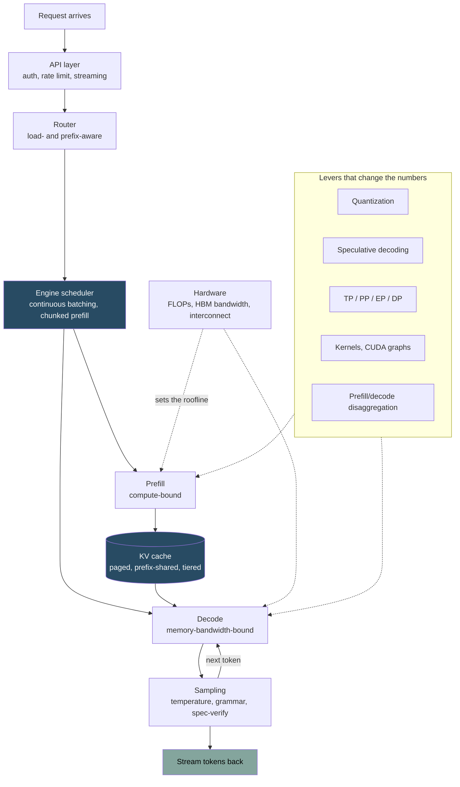

# Inference Engineering

Learning how to run large language models fast, cheaply, and reliably in production — from the arithmetic of one forward pass up to a fleet of GPUs serving millions of requests.

Written to take you from "I can call `model.generate()`" to "I can explain, measure, and fix every millisecond and every dollar between a request arriving and the last token leaving."

## The whole topic in one picture

The whole subject is one loop: **know the hardware roofline, know where each phase of the request sits on it, and move the bottleneck with the cheapest lever that keeps quality intact.** Everything else — paged KV, continuous batching, FP8, EAGLE, wide-EP — is a specific lever.

## Entry points

- [[00 - Inference Engineering Hub]] — reading paths, note index, notation
- [[98 - Formula Cheatsheet]] — every back-of-envelope formula in one place
- [[99 - Inference Engineering Glossary]] — terms in one place
- [[97 - Reading List]] — papers, blogs, codebases, courses, in reading order
- [[22 - Projects and Learning Roadmap]] — the build-it-yourself plan

## Foundations

- [[01 - What Inference Engineering Is]]
- [[02 - Transformer Inference Anatomy]]
- [[03 - Accelerator Hardware]]
- [[04 - Roofline and Performance Modeling]]

## The single-node engine

- [[05 - KV Cache]]
- [[06 - Attention Kernels]]
- [[07 - Batching and Scheduling]]
- [[08 - Quantization]]
- [[09 - Speculative Decoding]]
- [[13 - Kernels, Compilers, and CUDA Graphs]]
- [[15 - Sampling, Determinism, and Structured Output]]
- [[16 - Long Context Inference]]

## Scaling out

- [[10 - Parallelism]]
- [[11 - Mixture of Experts Inference]]
- [[12 - Disaggregated Serving]]

## Production

- [[14 - Inference Engines Landscape]]
- [[17 - Serving Systems, Routing, and Autoscaling]]
- [[18 - Benchmarking and Profiling]]
- [[19 - Cost and Capacity Planning]]
- [[20 - Edge and On-Device Inference]]

## Practice

- [[21 - Case Study - DeepInfer]] — guided tour of a production engine's source in `projects/DeepInfer`
- [[22 - Projects and Learning Roadmap]]

## Suggested learning path

1. Fix the vocabulary and the metrics: [[01 - What Inference Engineering Is]].
2. Learn exactly what one token costs: [[02 - Transformer Inference Anatomy]], then [[03 - Accelerator Hardware]], then [[04 - Roofline and Performance Modeling]]. Note 04 is the pivotal one — every later note is an application of it.
3. Learn the core of every modern engine: [[05 - KV Cache]] → [[07 - Batching and Scheduling]] → [[06 - Attention Kernels]].
4. Learn the big levers: [[08 - Quantization]], [[09 - Speculative Decoding]], [[13 - Kernels, Compilers, and CUDA Graphs]].
5. Scale out: [[10 - Parallelism]] → [[11 - Mixture of Experts Inference]] → [[12 - Disaggregated Serving]].
6. Operate it: [[18 - Benchmarking and Profiling]] before [[17 - Serving Systems, Routing, and Autoscaling]] and [[19 - Cost and Capacity Planning]].
7. Read real code with [[21 - Case Study - DeepInfer]] and build along [[22 - Projects and Learning Roadmap]].

Related:

- [[topics/README|Topics]]
- [[topics/hft/00 - Start/README|High-Frequency Trading]] — the same latency-engineering mindset (tail latency, batching vs latency, memory hierarchy) applied to markets
